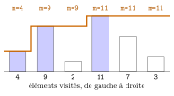
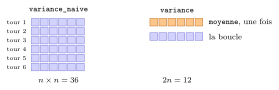

# Cours

<p class="sous-titre">Algorithmique : le parcours séquentiel</p>

<span id="chap-04" class="ancre"></span>

<div class="tete-chapitre" markdown>

Programme (BO)
:   *« Algorithmes sur les tableaux »* : *parcours séquentiel* d’un tableau ; *recherche* d’un élément ; calcul de la *moyenne*, du *minimum*, du *maximum* ; *notion de coût* d’un algorithme (coût *linéaire*).

Prérequis
:   les boucles `for`/`while`, les fonctions, et les **tableaux** (chapitre *Les types construits* : indices, `len`, parcours). (→ fiches de révision : ch. 1, ch. 3)

Objectifs
:   reconnaître et écrire le **patron** du parcours séquentiel ; le décliner (somme, moyenne, comptage, recherche, min/max) ; **évaluer et comparer** le coût d’un algorithme.

</div>

!!! situation "Situation de départ"

    1.  Pour savoir si un jour de l’année a atteint 40 °C, faut-il forcément lire tous les relevés de température ? Et pour trouver la température la plus basse ?

    2.  Si l’on double le nombre de relevés, le programme met-il toujours deux fois plus de temps ?

    3.  Comment être certain qu’une fonction qui cherche le plus grand nombre d’une liste répond juste pour *toutes* les listes, et pas seulement pour celles qu’on a essayées ?

!!! remarque "Remarque — Le fil conducteur : un patron, et sa facture"

    Presque tous les algorithmes de ce chapitre suivent **le même schéma** : parcourir un tableau du début à la fin en tenant à jour une information. On apprend d’abord ce **patron unique**, puis on se pose *la* question de l’algorithmicien : **combien ça coûte ?** On verra qu’un même calcul, selon l’endroit où on le place, peut être rapide (*linéaire*) ou lent (*quadratique*). Les points qui dépassent le programme sont signalés par le badge <span class="horsprog">au-delà du programme</span>.

## Le parcours séquentiel : un patron unique

!!! definition "Définition 1 — Parcours séquentiel"

    <span id="lex-parcours04" class="ancre"></span>**Parcourir** un tableau, c’est examiner ses éléments **un par un**, du premier au dernier. On dit aussi *parcours linéaire*.

La plupart des traitements suivent le même **squelette**, dit motif de l’**accumulateur** : on prépare un résultat, on le met à jour à chaque élément, on le renvoie.

!!! regle "Règle 1 — Le patron du parcours"

    ```python
    def traitement(t):
        resultat = ...            # INITIALISER
        for element in t:         # PARCOURIR
            resultat = ...        # METTRE A JOUR
        return resultat           # RENVOYER
    ```

    Écrire un algorithme de parcours, c’est simplement **choisir** l’initialisation et la mise à jour.

!!! encadre "Méthode — Les étiquettes d’étapes"

    Dans les exemples et les corrigés, un commentaire en **majuscules** nomme le **rôle** de la ligne. Ce sont toujours les mêmes mots, d’un exercice à l’autre : `INITIALISER`, `PARCOURIR`, `TESTER`, `METTRE A JOUR`, `RENVOYER` ; plus tard `VERIFIER` (une précondition) et, pour la récursivité, `CAS DE BASE`, `APPEL RECURSIF`. Devant un nouveau problème, on se demande d’abord : *que faut-il initialiser ? que met-on à jour ? que renvoie-t-on ?* Le code vient ensuite.

!!! encadre "Méthode — Par élément ou par indice ?"

    On parcourt **par élément** (`for x in t`) quand seules les valeurs comptent ; **par indice** (`for i in range(len(t))`) quand on a besoin de la position (ou pour *modifier* le tableau). Les deux réalisent le même parcours.

<span id="cours-04-1" class="ancre"></span>

<span class="afaire">▶ Exercices d'application :</span> exercices **[1](exercices.md#ex-04-1) et [2](exercices.md#ex-04-2)** (le patron du parcours)

## Décliner le patron : somme, moyenne, comptages

!!! exemple "Exemple — La somme, puis la moyenne"

    Même squelette : on accumule dans `s`, initialisé à `0`.

    ```python
    def somme(t):
        s = 0                     # INITIALISER : element neutre de l'addition
        for x in t:               # PARCOURIR
            s = s + x             # METTRE A JOUR
        return s                  # RENVOYER

    def moyenne(t):               # t suppose NON vide
        return somme(t) / len(t)
    ```

    <span class="routine">▷ Je prédis.</span> Que renvoient `somme([4, -1, 2])` et `moyenne([4, -1, 2])` ?

    ??? verifie "Je vérifie"

        `5`, puis `5 / 3`, soit environ `1.67` (un flottant, même si les éléments sont des entiers).

!!! exemple "Exemple — Compter : on accumule un compteur"

    ```python
    def nb_positifs(t):
        c = 0                     # INITIALISER
        for x in t:               # PARCOURIR
            if x > 0:             # TESTER : la mise a jour est conditionnelle
                c = c + 1         # METTRE A JOUR
        return c                  # RENVOYER
    ```

    <span class="routine">▷ Je prédis.</span> Que renvoie `nb_positifs([3, 0, -2, 5])` ?

    ??? verifie "Je vérifie"

        `2` : `0` n’est pas strictement positif.

!!! encadre "À retenir — Le bon élément neutre"

    On initialise l’accumulateur avec l’<span id="lex-neutre04" class="ancre"></span>**élément neutre** de l’opération : `0` pour une somme ou un compteur, `1` pour un produit, `""` pour concaténer du texte, `[]` pour construire un tableau.

<span id="cours-04-3" class="ancre"></span>

<span class="afaire">▶ Exercices d'application :</span> exercices **[3](exercices.md#ex-04-3) et [4](exercices.md#ex-04-4)** (comptages, moyenne pondérée)

## Chercher un élément : la recherche séquentielle

Chercher, c’est parcourir jusqu’à trouver. Deux questions distinctes : **l’élément est-il présent ?** et **où est-il ?**

!!! regle "Règle 2 — Recherche séquentielle"

    <span id="lex-rechseq04" class="ancre"></span>On parcourt le tableau ; dès qu’on trouve, on peut **s’arrêter** (`return`). Si le parcours se termine sans succès, l’élément est absent.

```python
def est_present(t, x):
    for element in t:         # PARCOURIR
        if element == x:      # TESTER
            return True       # RENVOYER : trouve, inutile de continuer
    return False              # RENVOYER : parcours fini sans succes

def indice(t, x):
    """Indice de la premiere occurrence de x, ou -1 si absent."""
    for i in range(len(t)):   # PARCOURIR
        if t[i] == x:         # TESTER
            return i          # RENVOYER
    return -1                 # RENVOYER : absent
```

<span class="routine">▷ Je prédis.</span> Que renvoient `indice([5, 8, 5], 5)` et `indice([5, 8, 5], 2)` ?

??? verifie "Je vérifie"

    `0` (la *première* occurrence : on sort dès qu’on trouve), puis `-1` (absent).

!!! remarque "Remarque — Absent : -1 ou None"

    Pour signaler un élément absent, `indice` renvoie `-1`, qui ne peut pas être un indice obtenu par le parcours. Beaucoup d’énoncés, au bac notamment, préfèrent renvoyer `None` (« rien ») : les deux conventions existent, on applique **celle de l’énoncé**.

!!! remarque "Remarque — « Sortir tôt » : un réflexe utile"

    Renvoyer dès qu’on a trouvé évite de parcourir inutilement la fin du tableau. C’est correct *et* souvent plus rapide — on y revient au § V (meilleur/pire cas).

<span id="cours-04-5" class="ancre"></span>

<span class="afaire">▶ Exercices d'application :</span> exercices **[5](exercices.md#ex-04-5) à [7](exercices.md#ex-04-7)** et **[26](exercices.md#ex-04-26)** (recherche séquentielle)

## Le plus grand, le plus petit : l’invariant du champion

<span id="lex-champion04" class="ancre"></span>

Pas de raccourci ici : pour connaître le maximum, il faut avoir **tout** regardé. On garde un « champion provisoire », mis à jour dès qu’on rencontre mieux.

```python
def maximum(t):               # t suppose NON vide
    m = t[0]                  # INITIALISER : le premier element
    for x in t:               # PARCOURIR
        if x > m:             # TESTER
            m = x             # METTRE A JOUR : nouveau champion
    return m                  # RENVOYER
```

Déroulons `maximum([4, 9, 2, 11, 7, 3])`. Les barres sont les éléments, dans l’ordre de visite ; le trait **orange** est la valeur de `m` *après* chaque tour. Il ne fait que **monter**, et seulement quand un nouveau champion (barre colorée) apparaît.

{ .tikz loading=lazy }

!!! regle "Règle 3 — Un invariant de boucle"

    À **chaque** tour, la variable `m` contient le maximum des éléments **déjà vus**. Cette propriété, vraie au départ et préservée à chaque tour, s’appelle un <span id="lex-invariant04" class="ancre"></span>**invariant de boucle** : elle *garantit* qu’à la fin, `m` est bien le maximum de *tout* le tableau. C’est ainsi qu’on **prouve** qu’un algorithme est correct.

<span class="retouract">↺ Retour sur l'activité.</span> La carte en main du chercheur, dans l’activité « La carte la plus haute », était ce champion : à tout moment, c’était la plus haute des cartes déjà retournées. Impossible de s’arrêter avant la fin de la pile : la dernière carte pouvait être plus haute.

!!! remarque "Remarque — Pourquoi initialiser avec t[0] et non 0 ?"

    Initialiser à `0` donnerait un résultat faux sur un tableau de nombres tous négatifs (le maximum de `[-3, -7]` est `-3`, pas `0`). On part donc d’un **vrai** élément du tableau. Pour le minimum, on remplace `>` par `<`.

<span class="retouract">↺ Retour sur l'activité.</span> Les températures $-3$, $-8$, $-1$, $-5$, $-6$ de l’activité le montraient : en partant d’une carte imaginaire de valeur $0$, le camarade annonçait $0$, une valeur absente du paquet, au lieu de $-1$.

!!! exemple "Exemple — Renvoyer aussi la position"

    Souvent on veut l’*indice* du maximum, pas seulement sa valeur :

    ```python
    def indice_du_max(t):
        i_max = 0                 # INITIALISER
        for i in range(len(t)):   # PARCOURIR
            if t[i] > t[i_max]:   # TESTER
                i_max = i         # METTRE A JOUR
        return i_max              # RENVOYER
    ```

    <span class="routine">▷ Je prédis.</span> Que renvoie `indice_du_max([4, 9, 2, 9])` ?

    ??? verifie "Je vérifie"

        `1` : le test `>` est strict, le second `9` ne détrône pas le premier.

### Prouver qu’une propriété est un invariant

Dire qu’une propriété est un invariant, cela ne se devine pas : cela se **démontre**, toujours de la même façon, en **deux étapes**.

!!! regle "Règle 4 — Les deux étapes d’une preuve d’invariant"

    Pour prouver qu’une propriété $P$ est un **invariant** d’une boucle :

    1.  **Initialisation** : $P$ est vraie *avant* le premier tour (juste après les initialisations).

    2.  **Hérédité** (ou *conservation*) : *si* $P$ est vraie avant un tour quelconque, *alors* elle est encore vraie après ce tour.

    Si ces deux points tiennent, $P$ est vraie à **chaque** tour. En ajoutant qu’à la fin la boucle a parcouru *tout* le tableau, on obtient la <span id="lex-correction04" class="ancre"></span>**correction** de l’algorithme.

!!! exemple "Exemple — Preuve pour le champion du maximum"

    Propriété $P$ : « `m` contient le maximum de `t[0]` et des éléments **déjà visités** par la boucle ».

    - **Initialisation** : avant le premier tour, la boucle n’a encore visité aucun élément et `m = t[0]` : `m` est bien le maximum de `t[0]` seul. $P$ est vraie.

    - **Hérédité** : supposons $P$ vraie. À la visite de `x`, soit `x <= m` et `m` ne change pas, soit `x > m` et `m` devient `x`. Dans les deux cas, `m` est le maximum des éléments visités *avec* `x` : $P$ reste vraie.

    À la fin, tous les éléments ont été visités : `m` est le maximum de *tout* le tableau. $\square$

!!! exemple "Exemple — Un second invariant : la somme"

    Pour `somme` (§ II), propriété $P$ : « `s` contient la somme des éléments déjà visités ».

    - **Initialisation** : avant le premier tour, aucun élément n’est visité et `s = 0` : la somme de rien vaut `0`. $P$ est vraie.

    - **Hérédité** : si `s` est la somme des éléments déjà vus, alors après `s = s + x` elle devient cette somme *plus* `x`, c’est-à-dire la somme des éléments vus *avec* `x`. $P$ reste vraie.

    À la fin, `s` est la somme du tableau entier. $\square$

!!! encadre "Méthode — Bien choisir l’invariant : « déjà visités »"

    La clé est presque toujours la même formulation : « la variable contient le résultat **pour les éléments déjà visités** ». C’est cette petite phrase qui rend l’hérédité facile à écrire. On retrouvera les invariants au chapitre *Spécifier et mettre au point ses programmes* (les vérifier par un `assert`), puis pour justifier les tris.

<span id="cours-04-8" class="ancre"></span>

<span class="afaire">▶ Exercices d'application :</span> exercices **[8](exercices.md#ex-04-8) à [13](exercices.md#ex-04-13)** (minimum, mot le plus long, position du champion, amplitude, moyenne sans la pire note, deuxième plus grand), **[25](exercices.md#ex-04-25)** (dérouler la recherche du maximum) et **[14](exercices.md#ex-04-14) à [16](exercices.md#ex-04-16)** (invariants)

## Combien ça coûte ?

Deux algorithmes peuvent tous deux être *corrects*, mais l’un être bien plus **rapide** que l’autre. Pour comparer sans dépendre de la machine, on **compte les opérations** en fonction de la taille `n` du tableau.

!!! definition "Définition 2 — Coût, coût linéaire"

    Le <span id="lex-cout04" class="ancre"></span>**coût** d’un algorithme est le nombre d’opérations élémentaires qu’il effectue, exprimé en fonction de la taille `n` des données. Un parcours simple fait un nombre d’opérations **proportionnel à `n`** : on dit que son coût est <span id="lex-lineaire04" class="ancre"></span>**linéaire**.

<span class="retouract">↺ Retour sur l'activité.</span> Pour 10 cartes, le chercheur faisait 9 comparaisons, pour 52 cartes 51, et $n - 1$ pour $n$ cartes, quel que soit l’ordre de la pile : si le paquet double, le travail double. C’est un coût linéaire.

Toutes les fonctions vues jusqu’ici (`somme`, `moyenne`, `maximum`, `est_present`…) font **un** parcours : leur coût est **linéaire**. Si l’on double `n`, le temps double.

!!! encadre "À retenir — Meilleur cas, pire cas : l’exemple de la recherche"

    La recherche séquentielle ne coûte pas toujours pareil :

    - <span id="lex-pirecas04" class="ancre"></span>**meilleur cas** : l’élément est en tête $\rightarrow$ `1` comparaison ;

    - **pire cas** : l’élément est absent (ou en dernier) $\rightarrow$ `n` comparaisons.

    Le pire cas reste **linéaire** : c’est lui qu’on retient pour caractériser un algorithme. Si le tableau est **trié**, on fera beaucoup mieux : c’est la recherche dichotomique, que l’on verra au chapitre *La recherche dichotomique*.

### Le piège quadratique : moyenne *vs* variance

Voici le cœur du chapitre. On note $x_0, x_1, \ldots, x_{n-1}$ les $n$ valeurs du tableau. Leur **moyenne** est

$$m = \frac{x_0 + x_1 + \cdots + x_{n-1}}{n}.$$

La **variance** <span class="horsprog">au-delà du programme</span> mesure ensuite leur dispersion autour de cette moyenne : c’est la moyenne des carrés des écarts à $m$,

$$V = \frac{(x_0 - m)^2 + (x_1 - m)^2 + \cdots + (x_{n-1} - m)^2}{n}.$$

**Version naïve** — on traduit la formule mot à mot :

```python
def variance_naive(t):
    n = len(t)
    s = 0                               # INITIALISER
    for x in t:                         # PARCOURIR
        s = s + (x - moyenne(t)) ** 2   # METTRE A JOUR ; DANGER : moyenne(t) A CHAQUE tour
    return s / n                        # RENVOYER
```

Cette version est **correcte**… mais lente. À chacun des `n` tours de boucle, elle rappelle `moyenne(t)`, qui fait elle-même un parcours de `n` éléments. Total : `n` $\times$ `n` $= n^2$ opérations. On dit que son coût est <span id="lex-quadratique04" class="ancre"></span>**quadratique**.

**Version efficace** — on calcule la moyenne **une seule fois**, *avant* la boucle :

```python
def variance(t):
    n = len(t)
    m = moyenne(t)                # calculee UNE fois : n operations
    s = 0                         # INITIALISER
    for x in t:                   # PARCOURIR
        s = s + (x - m) ** 2      # METTRE A JOUR : chaque tour est immediat
    return s / n                  # RENVOYER
```

<span class="routine">▷ Je prédis.</span> Que renvoie `variance([1, 3])` ? Et `variance([7, 7, 7])` ?

??? verifie "Je vérifie"

    `1.0` : la moyenne vaut `2`, les écarts `-1` et `1` ont pour carrés `1` et `1`, dont la moyenne est `1.0`. Puis `0.0` : des valeurs toutes égales ne sont pas dispersées.

Ici, un parcours pour la moyenne, un parcours pour la somme : environ `2n` opérations, donc un coût **linéaire**. Le résultat est **identique**, mais regardons la facture :

| **taille `n`** | `moyenne` ($\approx n$) | `variance_naive` ($\approx n^2$) | `variance` ($\approx 2n$) |
|---:|:--:|:--:|:--:|
| $10$ | $10$ | $100$ | $20$ |
| $100$ | $100$ | $10\,000$ | $200$ |
| $1\,000$ | $1\,000$ | $1\,000\,000$ | $2\,000$ |

Chaque case représente une opération, pour un tableau de $n = 6$ éléments. Dans `variance_naive`, *chaque* tour de boucle (une ligne) refait tout le parcours de `moyenne` : on remplit un **carré** de $6 \times 6 = 36$ cases. Dans `variance`, deux parcours *l’un après l’autre* : $2 \times 6 = 12$ cases seulement.

{ .tikz loading=lazy }

Ces ordres de grandeur se vérifient au chronomètre (TP proposé en fin de chapitre) : quand $n$ double, le temps de `variance_naive` est multiplié par 4, celui de `variance` par 2.

!!! regle "Règle 5 — La leçon"

    *Où* l’on place un calcul change tout. Un calcul qui ne dépend pas de la boucle doit être **sorti** de la boucle. Placer un parcours *à l’intérieur* d’un autre parcours fait passer le coût de **linéaire** ($n$) à **quadratique** ($n^2$) — pour $n = 1000$, on passe de quelques milliers à un **million** d’opérations.

!!! curieux "Pour les curieux (facultatif) — Reconnaître le quadratique"

    Deux boucles **imbriquées** sur le même tableau (ou un appel de parcours *dans* une boucle) sont le signe d’un coût quadratique. En notation savante, on écrit un coût linéaire $O(n)$ et un coût quadratique $O(n^2)$ (notation « grand O », que vous retrouverez en terminale).

<span id="cours-04-17" class="ancre"></span>

<span class="afaire">▶ Exercices d'application :</span> exercices **[17](exercices.md#ex-04-17) à [21](exercices.md#ex-04-21)** (le coût : linéaire ou quadratique ; min et max en une passe, deux tableaux)

## Un peu d’histoire

!!! curieux "Pour les curieux (facultatif) — Du mot « algorithme » à l’analyse de leur coût"

    Le mot **algorithme** vient du savant persan **al-Khwârizmî** (IX<sup>e</sup> siècle), dont le nom latinisé donna *algorismus*. Mais *mesurer* le coût d’un algorithme est bien plus récent : la notation « grand O » est due aux mathématiciens **Paul Bachmann** (1894) et **Edmund Landau**, et c’est **Donald Knuth** qui, à partir des années 1960, en fait l’outil central de l’*analyse des algorithmes* dans son œuvre monumentale *The Art of Computer Programming*. Choisir le bon algorithme, et pas seulement un algorithme correct, est depuis au cœur de l’informatique : sur des milliards de données, la différence entre linéaire et quadratique, c’est la différence entre une seconde et… des années.

!!! curieux "Pour les curieux (facultatif) — Liens avec d’autres chapitres"

    - **Ce qu’il réutilise.** Le patron du parcours généralise l’**accumulateur** des *Bases de la programmation Python* et s’applique aux tableaux des *Types construits*.

    - **Ce qu’il prépare.** Il resservira partout : boucle interne du **tri par sélection**, point de comparaison pour la **dichotomie**, filtres sur les **données en tables**, distances des **$k$ plus proches voisins**.

    - **En Terminale.** Le même patron parcourra les listes chaînées, les arbres et les graphes ; la **programmation dynamique** poussera à l’extrême la leçon de la variance : ne jamais recalculer.

## Bilan — la carte mémoire

| **Notion** | **À retenir** |
|:---|:---|
| Le patron | init $\to$ mise à jour à chaque élément $\to$ renvoi |
| Élément neutre | `0` (somme, compteur), `1` (produit), `""`, `[]` |
| Parcourir | par élément (`for x in t`) ou par indice (`for i in range`…) |
| Recherche séquentielle | s’arrête dès qu’on trouve ; `-1` ou `None` si absent |
| Minimum / maximum | garder un **champion** ; initialiser avec `t[0]`, jamais `0` |
| Invariant de boucle | propriété vraie à chaque tour : *prouve* que le résultat est correct |
| Coût linéaire | un parcours : $\approx n$ opérations (recherche : pire cas = absent) |
| Coût quadratique | un parcours *dans* un parcours : $\approx n^2$ (piège de la variance !) |
| Le réflexe | **sortir de la boucle** ce qui n’en dépend pas |

!!! situation "Retour à la situation de départ"

    1.  Pour 40 °C, non : la **recherche séquentielle** s’arrête dès qu’elle trouve (§ III) ; seul le pire cas, aucun jour à 40 °C, oblige à tout lire (§ V). Pour la plus basse, oui : on garde un **champion** jusqu’au bout, car la dernière valeur peut être la plus basse (§ IV).

    2.  Pour un parcours simple, oui : son coût est **linéaire**. Mais un parcours placé *dans* un autre (la variance naïve) a un coût **quadratique** : le temps est multiplié par 4 (§ V).

    3.  On prouve un **invariant de boucle** : « `m` contient le maximum des éléments déjà visités », vrai au départ (initialisation) et conservé à chaque tour (hérédité) ; à la fin, tout a été visité (§ IV).

## Erreurs fréquentes

- **Mal initialiser le maximum.** Partir de `0` échoue si toutes les valeurs sont négatives. *Le réflexe :* initialiser au **premier élément** du tableau.

- **Confondre indice et valeur.** `t[i]` est la *valeur*, `i` est la *position*.

- **Se tromper de bornes.** `range(n)` va de `0` à `n-1` ; le dernier indice est `len(t)-1`.

- **Recalculer dans la boucle ce qui est constant.** Appeler `moyenne(t)` *à l’intérieur* d’un parcours rend le coût **quadratique** (piège de la variance). *Le réflexe :* sortir de la boucle ce qui n’en dépend pas.

- **Ne pas s’arrêter dès qu’on a trouvé.** Dans une recherche, `return` dès la première occurrence.

- **Oublier le cas du tableau vide** (ou d’une valeur absente).

## Savoir-faire à maîtriser

*À la fin du chapitre, je sais…*

- écrire un **parcours séquentiel** (somme, moyenne, comptage) ;

- écrire une **recherche séquentielle** (présence, indice) et m’arrêter dès qu’on trouve ;

- écrire un **min / max** avec l’**invariant du champion** et la bonne initialisation ;

- énoncer et **prouver un invariant** de boucle (initialisation + hérédité) ;

- estimer le **coût** (linéaire / quadratique) et éviter les recalculs inutiles.
