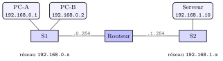
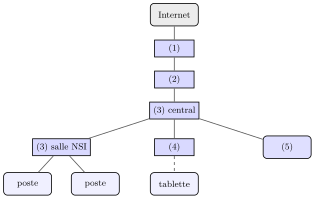

# TP et projets

<p class="sous-titre">Le Web : réseaux et interactions homme-machine</p>

## <span class="etiquette">TP 1</span> Mon premier site, pas à pas

*le site du Club Astro : structurer, mettre en forme, rendre interactif*

<p class="infos-activite">Durée : 2 h (une séance) · Seul, sur machine</p>

!!! fichiers "Fichiers à télécharger"

    [:material-folder-open: dossier en ligne](https://github.com/MathThibaud/nsi-fichiers-eleves/tree/main/premiere/10-tp-site-web-guide){ .md-button } [:material-zip-box: archive .zip](https://github.com/MathThibaud/nsi-fichiers-eleves/raw/main/zips/premiere-10-tp-site-web-guide.zip){ .md-button }

!!! encadre "But du TP"

    Construire, à partir d’un squelette fourni, le petit site du club d’astronomie du lycée : deux pages reliées par une barre de navigation, mises en forme par une feuille de style commune, puis rendues interactives en JavaScript (un compteur de « j’aime », une inscription qui vérifie ce qu’on a saisi, un mode nuit). Les trois parties suivent les trois premiers jalons du **projet « Créer un site web interactif »** : ce sont exactement les gestes que vous referez ensuite, seul, sur votre propre site.

!!! consignes "Consignes"

    - Fichiers à télécharger (lien ci-dessus) : le dossier `monsite/`, qui contient `index.html` (la page d’accueil), `style.css` (la feuille de style) et `script.js` (le programme JavaScript). Ne pas renommer ces fichiers.

    - Outils : un éditeur de texte (pas un traitement de texte) et un navigateur. Après chaque modification, **enregistrer** le fichier, puis **actualiser** la page dans le navigateur (touche `F5`).

    - Les commentaires `TODO` du squelette indiquent où écrire. Chaque partie commence par le rappel des outils utiles, avec le paragraphe du cours où les retrouver. Les réponses aux questions (sans <span class="run" title="À programmer et tester sur machine">▶</span> ) s’écrivent sur le cahier.

    - <span class="run" title="À programmer et tester sur machine">▶</span> *À écrire et tester dans le navigateur.* Niveau : ★ échauffement, ★★ classique (niveau bac), ★★★ défi ; les *coups de pouce* et les *corrigés* se déplient sous chaque exercice.

    - Usage de l’IA, indiqué sur chaque exercice : <span class="ia ia-rouge" title="Sans IA : le but est l'automatisme lui-même"></span> aucune ; <span class="ia ia-orange" title="IA en appui : déboguer, reformuler, vérifier ; la réponse finale est la vôtre"></span> en appui (déboguer, reformuler, vérifier ; la réponse finale est écrite et comprise par vous) ; <span class="ia ia-vert" title="IA intégrée : l'exercice s'appuie sur une réponse d'IA"></span> l’exercice s’appuie sur une réponse d’IA. Voir la [charte d’usage de l’IA](../charte.md).

## La structure HTML (jalon J1)

Environ 40 minutes. On écrit le **fond** de la page : les titres, les textes, la liste, le tableau et les liens.

!!! encadre "Outils de la partie 1 — les balises (cours, § V « HTML : structurer la page »)"

    - <code>&lt;head&gt;</code> contient les informations *sur* la page (<code>&lt;title&gt;</code>, le titre de l’onglet) ; <code>&lt;body&gt;</code> contient ce qui s’affiche.

    - <code>&lt;h1&gt;</code>, <code>&lt;h2&gt;</code> : titres ; <code>&lt;p&gt;</code> : paragraphe ; <code>&lt;strong&gt;</code> : texte important ; <code>&lt;ul&gt;</code> : liste à puces, dont chaque élément est un <code>&lt;li&gt;</code>.

    - <code>&lt;a href="…"&gt;texte&lt;/a&gt;</code> : lien hypertexte. Pour une page du même dossier, le nom du fichier suffit (`infos.html` : c’est un chemin **relatif**, comme au chapitre précédent) ; pour un autre site, on écrit l’adresse complète, qui commence par `https://`.

    - <code>&lt;div&gt;</code> : conteneur qui regroupe des éléments ; attributs `id="…"` (identifiant *unique* dans la page) et `class="…"` (étiquette *partagée*).

    - Tableau : <code>&lt;table&gt;</code> contient des lignes <code>&lt;tr&gt;</code> ; chaque ligne contient des cases <code>&lt;th&gt;</code> (case de titre) ou <code>&lt;td&gt;</code> (case ordinaire). Le squelette en donne un modèle.

    - <code>&lt;!-- … --&gt;</code> : commentaire, ignoré par le navigateur. Les consignes `TODO` du squelette en sont.

    Chaque balise ouverte se referme, et les balises s’emboîtent sans se croiser (sauf les balises auto-fermantes comme <code>&lt;meta&gt;</code>, <code>&lt;link&gt;</code>, <code>&lt;input&gt;</code>).

### <span class="stars" title="Niveau 1 sur 3">★</span> <span class="exo-num">Exercice 1</span> — Découvrir le squelette <span class="ia ia-rouge" title="Sans IA : le but est l'automatisme lui-même"></span> { #ex-10-le-web-reseaux-et-interactions-homme-mac-tp-1-1 }

1.  Ouvrir `index.html` dans le navigateur (double-clic), puis dans l’éditeur de texte. Quels textes le navigateur affiche-t-il ? Pourquoi les lignes `TODO` n’apparaissent-elles pas ?

2.  Combien de blocs <code>&lt;div class="carte"&gt;</code> la page contient-elle ? Pourquoi est-ce une `class` et pas un `id` ?

3.  Repérer le tableau du planning : combien de lignes compte-t-il pour l’instant ? Combien de cases par ligne ?

??? corrige "Corrigé"

    <div class="tete-chapitre" markdown>

    Ancrage BO (1re)
    :   réaliser et analyser une page HTML/CSS simple ; rôles de HTML, CSS et JavaScript ; événements et modification du document ; distinguer ce qui relève du client et du serveur.

    Code
    :   une version possible parmi d’autres : les textes, les couleurs et la disposition sont libres, pourvu que les balises, les sélecteurs et les fonctions demandés y soient.

    </div>

    Le fichier `script.js` terminé, bonus compris :

    ```text
    // Programme JavaScript du Club Astro

    // Le bouton "J'aime" : ajoute 1 au nombre affiche
    function aimer() {
      let zone = document.querySelector("#nbJaime");
      let n = parseInt(zone.textContent);
      zone.textContent = n + 1;
    }

    // L'inscription : refuse un champ vide, puis un club complet
    function inscrire() {
      let champ = document.querySelector("#nom");
      let nom = champ.value;
      let reponse = document.querySelector("#reponse");
      let zonePlaces = document.querySelector("#places");
      let places = parseInt(zonePlaces.textContent);
      if (nom === "") {
        reponse.textContent = "Veuillez écrire votre nom.";
        reponse.style.color = "red";
      } else if (places === 0) {
        reponse.textContent = "Désolé " + nom + ", c'est complet !";
        reponse.style.color = "red";
      } else {
        zonePlaces.textContent = places - 1;
        reponse.textContent = "Merci " + nom + ", à vendredi !";
        reponse.style.color = "green";
        champ.value = "";
      }
    }

    // Le mode nuit : ajoute la classe nuit au body si elle est absente, la retire sinon
    function basculerNuit() {
      document.body.classList.toggle("nuit");
    }

    let boutonNuit = document.querySelector("#boutonNuit");
    boutonNuit.addEventListener("click", basculerNuit);   // sans les parentheses

    // Bonus : le compte a rebours, construit avec une boucle while
    function compteARebours() {
      let texte = "";
      let i = 10;
      while (i > 0) {
        texte = texte + i + "... ";
        i = i - 1;
      }
      texte = texte + "Décollage !";
      document.querySelector("#decollage").textContent = texte;
    }
    ```

    **1.** Le navigateur affiche les cinq sous-titres (« Qui sommes-nous ? », « Ce que l’on observe », « Le planning », « Vous aimez le club ? », « S’inscrire à la nuit d’observation ») et le début du tableau, sans aucune mise en forme ; l’onglet porte le titre « Mon site ». Les lignes `TODO` sont écrites entre <code>&lt;!--</code> et `-->` : ce sont des **commentaires**, que le navigateur ignore. **2.** Cinq blocs. C’est une `class` parce que plusieurs balises portent la même étiquette, pour recevoir le même style ; un `id` doit être unique dans la page. **3.** Deux lignes (la ligne de titres et celle du lundi), de trois cases chacune.

### <span class="stars" title="Niveau 1 sur 3">★</span> <span class="exo-num">Exercice 2</span> — Titres, annonce et présentation <span class="ia ia-orange" title="IA en appui : déboguer, reformuler, vérifier ; la réponse finale est la vôtre"></span> { #ex-10-le-web-reseaux-et-interactions-homme-mac-tp-1-2 }

<span class="run" title="À programmer et tester sur machine">▶</span> 

1.  Remplacer le titre de l’onglet `Mon site` par `Club Astro - Accueil`. Où ce titre s’affiche-t-il ?

2.  Écrire le titre principal <code>&lt;h1&gt;</code> « Club Astro ».

3.  Juste en dessous, écrire un paragraphe d’identifiant `annonce` qui contient : « Prochaine nuit d’observation : vendredi à 21 h, sur le toit du lycée. »

4.  Dans la carte « Qui sommes-nous ? », écrire un paragraphe de deux ou trois phrases qui présente le club ; mettre quelques mots en valeur avec <code>&lt;strong&gt;</code>.

5.  Dans la carte « Ce que l’on observe », écrire une liste à puces d’au moins trois objets du ciel.

??? corrige "Corrigé"

    ```text
    <title>Club Astro - Accueil</title>
    ...
    <h1>Club Astro</h1>

    <p id="annonce">Prochaine nuit d'observation : vendredi à 21 h, sur le toit du lycée.</p>
    ...
    <div class="carte">
      <h2>Qui sommes-nous ?</h2>
      <p>Le Club Astro réunit les élèves curieux du ciel. On y apprend à
         <strong>reconnaître les constellations</strong> et à se servir d'un télescope.</p>
    </div>

    <div class="carte">
      <h2>Ce que l'on observe</h2>
      <ul>
        <li>la Lune et ses cratères</li>
        <li>les planètes Jupiter et Saturne</li>
        <li>les étoiles filantes du mois d'août</li>
      </ul>
    </div>
    ```

    Le titre de l’onglet s’affiche dans l’**onglet** du navigateur (et dans les favoris ou l’historique), pas dans la page.

    <span class="erreurfreq">▷ Erreur fréquente.</span> écrire les éléments de la liste directement dans <code>&lt;ul&gt;</code>, sans <code>&lt;li&gt;</code> : ils s’affichent alors à la suite, sans puces.

### <span class="stars" title="Niveau 1 sur 3">★</span> <span class="exo-num">Exercice 3</span> — Compléter le planning <span class="ia ia-orange" title="IA en appui : déboguer, reformuler, vérifier ; la réponse finale est la vôtre"></span> { #ex-10-le-web-reseaux-et-interactions-homme-mac-tp-1-3 }

<span class="run" title="À programmer et tester sur machine">▶</span> 

Ajouter au tableau, sur le modèle de la ligne du lundi, une ligne « Mercredi, 14 h, Fabriquer une lunette » et une ligne « Vendredi, 21 h, Nuit d’observation ». Pourquoi la première ligne utilise-t-elle des <code>&lt;th&gt;</code> et les autres des <code>&lt;td&gt;</code> ?

??? corrige "Corrigé"

    ```text
    <tr>
      <td>Mercredi</td>
      <td>14 h</td>
      <td>Fabriquer une lunette</td>
    </tr>
    <tr>
      <td>Vendredi</td>
      <td>21 h</td>
      <td>Nuit d'observation</td>
    </tr>
    ```

    La première ligne contient les **titres des colonnes** : ses cases sont des <code>&lt;th&gt;</code>, que le navigateur affiche en gras et centrées. Les lignes suivantes contiennent les données, dans des cases ordinaires <code>&lt;td&gt;</code>.

### <span class="stars" title="Niveau 2 sur 3">★★</span> <span class="exo-num">Exercice 4</span> — La barre de navigation et une deuxième page <span class="ia ia-orange" title="IA en appui : déboguer, reformuler, vérifier ; la réponse finale est la vôtre"></span> { #ex-10-le-web-reseaux-et-interactions-homme-mac-tp-1-4 }

<span class="run" title="À programmer et tester sur machine">▶</span> 

1.  À l’endroit indiqué, sous l’annonce, écrire un bloc <code>&lt;div class="barre"&gt;</code> qui contient trois liens : « Accueil » vers `index.html`, « Infos pratiques » vers `infos.html`, « En savoir plus » vers `https://fr.wikipedia.org/ wiki/ Astronomie`.

    ??? pouce "Coup de pouce"

        Reprendre la forme du lien de l’exemple du cours (§ V) : la destination entre les guillemets de `href`, le texte cliquable entre les deux balises.

2.  Lesquels de ces liens utilisent un chemin relatif ? Lequel une adresse complète ? Pourquoi le lien « Infos pratiques » ne mène-t-il encore nulle part ?

3.  Créer la page `infos.html` : dans l’éditeur, enregistrer une copie de `index.html` sous ce nom, **dans le même dossier**. Dans cette copie, changer le titre de l’onglet en `Club Astro - Infos pratiques` ; garder le <code>&lt;h1&gt;</code>, la barre et la ligne <code>&lt;script …&gt;</code> de la fin ; remplacer l’annonce et toutes les cartes par une seule carte « Infos pratiques » (lieu du rendez-vous, matériel à apporter).

4.  Vérifier qu’on passe d’une page à l’autre, dans les deux sens, avec la barre.

**Point d’étape  ✓** La page d’accueil affiche son titre, l’annonce, la barre, la présentation, la liste et un planning de quatre lignes ; la barre permet de passer d’une page à l’autre. C’est le jalon J1 du projet : des pages qui existent et sont reliées.

??? corrige "Corrigé"

    **1.**

    ```text
    <div class="barre">
      <a href="index.html">Accueil</a>
      <a href="infos.html">Infos pratiques</a>
      <a href="https://fr.wikipedia.org/wiki/Astronomie">En savoir plus</a>
    </div>
    ```

    **2.** `index.html` et `infos.html` sont des chemins **relatifs** : le navigateur cherche ces fichiers dans le dossier de la page affichée. Le lien vers Wikipédia est une adresse complète (protocole, nom de domaine, chemin). Tant que le fichier `infos.html` n’existe pas, le navigateur ne le trouve pas et affiche une page d’erreur (sur un serveur, ce serait l’erreur 404).

    **3.** Le fichier `infos.html` :

    ```text
    <!doctype html>
    <html lang="fr">
    <head>
      <meta charset="utf-8">
      <title>Club Astro - Infos pratiques</title>
    </head>
    <body>

      <h1>Club Astro</h1>

      <div class="barre">
        <a href="index.html">Accueil</a>
        <a href="infos.html">Infos pratiques</a>
        <a href="https://fr.wikipedia.org/wiki/Astronomie">En savoir plus</a>
      </div>

      <div class="carte">
        <h2>Infos pratiques</h2>
        <p>Rendez-vous en salle 204, puis sur le toit du lycée pour les observations.</p>
        <p>À apporter : une lampe rouge et des vêtements chauds.</p>
      </div>

      <script src="script.js"></script>
    </body>
    </html>
    ```

    <span class="erreurfreq">▷ Erreur fréquente.</span> enregistrer `infos.html` dans un autre dossier (Téléchargements, Bureau…) : le chemin relatif `infos.html` ne le trouve plus. Autre erreur : écrire le lien externe sans `https://` ; le navigateur cherche alors un fichier `fr.wikipedia.org` dans le dossier du site.

## La mise en forme CSS (jalon J2)

Environ 35 minutes. On écrit maintenant la **forme**, dans un fichier à part : le HTML ne change presque plus.

!!! encadre "Outils de la partie 2 — les règles CSS (cours, § VI « CSS : mettre en forme »)"

    - Relier la feuille de style : <code>&lt;link rel="stylesheet" href="style.css"&gt;</code>, dans le <code>&lt;head&gt;</code> de **chaque** page.

    - Une règle : `sélecteur { propriété: valeur; }`. Trois sélecteurs : par nom de balise (`h1`), par classe (`.barre`), par identifiant (`#annonce`).

    - Propriétés : `color`, `background-color`, `font-family`, `font-size`, `text-align`, `margin` (marge extérieure), `padding` (marge intérieure), `border` (par exemple `1px solid gray`). Tailles en `px` ; couleurs par leur nom anglais (`gold`, `white`, `midnightblue`, `aliceblue`…).

    - Flexbox (§ VI A) : `display: flex` sur le **conteneur** aligne ses enfants en ligne ; `gap` règle l’espace entre eux, `justify-content` leur répartition horizontale, `align-items` leur alignement vertical.

### <span class="stars" title="Niveau 1 sur 3">★</span> <span class="exo-num">Exercice 5</span> — Relier la feuille de style <span class="ia ia-rouge" title="Sans IA : le but est l'automatisme lui-même"></span> { #ex-10-le-web-reseaux-et-interactions-homme-mac-tp-1-5 }

<span class="run" title="À programmer et tester sur machine">▶</span> 

1.  Ouvrir `style.css`. Une règle y est fournie comme modèle :

    ```text
    .carte {
      border: 2px solid gray;
      padding: 10px 20px;
      margin-bottom: 15px;
    }
    ```

    Quelles balises vise-t-elle ? Que fait chacune de ses trois propriétés ?

2.  Relier `style.css` à `index.html`, à l’endroit indiqué. Actualiser : qu’est-ce qui change ?

3.  Relier aussi `style.css` à `infos.html`. Quel est l’intérêt d’une seule feuille de style pour tout le site ?

??? corrige "Corrigé"

    **1.** La règle vise toutes les balises de classe `carte` (les cinq blocs de la page d’accueil). `border` les entoure d’un trait gris continu de 2 pixels ; `padding` laisse une marge *intérieure* entre ce trait et le contenu (avec deux valeurs : 10 pixels en haut et en bas, 20 à gauche et à droite) ; `margin-bottom` laisse une marge *extérieure* de 15 pixels sous chaque carte.

    **2.** Dans le <code>&lt;head&gt;</code>, à la place du commentaire :

    ```text
    <link rel="stylesheet" href="style.css">
    ```

    Après actualisation, les cartes sont encadrées et espacées : la règle `.carte` s’applique.

    **3.** Même ligne dans le <code>&lt;head&gt;</code> de `infos.html`. Une seule feuille pour tout le site : on écrit chaque règle une fois, toutes les pages ont la même apparence, et une modification du style s’applique partout d’un coup. C’est la séparation du fond (les pages HTML) et de la forme (la feuille CSS).

### <span class="stars" title="Niveau 2 sur 3">★★</span> <span class="exo-num">Exercice 6</span> — Mettre en forme la page <span class="ia ia-orange" title="IA en appui : déboguer, reformuler, vérifier ; la réponse finale est la vôtre"></span> { #ex-10-le-web-reseaux-et-interactions-homme-mac-tp-1-6 }

<span class="run" title="À programmer et tester sur machine">▶</span> 

Dans `style.css`, à la place des commentaires `TODO J2`, écrire les règles suivantes. Actualiser après chacune pour en voir l’effet.

1.  Pour `body` : une police sans empattement (`sans-serif`), une couleur de fond claire, une marge de `20px`.

    ??? pouce "Coup de pouce"

        Chaque règle a la forme de la règle `.carte` fournie : le sélecteur, puis, entre accolades, une propriété par ligne, terminée par un point-virgule. Le premier sélecteur s’écrit simplement `body`.

2.  Pour `h1` : une couleur de texte, et le texte centré.

3.  Pour l’annonce : un fond doré, le texte centré, une marge intérieure de `8px`. Pourquoi faut-il ici un `#` et non un point ?

4.  Pour `th` : un fond foncé et un texte blanc ; pour `td` : une bordure fine et une marge intérieure de `5px`.

5.  Changer la couleur de fond dans la règle de `body`, puis ouvrir `infos.html`. Que constate-t-on ?

??? corrige "Corrigé"

    ```text
    body {
      font-family: sans-serif;
      background-color: aliceblue;
      margin: 20px;
    }

    h1 {
      color: royalblue;
      text-align: center;
    }

    #annonce {
      background-color: gold;
      color: black;
      text-align: center;
      padding: 8px;
    }

    th {
      background-color: midnightblue;
      color: white;
      padding: 5px;
    }

    td {
      border: 1px solid gray;
      padding: 5px;
    }
    ```

    **3.** `annonce` est un **identifiant** (`id="annonce"`) : le sélecteur commence par `#`. Le point est réservé aux classes. (La ligne `color: black;` garde l’annonce lisible en mode nuit, à l’exercice 10.) **5.** Le fond change aussi sur `infos.html` : les deux pages utilisent le même fichier `style.css`.

### <span class="stars" title="Niveau 2 sur 3">★★</span> <span class="exo-num">Exercice 7</span> — La barre de navigation avec Flexbox <span class="ia ia-orange" title="IA en appui : déboguer, reformuler, vérifier ; la réponse finale est la vôtre"></span> { #ex-10-le-web-reseaux-et-interactions-homme-mac-tp-1-7 }

<span class="run" title="À programmer et tester sur machine">▶</span> 

1.  Écrire la règle de la classe `barre` : ses liens en ligne, séparés de `10px`, sur un fond foncé, avec une marge intérieure de `10px`.

    ??? pouce "Coup de pouce"

        Revoir l’exemple `.barre` du cours (§ VI A) : `display: flex` et `gap` s’écrivent dans la règle du conteneur, pas dans celle des liens.

2.  Essayer successivement `justify-content: center`, puis `space-between`, puis `flex-end`. Décrire l’effet de chacune, et garder celle que vous préférez.

3.  Les liens bleus se lisent mal sur un fond foncé : écrire une règle qui met **tous** les liens en blanc. Quel sélecteur faut-il ?

**Point d’étape  ✓** Les deux pages utilisent le même `style.css`, la barre est en ligne, et vous avez écrit les trois sortes de sélecteurs : balise, classe, identifiant. C’est le jalon J2 du projet : le style s’applique, le fond et la forme sont séparés.

??? corrige "Corrigé"

    ```text
    .barre {
      display: flex;
      gap: 10px;
      justify-content: space-between;
      align-items: center;
      background-color: midnightblue;
      padding: 10px;
      margin-bottom: 15px;
    }

    a {
      color: white;
    }
    ```

    **2.** `center` regroupe les liens au milieu de la barre ; `space-between` place le premier à gauche, le dernier à droite, et répartit l’espace restant entre eux ; `flex-end` les regroupe à droite. **3.** Le sélecteur par nom de balise `a` vise tous les liens (ici, ce sont tous ceux de la barre).

    <span class="erreurfreq">▷ Erreur fréquente.</span> écrire `display: flex` dans la règle des liens `a` : ce sont les *enfants* ; c’est leur conteneur, `.barre`, qui doit devenir flexible.

## Les interactions JavaScript (jalon J3)

Environ 45 minutes. On écrit enfin le **comportement**, dans `script.js`. La ligne <code>&lt;script src="script.js"&gt;&lt;/script&gt;</code> est déjà à la fin du <code>&lt;body&gt;</code> : le programme est chargé après les balises qu’il utilise.

!!! encadre "Outils de la partie 3 — JavaScript (cours, § VII « JavaScript : rendre la page interactive »)"

    - Une fonction : `function aimer() { … }` ; une variable : `let n = 0;` ; chaque instruction finit par `;` et un commentaire commence par `//`.

    - Réagir à un clic : attribut `onclick="aimer()"` sur le bouton, ou, depuis le JavaScript, `bouton.addEventListener("click", aimer);` (sans parenthèses après `aimer`).

    - Sélectionner un élément : `document.querySelector("#nbJaime")` (ou `document. getElementById("nbJaime")`) ; le <code>&lt;body&gt;</code> s’obtient directement par `document.body`.

    - Modifier : `.textContent` (le contenu), `.style.color` (la couleur du texte), `.classList.toggle("nuit")` (ajoute la classe si elle est absente, la retire sinon), `.value` (le texte d’un champ). `parseInt(texte)` convertit un texte en entier (exercice 18 de la feuille).

    - `"Merci " + nom` colle deux textes ; un nombre collé à un texte devient du texte.

    - Si rien ne se passe : touche `F12`, onglet **Console** ; le message d’erreur indique le fichier et la ligne.

    La condition s’écrit comme en Python, avec des parenthèses autour du test et des accolades autour de chaque bloc ; on compare avec `===` (égal), `!==` (différent), `<`, `<=`, `>`, `>=`.

    ```text
    if (nom === "") {
        ...
    } else if (places === 0) {
        ...
    } else {
        ...
    }
    ```

    ```python
    if nom == "":
        ...
    elif places == 0:
        ...
    else:
        ...
    ```

### <span class="stars" title="Niveau 1 sur 3">★</span> <span class="exo-num">Exercice 8</span> — Le bouton « J’aime » <span class="ia ia-rouge" title="Sans IA : le but est l'automatisme lui-même"></span> { #ex-10-le-web-reseaux-et-interactions-homme-mac-tp-1-8 }

<span class="run" title="À programmer et tester sur machine">▶</span> 

1.  Dans la carte « Vous aimez le club ? », écrire un bouton « J’aime » qui appelle `aimer()` au clic, puis le paragraphe :

    ```text
    <p>Nombre de j'aime : <span id="nbJaime">0</span></p>
    ```

2.  Dans `script.js`, écrire la fonction `aimer()` : sélectionner le <code>&lt;span&gt;</code>, lire le nombre affiché, lui ajouter 1, réécrire le résultat.

    ??? pouce "Coup de pouce"

        C’est l’exercice 18 de la feuille : trois étapes, lire, ajouter 1, réécrire. Le texte lu est une chaîne : `parseInt` la transforme en entier.

3.  Dans `style.css`, écrire une règle qui affiche ce nombre en plus grand (`font-size`).

4.  Cliquer cinq fois, puis actualiser la page. Que devient le compteur ? Expliquer pourquoi.

??? corrige "Corrigé"

    Dans `index.html` :

    ```text
    <div class="carte">
      <h2>Vous aimez le club ?</h2>
      <button onclick="aimer()">J'aime</button>
      <p>Nombre de j'aime : <span id="nbJaime">0</span></p>
    </div>
    ```

    Dans `script.js` et dans `style.css` :

    ```text
    function aimer() {
      let zone = document.querySelector("#nbJaime");
      let n = parseInt(zone.textContent);
      zone.textContent = n + 1;
    }
    ```

    ```text
    #nbJaime {
      font-size: 24px;
    }
    ```

    **4.** Le compteur revient à 0 : actualiser recharge le fichier `index.html`, où le <code>&lt;span&gt;</code> contient 0. Le JavaScript n’a modifié que la page affichée, dans la mémoire du navigateur (le DOM) : rien n’a été enregistré, ni dans le fichier, ni sur un serveur.

    <span class="erreurfreq">▷ Erreur fréquente.</span> oublier `parseInt` : `zone.textContent` est une chaîne, et `"0" + 1` vaut `"01"`, puis `"011"`… Le compteur colle des 1 au lieu de compter.

### <span class="stars" title="Niveau 2 sur 3">★★</span> <span class="exo-num">Exercice 9</span> — Valider l’inscription <span class="ia ia-orange" title="IA en appui : déboguer, reformuler, vérifier ; la réponse finale est la vôtre"></span> { #ex-10-le-web-reseaux-et-interactions-homme-mac-tp-1-9 }

<span class="run" title="À programmer et tester sur machine">▶</span> 

1.  Dans la carte « S’inscrire à la nuit d’observation », écrire, dans cet ordre : un paragraphe « Places restantes : » suivi de <code>&lt;span id="places"&gt;3&lt;/span&gt;</code> ; un champ de texte d’identifiant `nom` ; un bouton « S’inscrire » qui appelle `inscrire()` au clic ; un paragraphe vide d’identifiant `reponse`.

    ??? pouce "Coup de pouce"

        L’exemple « Réagir à une saisie » du cours (§ VII B) contient déjà un champ, un bouton et un paragraphe vide.

2.  Écrire la fonction `inscrire()` : si le champ est vide, afficher en rouge, dans le paragraphe `reponse`, « Veuillez écrire votre nom. » ; sinon, afficher en vert un message qui reprend le nom saisi, par exemple « Merci Léa, à vendredi ! ». Tester les deux cas.

    ??? pouce "Coup de pouce"

        Lire le champ avec `.value` dans une variable `nom`, puis tester si elle est égale à la chaîne vide `""`. La couleur se règle avec `reponse.style.color = "red";`.

3.  Le club n’a que trois places. Améliorer `inscrire()` : à chaque inscription acceptée, le nombre de places affiché diminue de 1 ; quand il vaut 0, la fonction affiche en rouge « Désolé Tom, c’est complet ! » (avec le nom saisi) au lieu d’inscrire. Tester avec quatre inscriptions de suite.

    ??? pouce "Coup de pouce 2 (début de solution)"

        `let zonePlaces = document.querySelector("#places");`  
        `let places = parseInt(zonePlaces.textContent);`  
        `if (nom === "") { … }`  
        `else if (places === 0) { … }`  
        `else { zonePlaces.textContent = places - 1; … }`

4.  Après une inscription acceptée, vider le champ (comme dans la page complète de la fin du § VII).

5.  Un visiteur peut-il contourner cette limite de trois places ? Où faudrait-il faire la vérification pour qu’elle soit sûre ?

??? corrige "Corrigé"

    **1.**

    ```text
    <div class="carte">
      <h2>S'inscrire à la nuit d'observation</h2>
      <p>Places restantes : <span id="places">3</span></p>
      <input type="text" id="nom" placeholder="Votre nom">
      <button onclick="inscrire()">S'inscrire</button>
      <p id="reponse"></p>
    </div>
    ```

    **2.** Première version, sans les places :

    ```text
    function inscrire() {
      let nom = document.querySelector("#nom").value;
      let reponse = document.querySelector("#reponse");
      if (nom === "") {
        reponse.textContent = "Veuillez écrire votre nom.";
        reponse.style.color = "red";
      } else {
        reponse.textContent = "Merci " + nom + ", à vendredi !";
        reponse.style.color = "green";
      }
    }
    ```

    **3.** et **4.** Version finale. Avec Léa, Hugo, Inès puis Tom, les trois premiers sont inscrits (les places passent à 2, 1, 0) et Tom reçoit « Désolé Tom, c’est complet ! » ; un clic avec le champ vide donne toujours « Veuillez écrire votre nom. ».

    ```text
    function inscrire() {
      let champ = document.querySelector("#nom");
      let nom = champ.value;
      let reponse = document.querySelector("#reponse");
      let zonePlaces = document.querySelector("#places");
      let places = parseInt(zonePlaces.textContent);
      if (nom === "") {
        reponse.textContent = "Veuillez écrire votre nom.";
        reponse.style.color = "red";
      } else if (places === 0) {
        reponse.textContent = "Désolé " + nom + ", c'est complet !";
        reponse.style.color = "red";
      } else {
        zonePlaces.textContent = places - 1;
        reponse.textContent = "Merci " + nom + ", à vendredi !";
        reponse.style.color = "green";
        champ.value = "";
      }
    }
    ```

    **5.** Oui : il suffit d’actualiser la page pour retrouver 3 places, et les outils de développement (`F12`) permettent de modifier la page ou le programme. Cette vérification se fait **côté client**, sur la machine de l’utilisateur, qui la contrôle. Pour qu’elle soit sûre, il faut la faire **côté serveur** : c’est le serveur qui compterait les inscriptions reçues et refuserait la quatrième.

    <span class="erreurfreq">▷ Erreur fréquente.</span> écrire `if (nom = "")`, avec un seul `=` : c’est une affectation, pas une comparaison. La variable `nom` reçoit la chaîne vide, la condition est toujours fausse, et la page répond « Merci , à vendredi ! », sans le nom.

    <span class="erreurfreq">▷ Erreur fréquente.</span> oublier `parseInt` pour les places : `"0" === 0` est faux (une chaîne n’est pas un nombre) : le club n’est jamais complet, et les places affichées deviennent négatives.

### <span class="stars" title="Niveau 2 sur 3">★★</span> <span class="exo-num">Exercice 10</span> — Le mode nuit <span class="ia ia-orange" title="IA en appui : déboguer, reformuler, vérifier ; la réponse finale est la vôtre"></span> { #ex-10-le-web-reseaux-et-interactions-homme-mac-tp-1-10 }

<span class="run" title="À programmer et tester sur machine">▶</span> 

Les astronomes s’éclairent en rouge : cette lumière n’éblouit pas des yeux habitués à l’obscurité. On ajoute au site un mode nuit, fond noir et texte rouge.

1.  Dans `style.css`, écrire une règle pour la classe `nuit` : fond noir, texte rouge (`red`, ou `tomato`, plus doux).

2.  Dans la barre, **sur les deux pages**, ajouter le bouton <code>&lt;button id="boutonNuit"&gt;Mode nuit&lt;/button&gt;</code>, sans attribut `onclick`.

3.  Dans `script.js`, écrire une fonction `basculerNuit()` qui ajoute la classe `nuit` au <code>&lt;body&gt;</code> si elle est absente, et la retire sinon. Puis, en dehors de toute fonction, brancher le bouton `boutonNuit` sur cette fonction avec `addEventListener`.

    ??? pouce "Coup de pouce"

        L’exercice 20 de la feuille fait la même chose avec une classe `sombre`. Pour le branchement, revoir la remarque « Deux manières de brancher un événement » du cours (§ VII A).

4.  Passer en mode nuit, puis cliquer sur « Infos pratiques ». Le mode nuit est-il conservé ? Quel mécanisme du cours permet à un site de retenir une préférence d’une page à l’autre ?

**Point d’étape  ✓** Le compteur avance, l’inscription refuse un champ vide puis un club complet, le mode nuit fonctionne sur les deux pages. Votre fonction `inscrire` lit une saisie, utilise des variables et une condition, et modifie la page : c’est la « fonction algorithmique » demandée par le projet. C’est le jalon J3.

!!! encadre "Outil du bonus — la boucle while en JavaScript"

    Comme en Python, avec des parenthèses autour de la condition et des accolades autour du bloc répété :

    ```text
    let i = 10;
    while (i > 0) {
        ...
        i = i - 1;
    }
    ```

    ```python
    i = 10
    while i > 0:
        ...
        i = i - 1
    ```

??? corrige "Corrigé"

    Dans `style.css`, puis dans la barre de **chaque** page :

    ```text
    .nuit {
      background-color: black;
      color: tomato;
    }
    ```

    ```text
    <button id="boutonNuit">Mode nuit</button>
    ```

    Dans `script.js` :

    ```text
    function basculerNuit() {
      document.body.classList.toggle("nuit");
    }

    let boutonNuit = document.querySelector("#boutonNuit");
    boutonNuit.addEventListener("click", basculerNuit);   // sans les parentheses
    ```

    Le sélecteur de classe `.nuit` l’emporte sur le sélecteur de balise `body`, plus général : le fond devient noir même si la règle `body` en fixe un autre.

    **4.** Non : chaque page est chargée à nouveau, et la classe ajoutée au <code>&lt;body&gt;</code> de l’accueil n’existe pas dans `infos.html`. Pour s’en souvenir, le site pourrait faire retenir la préférence par le navigateur dans un **cookie** (cours, § VIII), comme on retient une langue.

    <span class="erreurfreq">▷ Erreur fréquente.</span> écrire `addEventListener("click", basculerNuit())`, avec des parenthèses : la fonction est exécutée une fois, tout de suite, au chargement (la page s’ouvre donc en mode nuit), et le clic ne fait plus rien.

    <span class="erreurfreq">▷ Erreur fréquente.</span> oublier le bouton dans la barre de `infos.html` : sur cette page, `querySelector` ne trouve aucune balise d’identifiant `boutonNuit` et renvoie `null` ; la console affiche une erreur sur la ligne de `addEventListener`.

### <span class="stars" title="Niveau 3 sur 3">★★★</span> <span class="exo-num">Exercice 11</span> — Bonus : le compte à rebours <span class="ia ia-orange" title="IA en appui : déboguer, reformuler, vérifier ; la réponse finale est la vôtre"></span> { #ex-10-le-web-reseaux-et-interactions-homme-mac-tp-1-11 }

<span class="run" title="À programmer et tester sur machine">▶</span> 

1.  Ajouter à la page d’accueil une carte « Le décollage » avec un bouton « Lancer le compte à rebours » et un paragraphe vide d’identifiant `decollage`.

2.  Écrire une fonction `compteARebours()` qui construit, avec une boucle `while`, le texte `10... 9... 8... 7... 6... 5... 4... 3... 2... 1... Décollage !`, puis l’affiche dans le paragraphe.

    ??? pouce "Coup de pouce"

        Partir d’une variable `texte` qui vaut la chaîne vide `""` ; à chaque tour, lui coller le nombre suivi de `"... "` ; après la boucle, lui coller `"Décollage !"`.

3.  Le texte apparaît d’un seul coup, et non seconde après seconde. Pourquoi ?

??? corrige "Corrigé"

    ```text
    <div class="carte">
      <h2>Le décollage</h2>
      <button onclick="compteARebours()">Lancer le compte à rebours</button>
      <p id="decollage"></p>
    </div>
    ```

    ```text
    function compteARebours() {
      let texte = "";
      let i = 10;
      while (i > 0) {
        texte = texte + i + "... ";
        i = i - 1;
      }
      texte = texte + "Décollage !";
      document.querySelector("#decollage").textContent = texte;
    }
    ```

    Le paragraphe affiche `10... 9... 8... 7... 6... 5... 4... 3... 2... 1... Décollage !`. La boucle s’exécute en une fraction de milliseconde, et la page n’est affichée à nouveau qu’une fois la fonction terminée : tout apparaît d’un coup. Pour montrer un nombre par seconde, il faudrait programmer une attente entre deux étapes, ce qui dépasse le programme.

## Vers le projet

- Ce site n’est qu’un exemple : dans le projet, le thème, les pages et les interactions sont les vôtres. Vous pouvez repartir de ce dossier, en le réorganisant selon l’**arborescence imposée** : la feuille de style va dans `styles/`, le programme dans `scripts/`, les autres pages dans `contenus/`. Les chemins changent alors : depuis `index.html`, on écrit `styles/style.css` ; depuis une page de `contenus/`, `../styles/style.css` (on remonte d’un cran avec `..`, comme dans le terminal).

- Le projet demande aussi des images (<code>&lt;img src="…" alt="…"&gt;</code>, cours § V), un formulaire avec un attribut `method` (cours § VIII, jalon J4) et au moins quatre interactions : ce TP en compte déjà trois.

## <span class="etiquette">Projet</span> Créer un site web interactif

!!! remarque "Remarque — De quoi s’agit-il ?"

    Vous allez concevoir, **seul**, un petit site web **interactif** en HTML, CSS et JavaScript, sur le thème de votre choix. Ce projet est le **couronnement** du chapitre sur le Web : il réunit tout ce que vous avez appris (structure, mise en forme, interactions, formulaire).  
    **Ce qui est noté n’est pas seulement le site fini**, mais surtout ce que *vous* savez faire et expliquer : votre **soutenance orale**, un **contrôle individuel sur machine**, et votre **carnet de bord**. Lisez bien la partie « Comment vous serez évalué ».

## Le cahier des charges

**Outils :** un simple **éditeur de texte** (et un navigateur pour tester). **Pas de framework** (React, Bootstrap…), pas de générateur de site : uniquement du **HTML, CSS et JavaScript** écrits par vous.

Votre site doit comporter :

- **3 à 4 pages** reliées par une **navigation claire** (un menu présent sur chaque page) ;

- des **liens hypertextes**, avec au moins un lien vers un autre site (**adresse complète**, en `https://`) et un **chemin relatif** vers une de vos pages ;

- des **images** (libres de droit, sources citées) et au moins un **tableau** ;

- une **feuille de style CSS séparée** : le fond (HTML) et la forme (CSS) dans des fichiers distincts ; elle utilise des sélecteurs de **balise**, de **classe** et d’**identifiant**, et au moins une disposition avec **Flexbox** (vue dans le TP guidé) ;

- au moins **quatre interactions JavaScript** réagissant à des **événements** (clic, survol…) et modifiant la page (le DOM) ;

- **au moins une fonction JavaScript « algorithmique »** que vous avez écrite : elle doit contenir une **variable** et une **condition** ou une **boucle** (un mini-quiz qui compte les points, un compteur avec un seuil, une vérification de formulaire…) — pas seulement un `innerHTML = "…"` ;

- un **formulaire** (avec un attribut `method`).

!!! encadre "Aide-mémoire JavaScript : boucle et hasard (en plus du cours)"

    Le cours montre la condition `if (…) { …}`. Pour une boucle ou un tirage au hasard :

    - `for (let i = 1; i <= 10; i++) { …}` répète le bloc pour `i` allant de 1 à 10 (comme `for i in range(1, 11):` en Python) ;

    - `while (n > 0) { …}` répète tant que la condition est vraie ;

    - `Math.floor(Math.random() * 6) + 1` donne un entier au hasard entre 1 et 6 (comme `randint(1, 6)`).

!!! encadre "Arborescence imposée"

    Tout le site tient dans un dossier `monsite/` organisé ainsi :

    |                      |                                         |
    |:---------------------|:----------------------------------------|
    | `monsite/index.html` | la page d’accueil (nom **obligatoire**) |
    | `monsite/contenus/`  | les autres pages `.html`                |
    | `monsite/styles/`    | les feuilles de style `.css`            |
    | `monsite/scripts/`   | les fichiers JavaScript `.js`           |
    | `monsite/medias/`    | les images et autres médias             |

## Choisir un thème

Choisissez **un** thème dans le menu ci-dessous (ou proposez le vôtre, à faire valider). Chaque thème suggère des interactions ; à vous de les enrichir.

| **Thème** | **Interactions JavaScript possibles** |
|:---|:---|
| Site *utile* (convertisseur, minuteur, *to-do*) | calcul en direct, ajout/suppression d’éléments, compte à rebours |
| Mini-*quiz* sur un sujet | score qui se met à jour, correction, message selon le résultat |
| Mini-*jeu* (devine le nombre, pierre-feuille-ciseaux) | tirage aléatoire, test de la réponse, compteur de parties |
| *Portfolio* / page personnelle | galerie d’images, mode clair/sombre, afficher/masquer des sections |
| Site d’un *club* ou d’une *association* | formulaire d’adhésion, agenda interactif, bouton « j’aime » |

*Contrainte de bon sens :* un thème **correct et respectueux**, sans contenu personnel sensible (le site pourra être montré en classe).

## L’intelligence artificielle : mode d’emploi

!!! encadre "L’IA est autorisée — mais déclarée, et elle ne pense pas à votre place"

    Vous **pouvez** utiliser une IA (comme le web, pour chercher une technique ou débloquer un bug). **Mais** :

    - vous devez **comprendre et pouvoir expliquer chaque ligne** de votre site. *Ce que vous ne savez pas expliquer à l’oral ne comptera pas* — pire, cela se retournera contre vous ;

    - vous **déclarez** votre usage de l’IA dans votre **carnet de bord** : quels prompts, ce que vous avez **gardé, modifié ou rejeté**, et **pourquoi** ;

    - une IA se **trompe** souvent : à vous de repérer et corriger. Une suggestion d’IA n’est pas une vérité.

    En résumé : <span class="ia ia-orange" title="IA en appui : déboguer, reformuler, vérifier ; la réponse finale est la vôtre"></span> IA **en appui** pendant le projet (chercher, déboguer, vérifier ; le code final est écrit et compris par vous) ; <span class="ia ia-rouge" title="Sans IA : le but est l'automatisme lui-même"></span> **sans IA** pour le contrôle sur machine et la soutenance. Voir la [charte d’usage de l’IA](../charte.md), au début du livre.

    **L’essentiel de votre note vient de ce que *vous* savez faire seul** (voir plus bas). Un site parfait que vous ne savez pas expliquer vaut moins qu’un site modeste que vous maîtrisez.

## Le déroulé : les jalons

Le projet se fait **en classe**, par étapes. À la fin de chaque séance, un point rapide avec le professeur valide votre avancée (et nourrit votre carnet de bord).

| **Jalon** | **Objectif de la séance** | **Validé si…** |
|:--:|:---|:---|
| J1 | structure HTML des pages $+$ navigation | les pages existent et sont reliées |
| J2 | mise en forme CSS (fichier séparé) | le style s’applique, fond/forme séparés |
| J3 | interactions JavaScript | au moins 4 interactions fonctionnent |
| J4 | formulaire, finitions, carnet de bord | le cahier des charges est complet |

## Comment vous serez évalué

L’évaluation récompense d’abord votre **compréhension**, pas seulement le résultat. Elle porte sur quatre éléments :

- la **soutenance orale** (individuelle) : expliquer votre code *et modifier une interaction en direct* ;

- un **contrôle sur machine, sans IA** : refaire seul, en classe, les gestes du projet ;

- le **carnet de bord** (dont l’usage de l’IA) : sérieux de la démarche et transparence ;

- **le site** (cahier des charges, code, navigation) : le produit fini et sa qualité.

!!! remarque "Remarque — Deux points d’attention"

    **La soutenance** (5 à 10 min) : vous présentez le site, on vous demande d’**expliquer** une fonction, de **prévoir** l’effet d’une modification, et d’**ajouter une petite interaction devant le professeur**.  
    **Le contrôle sans IA** : en classe, sans internet ni IA, à partir d’une page fournie, vous ajouterez quelques interactions et corrigerez un bug. C’est la preuve que *vous* savez faire.

## Le rendu

- Vérifiez que le site s’ouvre en double-cliquant sur `index.html`, et que **toute** la navigation fonctionne.

- **Compressez** le dossier `monsite/` (fichier `.zip`) et remettez-le selon les consignes de votre professeur, avant la date indiquée.

- Joignez votre **carnet de bord** complété.

- Citez vos **sources** (images, techniques) et n’utilisez que des médias **libres de droit**.

## Critères d’évaluation

La grille détaille, critère par critère, les quatre éléments de l’évaluation présentés plus haut. Les critères du site reprennent les jalons J1 à J4 : le TP qui précède (« Mon premier site, pas à pas ») vous a fait franchir les trois premiers sur un exemple ; il s’agit maintenant de refaire ces gestes sur votre propre site.

<table>
<thead>
<tr>
<th style="text-align: left;"><strong>Critère</strong></th>
<th style="text-align: left;"><strong>Ce qui est attendu</strong></th>
</tr>
</thead>
<tbody>
<tr>
<td colspan="2" style="text-align: left;"><strong>Le site</strong></td>
</tr>
<tr>
<td style="text-align: left;">Structure et navigation (J1)</td>
<td style="text-align: left;">3 à 4 pages aux balises bien fermées et bien emboîtées ; un menu sur chaque page ; au moins un chemin relatif et un lien en adresse complète (<code>https://</code>) ; l’arborescence imposée respectée</td>
</tr>
<tr>
<td style="text-align: left;">Mise en forme (J2)</td>
<td style="text-align: left;">une feuille CSS séparée, reliée à chaque page ; des sélecteurs de balise, de classe et d’identifiant ; une disposition avec Flexbox</td>
</tr>
<tr>
<td style="text-align: left;">Interactions (J3)</td>
<td style="text-align: left;">au moins quatre interactions qui réagissent à un événement et modifient la page ; une fonction écrite par vous, avec une variable et une condition ou une boucle</td>
</tr>
<tr>
<td style="text-align: left;">Contenus et formulaire (J4)</td>
<td style="text-align: left;">des images libres de droit, sources citées ; un tableau ; un formulaire avec un attribut <code>method</code> ; le site s’ouvre depuis <code>index.html</code></td>
</tr>
<tr>
<td colspan="2" style="text-align: left;"><strong>Soutenance orale</strong></td>
</tr>
<tr>
<td style="text-align: left;">Démonstration</td>
<td style="text-align: left;">le site fonctionne et respecte le cahier des charges</td>
</tr>
<tr>
<td style="text-align: left;">HTML et CSS</td>
<td style="text-align: left;">expliquer la structure des pages et la séparation du fond et de la forme</td>
</tr>
<tr>
<td style="text-align: left;">Une fonction JavaScript</td>
<td style="text-align: left;">l’expliquer ligne par ligne : l’événement, la sélection dans la page, la logique (condition ou boucle)</td>
</tr>
<tr>
<td style="text-align: left;">Modification en direct</td>
<td style="text-align: left;">réaliser devant le professeur la petite modification demandée</td>
</tr>
<tr>
<td style="text-align: left;">Recul</td>
<td style="text-align: left;">justifier un choix ; parler honnêtement de son usage de l’IA</td>
</tr>
<tr>
<td colspan="2" style="text-align: left;"><strong>Contrôle sur machine, sans IA</strong></td>
</tr>
<tr>
<td style="text-align: left;">Ajouter des interactions</td>
<td style="text-align: left;">sur une page fournie : brancher un événement, sélectionner un élément, modifier la page</td>
</tr>
<tr>
<td style="text-align: left;">Corriger un bug</td>
<td style="text-align: left;">repérer l’erreur (console de <code>F12</code>, relecture) et la corriger</td>
</tr>
<tr>
<td colspan="2" style="text-align: left;"><strong>Carnet de bord</strong></td>
</tr>
<tr>
<td style="text-align: left;">Suivi des séances</td>
<td style="text-align: left;">une entrée par séance : ce qui a été fait, les difficultés, les solutions trouvées</td>
</tr>
<tr>
<td style="text-align: left;">Usage de l’IA</td>
<td style="text-align: left;">chaque usage déclaré (la demande, la réponse, ce qui a été gardé, modifié ou rejeté, et pourquoi) ; le bilan final</td>
</tr>
</tbody>
</table>

## <span class="etiquette">Activité 2</span> Simuler un réseau

*du réseau local à Internet, sur le simulateur Filius*

<p class="infos-activite">Durée : 55 min · Par binômes, sur le simulateur gratuit et libre Filius</p>

!!! consignes "Consignes"

    - Sur le simulateur gratuit et libre **Filius** (en français). Les réponses se notent sur le cahier.

    - Les questions marquées <span class="run" title="À programmer et tester sur machine">▶</span>  se font sur le simulateur. Sans machine, les autres se traitent sur les schémas de l’énoncé.

    - Rappels de seconde : un **commutateur** (*switch*) relie les machines d’un même réseau local ; un **routeur** relie plusieurs réseaux ; la **passerelle** d’une machine est l’adresse du routeur de son réseau, à qui elle confie les paquets destinés à un autre réseau. Filius demande aussi un **masque** : recopier `255.255.255.0`, sans chercher à l’expliquer.

**Prise en main de Filius.** Le mode **construction** (le marteau) sert à poser les composants (Ordinateur, Switch, Routeur) et à les relier avec le Câble ; un double-clic sur une machine ouvre sa configuration (adresse IP, masque, passerelle). Le mode **simulation** (la flèche verte) lance les échanges : un double-clic sur une machine permet d’y installer des logiciels (Ligne de commande, Serveur web, Navigateur web) ; un clic droit, « Afficher les échanges de données », montre les messages qui passent.

### <span class="exo-num">Exercice 1</span> — Deux réseaux reliés par un routeur <span class="ia ia-rouge" title="Sans IA : le but est l'automatisme lui-même"></span> { #ex-10-le-web-reseaux-et-interactions-homme-mac-tp-3-1 }

<span class="run" title="À programmer et tester sur machine">▶</span>  Construire le réseau suivant : deux réseaux locaux, chacun avec son switch, reliés par un routeur à deux interfaces.

{ .tikz loading=lazy }

Interfaces du routeur : `192.168.0.254` côté S1, `192.168.1.254` côté S2 ; masque `255.255.255.0` partout. Pour l’instant, **ne pas remplir** les passerelles.

1.  <span class="run" title="À programmer et tester sur machine">▶</span>  En simulation, installer la Ligne de commande sur PC-A et taper `ping 192.168.0.2`. Le `ping` réussit-il ? Quels composants le message traverse-t-il ? Le routeur intervient-il ?

2.  <span class="run" title="À programmer et tester sur machine">▶</span>  Taper `ping 192.168.1.10`. Que se passe-t-il ? Expliquer pourquoi, sans passerelle, PC-A ne peut pas joindre le serveur.

3.  <span class="run" title="À programmer et tester sur machine">▶</span>  Régler la passerelle de PC-A et de PC-B sur `192.168.0.254`, celle du serveur sur `192.168.1.254`, puis relancer le `ping`. Décrire le trajet complet du message.

4.  <span class="run" title="À programmer et tester sur machine">▶</span>  Taper `traceroute 192.168.1.10` sur PC-A. Combien d’étapes sont affichées ? Que représente l’étape intermédiaire ?

??? corrige "Corrigé"

    **1.** Le client est le navigateur, le serveur est le programme Python (Flask) : deux logiciels sur la **même** machine, qui se parlent en HTTP comme s’ils étaient à deux bouts du monde. **2.** Non : le navigateur n’a reçu que la chaîne renvoyée par la fonction, du HTML. Le code Python reste sur le serveur. **3.** Une ligne du type `127.0.0.1 - - [08/Nov/2026 14:05:32] "GET / HTTP/1.1" 200 -` : méthode `GET`, chemin `/`, code `200` (OK). L’adresse `127.0.0.1` est celle du client… c’est-à-dire la machine elle-même. **4.** `404` : la ressource demandée n’existe pas (aucune route `/bidule`) ; erreur du client (famille 4). **5.** Le navigateur affiche une erreur de connexion (« Impossible de se connecter », « Connexion refusée ») : plus aucun programme n’attend de requête sur ce port. Il n’y a pas de code HTTP, puisqu’aucun serveur n’a répondu. **6.** Un site ordinaire utilise le port par défaut (80 en `http`, 443 en `https`), sous-entendu dans l’URL. Notre serveur écoute sur un autre port, 8080 : il faut le préciser.

### <span class="exo-num">Exercice 2</span> — Ouvrir les enveloppes : l’encapsulation <span class="ia ia-rouge" title="Sans IA : le but est l'automatisme lui-même"></span> { #ex-10-le-web-reseaux-et-interactions-homme-mac-tp-3-2 }

<span class="run" title="À programmer et tester sur machine">▶</span>  Sur le serveur, installer le logiciel **Serveur web** et le démarrer ; sur PC-A, installer le **Navigateur web** et ouvrir l’adresse `http://192.168.1.10`.

1.  <span class="run" title="À programmer et tester sur machine">▶</span>  La page d’accueil du serveur s’affiche-t-elle sur PC-A ? Quel protocole, vu dans le chapitre, le navigateur a-t-il utilisé pour la demander ?

2.  <span class="run" title="À programmer et tester sur machine">▶</span>  Ouvrir « Afficher les échanges de données » sur PC-A. Pour chaque ligne, Filius indique le protocole et la couche concernée. Relever les protocoles qui apparaissent pendant le chargement de la page. Retrouver la ligne de la requête `GET` : quelles sont ses adresses IP source et destination ?

3.  Un message HTTP voyage « emballé » dans plusieurs en-têtes. Recopier et compléter le schéma ci-dessous avec : *adresses IP source et destination*, *ports (80 pour le serveur web)*, *adresses MAC*, *requête `GET /`*.

    { .tikz loading=lazy }

4.  Un routeur reçoit ce message au milieu du trajet. Jusqu’à quel en-tête a-t-il besoin de « l’ouvrir » pour faire son travail ? Et un switch, qui ne regarde que les adresses de trame ?

5.  Si PC-A était relié en Wi-Fi au lieu d’un câble, quelle enveloppe changerait ? Le navigateur et le serveur devraient-ils écrire la requête autrement ? Quel est donc l’intérêt de découper le travail en couches qui s’emboîtent ?

??? corrige "Corrigé"

    ```python
    @app.route("/apropos")
    def apropos():
        return "<h1>À propos</h1><p>Site d'entraînement de la classe de 1re NSI.</p><p><a href='/'>Retour à l'accueil</a></p>"
    ```

    **2.** Deux requêtes `GET` : `/apropos`, puis `/` après le clic sur le lien (plus, parfois, une requête `/favicon.ico` en 404 : le navigateur cherche l’icône de l’onglet). **3.** La route n’existe pas encore pour le serveur en marche : on obtient 404. Le programme a été lu au lancement ; il faut le relancer. Erreur fréquente : deux fonctions de même nom (deux `def accueil`) : Flask refuse de démarrer (`AssertionError: View function mapping is overwriting…`).

### <span class="exo-num">Exercice 3</span> — Le réseau d’un établissement <span class="ia ia-rouge" title="Sans IA : le but est l'automatisme lui-même"></span> { #ex-10-le-web-reseaux-et-interactions-homme-mac-tp-3-3 }

Le schéma suivant représente un réseau d’établissement typique ; celui du lycée lui ressemble (on peut demander au professeur ce qui diffère).

{ .tikz loading=lazy }

1.  Identifier les constituants numérotés de (1) à (5) parmi : *point d’accès Wi-Fi*, *commutateur*, *pare-feu*, *routeur d’accès (box)*, *serveur de fichiers et de comptes*. Donner le rôle de chacun en une phrase.

2.  Quels constituants la requête d’un poste de la salle NSI vers `fr.wikipedia.org` traverse-t-elle avant d’atteindre Internet ? Et celle de la tablette ?

3.  Les postes du lycée ont des adresses comme `10.0.3.17`. Pourquoi Wikipédia ne voit-il jamais cette adresse ? Quel constituant intervient ?

4.  Un élève enregistre son travail « dans son dossier du lycée » depuis un poste de la salle NSI. Ce fichier sort-il sur Internet ? Quel chemin suit-il ?

??? corrige "Corrigé"

    ```python
    @app.route("/")
    def accueil():
        return render_template("accueil.html")
    ```

    **3.** Erreur 404 : le lien existe dans la page, mais aucune route `/heure` n’est encore écrite côté serveur. Un lien n’est qu’une adresse ; c’est le serveur qui décide d’y répondre.

## <span class="etiquette">TP 2</span> Côté serveur

*un formulaire avec Flask, et ce qui circule sur le réseau*

<p class="infos-activite">Durée : 2 h 30 à 3 h (une séance longue, ou deux séances avec une coupure après la partie 3)</p>

!!! fichiers "Fichiers à télécharger"

    [:material-folder-open: dossier en ligne](https://github.com/MathThibaud/nsi-fichiers-eleves/tree/main/premiere/10-tp-flask){ .md-button } [:material-zip-box: archive .zip](https://github.com/MathThibaud/nsi-fichiers-eleves/raw/main/zips/premiere-10-tp-flask.zip){ .md-button }

!!! encadre "But du TP"

    Jusqu’ici, vos pages étaient des fichiers **figés** : le navigateur les ouvrait, et tout ce qui « bougeait » était exécuté par lui, **côté client**. Vous allez maintenant passer de l’autre côté : écrire en Python, avec la bibliothèque **Flask**, le **serveur** qui fabrique les pages et reçoit les formulaires (cours, § VIII, « Le web dynamique »). Le client et le serveur seront sur la **même machine**, la vôtre. Vous traiterez un formulaire envoyé en `POST`, puis le même en `GET`, vous écrirez une page de connexion (avec des comptes **fictifs**), et vous regarderez enfin **ce qui circule réellement** entre le navigateur et le serveur quand on envoie un mot de passe.

!!! consignes "Consignes"

    - En binôme, sur machine. Basthon ne convient pas : il faut Spyder (ou un autre Python installé sur la machine) avec Flask, et un navigateur.

    - Fichiers à télécharger (lien ci-dessus) : le dossier `tp_flask/`, qui contient `tp_flask_depart.py` (tout le code Python s’y écrit) et le dossier `templates/` (les modèles de pages HTML, à compléter). Ne renommer ni les fichiers ni le dossier `templates/`, et les laisser l’un à côté de l’autre.

    - Les commentaires `A COMPLETER` et `TODO` indiquent où écrire. Chaque partie commence par le rappel des outils utiles. Les réponses aux questions (sans <span class="run" title="À programmer et tester sur machine">▶</span> ) s’écrivent sur le cahier.

    - **Aucune vraie donnée** : on n’écrit dans ces pages que des prénoms, des messages et les mots de passe de test fournis, jamais un mot de passe personnel.

    - <span class="run" title="À programmer et tester sur machine">▶</span> *À écrire et tester sur machine.* Niveau : ★ échauffement, ★★ classique (niveau bac), ★★★ défi ; les *coups de pouce* et les *corrigés* se déplient sous chaque exercice.

    - Usage de l’IA, indiqué sur chaque exercice : <span class="ia ia-rouge" title="Sans IA : le but est l'automatisme lui-même"></span> aucune ; <span class="ia ia-orange" title="IA en appui : déboguer, reformuler, vérifier ; la réponse finale est la vôtre"></span> en appui (déboguer, reformuler, vérifier ; la réponse finale est écrite et comprise par vous) ; <span class="ia ia-vert" title="IA intégrée : l'exercice s'appuie sur une réponse d'IA"></span> l’exercice s’appuie sur une réponse d’IA. Voir la [charte d’usage de l’IA](../charte.md).

!!! encadre "Lancer et arrêter le serveur dans Spyder"

    1.  Ouvrir `tp_flask_depart.py` dans Spyder et l’exécuter (`F5`). La console affiche `Running on http://127.0.0.1:8080` et ne rend plus la main : c’est normal, le programme est devenu un serveur qui **attend des requêtes**.

    2.  Dans le navigateur, ouvrir l’adresse `http://localhost:8080`.

    3.  **Arrêter** le serveur : bouton carré rouge (« Interrompre le noyau ») en haut de la console, ou clic dans la console puis `Ctrl+C`.

    4.  Après **chaque modification du fichier Python** : arrêter le serveur, enregistrer, relancer (`F5`). Une modification d’un modèle de `templates/` ne demande qu’une actualisation de la page.

    **En cas de problème.** `Address already in use` (port déjà utilisé) : un ancien serveur tourne encore ; menu *Consoles* $\to$ *Redémarrer le noyau*, puis `F5`. `TemplateNotFound` : le dossier `templates/` n’est pas à côté du fichier `.py`, ou son nom est mal écrit. `ModuleNotFoundError: No module named ’flask’` : prévenir le professeur.

## Un serveur sur ma machine

Environ 25 minutes.

!!! encadre "Outils de la partie 1 — le serveur Flask minimal (cours, § III et IV)"

    ```python
    from flask import Flask
    app = Flask(__name__)            # l'application : c'est elle qui repond aux requetes

    @app.route("/")                  # la "route" : le chemin demande dans l'URL
    def accueil():                   # la fonction appelee quand ce chemin est demande
        return "<h1>Bonjour</h1>"    # le texte renvoye : le corps de la reponse HTTP

    app.run(port=8080)               # demarre le serveur, qui attend sur le port 8080
    ```

    `localhost` (ou `127.0.0.1`) désigne **la machine elle-même** : le navigateur s’adresse au serveur qui tourne sur son propre ordinateur. Le `8080` est le **port** du service (cours, § III).

### <span class="stars" title="Niveau 1 sur 3">★</span> <span class="exo-num">Exercice 1</span> — Premier contact <span class="ia ia-rouge" title="Sans IA : le but est l'automatisme lui-même"></span> { #ex-10-le-web-reseaux-et-interactions-homme-mac-tp-4-1 }

<span class="run" title="À programmer et tester sur machine">▶</span> 

1.  Lancer `tp_flask_depart.py`, puis ouvrir `http://localhost:8080`. Qui joue ici le rôle du client ? du serveur ? Sur quelle(s) machine(s) ?

2.  Afficher le code source de la page reçue (`Ctrl+U`). Le navigateur a-t-il reçu du Python ? Qu’a-t-il reçu exactement ?

3.  Regarder la console de Spyder : une ligne est apparue. Y retrouver la **méthode** de la requête, le **chemin** demandé et le **code de statut** de la réponse (cours, § IV).

4.  Demander l’adresse `http://localhost:8080/bidule`. Quel code de statut lit-on dans la console ? Que signifie-t-il ?

5.  Arrêter le serveur, puis actualiser la page dans le navigateur. Que se passe-t-il ? Relancer le serveur.

6.  Pourquoi faut-il écrire `:8080` dans cette adresse, alors qu’on n’écrit jamais de numéro de port pour aller sur un site ordinaire ?

### <span class="stars" title="Niveau 1 sur 3">★</span> <span class="exo-num">Exercice 2</span> — Une deuxième route <span class="ia ia-orange" title="IA en appui : déboguer, reformuler, vérifier ; la réponse finale est la vôtre"></span> { #ex-10-le-web-reseaux-et-interactions-homme-mac-tp-4-2 }

<span class="run" title="À programmer et tester sur machine">▶</span> 

1.  À l’endroit indiqué, écrire une route `/apropos` qui renvoie un titre « À propos », une phrase qui présente le site, et un lien vers la page d’accueil.

    ??? pouce "Coup de pouce"

        Copier les trois lignes de la route `/` et changer trois choses : le chemin entre les guillemets de `@app.route`, le nom de la fonction, le texte renvoyé. Le lien vers l’accueil a pour destination `/`.

2.  Tester `http://localhost:8080/apropos`, puis le lien. Combien de requêtes la console a-t-elle enregistrées ?

3.  Que se passe-t-il si l’on oublie de relancer le serveur après avoir écrit la route ?

**Point d’étape  ✓** Les deux chemins `/` et `/apropos` répondent (code 200), un chemin inconnu donne 404, et vous savez arrêter et relancer le serveur.

## Des pages fabriquées par le serveur

Environ 35 minutes. Écrire tout le HTML dans des chaînes Python devient vite illisible : on le range dans des **modèles** (*templates*), des fichiers HTML du dossier `templates/`, où le serveur glisse des valeurs calculées au moment de la requête.

!!! encadre "Outils de la partie 2 — les modèles"

    - Dans le Python : `return render_template("heure.html", heure=h)` renvoie la page `templates/heure.html`, en lui transmettant une variable `heure` qui vaut `h`. On peut en transmettre plusieurs, séparées par des virgules.

    - Dans le modèle : `{{ heure }}` est **remplacé** par la valeur de la variable `heure`, sur le serveur, avant l’envoi.

    - L’heure : `maintenant = datetime.now()`, puis `maintenant.strftime("%H:%M:%S")` donne une chaîne comme `"14:05:32"` et `maintenant.strftime("%d/%m/%Y")` une chaîne comme `"08/11/2026"`.

### <span class="stars" title="Niveau 1 sur 3">★</span> <span class="exo-num">Exercice 3</span> — Un modèle pour l’accueil <span class="ia ia-orange" title="IA en appui : déboguer, reformuler, vérifier ; la réponse finale est la vôtre"></span> { #ex-10-le-web-reseaux-et-interactions-homme-mac-tp-4-3 }

<span class="run" title="À programmer et tester sur machine">▶</span> 

1.  Ouvrir `templates/accueil.html` dans l’éditeur de Spyder (ou un éditeur de texte). Compléter le titre de l’onglet, puis écrire un titre <code>&lt;h1&gt;</code> et un paragraphe de présentation à l’endroit indiqué.

2.  Modifier la route `/` pour qu’elle renvoie ce modèle au lieu de la chaîne. Tester.

3.  Cliquer sur le lien « L’heure du serveur ». Que se passe-t-il, et pourquoi ?

### <span class="stars" title="Niveau 2 sur 3">★★</span> <span class="exo-num">Exercice 4</span> — L’heure du serveur <span class="ia ia-orange" title="IA en appui : déboguer, reformuler, vérifier ; la réponse finale est la vôtre"></span> { #ex-10-le-web-reseaux-et-interactions-homme-mac-tp-4-4 }

<span class="run" title="À programmer et tester sur machine">▶</span> 

1.  Écrire la route `/heure` : elle calcule la date et l’heure du moment et les transmet au modèle `heure.html`. Compléter ce modèle pour qu’il affiche une phrase comme « Nous sommes le 08/11/2026 et il est 14:05:32 ».

    ??? pouce "Coup de pouce"

        Deux variables à transmettre, par exemple `date` et `heure` : `render_template("heure.html", date=…, heure=…)`. Dans le modèle, chacune s’écrit entre doubles accolades, à l’endroit où sa valeur doit apparaître.

2.  Actualiser la page plusieurs fois. Qu’observe-t-on ? En quoi cette page diffère-t-elle d’un fichier HTML ordinaire ?

3.  Afficher le code source de la page (`Ctrl+U`). Les accolades y figurent-elles ? Qui les a remplacées, et à quel moment ?

4.  Si ce serveur était installé à Tokyo et consulté depuis Monaco, quelle heure la page afficherait-elle ? Et si l’heure était calculée par un programme JavaScript de la page ? Relier la réponse à la distinction client / serveur du cours.

### <span class="stars" title="Niveau 2 sur 3">★★</span> <span class="exo-num">Exercice 5</span> — Un compteur de visites <span class="ia ia-orange" title="IA en appui : déboguer, reformuler, vérifier ; la réponse finale est la vôtre"></span> { #ex-10-le-web-reseaux-et-interactions-homme-mac-tp-4-5 }

<span class="run" title="À programmer et tester sur machine">▶</span> 

Le fichier contient déjà le dictionnaire `compteur = {"visites": 0}`, écrit en dehors de toute fonction : il existe tant que le serveur tourne.

1.  Modifier la route `/` : à chaque appel, elle augmente de 1 le nombre de visites, puis transmet ce nombre au modèle. Compléter `accueil.html` pour qu’il affiche « Vous êtes le visiteur numéro … ».

    ??? pouce "Coup de pouce"

        `compteur["visites"]` se lit et se modifie comme n’importe quelle valeur de dictionnaire. La mise à jour se fait *avant* le `return`.

2.  Actualiser plusieurs fois, puis ouvrir la même adresse dans un **autre navigateur** (ou une fenêtre de navigation privée). Le compteur repart-il de 1 ? Où ce nombre est-il donc stocké ?

3.  Arrêter puis relancer le serveur. Que devient le compteur ? Pourquoi ?

4.  Dans le TP « Mon premier site », le compteur de « j’aime » revenait à 0 à chaque actualisation. Expliquer la différence entre les deux compteurs.

**Point d’étape  ✓** L’accueil vient d’un modèle et compte ses visiteurs ; la page `/heure` change à chaque actualisation. Vous avez vu que le navigateur ne reçoit que du HTML, fabriqué sur le serveur au moment de la requête.

## Un formulaire, en `POST` puis en `GET`

Environ 40 minutes.

!!! encadre "Outils de la partie 3 — recevoir un formulaire (cours, § VIII)"

    - Côté client : <code>&lt;form action="/bonjour" method="post"&gt;</code> envoie les champs vers le chemin `/bonjour` ; chaque champ <code>&lt;input type="text" name="prenom"&gt;</code> arrive au serveur sous l’étiquette donnée par son `name`.

    - Côté serveur, la route doit accepter la méthode : `@app.route("/bonjour", methods=["POST"])`. Sans `methods`, une route n’accepte que `GET`.

    - Lire une donnée reçue en `POST` : `request.form["prenom"]` ; reçue en `GET` : `request.args["prenom"]`. Le résultat est toujours une **chaîne**.

### <span class="stars" title="Niveau 2 sur 3">★★</span> <span class="exo-num">Exercice 6</span> — Envoyer en `POST` <span class="ia ia-orange" title="IA en appui : déboguer, reformuler, vérifier ; la réponse finale est la vôtre"></span> { #ex-10-le-web-reseaux-et-interactions-homme-mac-tp-4-6 }

<span class="run" title="À programmer et tester sur machine">▶</span> 

1.  Écrire la route `/formulaire`, qui renvoie le modèle `formulaire.html`. Dans ce modèle, la balise <code>&lt;form&gt;</code> est fournie : écrire à l’intérieur un champ texte `prenom`, un champ texte `classe` (chacun précédé de son <code>&lt;label&gt;</code>) et un bouton d’envoi.

2.  Écrire la route `/bonjour` : elle accepte la méthode `POST`, lit le prénom et la classe reçus et les transmet au modèle `bonjour.html`, à compléter pour qu’il affiche « Bonjour Léa ! » et la classe.

    ??? pouce "Coup de pouce"

        Trois lignes dans la fonction : deux pour lire les champs avec `request.form`, une pour le `return render_template(…)` avec deux variables, comme à l’exercice 4.

3.  Envoyer le formulaire. Quelle adresse lit-on dans la barre d’adresse ? Y voit-on le prénom ? Où se trouvent donc les données dans la requête ?

4.  Sur la page de réponse, actualiser (`F5`). Que demande le navigateur ? Pourquoi ?

5.  Taper directement l’adresse `http://localhost:8080/bonjour` dans la barre d’adresse. Quel code de statut obtient-on ? Avec quelle méthode le navigateur envoie-t-il la requête quand on tape une adresse ?

### <span class="stars" title="Niveau 2 sur 3">★★</span> <span class="exo-num">Exercice 7</span> — Le même en `GET` <span class="ia ia-orange" title="IA en appui : déboguer, reformuler, vérifier ; la réponse finale est la vôtre"></span> { #ex-10-le-web-reseaux-et-interactions-homme-mac-tp-4-7 }

<span class="run" title="À programmer et tester sur machine">▶</span> 

1.  Dans `templates/`, enregistrer une copie de `formulaire.html` sous le nom `formulaire_get.html`. Dans la copie, changer le titre, la méthode (`get`) et la destination (`/bonjour_get`).

2.  Écrire la route `/formulaire_get`, qui renvoie ce nouveau modèle, et la route `/bonjour_get`, qui fait le même travail que `/bonjour` mais pour un formulaire envoyé en `GET`. Elle réutilise le modèle `bonjour.html`.

3.  Envoyer ce formulaire avec le prénom `Léa` et votre classe. Recopier l’adresse obtenue. Repérer le `?`, les paires `clef=valeur` et le séparateur `&`. Comment le `é` a-t-il été écrit ? <span class="horsprog">au-delà du programme</span>

4.  Modifier le prénom **directement dans la barre d’adresse**, puis valider. Le formulaire a-t-il servi ? Qu’en conclure sur les données qu’un serveur reçoit ?

5.  Regarder la console de Spyder : où retrouve-t-on le prénom ? Et pour l’envoi en `POST` de l’exercice précédent ?

6.  Ouvrir `http://localhost:8080/bonjour_get`, sans rien après. Que se passe-t-il ? Quelle ligne du programme est en cause ?

7.  Ouvrir l’historique du navigateur (`Ctrl+H`). Lequel des deux envois y a laissé le prénom ? Pour un moteur de recherche, quelle méthode choisir ? Pour un mot de passe ?

**Point d’étape  ✓** Les deux formulaires mènent à la même page « Bonjour », l’un par `POST`, l’autre par `GET` ; en `GET`, les données sont dans l’URL, dans l’historique et dans le journal du serveur.

## Défi : une page de connexion

Environ 30 minutes. Le fichier contient deux comptes **fictifs** :

```python
COMPTES_TEST = {"alice": "tournesol42", "bob": "pivoine7"}
```

Un dictionnaire dont les clefs sont les identifiants et les valeurs les mots de passe. (Un vrai site ne garde jamais les mots de passe en clair : il n’en conserve qu’une empreinte, dont on reparlera en Terminale.)

### <span class="stars" title="Niveau 2 sur 3">★★</span> <span class="exo-num">Exercice 8</span> — Vérifier des identifiants <span class="ia ia-rouge" title="Sans IA : le but est l'automatisme lui-même"></span> { #ex-10-le-web-reseaux-et-interactions-homme-mac-tp-4-8 }

<span class="run" title="À programmer et tester sur machine">▶</span> 

La fonction `verifier_identifiants(comptes, identifiant, mot_de_passe)` doit renvoyer `True` si `identifiant` est une clef du dictionnaire `comptes` et que le mot de passe associé est `mot_de_passe`, et `False` dans tous les autres cas. Elle se teste sans le serveur : c’est du Python ordinaire.

<span class="routine">▷ Avant de coder.</span> Écrire trois appels attendus sous forme d’`assert` : un cas **normal**, un cas **limite**, un cas **piège**.

1.  Dans `tester_connexion`, sous l’`assert` fourni, écrire vos trois `assert` (le résultat attendu d’un appel qui doit renvoyer `False` s’écrit `assert not …`).

2.  Écrire la fonction, décommenter `tester_connexion()` dans le programme principal et exécuter : les tests doivent passer avant le démarrage du serveur.

    ??? pouce "Coup de pouce"

        Que fait `comptes[identifiant]` si `identifiant` n’est pas une clef ? Tester d’abord sa présence avec `in`.

### <span class="stars" title="Niveau 3 sur 3">★★★</span> <span class="exo-num">Exercice 9</span> — La page de connexion <span class="ia ia-orange" title="IA en appui : déboguer, reformuler, vérifier ; la réponse finale est la vôtre"></span> { #ex-10-le-web-reseaux-et-interactions-homme-mac-tp-4-9 }

<span class="run" title="À programmer et tester sur machine">▶</span> 

1.  Compléter `templates/connexion.html` : un formulaire envoyé en `POST` vers `/verifier`, avec un champ `identifiant`, un champ `mot_de_passe` de type `password` et un bouton « Se connecter ».

2.  Écrire la route `/connexion`, qui affiche ce formulaire, et la route `/verifier`, qui lit les deux champs, appelle `verifier_identifiants` et transmet au modèle `resultat.html` (à compléter) un message : « Bienvenue, alice : vous êtes connecté(e). » ou « Identifiant ou mot de passe incorrect. ».

    ??? pouce "Coup de pouce 2 (début de solution)"

        `identifiant = request.form["identifiant"]`  
        `mot_de_passe = request.form["mot_de_passe"]`  
        `if verifier_identifiants(COMPTES_TEST, identifiant, mot_de_passe):`  
        `message = f"Bienvenue, {identifiant} : vous êtes connecté(e)."`  
        `else:` …

3.  Tester avec les deux comptes, avec un mauvais mot de passe, avec un identifiant inconnu, avec des champs vides.

4.  Que change le type `password` pour la personne qui tape ? Protège-t-il le mot de passe pendant son **voyage** vers le serveur ? (Gardez votre réponse : la partie suivante va la vérifier.)

**Point d’étape  ✓** La connexion accepte `alice` et `bob` avec leur mot de passe, et refuse tout le reste ; `tester_connexion` passe.

## Ce qui circule sur le réseau

Environ 35 minutes. Quand le formulaire de connexion part, que contient **exactement** la requête ? On va la regarder, avec l’un des deux outils ci-dessous : **Wireshark** s’il est installé sur la machine (exercice 10), sinon les **outils de développement** du navigateur (exercice 11). L’exercice 12 est commun.

!!! encadre "Règle du jeu"

    On n’observe que **son propre trafic**, sur **sa machine**, avec des mots de passe **de test**. Intercepter les communications des autres est **interdit par la loi** et par la charte informatique du lycée. Ici, le client et le serveur sont sur le même ordinateur : la requête passe par l’**interface de bouclage** (*loopback*), un réseau « interne » qui ne sort jamais de la machine.

!!! encadre "Pour le professeur — à préparer avant la séance"

    **Voie A** : installer **Wireshark** (gratuit, <https://www.wireshark.org>), ce qui demande les droits d’administrateur. Sous Windows, garder l’installation de **Npcap** proposée et cocher son option de capture du trafic de bouclage (*loopback*) ; sous macOS, accepter le composant *ChmodBPF*, qui permet de capturer sans être administrateur. Vérifier une fois que l’interface de bouclage apparaît. **Voie B** : rien à installer, tout navigateur récent convient. **Flask** est fourni avec Anaconda : vérifier dans la console de Spyder que `import flask` ne produit pas d’erreur, et que le port `8080` est libre.

### <span class="stars" title="Niveau 2 sur 3">★★</span> <span class="exo-num">Exercice 10</span> — Voie A : avec Wireshark <span class="ia ia-orange" title="IA en appui : déboguer, reformuler, vérifier ; la réponse finale est la vôtre"></span> { #ex-10-le-web-reseaux-et-interactions-homme-mac-tp-4-10 }

<span class="run" title="À programmer et tester sur machine">▶</span> 

Wireshark est un **analyseur de réseau** : il enregistre une copie de chaque paquet qui passe par une interface réseau et en décode les couches (cours, § II, encapsulation).

1.  Le serveur Flask étant lancé, ouvrir Wireshark. Dans la liste des interfaces, double-cliquer sur l’interface de bouclage : `Loopback: lo0` (macOS), `Adapter for loopback traffic capture` (Windows) ou `Loopback: lo` (Linux). La capture démarre.

2.  Dans la barre de filtre, en haut, taper `http` puis `Entrée` : seuls les échanges HTTP restent affichés.

3.  Dans le navigateur, se connecter avec `alice` et `tournesol42`. Revenir dans Wireshark et arrêter la capture (carré rouge).

4.  Repérer la ligne `POST /verifier`. La sélectionner : le panneau du milieu détaille ses couches. Retrouver l’adresse IP source et destination, les ports, puis, tout en bas, la partie `HTML Form URL Encoded`. Qu’y lit-on ?

5.  Clic droit sur la ligne, *Suivre* $\to$ *Flux TCP* (*Follow* $\to$ *TCP Stream*). Recopier la première ligne de la requête, l’en-tête `Content-Type`, la dernière ligne de la requête, et la première ligne de la réponse.

6.  Refaire une capture en envoyant le formulaire de l’exercice 7 (`GET`). Où se trouvent cette fois les données dans la requête ?

### <span class="stars" title="Niveau 2 sur 3">★★</span> <span class="exo-num">Exercice 11</span> — Voie B : sans installation, les outils de développement <span class="ia ia-orange" title="IA en appui : déboguer, reformuler, vérifier ; la réponse finale est la vôtre"></span> { #ex-10-le-web-reseaux-et-interactions-homme-mac-tp-4-11 }

<span class="run" title="À programmer et tester sur machine">▶</span> 

1.  Sur la page de connexion, ouvrir les outils de développement (`F12`), onglet **Réseau**, puis se connecter avec `alice` et `tournesol42`.

2.  Cliquer sur la requête `verifier`. Dans l’onglet **En-têtes**, relever la méthode, l’adresse demandée, le code de statut et l’adresse du serveur (avec son port), puis l’en-tête de requête `Content-Type`.

3.  Ouvrir l’onglet qui montre ce que le navigateur a envoyé : **Requête** (Firefox) ou **Charge utile** (Chrome, Edge). Qu’y lit-on ? Afficher la version brute (bouton *Brut* ou *Afficher la source*) et la recopier.

4.  Refaire l’expérience avec le formulaire de l’exercice 7 (`GET`). Où se trouvent cette fois les données ?

5.  Ces outils montrent ce que le navigateur *envoie*, juste avant que la requête ne parte sur le réseau : ils montreraient la même chose sur un site en `https`. Quel argument permet pourtant d’affirmer qu’ici le mot de passe a *voyagé* tel quel, lisible ?

    ??? pouce "Coup de pouce"

        Le programme Python a lu le prénom (exercice 6) et le mot de passe (exercice 9) directement, sans aucune clef de déchiffrement : sous quelle forme les octets lui sont-ils donc parvenus ?

### <span class="stars" title="Niveau 2 sur 3">★★</span> <span class="exo-num">Exercice 12</span> — Conclure : et avec `https` ? <span class="ia ia-rouge" title="Sans IA : le but est l'automatisme lui-même"></span> { #ex-10-le-web-reseaux-et-interactions-homme-mac-tp-4-12 }

1.  Revenir à la réponse de l’exercice 9, question 4 : était-elle juste ?

2.  Si ce site était sur Internet, en `http`, par quels équipements la requête de connexion passerait-elle entre un ordinateur connecté au Wi-Fi d’un café et le serveur (cours, § II) ? Lesquels pourraient lire le mot de passe ?

3.  Le cours dit qu’un routeur n’ouvre l’enveloppe « que jusqu’à l’en-tête IP ». Est-ce une protection pour le mot de passe ? Pourquoi ?

4.  Avec `https`, qu’est-ce qui change dans ce que verrait Wireshark ? Qu’est-ce qui resterait visible ?

5.  L’envoi en `POST` suffit-il à protéger un mot de passe ? Et `https` avec un envoi en `GET` ? Rédiger en deux ou trois phrases la règle à retenir pour un formulaire de connexion.

**Point d’étape  ✓** Vous avez vu le mot de passe dans le corps de la requête `POST`, et le prénom dans l’URL de la requête `GET`. Sans `https`, l’un comme l’autre circule en clair.

## Bonus : un livre d’or

### <span class="stars" title="Niveau 3 sur 3">★★★</span> <span class="exo-num">Exercice 13</span> — Le livre d’or <span class="ia ia-orange" title="IA en appui : déboguer, reformuler, vérifier ; la réponse finale est la vôtre"></span> { #ex-10-le-web-reseaux-et-interactions-homme-mac-tp-4-13 }

<span class="run" title="À programmer et tester sur machine">▶</span> 

La liste `livre`, en dehors de toute fonction, contient les messages publiés, chacun sous la forme d’un dictionnaire `{"pseudo": …, "texte": …}`. Le modèle `livre.html` fournit déjà la boucle qui affiche tous les messages.

1.  Écrire trois `assert` dans `tester_livre`, puis la fonction `ajouter_message(livre, pseudo, texte)` décrite par sa documentation. Décommenter `tester_livre()` et exécuter.

2.  Compléter `livre.html` avec un formulaire (pseudo, texte, bouton), envoyé en `POST` vers `/livre/ecrire`. Écrire la route `/livre`, qui affiche le modèle avec la liste des messages et une variable `erreur` vide, et la route `/livre/ecrire`, qui appelle `ajouter_message` puis affiche le même modèle, avec un message d’erreur si l’ajout a été refusé.

3.  Publier deux messages depuis deux navigateurs différents : chacun voit-il les messages de l’autre ? Pourquoi ?

4.  Juste après avoir publié, actualiser la page (`F5`) et accepter le renvoi. Que se passe-t-il ? Pourquoi ?

5.  Publier le message <code>&lt;b&gt;coucou&lt;/b&gt;</code>. Comment s’affiche-t-il ? Regarder le code source de la page (`Ctrl+U`) : qu’est devenu le `<` ? Pourquoi est-il prudent que le serveur procède ainsi avec un texte écrit par un visiteur ? <span class="horsprog">au-delà du programme</span>

## Corrigé

??? corrige "Corrigé"

    **1.** Oui. Le message va de PC-A au switch S1, puis de S1 à PC-B : les deux machines sont dans le **même réseau local** (`192.168.0.x`), le routeur n’intervient pas.

    **2.** Échec (« destination non joignable » ou délai dépassé). Le serveur est dans un **autre réseau** (`192.168.1.x`) : PC-A doit confier le paquet au routeur, mais sans passerelle il ne sait pas à qui le remettre.

    **3.** Le `ping` réussit. Trajet : PC-A $\to$ S1 $\to$ routeur (interface `192.168.0.254`, puis `192.168.1.254`) $\to$ S2 $\to$ serveur, et la réponse fait le chemin inverse (d’où la passerelle du serveur, elle aussi indispensable).

    **4.** Deux étapes : le routeur (`192.168.0.254`), puis le serveur. L’étape intermédiaire est le **routeur**, seule machine qui change le paquet de réseau ; les switchs n’apparaissent pas, car ils ne lisent pas l’en-tête IP.

??? corrige "Corrigé"

    **5.** Oui, la page d’accueil du serveur web de Filius s’affiche. Le navigateur l’a demandée avec le protocole **HTTP** (requête `GET`).

    **6.** On voit passer **ARP** (recherche de l’adresse MAC de la passerelle sur le réseau local), **TCP** (ouverture de la connexion, accusés de réception) et **HTTP** (la requête `GET` et la réponse), le tout transporté par **IP**. Pour la requête `GET` : source `192.168.0.1` (PC-A), destination `192.168.1.10` (le serveur).

    **7.** De l’extérieur vers l’intérieur : en-tête de trame : **adresses MAC** (de PC-A et de la prochaine machine, ici le routeur) ; en-tête IP : **adresses IP** source `192.168.0.1` et destination `192.168.1.10` ; en-tête TCP : **ports** (80 côté serveur) ; données HTTP : la **requête** `GET /`.

    **8.** Le routeur ouvre la trame jusqu’à l’**en-tête IP** : il lui faut l’adresse IP de destination pour aiguiller. Le switch s’arrête à l’**en-tête de trame** : il ne lit que l’adresse MAC pour faire suivre la trame vers le bon câble. Ni l’un ni l’autre ne lit la requête HTTP.

    **9.** Seule l’enveloppe extérieure (la trame : Wi-Fi au lieu d’Ethernet) changerait. La requête HTTP, l’en-tête TCP et l’en-tête IP resteraient identiques : le navigateur et le serveur n’ont rien à changer. Chaque couche fait son travail **sans connaître les autres** : on peut changer de support (câble, Wi-Fi, fibre, 4G) sans réécrire les applications. C’est l’intérêt de l’**encapsulation**.

??? corrige "Corrigé"

    **10.** (1) **routeur d’accès** (box) : relie le réseau du lycée à Internet et traduit les adresses privées en adresse publique ; (2) **pare-feu** : filtre les échanges entre l’intérieur et l’extérieur ; (3) **commutateurs** (central et de salle) : relient par câble les machines du réseau local ; (4) **point d’accès Wi-Fi** : relie sans fil les tablettes et portables au réseau ; (5) **serveur** : stocke les fichiers des élèves, gère les comptes et les mots de passe.

    **11.** Poste de la salle NSI : commutateur de salle $\to$ commutateur central $\to$ pare-feu $\to$ routeur d’accès $\to$ Internet. Tablette : point d’accès Wi-Fi $\to$ commutateur central $\to$ pare-feu $\to$ routeur d’accès.

    **12.** `10.0.3.17` est une adresse **privée**, valable seulement à l’intérieur du lycée. Le **routeur d’accès** la remplace par l’adresse **publique** du lycée avant que le paquet ne sorte (traduction d’adresses, NAT) ; il redistribue ensuite la réponse au bon poste.

    **13.** Non : il reste dans le réseau local. Chemin : poste $\to$ commutateur de salle $\to$ commutateur central $\to$ serveur. Ni le pare-feu ni le routeur d’accès ne sont traversés.

??? corrige "Corrigé"

    ```python
    @app.route("/heure")
    def heure():
        maintenant = datetime.now()
        return render_template("heure.html",
                               date=maintenant.strftime("%d/%m/%Y"),
                               heure=maintenant.strftime("%H:%M:%S"))
    ```

    ```text
    <p>Nous sommes le {{ date }} et il est {{ heure }} (heure du serveur).</p>
    ```

    **2.** L’heure change à chaque actualisation : chaque requête fait exécuter la fonction, qui fabrique une page **nouvelle**. Un fichier HTML ordinaire est renvoyé tel quel, identique à chaque fois (page statique) ; ici la page est **dynamique**. **3.** Non : le code source contient la date et l’heure, pas les accolades. Le serveur (le moteur de modèles de Flask) les a remplacées **avant** d’envoyer la réponse ; le navigateur ne sait même pas qu’il y avait un modèle. **4.** L’heure de Tokyo, celle du serveur, car le calcul est fait côté serveur, au moment de la requête. Un programme JavaScript s’exécuterait dans le navigateur, côté client : il afficherait l’heure de l’ordinateur de l’internaute, à Monaco. Même résultat affiché, mais pas exécuté au même endroit.

??? corrige "Corrigé"

    ```python
    compteur = {"visites": 0}       # garde en memoire vive du serveur

    @app.route("/")
    def accueil():
        # METTRE A JOUR
        compteur["visites"] += 1
        return render_template("accueil.html", nb_visites=compteur["visites"])
    ```

    ```text
    <p>Vous êtes le visiteur numéro <strong>{{ nb_visites }}</strong> depuis le lancement du serveur.</p>
    ```

    **2.** Le compteur continue d’augmenter : il est stocké **sur le serveur**, dans la mémoire du programme, et partagé par tous les clients. **3.** Il repart de 0 : la variable vit en mémoire vive tant que le programme tourne. Un vrai site enregistre ce genre de donnée dans un fichier ou une base de données (Terminale). **4.** Le compteur de « j’aime » était une valeur de la page, dans le navigateur (côté client) : actualiser recharge la page d’origine et l’efface. Celui-ci est côté serveur : actualiser envoie une nouvelle requête, qui l’augmente.

    !!! remarque "Remarque — Pourquoi un dictionnaire ?"

        Un `compteur = 0` modifié dans la fonction déclencherait une erreur (`UnboundLocalError`) : une variable *affectée* dans une fonction est locale. Modifier une valeur *dans* un dictionnaire n’est pas une affectation de la variable `compteur` : cela évite le mot-clef `global`, non étudié.

??? corrige "Corrigé"

    ```text
    <form action="/bonjour" method="post">
      <label for="prenom">Prénom :</label>
      <input type="text" name="prenom" id="prenom">
      <label for="classe">Classe :</label>
      <input type="text" name="classe" id="classe">
      <button type="submit">Envoyer</button>
    </form>
    ```

    ```python
    @app.route("/formulaire")
    def formulaire():
        return render_template("formulaire.html")

    @app.route("/bonjour", methods=["POST"])
    def bonjour():
        prenom = request.form["prenom"]       # donnees dans le corps de la requete
        classe = request.form["classe"]
        return render_template("bonjour.html", prenom=prenom, classe=classe)
    ```

    ```text
    <h1>Bonjour {{ prenom }} !</h1>
    <p>Le serveur a bien reçu votre classe : {{ classe }}.</p>
    ```

    **3.** `http://localhost:8080/bonjour`, sans le prénom : en `POST`, les données voyagent dans le **corps** de la requête, après les en-têtes. **4.** Il demande s’il faut **renvoyer** les données du formulaire : la page a été obtenue par un `POST`, et la redemander, c’est renvoyer ces données (un achat ou un message pourrait être enregistré deux fois). **5.** `405 Method Not Allowed` (famille 4, erreur du client) : taper une adresse envoie toujours un `GET`, et la route n’accepte que `POST`.

??? corrige "Corrigé"

    ```python
    @app.route("/formulaire_get")
    def formulaire_get():
        return render_template("formulaire_get.html")

    @app.route("/bonjour_get", methods=["GET"])
    def bonjour_get():
        prenom = request.args["prenom"]       # donnees dans l'URL, apres le ?
        classe = request.args["classe"]
        return render_template("bonjour.html", prenom=prenom, classe=classe)
    ```

    Dans `formulaire_get.html`, seule la balise d’ouverture change : <code>&lt;form action="/bonjour&#95;get" method="get"&gt;</code>. L’écriture `methods=["GET"]` est facultative (c’est la valeur par défaut) mais explicite.

    **3.** Par exemple `http://localhost:8080/bonjour_get?prenom=L%C3%A9a&classe=1G3` : après le `?`, les paires `prenom=…` et `classe=…`, séparées par `&`. Le `é` est codé `%C3%A9` (ses deux octets en UTF-8, en hexadécimal ; un espace devient `+`). Le navigateur affiche parfois l’adresse décodée, avec le `é`. **4.** La page salue le nouveau prénom : le formulaire n’a pas servi. Le serveur reçoit ce qu’on lui envoie, formulaire ou pas : il ne doit jamais faire confiance aux données reçues (même idée que pour les cookies). **5.** Dans la ligne du journal : `"GET /bonjour_get?prenom=Léa&classe=1G3 HTTP/1.1" 200`. Pour le `POST`, le journal n’affiche que `"POST /bonjour HTTP/1.1" 200` : le corps n’y figure pas. Un mot de passe envoyé en `GET` se retrouverait dans les journaux du serveur. **6.** En mode `debug`, le navigateur affiche l’erreur Python (code 500) : `KeyError: ’prenom’`, sur la ligne `prenom = request.args["prenom"]` ; il n’y a aucun paramètre dans l’URL. Sans le mode `debug`, Flask répond `400 Bad Request`. **7.** L’envoi en `GET` : son URL complète, prénom compris, est dans l’historique. `GET` pour une recherche (le résultat a une adresse qu’on peut partager ou mettre en favori) ; `POST` pour un mot de passe.

??? corrige "Corrigé"

    Trois appels attendus possibles : un cas normal (`"alice"`, `"tournesol42"` $\to$ `True`, ou un mauvais mot de passe $\to$ `False`) ; un cas limite (identifiant et mot de passe vides $\to$ `False`, ou dictionnaire vide) ; un cas piège (identifiant **inconnu** $\to$ `False` *sans erreur* ; ou `"Alice"` avec une majuscule $\to$ `False`).

    ```python
    def verifier_identifiants(comptes, identifiant, mot_de_passe):
        """Renvoie True si identifiant est une clef de comptes et que son
        mot de passe est mot_de_passe, False sinon."""
        # TESTER
        if identifiant not in comptes:
            # RENVOYER
            return False
        # RENVOYER
        return comptes[identifiant] == mot_de_passe

    def tester_connexion():
        assert verifier_identifiants(COMPTES_TEST, "bob", "pivoine7")            # fourni
        assert verifier_identifiants(COMPTES_TEST, "alice", "tournesol42")       # cas normal
        assert not verifier_identifiants(COMPTES_TEST, "", "")                   # cas limite
        assert not verifier_identifiants(COMPTES_TEST, "zoe", "tournesol42")     # piege
        print("verifier_identifiants : tous les tests passent.")
    ```

    Le piège : `comptes[identifiant]` sans test préalable lève `KeyError` pour un identifiant inconnu ; en ligne, la page de connexion planterait (erreur 500) au lieu de dire « incorrect ». Écriture acceptée aussi : `if … and …: return True` puis `return False`.

??? corrige "Corrigé"

    ```text
    <form action="/verifier" method="post">
      <label for="identifiant">Identifiant :</label>
      <input type="text" name="identifiant" id="identifiant">
      <label for="mot_de_passe">Mot de passe :</label>
      <input type="password" name="mot_de_passe" id="mot_de_passe">
      <button type="submit">Se connecter</button>
    </form>
    ```

    ```python
    @app.route("/connexion")
    def connexion():
        return render_template("connexion.html")

    @app.route("/verifier", methods=["POST"])
    def verifier():
        identifiant = request.form["identifiant"]
        mot_de_passe = request.form["mot_de_passe"]
        if verifier_identifiants(COMPTES_TEST, identifiant, mot_de_passe):
            message = f"Bienvenue, {identifiant} : vous êtes connecté(e)."
        else:
            message = "Identifiant ou mot de passe incorrect."
        return render_template("resultat.html", message=message)
    ```

    Dans `resultat.html` : <code>&lt;p&gt;{{ message }}&lt;/p&gt;</code>. **4.** Le type `password` masque les caractères **à l’écran** (contre un regard par-dessus l’épaule). Il ne change rien à ce qui est envoyé : la réponse attendue, à vérifier en partie 5, est « non ».

??? corrige "Corrigé"

    **4.** Source et destination : `127.0.0.1` (ou `::1` en IPv6), la même machine ; port de destination 8080, port source quelconque, choisi par le système pour le navigateur. En bas : `Form item: "identifiant" = "alice"` et `Form item: "mot_de_passe" = "tournesol42"` : le mot de passe est lisible tel quel. **5.** Le flux TCP montre la requête (en rouge) puis la réponse (en bleu), par exemple :

    ```http
    POST /verifier HTTP/1.1
    Host: localhost:8080
    Content-Type: application/x-www-form-urlencoded
    Content-Length: 42
    Referer: http://localhost:8080/connexion
    ...                                        <- autres en-tetes du navigateur

    identifiant=alice&mot_de_passe=tournesol42

    HTTP/1.1 200 OK                            <- HTTP/1.0 avec Flask 2.0
    Content-Type: text/html; charset=utf-8
    ...
    ```

    On retrouve exactement la structure du cours : ligne de requête, en-têtes, ligne vide, corps. `Content-Length: 42` est le nombre d’octets du corps. **6.** En `GET`, il n’y a pas de corps : les données sont dans la **première ligne**, `GET /bonjour_get?prenom=…&classe=… HTTP/1.1`.

??? corrige "Corrigé"

    **2.** Méthode `POST`, adresse `http://localhost:8080/verifier`, statut `200 OK`, adresse distante `127.0.0.1:8080` ; l’en-tête `Content-Type` vaut `application/x-www-form-urlencoded` (données de formulaire). **3.** Les données du formulaire : `identifiant: alice` et `mot_de_passe: tournesol42` ; en brut, la ligne  
    `identifiant=alice&mot_de_passe=tournesol42`  
    (la même que dans le flux TCP de la voie A). **4.** En `GET`, pas de corps : les données sont dans l’URL de la requête (rubrique « paramètres de la chaîne de requête »). **5.** Les outils de développement sont *dans* le navigateur, avant le chiffrement éventuel : sur un site `https`, ils montreraient aussi le mot de passe en clair. L’argument : le programme Python a lu et affiché les données reçues sans rien déchiffrer ; les octets sont donc arrivés tels qu’ils étaient partis, lisibles, et toute machine placée sur leur chemin aurait pu les lire de même. Seul un analyseur placé *sur le réseau*, comme Wireshark, le montre directement.

??? corrige "Corrigé"

    **1.** Non, si l’on pensait que `password` protégeait le transport : le mot de passe circule en clair, dans le corps de la requête. **2.** Le point d’accès Wi-Fi du café, sa box, les routeurs du fournisseur d’accès et ceux d’Internet jusqu’au serveur. Tous *pourraient* le lire, ainsi que toute personne qui écoute le Wi-Fi s’il n’est pas protégé. **3.** Non. Un routeur honnête n’en a pas besoin, mais rien ne l’empêche techniquement d’ouvrir les enveloppes suivantes : TCP, puis HTTP, sont lisibles par quiconque détient le paquet. L’encapsulation range les informations, elle ne les cache pas. **4.** Avec `https`, la partie HTTP entière (ligne de requête, en-têtes, corps) est chiffrée : Wireshark n’afficherait que des paquets `TLS`, « Application Data », illisibles. Resteraient visibles les adresses IP et les ports (`443`), la taille et l’instant des échanges, et le nom du site (requête DNS, début de la connexion chiffrée). **5.** `POST` seul ne protège rien sur le réseau : il évite seulement que le mot de passe s’affiche dans l’URL, l’historique et les journaux. `https` avec `GET` chiffre bien le transport, mais le mot de passe reste dans l’historique et les journaux du serveur. Règle : un formulaire de connexion s’envoie en `POST` **et** sur une page `https` ; et, comme le dit le cours, le cadenas ne garantit pas que le site est honnête.

    !!! remarque "Remarque — Prolongement possible (démonstration du professeur)"

        Sur sa propre machine, capturer quelques secondes de trafic avec le filtre `tls` pendant le chargement d’un site en `https` : on voit `Client Hello` (avec le nom du site), puis seulement des `Application Data`. Le chiffrement sera étudié en Terminale (*Cryptographie*).

??? corrige "Corrigé"

    ```python
    livre = []      # liste de dictionnaires {"pseudo": ..., "texte": ...}

    def ajouter_message(livre, pseudo, texte):
        """Ajoute {"pseudo": pseudo, "texte": texte} a la fin de livre et renvoie True,
        sauf si pseudo ou texte est vide, ou si texte depasse 200 caracteres :
        dans ce cas, livre n'est pas modifie et la fonction renvoie False."""
        # TESTER
        if pseudo == "" or texte == "" or len(texte) > 200:
            # RENVOYER
            return False
        # METTRE A JOUR
        livre.append({"pseudo": pseudo, "texte": texte})
        # RENVOYER
        return True

    def tester_livre():
        essai = []
        assert ajouter_message(essai, "Léa", "Super site !")                   # fourni
        assert essai == [{"pseudo": "Léa", "texte": "Super site !"}]
        assert ajouter_message(essai, "Tom", "x" * 200)                        # cas limite : 200 caracteres
        assert not ajouter_message(essai, "", "Message sans pseudo")           # piege : pseudo vide
        assert not ajouter_message(essai, "Zoé", "x" * 201)                    # piege : trop long
        assert len(essai) == 2                                                 # rien n'a ete ajoute
        print("ajouter_message : tous les tests passent.")

    @app.route("/livre")
    def livre_or():
        return render_template("livre.html", messages=livre, erreur="")

    @app.route("/livre/ecrire", methods=["POST"])
    def livre_ecrire():
        if ajouter_message(livre, request.form["pseudo"], request.form["texte"]):
            erreur = ""
        else:
            erreur = "Message refusé : pseudo et texte obligatoires, 200 caractères au plus."
        return render_template("livre.html", messages=livre, erreur=erreur)
    ```

    Formulaire de `livre.html` : <code>&lt;form action="/livre/ecrire" method="post"&gt;</code> avec deux champs texte `pseudo` et `texte` et un bouton (même forme qu’à l’exercice 6). Attention au nom de la fonction de la route : `livre` est déjà le nom de la liste, d’où `livre_or`.

    **3.** Oui : la liste est sur le serveur, partagée par tous les clients (comme le compteur). **4.** Le message est publié une deuxième fois : actualiser renvoie la même requête `POST`, avec les mêmes données. Les vrais sites répondent à un `POST` par une *redirection* vers une page en `GET` pour éviter ce doublon <span class="horsprog">au-delà du programme</span>. **5.** Le texte s’affiche tel quel, balises comprises, et non en gras : dans le code source, `<` est devenu `&lt;` (et `>` `&gt;`). Le moteur de modèles « neutralise » ainsi le HTML écrit par un visiteur ; sinon, un visiteur pourrait glisser dans la page de *tous* les autres une balise <code>&lt;script&gt;</code> et y faire exécuter son programme (attaque dite XSS). Encore une fois : ne jamais faire confiance aux données reçues.
