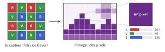

# La photographie numérique

{ .ouverture }

-   [:material-book-open-variant: Cours](cours.md)
-   [:material-pencil-outline: Exercices](exercices.md)
-   [:material-laptop: TP et projets](tp.md)

<!-- pdf-chapitre -->
!!! livre "Le chapitre en PDF"

    Les pages du manuel pour ce chapitre — activités, cours, exercices, TP, fiche de révision — suivies de leurs corrigés, avec les numéros de page du manuel (34 pages, version du 7 novembre 2026).

    [:material-download: Télécharger le chapitre (1,8 Mo)](https://github.com/MathThibaud/informatique-en-autonomie/releases/download/livres/chapitre-seconde-03-la-photographie-numerique.pdf){ .md-button .md-button--primary }
<!-- /pdf-chapitre -->
