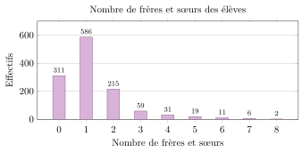
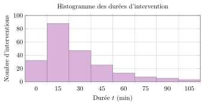
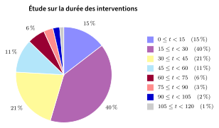

# TP et projets

Les données structurées et leur traitement

## TP 1 Tableur 1 : notes, fréquences et graphiques

*Excel, le grand oublié des programmes — I*

!!! fichiers "Fichiers à télécharger"

    [:material-folder-open: dossier en ligne](https://github.com/MathThibaud/nsi-fichiers-eleves/tree/main/seconde/05-tp-tableur-1){ .md-button } [:material-zip-box: archive .zip](https://github.com/MathThibaud/nsi-fichiers-eleves/raw/main/zips/seconde-05-tp-tableur-1.zip){ .md-button }

Usage de l’IA, indiqué sur chaque exercice :  aucune ;  en appui (déboguer, reformuler, vérifier ; la réponse finale est écrite et comprise par vous) ;  l’exercice s’appuie sur une réponse d’IA. Voir la charte d’usage de l’IA.

!!! encadre "Pour commencer"

    Récupérer le fichier `tableur1.xlsx` (à télécharger : <https://github.com/MathThibaud/nsi-fichiers-eleves/tree/main/seconde/05-tp-tableur-1>). Il contient **quatre feuilles** nommées « `Exercice 1` », « `Exercice 2` », « `Exercice 3` » et « `Exercice 4` » (onglets en bas de la fenêtre). Les **données de départ** y sont déjà saisies ; les cellules sur **fond jaune** sont **à compléter**.

### Exercice 1 — Notes d’un contrôle (feuille `Exercice 1`)  { #ex-05-les-donnees-structurees-et-leur-traiteme-tp-1-1 }

On a relevé, dans l’ordre croissant, les notes obtenues à un contrôle de mathématiques par les élèves de la classe de 2de 11 (cellules `C2:O3`).

1.  **Moyenne d’une série de données.** En `B5`, saisir la formule `=MOYENNE(C2:O3)`. *(Utiliser le menu des fonctions, choisir `MOYENNE`, puis sélectionner la plage `C2` à `O3`.)*

2.  **Ligne des effectifs.** La ligne `8` donne les différentes notes. Compléter la ligne des **effectifs** (`C9:O9`) : pour chaque note, le nombre d’élèves l’ayant obtenue.

3.  **Fréquences (décimales, puis en pourcentage).**

    1.  En `P9`, calculer l’**effectif total** avec `=SOMME(C9:O9)`.

    2.  En `C10`, calculer la fréquence de la première note avec `=C9/$P9`.

    3.  Recopier `C10` vers `D10:O10` avec la **poignée de recopie** (la petite croix en bas à droite de la cellule). *Le symbole `$` **fixe** la colonne `P` lors de la recopie.*

    4.  En `C11`, saisir `=C10`. Puis, par un clic droit » « Format de cellule » » onglet `Nombre`, choisir **Pourcentage**, `0` décimale. Recopier vers `D11:O11`.

    5.  Compléter `P10` et `P11` avec `=SOMME(C10:O10)` et `=SOMME(C11:O11)`. Que doivent valoir ces totaux ?

4.  **Effectifs cumulés croissants (E.C.C.).**

    1.  En `C12`, saisir `=C9`.

    2.  En `D12`, saisir `=C12+D9`, puis recopier vers `E12:O12`.

5.  **Moyenne pondérée par les effectifs.** En `B14`, saisir la formule  
    `=SOMMEPROD(C8:O8;C9:O9)/P9`.  
    **Comparer** avec la moyenne trouvée à la question **1** : que remarque-t-on ?

### Exercice 2 — Fréquences et F.C.C. (feuille `Exercice 2`)  { #ex-05-les-donnees-structurees-et-leur-traiteme-tp-1-2 }

La feuille `Exercice 2` donne les effectifs du lycée par **année de naissance**. Compléter, à l’aide de formules, la ligne des **fréquences** et celle des **fréquences cumulées croissantes** (F.C.C.).

### Exercice 3 — Graphiques (feuille `Exercice 3`)  { #ex-05-les-donnees-structurees-et-leur-traiteme-tp-1-3 }

La feuille `Exercice 3` donne les effectifs du lycée par **niveau** et par **dominante**.

1.  Sélectionner les cellules `A1:D2`, puis *Insertion » Graphique » Secteurs* pour construire un **diagramme circulaire** des élèves de Seconde par dominante.

2.  Sélectionner `A1:D4`, puis *Insertion » Graphique » Colonnes* pour construire un **histogramme** des effectifs par niveau et par dominante. Soigner le titre et la légende.

### Exercice 4 — Moyennes (feuille `Exercice 4`)  { #ex-05-les-donnees-structurees-et-leur-traiteme-tp-1-4 }

La feuille `Exercice 4` donne les salaires d’une entreprise (colonne `A`).

1.  En `D2`, faire calculer le **nombre d’employés** (fonction `NB`).

2.  En `D3`, faire calculer la **masse salariale**, c’est-à-dire le montant total des salaires (fonction `SOMME`).

3.  En `D4`, faire calculer le **salaire moyen** (fonction `MOYENNE`).

??? corrige "Corrigé de l'activité"

    Notions du cours mobilisées

    - **Donnée**, **donnée personnelle** (identification directe ou indirecte), **métadonnée**.

    - **Table** : descripteurs (colonnes), enregistrements (lignes) ; **format CSV**, **format ouvert**.

    - **Rechercher, filtrer, trier**, et surtout **croiser deux tables** : c’est le mécanisme de la réidentification (doc. 4).

    - **Open data** (`data.gouv.fr`, portail de Monaco) et pouvoir citoyen, data-journalisme.

    - **RGPD** (consentement, but précis, droits) ; **loi n° 1.565** et **APDP** à Monaco ; **big data**.

    Arguments attendus

    <table>
    <thead>
    <tr>
    <th style="text-align: left;"><strong>POUR (oui) : ouvrir le plus possible</strong></th>
    <th style="text-align: left;"><strong>CONTRE (non) : limiter fortement</strong></th>
    </tr>
    </thead>
    <tbody>
    <tr>
    <td style="text-align: left;"><ul>
    <li>
<strong>Transparence démocratique</strong> : contrôler l’usage de l’argent public (doc. 2).
</li>
    <li>
<strong>Utilité concrète</strong> : transports, santé, environnement, recherche (doc. 2).
</li>
    <li>
<strong>Données payées par les contribuables</strong> : elles appartiennent à tous (doc. 2).
</li>
    <li>
<strong>C’est la loi</strong> en France depuis 2016, avec retrait des données personnelles (doc. 1).
</li>
    <li>
<strong>On peut protéger</strong> : regrouper les cas rares (INSEE), interdire la réidentification (doc. 3 et 4).
</li>
    <li>
<strong>Format ouvert</strong> (CSV) : tout le monde peut vérifier et réutiliser, pas seulement les grandes entreprises (cours).
</li>
    </ul></td>
    <td style="text-align: left;"><ul>
    <li>
<strong>Réidentification</strong> : trois informations suffisent à retrouver une personne (doc. 4) ; croiser des tables est facile (cours).
</li>
    <li>
<strong>Curiosité mal placée</strong> : le prix payé par son voisin (doc. 3).
</li>
    <li>
<strong>Une fois publiée, une table est copiée</strong> : on ne peut plus la retirer (permanence, comme sur les réseaux sociaux).
</li>
    <li>
<strong>Une interdiction d’usage ne garantit rien</strong> : qui contrôle ceux qui téléchargent (doc. 3) ?
</li>
    <li>
<strong>Pas de consentement</strong> des personnes concernées : elles n’ont pas choisi d’être dans la table.
</li>
    <li>
<strong>Big data</strong> : plus il y a de tables publiques, plus les croisements possibles sont nombreux (cours).
</li>
    </ul></td>
    </tr>
    </tbody>
    </table>

    *Arguments de l’autre camp souvent jugés solides dans la trace écrite :* un élève POUR retient souvent « retirer le nom ne suffit pas à rendre une table anonyme » ; un élève CONTRE, « les données ouvertes ont rendu de vrais services pendant l’épidémie ».

    Questions de relance (pour le modérateur)

    1.  Dans la base DVF (doc. 3), quelle colonne faudrait-il retirer ou rendre moins précise pour mieux protéger les personnes ? Que perd-on alors ?

    2.  Avec quelles colonnes d’une autre table pourrait-on « croiser » une table sans nom pour retrouver quelqu’un (doc. 4) ?

    3.  Qui doit décider de ce qui est publié : l’administration, la loi, les personnes concernées ?

    4.  Les résultats d’une élection par bureau de vote sont publics : pourquoi est-ce important ? Est-ce une donnée personnelle ?

    !!! encadre "Synthèse possible"

        L’**open data** met à la disposition de tous des tables publiques (souvent en CSV) : transparence, recherche, nouveaux services. En France, l’ouverture est la règle depuis 2016, à condition de retirer les données personnelles. Mais **retirer le nom ne suffit pas** : en **croisant** plusieurs tables, quelques descripteurs (code postal, date de naissance, sexe, adresse) suffisent souvent à retrouver une personne. Une donnée pseudonymisée reste une donnée personnelle (RGPD ; loi n° 1.565 à Monaco). Ouvrir les données suppose donc de choisir **quelles colonnes publier, avec quelle précision**, et d’encadrer leur réutilisation.

??? corrige "Corrigé de l'activité"

    Notions du cours mobilisées

    - **Donnée**, **donnée personnelle** (identification directe ou indirecte), **métadonnée**.

    - **Table** : descripteurs (colonnes), enregistrements (lignes) ; **format CSV**, **format ouvert**.

    - **Rechercher, filtrer, trier**, et surtout **croiser deux tables** : c’est le mécanisme de la réidentification (doc. 4).

    - **Open data** (`data.gouv.fr`, portail de Monaco) et pouvoir citoyen, data-journalisme.

    - **RGPD** (consentement, but précis, droits) ; **loi n° 1.565** et **APDP** à Monaco ; **big data**.

    Arguments attendus

    <table>
    <thead>
    <tr>
    <th style="text-align: left;"><strong>POUR (oui) : ouvrir le plus possible</strong></th>
    <th style="text-align: left;"><strong>CONTRE (non) : limiter fortement</strong></th>
    </tr>
    </thead>
    <tbody>
    <tr>
    <td style="text-align: left;"><ul>
    <li>
<strong>Transparence démocratique</strong> : contrôler l’usage de l’argent public (doc. 2).
</li>
    <li>
<strong>Utilité concrète</strong> : transports, santé, environnement, recherche (doc. 2).
</li>
    <li>
<strong>Données payées par les contribuables</strong> : elles appartiennent à tous (doc. 2).
</li>
    <li>
<strong>C’est la loi</strong> en France depuis 2016, avec retrait des données personnelles (doc. 1).
</li>
    <li>
<strong>On peut protéger</strong> : regrouper les cas rares (INSEE), interdire la réidentification (doc. 3 et 4).
</li>
    <li>
<strong>Format ouvert</strong> (CSV) : tout le monde peut vérifier et réutiliser, pas seulement les grandes entreprises (cours).
</li>
    </ul></td>
    <td style="text-align: left;"><ul>
    <li>
<strong>Réidentification</strong> : trois informations suffisent à retrouver une personne (doc. 4) ; croiser des tables est facile (cours).
</li>
    <li>
<strong>Curiosité mal placée</strong> : le prix payé par son voisin (doc. 3).
</li>
    <li>
<strong>Une fois publiée, une table est copiée</strong> : on ne peut plus la retirer (permanence, comme sur les réseaux sociaux).
</li>
    <li>
<strong>Une interdiction d’usage ne garantit rien</strong> : qui contrôle ceux qui téléchargent (doc. 3) ?
</li>
    <li>
<strong>Pas de consentement</strong> des personnes concernées : elles n’ont pas choisi d’être dans la table.
</li>
    <li>
<strong>Big data</strong> : plus il y a de tables publiques, plus les croisements possibles sont nombreux (cours).
</li>
    </ul></td>
    </tr>
    </tbody>
    </table>

    *Arguments de l’autre camp souvent jugés solides dans la trace écrite :* un élève POUR retient souvent « retirer le nom ne suffit pas à rendre une table anonyme » ; un élève CONTRE, « les données ouvertes ont rendu de vrais services pendant l’épidémie ».

    Questions de relance (pour le modérateur)

    1.  Dans la base DVF (doc. 3), quelle colonne faudrait-il retirer ou rendre moins précise pour mieux protéger les personnes ? Que perd-on alors ?

    2.  Avec quelles colonnes d’une autre table pourrait-on « croiser » une table sans nom pour retrouver quelqu’un (doc. 4) ?

    3.  Qui doit décider de ce qui est publié : l’administration, la loi, les personnes concernées ?

    4.  Les résultats d’une élection par bureau de vote sont publics : pourquoi est-ce important ? Est-ce une donnée personnelle ?

    !!! encadre "Synthèse possible"

        L’**open data** met à la disposition de tous des tables publiques (souvent en CSV) : transparence, recherche, nouveaux services. En France, l’ouverture est la règle depuis 2016, à condition de retirer les données personnelles. Mais **retirer le nom ne suffit pas** : en **croisant** plusieurs tables, quelques descripteurs (code postal, date de naissance, sexe, adresse) suffisent souvent à retrouver une personne. Une donnée pseudonymisée reste une donnée personnelle (RGPD ; loi n° 1.565 à Monaco). Ouvrir les données suppose donc de choisir **quelles colonnes publier, avec quelle précision**, et d’encadrer leur réutilisation.

??? corrige "Corrigé de l'activité"

    Notions du cours mobilisées

    - **Donnée**, **donnée personnelle** (identification directe ou indirecte), **métadonnée**.

    - **Table** : descripteurs (colonnes), enregistrements (lignes) ; **format CSV**, **format ouvert**.

    - **Rechercher, filtrer, trier**, et surtout **croiser deux tables** : c’est le mécanisme de la réidentification (doc. 4).

    - **Open data** (`data.gouv.fr`, portail de Monaco) et pouvoir citoyen, data-journalisme.

    - **RGPD** (consentement, but précis, droits) ; **loi n° 1.565** et **APDP** à Monaco ; **big data**.

    Arguments attendus

    <table>
    <thead>
    <tr>
    <th style="text-align: left;"><strong>POUR (oui) : ouvrir le plus possible</strong></th>
    <th style="text-align: left;"><strong>CONTRE (non) : limiter fortement</strong></th>
    </tr>
    </thead>
    <tbody>
    <tr>
    <td style="text-align: left;"><ul>
    <li>
<strong>Transparence démocratique</strong> : contrôler l’usage de l’argent public (doc. 2).
</li>
    <li>
<strong>Utilité concrète</strong> : transports, santé, environnement, recherche (doc. 2).
</li>
    <li>
<strong>Données payées par les contribuables</strong> : elles appartiennent à tous (doc. 2).
</li>
    <li>
<strong>C’est la loi</strong> en France depuis 2016, avec retrait des données personnelles (doc. 1).
</li>
    <li>
<strong>On peut protéger</strong> : regrouper les cas rares (INSEE), interdire la réidentification (doc. 3 et 4).
</li>
    <li>
<strong>Format ouvert</strong> (CSV) : tout le monde peut vérifier et réutiliser, pas seulement les grandes entreprises (cours).
</li>
    </ul></td>
    <td style="text-align: left;"><ul>
    <li>
<strong>Réidentification</strong> : trois informations suffisent à retrouver une personne (doc. 4) ; croiser des tables est facile (cours).
</li>
    <li>
<strong>Curiosité mal placée</strong> : le prix payé par son voisin (doc. 3).
</li>
    <li>
<strong>Une fois publiée, une table est copiée</strong> : on ne peut plus la retirer (permanence, comme sur les réseaux sociaux).
</li>
    <li>
<strong>Une interdiction d’usage ne garantit rien</strong> : qui contrôle ceux qui téléchargent (doc. 3) ?
</li>
    <li>
<strong>Pas de consentement</strong> des personnes concernées : elles n’ont pas choisi d’être dans la table.
</li>
    <li>
<strong>Big data</strong> : plus il y a de tables publiques, plus les croisements possibles sont nombreux (cours).
</li>
    </ul></td>
    </tr>
    </tbody>
    </table>

    *Arguments de l’autre camp souvent jugés solides dans la trace écrite :* un élève POUR retient souvent « retirer le nom ne suffit pas à rendre une table anonyme » ; un élève CONTRE, « les données ouvertes ont rendu de vrais services pendant l’épidémie ».

    Questions de relance (pour le modérateur)

    1.  Dans la base DVF (doc. 3), quelle colonne faudrait-il retirer ou rendre moins précise pour mieux protéger les personnes ? Que perd-on alors ?

    2.  Avec quelles colonnes d’une autre table pourrait-on « croiser » une table sans nom pour retrouver quelqu’un (doc. 4) ?

    3.  Qui doit décider de ce qui est publié : l’administration, la loi, les personnes concernées ?

    4.  Les résultats d’une élection par bureau de vote sont publics : pourquoi est-ce important ? Est-ce une donnée personnelle ?

    !!! encadre "Synthèse possible"

        L’**open data** met à la disposition de tous des tables publiques (souvent en CSV) : transparence, recherche, nouveaux services. En France, l’ouverture est la règle depuis 2016, à condition de retirer les données personnelles. Mais **retirer le nom ne suffit pas** : en **croisant** plusieurs tables, quelques descripteurs (code postal, date de naissance, sexe, adresse) suffisent souvent à retrouver une personne. Une donnée pseudonymisée reste une donnée personnelle (RGPD ; loi n° 1.565 à Monaco). Ouvrir les données suppose donc de choisir **quelles colonnes publier, avec quelle précision**, et d’encadrer leur réutilisation.

## TP 2 Tableur 2 : suites de nombres et conjecture

*Excel, le grand oublié des programmes — II*

!!! fichiers "Fichiers à télécharger"

    [:material-folder-open: dossier en ligne](https://github.com/MathThibaud/nsi-fichiers-eleves/tree/main/seconde/05-tp-tableur-2){ .md-button } [:material-zip-box: archive .zip](https://github.com/MathThibaud/nsi-fichiers-eleves/raw/main/zips/seconde-05-tp-tableur-2.zip){ .md-button }

Usage de l’IA, indiqué sur chaque exercice :  aucune ;  en appui (déboguer, reformuler, vérifier ; la réponse finale est écrite et comprise par vous) ;  l’exercice s’appuie sur une réponse d’IA. Voir la charte d’usage de l’IA.

!!! encadre "Pour commencer"

    Récupérer le fichier `tableur2.xlsx` (à télécharger : <https://github.com/MathThibaud/nsi-fichiers-eleves/tree/main/seconde/05-tp-tableur-2>). Il contient les feuilles « `Exercice 1` » à « `Exercice 4` » et un « `Bonus` ». Les valeurs de départ y sont déjà en place (cellules sur fond jaune à compléter).

### Exercice 1 — Une suite de nombres, pas de 1 (feuille `Exercice 1`)  { #ex-05-les-donnees-structurees-et-leur-traiteme-tp-2-1 }

Pour créer une suite de 30 nombres consécutifs dans la colonne `A` : la cellule `A1` contient déjà le premier nombre, `5`. En `A2`, saisir la formule `=A1+1`, puis, à l’aide de la **poignée de recopie**, créer la suite de 30 nombres dans la colonne `A`. On dit que le **pas** entre deux nombres est de `1`.

### Exercice 2 — Un pas réglable (feuille `Exercice 2`)  { #ex-05-les-donnees-structurees-et-leur-traiteme-tp-2-2 }

On veut compter de `8` en `8` à partir de `5`. Le **pas** est en `C1` (`8`) et le premier nombre en `A1` (`5`). En `A2`, saisir `=A1+C$1`, puis recopier vers le bas. *Le symbole `$` **fixe** la ligne `1` lors de la recopie.*

### Exercice 3 — Somme d’une suite : émettre une conjecture (feuille `Exercice 3`)  { #ex-05-les-donnees-structurees-et-leur-traiteme-tp-2-3 }

On compte de `3` en `3` à partir de `5` (pas en `C1`, premier terme en `A1`). En `A2`, saisir `=A1+C$1` et recopier pour obtenir 30 termes.

1.  En `C4`, le **nombre de termes** : `=NB(A1:A30)`.

2.  En `C7`, la plus petite valeur : `=MIN(A1:A30)`. En `C8`, la plus grande : `=MAX(A1:A30)`.

3.  En `C9`, la **somme des deux valeurs extrêmes**. En `C12`, la **somme de tous les termes** : `=SOMME(A1:A30)`.

4.  **Conjecture.** En faisant varier les données, trouver la relation entre la **somme des termes**, le **nombre de termes** et les **valeurs extrêmes**. Noter votre idée.

### Exercice 4 — Contrôler la conjecture : départ aléatoire (feuille `Exercice 4`)  { #ex-05-les-donnees-structurees-et-leur-traiteme-tp-2-4 }

On fait varier automatiquement le premier terme.

1.  En `B1`, un décimal aléatoire entre 0 et 1 : `=ALEA()`. En `B2` : `=B1*100`. En `B3`, un **entier** aléatoire entre 0 et 99 : `=ENT(B2)` (partie entière).

2.  Le pas est en `E1` (`3`). En `C1`, recopier le nombre aléatoire : `=B3`. Créer dans la colonne `C` une suite de 30 termes de pas 3.

3.  Compléter `E4`, `E7`, `E8`, `E9` et `E12` (comme en `Exercice 3`, mais sur la colonne `C`). **Vérifier** la conjecture. On peut appuyer sur `F9` pour retirer un nouveau nombre aléatoire.

### Exercice 5 — BONUS : départ *et* pas quelconques (feuille `Bonus`)  { #ex-05-les-donnees-structurees-et-leur-traiteme-tp-2-5 }

Faire varier automatiquement le premier terme **et** le pas.

1.  Obtenir en `B3` un entier aléatoire entre 0 et 99. Choisir un pas entier quelconque en `E1`.

2.  Dans la colonne `C`, créer une suite d’autant de termes que voulu, de pas celui de `E1`, à partir de `B3`.

3.  Compléter `E2`, `E7`, `E8`, `E9` et `E12` en prenant pour plage la **colonne `C` entière** : `C:C`. Vérifier la conjecture.

## TP 3 Tableur 3 : représenter et résumer une série

*Excel, le grand oublié des programmes — III*

!!! fichiers "Fichiers à télécharger"

    [:material-folder-open: dossier en ligne](https://github.com/MathThibaud/nsi-fichiers-eleves/tree/main/seconde/05-tp-tableur-3){ .md-button } [:material-zip-box: archive .zip](https://github.com/MathThibaud/nsi-fichiers-eleves/raw/main/zips/seconde-05-tp-tableur-3.zip){ .md-button }

Usage de l’IA, indiqué sur chaque exercice :  aucune ;  en appui (déboguer, reformuler, vérifier ; la réponse finale est écrite et comprise par vous) ;  l’exercice s’appuie sur une réponse d’IA. Voir la charte d’usage de l’IA.

!!! encadre "Pour commencer"

    Récupérer le fichier `tableur3.xlsx` (à télécharger : <https://github.com/MathThibaud/nsi-fichiers-eleves/tree/main/seconde/05-tp-tableur-3>). Il contient quatre feuilles (« `Exercice 1` » à « `Exercice 4` ») dont les données sont déjà saisies.

### Exercice 1 — Représentation de séries statistiques (feuille `Exercice 1`)  { #ex-05-les-donnees-structurees-et-leur-traiteme-tp-3-1 }

**1er cas : série statistique discrète.** Nombre de frères et sœurs parmi les 1240 élèves d’un lycée :

| Nombre de frères et sœurs |  0  |  1  |  2  |  3  |  4  |  5  |  6  |  7  |  8  |
|:-------------------------:|:---:|:---:|:---:|:---:|:---:|:---:|:---:|:---:|:---:|
|         Effectifs         | 311 | 586 | 215 | 59  | 31  | 19  | 11  |  6  |  2  |

**Diagramme en barres :** via *Insertion » Graphique*, représenter cette série par un diagramme en barres (soigner le titre et la légende). Résultat attendu :

{ .tikz loading=lazy }

**2e cas : série à classes.** Durée des interventions :

| Durée (min) | $0 \leq t < 15$ | $15 \leq t < 30$ | $30 \leq t < 45$ | $45 \leq t < 60$ | $60 \leq t < 75$ | $75 \leq t < 90$ | $90 \leq t < 105$ | $105 \leq t < 120$ |
|:--:|:--:|:--:|:--:|:--:|:--:|:--:|:--:|:--:|
| Nombre d’interventions | 32 | 88 | 47 | 25 | 13 | 7 | 5 | 3 |

**Histogramme**, puis **diagramme circulaire** de cette série (via *Insertion » Graphique*). Résultats attendus :

{ .tikz loading=lazy }

{ .tikz loading=lazy }

*Pourcentages arrondis à l’unité (total des effectifs : 220).*

### Exercice 2 — Caractéristiques de position d’une série en liste (feuille `Exercice 2`)  { #ex-05-les-donnees-structurees-et-leur-traiteme-tp-3-2 }

Taille (cm) de 10 nourrissons (colonne `A`) : 49 ; 50,5 ; 50 ; 48,5 ; 52 ; 50 ; 49,5 ; 51 ; 49,5 ; 50,5.

- \(a\) Ordonner les tailles par ordre croissant (*Données » Trier*).

- \(b\) En `C1` : `=MEDIANE(A1:A10)`.

- \(c\) En `C2` : `=QUARTILE(A1:A10;1)`. En `C3` : `=QUARTILE(A1:A10;3)`.

- \(d\) En `C4` : `=MOYENNE(A1:A10)`.

- \(e\) En `C5` : calculer l’**étendue** (`=MAX(A1:A10)-MIN(A1:A10)`).

### Exercice 3 — Caractéristiques de position dans un tableau (feuille `Exercice 3`)  { #ex-05-les-donnees-structurees-et-leur-traiteme-tp-3-3 }

Tailles de 885 nourrissons :

|  Taille $t$  | 47,5 | 48  | 48,5 | 49  | 49,5 | 50  | 50,5 | 51  | 51,5 | 52  | 52,5 | 53  | TOTAL |
|:------------:|:-----|:----|:-----|:----|:-----|:----|:-----|:----|:-----|:----|:-----|:----|:------|
| Effectif $n$ | 55   | 77  | 105  | 115 | 132  | 154 | 66   | 77  | 55   | 25  | 13   | 11  |       |
| $t \times n$ |      |     |      |     |      |     |      |     |      |     |      |     |       |
|   E. C. C.   | 55   |     |      |     |      |     |      |     |      |     |      |     |       |

- \(a\) Compléter la ligne des produits $t \times n$ (par exemple `=B3*B4`, à recopier).

- \(b\) Calculer la moyenne à l’aide de $\dfrac{\sum (t \times n)}{\sum n}$.

- \(c\) Calculer l’étendue.

- \(d\) Trouver médiane, premier et troisième quartile par lecture de la ligne des E.C.C. *Méthode : avec un effectif total $N$, le premier quartile est la première valeur dont l’E.C.C. atteint (ou dépasse) $N/4$ ; la médiane, la première dont l’E.C.C. atteint $N/2$ ; le troisième quartile, la première dont l’E.C.C. atteint $3N/4$.*

### Exercice 4 — Caractéristiques de position pour données groupées (feuille `Exercice 4`)  { #ex-05-les-donnees-structurees-et-leur-traiteme-tp-3-4 }

Tailles de 640 nourrissons :

| Taille $t$ | \[45;46\[ | \[46;47\[ | \[47;48\[ | \[48;49\[ | \[49;50\[ | \[50;51\[ | \[51;52\[ | \[52;53\[ | \[53;54\[ | \[54;55\[ | TOTAL |
|:--:|:---|:---|:---|:---|:---|:---|:---|:---|:---|:---|:---|
| Effectif $n$ | 10 | 25 | 35 | 65 | 128 | 190 | 95 | 45 | 32 | 15 |  |
| Fréquence | 1,56% |  |  |  |  |  |  |  |  |  |  |
| F. C. C. | 1,56% |  |  |  |  |  |  |  |  |  |  |
| Centre de classe | 45,5 |  |  |  |  |  |  |  |  |  |  |

- \(a\) Compléter les fréquences, les centres de classe et les F.C.C.

- \(b\) Localiser médiane, premier et troisième quartile *(même méthode, avec les F.C.C. : première classe dont la F.C.C. atteint $25\,\%$, $50\,\%$, puis $75\,\%$)*.

- \(c\) Calculer la moyenne avec `=SOMMEPROD(centres;effectifs)/total`.

0

## Débat Faut-il ouvrir à tous le plus possible de données publiques, même quand elles concernent des personnes ?

*open data contre vie privée*

Durée : 50 min

!!! consignes "Consignes"

    - En classe entière. Les rôles sont tirés au sort : vous défendrez peut-être une position qui n’est pas la vôtre, c’est un excellent entraînement.

    - Chaque argument s’appuie sur un **document** ci-dessous ou sur le **cours**.  Préparation sans IA ni recherche en ligne.

    - Avant de commencer, notez sur votre cahier votre position de départ : oui, non ou je ne sais pas.

**Rappel du cours.** Une **donnée personnelle** permet d’identifier une personne, directement ou indirectement. Les **données ouvertes** (*open data*) sont des tables publiques librement téléchargeables, le plus souvent en **CSV**. **Croiser deux tables** permet de trouver des informations qu’aucune ne donne seule. Ouvrir les données, c’est donner du pouvoir aux citoyens… mais à qui exactement, et pour en faire quoi ?

!!! encadre "Les deux camps"

    **Groupe POUR** — oui : il faut publier le plus possible de données publiques, en les protégeant au mieux.  
    **Groupe CONTRE** — non : dès que des personnes sont concernées, il faut limiter fortement ce que l’on publie.

Les documents

!!! encadre "Document 1 — L’ouverture par défaut"

    Depuis 2011, l’État français publie ses données sur `data.gouv.fr` ; la Principauté de Monaco dispose elle aussi d’un portail *open data*. En France, la loi pour une République numérique du 7 octobre 2016 a fait de l’ouverture **la règle** : les administrations de plus de 50 agents et les collectivités de plus de 3 500 habitants doivent publier en ligne, dans un format ouvert, leurs principales bases de données. Avant publication, elles doivent en principe en retirer les **données personnelles**, sauf exceptions prévues par la loi.

    Source : loi n° 2016-1321 du 7 octobre 2016 pour une République numérique ; `data.gouv.fr`.

!!! encadre "Document 2 — À quoi servent les données ouvertes ?"

    Horaires des bus, qualité de l’air, résultats des élections, dépenses des communes : grâce aux données ouvertes, des développeurs créent des applications de transport, des journalistes vérifient l’usage de l’argent public, des chercheurs étudient la pollution. Pendant l’épidémie de COVID-19, des citoyens bénévoles ont utilisé les données publiées par Santé publique France pour créer des sites de suivi des cas et de la vaccination, très consultés. Ces données ont été produites grâce à l’argent des contribuables : pour beaucoup, il est normal qu’elles reviennent à tous.

    Source : `data.gouv.fr` ; Santé publique France, données COVID-19 publiées en *open data* (2020–2022).

!!! encadre "Document 3 — Le prix de la maison du voisin"

    Depuis 2019, l’État publie en données ouvertes la base « Demandes de valeurs foncières » (DVF) : pour chaque vente immobilière des dernières années, on y trouve la **date**, le **prix**, la **surface** et la **localisation** du bien (adresse ou parcelle), sans le nom du vendeur ni de l’acheteur. Très utile pour connaître les prix d’un quartier avant d’acheter… mais, quand on connaît ses voisins, on peut deviner combien chacun a payé sa maison. Les conditions d’utilisation interdisent de chercher à réidentifier les personnes et de faire apparaître ces données dans les moteurs de recherche.

    Source : `data.gouv.fr`, jeu de données « Demandes de valeurs foncières » (Direction générale des Finances publiques).

!!! encadre "Document 4 — « Anonyme » ne veut pas dire « introuvable »"

    En 2000, la chercheuse Latanya Sweeney (université Carnegie Mellon) a montré qu’environ **87 %** des Américains pouvaient être identifiés de façon unique avec seulement trois informations : **code postal**, **date de naissance** et **sexe**. Retirer la colonne « nom » d’une table ne suffit donc pas : en la croisant avec une autre table, on peut retrouver qui est qui. Le RGPD fait la différence : une donnée **pseudonymisée** (nom remplacé par un numéro) reste une donnée personnelle ; seule une donnée réellement **anonymisée** échappe au règlement. C’est pourquoi l’INSEE, dans son fichier des prénoms, regroupe les prénoms trop rares sous une mention commune.

    Source : L. Sweeney, « *Simple Demographics Often Identify People Uniquely* », 2000 ; RGPD, considérant 26 ; INSEE, fichier des prénoms.

Organisation du débat

| **Rôle** | **Préparation (15 min), puis débat** |
|:---|:---|
| Groupe POUR ($\approx$ 1/3) | Défend **oui** : au moins trois arguments, chacun appuyé sur un document ou le cours ; prévoit la réponse à deux arguments adverses ; choisit qui ouvre et qui conclut. |
| Groupe CONTRE ($\approx$ 1/3) | Défend **non** : même travail que le groupe POUR. |
| Modérateur (1 ou 2) | Prépare deux questions de relance ; donne la parole en alternant les camps, tient le temps, recentre. Ne donne **pas** son avis. |
| Secrétaire (1 ou 2) | Note au tableau, en deux colonnes POUR / CONTRE, chaque argument et le numéro du document cité. |
| Observateurs (les autres) | Suivent deux ou trois élèves (citent-ils un document ? répondent-ils à l’argument précédent ?) et notent le meilleur argument de chaque camp. |

| **Min.** | **Étape** | **Min.** | **Étape** |
|---:|:---|---:|:---|
| 0–3 | **Mise en place** : tirage des rôles, groupes face à face. | 26–38 | **Échanges** : 12 min, parole alternée entre les camps. |
| 3–18 | **Préparation** en groupes, tableau d’arguments ci-dessous. | 38–42 | **Observateurs** : meilleur argument de chaque camp. |
| 18–20 | **Ouverture** : le modérateur lit la question et les règles. | 42–44 | **Conclusions** : 1 min par groupe. |
| 20–26 | **Prises de position** : 3 min POUR, puis 3 min CONTRE. | 44–50 | **Bilan** : trace écrite individuelle, puis vote. |

!!! encadre "Règles de prise de parole"

    - On lève la main, le modérateur donne la parole ; une seule personne à la fois, une minute au plus.

    - On **argumente** (« je pense que… **parce que**… ») et on **cite** un document ou le cours (« d’après le document 2… »).

    - On **répond à l’argument précédent** avant d’en avancer un nouveau : « vous dites que…, mais… ».

    - On **respecte** : on critique une idée, jamais une personne ; pas de moquerie ; on ne raconte pas la vie privée de quelqu’un.

Tableau d’arguments

Recopier ce tableau sur le cahier et le compléter pendant le débat.

| **Argument POUR (oui)** | **Doc.** | **Argument CONTRE (non)** | **Doc.** |
|:------------------------|:---------|:--------------------------|:---------|
| …                       |          | …                         |          |

Trace écrite finale (individuelle)

Sur le cahier, notez votre position après le débat (oui, non, je ne sais toujours pas) et si vous avez changé d’avis. Puis, en trois à cinq lignes, justifiez-la avec vos **deux meilleurs arguments**, dont **un argument de l’autre camp** que vous trouvez solide (avec le document qui l’appuie).

## Corrigé

??? corrige "Corrigé"

    0
