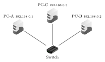

# TP et projets

Internet

## TP Construire un réseau et faire circuler un paquet

*sur le simulateur Filius, gratuit et en français*

Usage de l’IA, indiqué sur chaque exercice :  aucune ;  en appui (déboguer, reformuler, vérifier ; la réponse finale est écrite et comprise par vous) ;  l’exercice s’appuie sur une réponse d’IA. Voir la charte d’usage de l’IA.

!!! encadre "But du TP"

    Avec le logiciel gratuit **Filius**, on va **construire** un petit réseau, donner une **adresse IP** à chaque machine, puis envoyer un paquet avec la commande `ping` et l’**observer voyager**. On ira du réseau local le plus simple jusqu’à **deux réseaux reliés par un routeur**.

**Prise en main.** Filius a deux modes (en haut) : le mode **construction** (le marteau) pour poser et relier les composants avec le **Câble**, et le mode **simulation** (la flèche verte) pour lancer les échanges. Les composants (barre de gauche) sont l’**Ordinateur**, le **Switch**, le **Routeur** et le **Câble** :

{ .tikz loading=lazy }

Un **double-clic** sur une machine ouvre sa configuration (adresse IP, masque, passerelle). En mode simulation, un double-clic permet d’installer la « **Ligne de commande** » : on y tape `ping`, `ipconfig`, `traceroute`. Le clic droit « **Afficher les échanges de données** » montre les paquets qui passent.

!!! encadre "Le vocabulaire du TP"

    - Un **switch** (ou *commutateur*) est le boîtier qui relie entre elles, par des câbles, les machines d’un **même réseau local** (une salle, une maison) : il fait suivre chaque paquet vers la machine à qui il est destiné.

    - Un **routeur** (vu en cours) relie **plusieurs réseaux** entre eux et aiguille les paquets de l’un à l’autre.

    - La **passerelle** d’une machine est l’adresse IP du routeur de *son* réseau local : c’est à lui qu’elle confie tout paquet destiné à une machine d’un **autre** réseau, comme on passe par la porte de sortie d’un bâtiment. On l’appelle aussi *routeur par défaut*.

    - Filius demande aussi un **masque** : recopiez simplement la valeur donnée (`255.255.255.0`), sans chercher à l’expliquer.

## Partie 1 — Un réseau local

### Exercice 1  { #ex-06-internet-tp-1-1 }

▶  En mode **construction**, poser **trois Ordinateurs** reliés à un même **Switch**. Double-cliquer sur chacun et saisir son **adresse IP** et le **masque** `255.255.255.0` (laisser la passerelle vide) :

{ .tikz loading=lazy }

1.  Les trois machines ont des adresses `192.168.0._`. À quoi sert le **switch** ?

2.  Double-cliquer sur le switch : Filius propose-t-il de lui donner une adresse IP ? Qu’en déduire ?

??? corrige "Corrigé"

    0

    1.  Le **switch** relie entre elles les machines d’un *même* réseau local et aiguille les données vers la bonne machine. *(Toutes les IP commencent par `192.168.0` : même réseau local.)*

    2.  **Non**, Filius ne propose aucune adresse IP pour le switch : il n’en a pas besoin (il ne fait que distribuer dans le réseau local, il ne « raisonne » pas sur les adresses IP comme un routeur).

### Exercice 2  { #ex-06-internet-tp-1-2 }

▶  Passer en **simulation**. Sur PC-A, installer la **Ligne de commande**, l’ouvrir et taper : `ping 192.168.0.2`. Ralentir la vitesse (curseur en haut) pour bien voir.

1.  Le `ping` réussit-il ? Décrire le trajet du paquet (quels composants traverse-t-il ?).

2.  ▶  Ouvrir « Afficher les échanges de données » sur PC-B : que voit-on arriver ?

3.  ▶  Taper `ping 192.168.0.9` (machine qui n’existe pas). Que se passe-t-il, et pourquoi ?

??? corrige "Corrigé"

    1.  Le `ping` **réussit**. Trajet : PC-A $\to$ Switch $\to$ PC-B, et la réponse revient par le même chemin.

    2.  On voit **arriver les paquets** (requête « echo » puis réponse). C’est l’échange « requête echo » / « réponse echo » du `ping`.

    3.  `ping 192.168.0.9` : **échec** (« délai dépassé » / pas de réponse) car aucune machine ne porte cette adresse dans le réseau.

## Partie 2 — Deux réseaux reliés par un routeur

### Exercice 3  { #ex-06-internet-tp-1-3 }

▶  Construire **deux** réseaux locaux reliés par **un Routeur**. À la création du routeur, Filius demande le **nombre d’interfaces** : en mettre **2**.

{ .tikz loading=lazy }

Interface du routeur côté réseau 0 : `192.168.0.254` ; côté réseau 1 : `192.168.1.254` (masque `255.255.255.0` partout).

??? corrige "Corrigé"

    Construction conforme au schéma de l’énoncé : PC-A et S1 dans le réseau `192.168.0.0`, PC-B et S2 dans le réseau `192.168.1.0`, et le routeur avec ses deux interfaces `192.168.0.254` et `192.168.1.254`.

### Exercice 4  { #ex-06-internet-tp-1-4 }

▶  En simulation, sur PC-A, taper `ping 192.168.1.1`.

1.  Sans passerelle, Filius répond « `destination non joignable` ». Pourquoi ? *(Le paquet doit **quitter** le réseau local.)*

2.  ▶  Régler la **passerelle** de PC-A sur `192.168.0.254` (l’interface du routeur de *son* côté), et celle de PC-B sur `192.168.1.254`. Relancer le `ping` : il doit réussir. Décrire le trajet complet du paquet.

3.  ▶  Taper `traceroute 192.168.1.1` sur PC-A. Combien d’étapes ? Que représente l’étape intermédiaire ?

!!! encadre "Bilan du TP"

    Dans un **réseau local**, un **switch** suffit pour relier les machines (mêmes adresses `192.168.0._`). Pour **changer de réseau**, il faut un **routeur**, et chaque machine doit connaître sa **passerelle** (la porte de sortie vers les autres réseaux). Le paquet avance ensuite **de proche en proche**.

??? corrige "Corrigé"

    1.  PC-A (`192.168.0.1`) et PC-B (`192.168.1.1`) ne sont **pas dans le même réseau** (`.0.` vs `.1.`). Sans passerelle, PC-A ne sait pas *par où sortir* de son réseau local $\to$ « destination non joignable ».

    2.  Avec les passerelles réglées, le `ping` réussit. Trajet : **PC-A $\to$ S1 $\to$ Routeur $\to$ S2 $\to$ PC-B** (et retour). Le routeur fait le lien entre les deux réseaux.

    3.  `traceroute` montre **deux étapes** : d’abord le **routeur** (`192.168.0.254`), puis **PC-B**. L’étape intermédiaire est le routeur (la passerelle).

    *Pour aller plus loin : couper le câble PC-B–S2 en pleine simulation et relancer le ping $\to$ échec ; le rebrancher $\to$ succès. Illustre une **panne** : ce câble est le seul chemin vers PC-B, donc plus rien ne passe. La **robustesse** d’Internet viendrait d’un **second chemin** entre routeurs, par lequel les paquets pourraient contourner la panne.*

0

## Débat Les fournisseurs d’accès à Internet doivent-ils traiter tous les paquets de la même façon ?

*la neutralité du Net*

Durée : 50 min

!!! consignes "Consignes"

    - En classe entière. Les rôles sont tirés au sort : vous défendrez peut-être une position qui n’est pas la vôtre, c’est un excellent entraînement.

    - Chaque argument s’appuie sur un **document** ci-dessous ou sur le **cours**.  Préparation sans IA ni recherche en ligne.

    - Avant de commencer, notez sur votre cahier votre position de départ : oui, non ou je ne sais pas.

**Rappel du cours.** Les routeurs acheminent les **paquets** de proche en proche. La **neutralité du Net** est le principe selon lequel ils transmettent **tous** les paquets de la même façon, sans favoriser un contenu ou un service. Techniquement, votre fournisseur d’accès à Internet (FAI : Monaco Telecom, Orange, Free…) pourrait ralentir certains paquets ou en accélérer d’autres. En a-t-il le droit ? Et serait-ce une bonne idée ?

!!! encadre "Les deux camps"

    **Groupe POUR** — oui : tous les paquets doivent être traités de la même façon (neutralité stricte).  
    **Groupe CONTRE** — non : un FAI doit pouvoir donner des priorités ou proposer des offres différentes selon les services.

Les documents

!!! encadre "Document 1 — La règle en Europe : un Internet ouvert"

    Depuis 2016, un règlement européen oblige les FAI à traiter tout le trafic **de façon égale**, quels que soient l’expéditeur, le contenu ou l’application. Une gestion « raisonnable » reste permise (congestion passagère, *catégories* de trafic aux besoins différents : un appel vidéo supporte mal le retard, un téléchargement peut attendre), jamais pour des raisons commerciales. En France, l’**Arcep** y veille. Monaco, hors de l’Union européenne, n’est pas directement concerné.

    **À retenir :** en Europe, la neutralité est la loi, avec des exceptions techniques limitées.

    Source : règlement (UE) 2015/2120 du 25 novembre 2015, article 3 ; Arcep, rapport annuel « L’état de l’internet en France ».

!!! encadre "Document 2 — L’« illimité »… sur certaines applications seulement"

    Certains forfaits mobiles ont proposé un « tarif zéro » : le trafic de quelques applications partenaires (musique, vidéo, réseau social) n’était pas décompté du forfait, celui des autres si. Bonne affaire pour le client ; handicap pour une petite application concurrente. En 2020 puis en 2021 (affaire Telenor, en Hongrie), la Cour de justice de l’Union européenne a jugé ces offres contraires à l’égalité de traitement du trafic.

    **À retenir :** en Europe, un FAI ne peut pas avantager quelques applications, même au profit du client.

    Source : Cour de justice de l’Union européenne, arrêts du 15 septembre 2020 (Telenor Magyarország) et du 2 septembre 2021.

!!! encadre "Document 3 — Les opérateurs : « que les plus gros paient leur part »"

    Quelques grandes plateformes, surtout de vidéo, produisent une grande part du trafic, mais ce sont les opérateurs qui paient antennes, fibre et routeurs. Plusieurs opérateurs européens réclament donc aux plateformes une « juste part » (*fair share*) ; la Commission européenne a ouvert une consultation en février 2023. Les plateformes répondent qu’elles investissent déjà (câbles sous-marins, serveurs proches des abonnés) et que les abonnés paient leur abonnement pour regarder ces vidéos.

    **À retenir :** derrière la neutralité se pose une autre question : qui paie le réseau ?

    Source : Commission européenne, consultation « L’avenir du secteur des communications électroniques et de ses infrastructures », février 2023.

!!! encadre "Document 4 — Aux États-Unis, la règle fait le yo-yo"

    Aux États-Unis, l’autorité des télécoms (FCC) a adopté des règles de neutralité en 2015, les a supprimées fin 2017, rétablies en 2024 ; une cour d’appel les a annulées en janvier 2025. Sans règle, un FAI peut vendre des « voies rapides » à ceux qui en ont les moyens. Pour les uns, l’Internet américain s’est développé quand même ; pour les autres, plusieurs États, comme la Californie en 2018, ont voté leur propre loi.

    **À retenir :** la neutralité est un choix politique, qui varie selon les pays.

    Source : FCC, décisions de 2015, 2017 et 2024 ; cour d’appel fédérale (6e circuit), 2 janvier 2025.

Rôles, déroulé minuté, règles de prise de parole et trace écrite : voir la page « Méthode : débattre ».

Tableau d’arguments

Recopier ce tableau sur le cahier et le compléter pendant le débat.

| **Argument POUR (oui)** | **Doc.** | **Argument CONTRE (non)** | **Doc.** |
|:------------------------|:---------|:--------------------------|:---------|
| …                       |          | …                         |          |

Trace écrite finale (individuelle)

Sur le cahier, notez votre position après le débat (oui, non, je ne sais toujours pas) et si vous avez changé d’avis. Puis, en trois à cinq lignes, justifiez-la avec vos **deux meilleurs arguments**, dont **un argument de l’autre camp** que vous trouvez solide (avec le document qui l’appuie).

??? corrige "Corrigé de l'activité"

    **À lire après le débat.** Ces éléments de réponse servent à vérifier et à compléter votre trace écrite : les lire avant le débat lui ôterait son intérêt.

    Notions du cours mobilisées

    - **Paquet**, **routeur**, **routage** de proche en proche, sans chef d’orchestre central.

    - **IP** achemine, **TCP** fiabilise mais *sans garantie de temps* : d’où les saccades du streaming (argument pour la priorité au temps réel).

    - **Ordres de grandeur du trafic** (zetta-octets par an) : la congestion est un vrai problème.

    - **Neutralité du Net** et **déni de service** (cadre « Deux enjeux de société »).

    - Indépendance d’Internet vis-à-vis du réseau physique : qui paie la fibre, les antennes 4G/5G ?

    - **Internet $\neq$ Web** : la neutralité concerne le réseau, pas le contenu des sites.

    Arguments attendus

    <table>
    <thead>
    <tr>
    <th style="text-align: left;"><strong>POUR (oui) : neutralité stricte</strong></th>
    <th style="text-align: left;"><strong>CONTRE (non) : priorités ou offres différenciées</strong></th>
    </tr>
    </thead>
    <tbody>
    <tr>
    <td style="text-align: left;"><ul>
    <li>
<strong>Égalité des chances</strong> : une petite application ou un site naissant doit arriver aussi vite qu’un géant (doc. 2).
</li>
    <li>
<strong>Concurrence et innovation</strong> : Internet s’est développé sans « péage » ; les « voies rapides » payantes favoriseraient ceux qui ont déjà de l’argent (doc. 4).
</li>
    <li>
<strong>Liberté d’accès à l’information</strong> : le FAI ne doit pas choisir ce que l’abonné voit ou utilise.
</li>
    <li>
<strong>C’est la loi en Europe</strong>, confirmée par la justice (doc. 1 et 2) ; la Californie a recréé une règle quand la règle fédérale a disparu (doc. 4).
</li>
    <li>
<strong>Le client paie déjà</strong> son abonnement pour accéder à tout Internet (doc. 3).
</li>
    <li>
La gestion technique « raisonnable » est <em>déjà</em> permise sans casser la neutralité (doc. 1).
</li>
    </ul></td>
    <td style="text-align: left;"><ul>
    <li>
<strong>Tous les paquets n’ont pas les mêmes besoins</strong> : appel vidéo, téléconsultation, jeu en ligne supportent mal le retard ; TCP ne garantit pas le temps (cours, doc. 1).
</li>
    <li>
<strong>Congestion</strong> : le trafic explose (cours) ; donner la priorité permet de mieux utiliser le réseau.
</li>
    <li>
<strong>Qui paie les réseaux ?</strong> Les grandes plateformes produisent beaucoup de trafic sans financer les antennes et la fibre (doc. 3).
</li>
    <li>
<strong>Offres moins chères</strong> pour le client : le « tarif zéro » était une bonne affaire pour certains abonnés (doc. 2).
</li>
    <li>
<strong>L’exemple américain</strong> : l’Internet a continué à se développer sans règle fédérale (doc. 4).
</li>
    <li>
La neutralité est un <strong>principe européen</strong> : Monaco n’est pas tenu par ce règlement (doc. 1), chaque pays peut faire un autre choix.
</li>
    </ul></td>
    </tr>
    </tbody>
    </table>

    *Arguments de l’autre camp souvent jugés solides dans la trace écrite :* un élève POUR retient souvent « certains usages (appel vidéo, secours) ont vraiment besoin de passer vite » ; un élève CONTRE, « une petite application n’a aucune chance si les géants achètent la priorité ».

    Questions de relance (pour le modérateur)

    1.  Si un hôpital fait une consultation à distance, doit-elle passer avant une vidéo de divertissement ? Est-ce contraire à la neutralité (doc. 1) ?

    2.  Qui devrait payer les nouvelles antennes et la fibre : l’abonné, les plateformes, l’État ?

    3.  Une option « réseau social illimité » à 2 € : bonne affaire pour vous, mais pour l’application concurrente ?

    4.  Que se passerait-il si votre FAI ralentissait le site d’un concurrent de son propre service de vidéo ?

    !!! encadre "Synthèse possible"

        La **neutralité du Net** est le principe selon lequel les FAI traitent tous les paquets de la même façon, sans favoriser un contenu, un service ou une entreprise. Dans l’Union européenne, c’est une **obligation légale** depuis 2016 (règlement 2015/2120), contrôlée en France par l’Arcep, avec des exceptions techniques limitées (congestion, catégories de trafic aux besoins différents). Le débat porte sur deux questions : **qui paie** les réseaux dont le trafic explose, et **qui décide** de ce qui passe en premier. Les choix diffèrent selon les pays (États-Unis, Monaco hors UE).

??? corrige "Corrigé de l'activité"

    **À lire après le débat.** Ces éléments de réponse servent à vérifier et à compléter votre trace écrite : les lire avant le débat lui ôterait son intérêt.

    Notions du cours mobilisées

    - **Paquet**, **routeur**, **routage** de proche en proche, sans chef d’orchestre central.

    - **IP** achemine, **TCP** fiabilise mais *sans garantie de temps* : d’où les saccades du streaming (argument pour la priorité au temps réel).

    - **Ordres de grandeur du trafic** (zetta-octets par an) : la congestion est un vrai problème.

    - **Neutralité du Net** et **déni de service** (cadre « Deux enjeux de société »).

    - Indépendance d’Internet vis-à-vis du réseau physique : qui paie la fibre, les antennes 4G/5G ?

    - **Internet $\neq$ Web** : la neutralité concerne le réseau, pas le contenu des sites.

    Arguments attendus

    <table>
    <thead>
    <tr>
    <th style="text-align: left;"><strong>POUR (oui) : neutralité stricte</strong></th>
    <th style="text-align: left;"><strong>CONTRE (non) : priorités ou offres différenciées</strong></th>
    </tr>
    </thead>
    <tbody>
    <tr>
    <td style="text-align: left;"><ul>
    <li>
<strong>Égalité des chances</strong> : une petite application ou un site naissant doit arriver aussi vite qu’un géant (doc. 2).
</li>
    <li>
<strong>Concurrence et innovation</strong> : Internet s’est développé sans « péage » ; les « voies rapides » payantes favoriseraient ceux qui ont déjà de l’argent (doc. 4).
</li>
    <li>
<strong>Liberté d’accès à l’information</strong> : le FAI ne doit pas choisir ce que l’abonné voit ou utilise.
</li>
    <li>
<strong>C’est la loi en Europe</strong>, confirmée par la justice (doc. 1 et 2) ; la Californie a recréé une règle quand la règle fédérale a disparu (doc. 4).
</li>
    <li>
<strong>Le client paie déjà</strong> son abonnement pour accéder à tout Internet (doc. 3).
</li>
    <li>
La gestion technique « raisonnable » est <em>déjà</em> permise sans casser la neutralité (doc. 1).
</li>
    </ul></td>
    <td style="text-align: left;"><ul>
    <li>
<strong>Tous les paquets n’ont pas les mêmes besoins</strong> : appel vidéo, téléconsultation, jeu en ligne supportent mal le retard ; TCP ne garantit pas le temps (cours, doc. 1).
</li>
    <li>
<strong>Congestion</strong> : le trafic explose (cours) ; donner la priorité permet de mieux utiliser le réseau.
</li>
    <li>
<strong>Qui paie les réseaux ?</strong> Les grandes plateformes produisent beaucoup de trafic sans financer les antennes et la fibre (doc. 3).
</li>
    <li>
<strong>Offres moins chères</strong> pour le client : le « tarif zéro » était une bonne affaire pour certains abonnés (doc. 2).
</li>
    <li>
<strong>L’exemple américain</strong> : l’Internet a continué à se développer sans règle fédérale (doc. 4).
</li>
    <li>
La neutralité est un <strong>principe européen</strong> : Monaco n’est pas tenu par ce règlement (doc. 1), chaque pays peut faire un autre choix.
</li>
    </ul></td>
    </tr>
    </tbody>
    </table>

    *Arguments de l’autre camp souvent jugés solides dans la trace écrite :* un élève POUR retient souvent « certains usages (appel vidéo, secours) ont vraiment besoin de passer vite » ; un élève CONTRE, « une petite application n’a aucune chance si les géants achètent la priorité ».

    Questions de relance (pour le modérateur)

    1.  Si un hôpital fait une consultation à distance, doit-elle passer avant une vidéo de divertissement ? Est-ce contraire à la neutralité (doc. 1) ?

    2.  Qui devrait payer les nouvelles antennes et la fibre : l’abonné, les plateformes, l’État ?

    3.  Une option « réseau social illimité » à 2 € : bonne affaire pour vous, mais pour l’application concurrente ?

    4.  Que se passerait-il si votre FAI ralentissait le site d’un concurrent de son propre service de vidéo ?

    !!! encadre "Synthèse possible"

        La **neutralité du Net** est le principe selon lequel les FAI traitent tous les paquets de la même façon, sans favoriser un contenu, un service ou une entreprise. Dans l’Union européenne, c’est une **obligation légale** depuis 2016 (règlement 2015/2120), contrôlée en France par l’Arcep, avec des exceptions techniques limitées (congestion, catégories de trafic aux besoins différents). Le débat porte sur deux questions : **qui paie** les réseaux dont le trafic explose, et **qui décide** de ce qui passe en premier. Les choix diffèrent selon les pays (États-Unis, Monaco hors UE).
