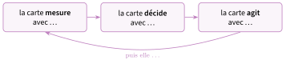

# Activités préparatoires

<p class="sous-titre">Informatique embarquée et objets connectés</p>

## <span class="etiquette">Activité 1</span> La carte qui réagit

*programmer une carte micro:bit sur simulateur*

<p class="infos-activite">Durée : 20 min · Par deux, sur ordinateur</p>

!!! consignes "Consignes"

    - Ouvrir `makecode.microbit.org` (gratuit, sans compte) et cliquer sur **Nouveau projet**. Si l’éditeur est en anglais : roue dentée (en haut à droite) $\to$ *Language* $\to$ *Français*.

    - On programme avec des **blocs** que l’on fait glisser depuis les catégories du menu de gauche (**Base**, **Entrée**, **Logique**…). La carte dessinée à gauche est un **simulateur** : on peut cliquer sur ses boutons.

    - Pas besoin de vraie carte. On répond aux questions sur le cahier.

### <span class="exo-num">Exercice 1</span> — Un bouton, une réponse <span class="ia ia-rouge" title="Sans IA : le but est l'automatisme lui-même"></span> { #ex-08-informatique-embarquee-et-objets-connect-act-1-1 }

1.  Dans **Entrée**, faire glisser le bloc lorsque le bouton A est pressé. Dans **Base**, prendre montrer l’icône et l’emboîter *à l’intérieur* du premier bloc ; choisir le cœur. Cliquer sur le bouton A du simulateur. Que se passe-t-il ?

    Et tant qu’on n’appuie sur rien ?

2.  Ajouter un deuxième bloc pour que le bouton B affiche une autre icône. Tester.

3.  Sur cette carte, quel élément permet à l’humain de **donner un ordre** ? Lequel permet à la carte de **répondre** ?

??? corrige "Corrigé"

    **1.** Un clic sur A affiche le **cœur** sur l’écran de LED. Tant qu’on n’appuie sur rien, la carte **attend** (rien ne s’affiche, ou l’icône reste affichée).

    **2.** Programme attendu (deux blocs indépendants) :

    ```text
    lorsque le bouton A est presse
        montrer l'icone  (coeur)
    lorsque le bouton B est presse
        montrer l'icone  (triste)
    ```

    **3.** L’humain donne un ordre avec les **boutons** (une *entrée*) ; la carte répond avec l’**écran de LED** (une *sortie*).

### <span class="exo-num">Exercice 2</span> — La carte mesure <span class="ia ia-rouge" title="Sans IA : le but est l'automatisme lui-même"></span> { #ex-08-informatique-embarquee-et-objets-connect-act-1-2 }

1.  Dans le bloc toujours (catégorie **Base**), placer montrer nombre, puis remplacer le $0$ par le bloc température (°C) (catégorie **Entrée**). Un thermomètre apparaît à côté du simulateur : faire glisser son curseur. Que montre la carte ?

2.  Sur une vraie carte, ce nombre n’est pas tapé par quelqu’un. D’où vient-il ?

3.  Déplacer montrer nombre dans au démarrage, à la place de toujours, puis bouger le curseur. Que change-t-il ? À quoi sert donc toujours ?

??? corrige "Corrigé"

    **4.** La carte fait défiler la **température** indiquée par le curseur ; le nombre change dès qu’on bouge le curseur.

    **5.** D’un **capteur de température** intégré à la carte : il mesure une grandeur physique et la transforme en nombre.

    **6.** Dans au démarrage, la température n’est lue et affichée **qu’une seule fois** : bouger le curseur ne change plus rien. toujours **répète sans fin** la mesure et l’affichage : c’est ce qui permet à la carte de suivre le monde réel.

### <span class="exo-num">Exercice 3</span> — La carte décide <span class="ia ia-rouge" title="Sans IA : le but est l'automatisme lui-même"></span> { #ex-08-informatique-embarquee-et-objets-connect-act-1-3 }

Votre mission : la carte doit surveiller une salle et afficher l’icône **non** (une croix) si la température **dépasse $25\,^\circ$C**, et l’icône **oui** (une coche) sinon. Aucun nouveau bloc ne vous est expliqué : cherchez dans les catégories.

1.  Dans quelle catégorie avez-vous trouvé le bloc qui permet de choisir entre deux actions ? Comment s’appelle-t-il ?

2.  Où avez-vous placé la comparaison avec $25$ ? Écrire la condition utilisée.

3.  Tester avec le curseur à $20\,^\circ$C puis à $30\,^\circ$C : qu’affiche la carte dans chaque cas ?

4.  Recopier sur le cahier et compléter le schéma de votre programme :

    { .tikz loading=lazy }

??? corrige "Corrigé"

    **7.** Dans la catégorie Logique : le bloc si … alors … sinon (on peut aussi prendre si … alors et ajouter le sinon avec le petit « + »).

    **8.** La comparaison (bloc 0 \< 0 de Logique, réglé sur « $>$ ») se place dans la case du si, avec température (°C) à gauche et $25$ à droite : *température $> 25$*. Programme attendu :

    ```text
    toujours
        si  temperature (degres C) > 25  alors
            montrer l'icone  (non)
        sinon
            montrer l'icone  (oui)
    ```

    *(Les accents sont omis dans ces listings. Équivalent affiché par l’onglet Python de MakeCode :)*

    ```python
    def on_forever():
        if input.temperature() > 25:
            basic.show_icon(IconNames.NO)
        else:
            basic.show_icon(IconNames.YES)
    basic.forever(on_forever)
    ```

    **9.** À $20\,^\circ$C : la condition est fausse $\to$ icône **oui** (coche). À $30\,^\circ$C : la condition est vraie $\to$ icône **non** (croix).

    **10.** La carte **mesure** avec le **capteur de température** ; elle **décide** avec le bloc **si … alors … sinon** (le programme) ; elle **agit** avec l’**écran de LED** ; puis elle **recommence** (bloc toujours).

    *Erreurs fréquentes* : bloc si placé dans au démarrage (une seule mesure) ; comparaison inversée ($<$ au lieu de $>$) ; icônes inversées. Faire tester les deux valeurs du curseur, de part et d’autre de $25$, suffit à les repérer.

### <span class="exo-num">Exercice 4</span> — Ce qu’on a découvert <span class="ia ia-rouge" title="Sans IA : le but est l'automatisme lui-même"></span> { #ex-08-informatique-embarquee-et-objets-connect-act-1-4 }

1.  Recopier sur le cahier et compléter, en choisissant parmi ces mots : *actionneur*, *capteur*, *programme*, *sans fin*, *communiquer*.

    - La partie de la carte qui **mesure** le monde réel s’appelle un …

    - La partie qui **agit** sur le monde réel (ici, qui s’allume) s’appelle un …

    - Entre les deux, le … décide, et il recommence …

    - Les boutons et l’écran de LED permettent à l’humain et à la machine de …

2.  La carte micro:bit est un petit ordinateur. Citer une différence avec l’ordinateur de la salle.

??? corrige "Corrigé"

    **11.**

    - La partie qui mesure le monde réel s’appelle un **capteur**.

    - La partie qui agit sur le monde réel s’appelle un **actionneur**.

    - Entre les deux, le **programme** décide, et il recommence **sans fin** (en boucle).

    - Les boutons et l’écran permettent à l’humain et à la machine de **communiquer** (de dialoguer) : le cours appellera cela l’**interface homme-machine**.

    **12.** Par exemple : la carte ne fait qu’**une tâche** à la fois (celle qu’on lui a programmée) ; elle n’a ni clavier ni vrai écran ; elle est minuscule et consomme très peu ; elle réagit tout de suite à ce qu’elle mesure.
