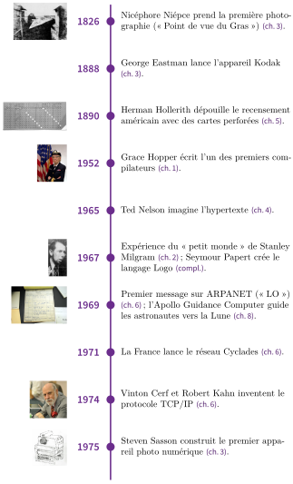
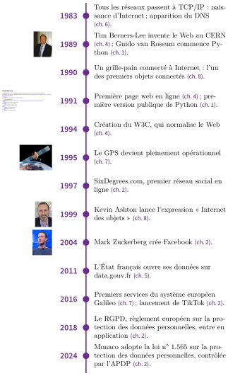

# Méthode : débattre

Chacun des sept thèmes se termine par une **fiche débat** : une question de société, deux camps (POUR et CONTRE) et quatre documents. Cette page donne la méthode, commune à tous les débats. Les rôles sont **tirés au sort** : vous défendrez peut-être une position qui n’est pas la vôtre, c’est un excellent entraînement. La préparation se fait avec les documents de la fiche et le cours,  sans IA ni recherche en ligne.

#### 1. Les rôles

| **Rôle** | **Votre tâche (préparation de 15 min, puis débat)** |
|:---|:---|
| Groupe POUR ($\approx$ 1/3) | Défendre la réponse **oui** : préparer au moins trois arguments, chacun appuyé sur un document ou le cours ; prévoir la réponse à deux arguments adverses ; choisir qui ouvre et qui conclut. |
| Groupe CONTRE ($\approx$ 1/3) | Défendre la réponse **non** : même travail que le groupe POUR. |
| Modérateur (1 ou 2) | Préparer deux questions de relance ; lire la question et les règles ; donner la parole en alternant les camps, tenir le temps, ramener à la question et aux documents. Ne **pas** donner son avis. |
| Secrétaire (1 ou 2) | Noter au tableau, en deux colonnes POUR / CONTRE, chaque argument et le numéro du document cité ; un argument sans appui est noté avec un point d’interrogation. |
| Observateurs (les autres) | Suivre deux ou trois élèves (citent-ils un document ? répondent-ils à l’argument précédent ?) ; noter le meilleur argument de chaque camp et le présenter au bilan. |

#### 2. Le déroulé minuté (50 min)

| **Min.** | **Étape** | **Min.** | **Étape** |
|---:|:---|---:|:---|
| 0–3 | **Mise en place** : tirage des rôles, groupes face à face. | 26–38 | **Échanges** : 12 min, parole alternée entre les camps. |
| 3–18 | **Préparation** en groupes, tableau d’arguments de la fiche. | 38–42 | **Observateurs** : meilleur argument de chaque camp. |
| 18–20 | **Ouverture** : le modérateur lit la question et les règles. | 42–44 | **Conclusions** : 1 min par groupe. |
| 20–26 | **Prises de position** : 3 min POUR, puis 3 min CONTRE. | 44–50 | **Bilan** : trace écrite individuelle, puis vote. |

#### 3. Les règles de prise de parole

- Lever la main et attendre que le modérateur vous donne la parole ; une seule personne à la fois, une minute au plus.

- **Argumenter** (« je pense que… **parce que**… ») et **citer** un document ou le cours (« d’après le document 2… »).

- **Répondre à l’argument précédent** avant d’en avancer un nouveau : « vous dites que…, mais… ».

- **Respecter** les autres : critiquer une idée, jamais une personne ; pas de moquerie ; ne pas raconter la vie privée de quelqu’un.

#### 4. Construire un argument

| **Ingrédient** | **Ce que vous dites** | **Pour commencer la phrase** |
|:---|:---|:---|
| Affirmation | Ce que vous défendez, en une phrase claire. | « Je pense que… » |
| Appui | Un document de la fiche (et son numéro) ou une notion du cours. | « … d’après le document 3, … » |
| Exemple | Un cas concret qui rend l’idée visible. | « Par exemple, … » |

Un avis sans appui n’est qu’une opinion, pas un argument. *Exemple (question imaginée : faut-il commencer les cours à 9 h ?)* : « Je pense qu’il faut commencer plus tard (affirmation), parce que, d’après le document 2, les adolescents s’endorment plus tard que les adultes (appui). Par exemple, un élève qui se couche à 23 h et se lève à 6 h ne dort que 7 h (exemple). »

#### 5. Répondre à l’argument adverse

1.  **Reformuler** l’argument, pour montrer que vous avez écouté : « Vous dites que… »

2.  **Répondre** : vérifier l’appui (le document dit-il vraiment cela ? concerne-t-il le même pays, la même époque ?), nuancer (« c’est vrai, mais… »), ou opposer un autre document ou un contre-exemple.

3.  **Relancer** avec l’un de vos arguments.

#### 6. La trace écrite individuelle

- **Avant le débat** : noter sur le cahier votre position de départ (oui, non ou je ne sais pas).

- **Pendant le débat** : compléter le tableau d’arguments de la fiche (argument et numéro du document).

- **Après le débat** : noter votre position (oui, non, je ne sais toujours pas) et si vous avez changé d’avis ; la justifier en trois à cinq lignes avec vos **deux meilleurs arguments**, dont **un de l’autre camp** que vous trouvez solide (avec son document).

Frise chronologique — de la photographie à Internet

{ .tikz loading=lazy }

Frise chronologique — du Web aux objets connectés

{ .tikz loading=lazy } mainmattertrue
