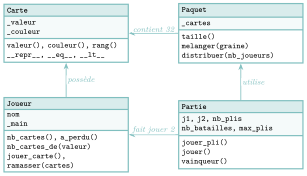
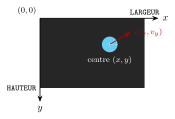
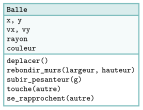

# TP et projets

<p class="sous-titre">Programmation orientée objet et paradigmes</p>

## <span class="etiquette">Projet</span> La Bataille, en objets

*quatre classes qui jouent ensemble*

<p class="infos-activite">Durée : 3 h environ (deux séances) · Sur machine, seul ou par deux</p>

!!! fichiers "Fichiers à télécharger"

    [:material-folder-open: dossier en ligne](https://github.com/MathThibaud/nsi-fichiers-eleves/tree/main/terminale/02-projet-poo){ .md-button } [:material-zip-box: archive .zip](https://github.com/MathThibaud/nsi-fichiers-eleves/raw/main/zips/terminale-02-projet-poo.zip){ .md-button }

!!! encadre "But du projet"

    Programmer **de bout en bout** le jeu de cartes de la Bataille, puis le faire jouer **mille fois** pour répondre à de vraies questions : combien de temps dure une partie ? Avoir des As aide-t-il à gagner ? Une partie peut-elle ne jamais finir ? Le programme repose sur **quatre classes** qui interagissent, avec des attributs **encapsulés**, des **méthodes spéciales** et des **tests** ; les statistiques s’écrivent dans le style **fonctionnel**. <span class="run" title="À programmer et tester sur machine">▶</span>  signale ce qui est à programmer et tester.

!!! consignes "Consignes"

    - L’extension est facultative.

    - Le fichier `projet_poo_depart.py` est **à télécharger** (lien ci-dessus) : squelette des classes et, en fin de fichier, des **tests**. Relancer le fichier après chaque partie : chaque ligne `[A FAIRE]` doit devenir `[OK]`. On ne modifie pas les tests.

    - Tous les attributs dont le nom commence par `_` sont **privés** : en dehors de leur classe, on n’y accède **que** par des méthodes.

    - Usage de l’IA, indiqué sur chaque exercice : <span class="ia ia-rouge" title="Sans IA : le but est l'automatisme lui-même"></span> aucune ; <span class="ia ia-orange" title="IA en appui : déboguer, reformuler, vérifier ; la réponse finale est la vôtre"></span> en appui (déboguer, reformuler, vérifier ; la réponse finale est écrite et comprise par vous) ; <span class="ia ia-vert" title="IA intégrée : l'exercice s'appuie sur une réponse d'IA"></span> l’exercice s’appuie sur une réponse d’IA. Voir la [charte d’usage de l’IA](../charte.md).

!!! encadre "Les règles (version 32 cartes)"

    On utilise un jeu de 32 cartes : huit valeurs (`7`, `8`, `9`, `10`, `Valet`, `Dame`, `Roi`, `As`, de la plus faible à la plus forte) dans quatre couleurs (`pique`, `coeur`, `carreau`, `trefle`). La couleur ne compte pas pour comparer deux cartes.

    - Le paquet est mélangé puis distribué entièrement, une carte à chacun à tour de rôle : 16 cartes par joueur, en tas, faces cachées.

    - À chaque **pli**, chaque joueur retourne la carte du dessus de son tas et la pose sur le **tapis**. La plus forte l’emporte : son propriétaire ramasse **tout le tapis** et le place **sous** son tas, dans l’ordre où les cartes ont été posées (à chaque tour, la carte du premier joueur avant celle du second, cartes cachées comprises).

    - En cas d’égalité, c’est la **bataille** : chacun pose une carte **face cachée**, puis on rejoue (une carte face visible chacun), et ainsi de suite jusqu’à départager. Le gagnant ramasse tout le tapis.

    - Un joueur qui n’a plus de cartes a perdu, y compris au milieu d’une bataille (l’autre ramasse alors le tapis).

## L’architecture du programme

Avant d’écrire la moindre ligne, on fixe les classes, ce qu’elles savent (attributs) et ce qu’elles savent faire (méthodes).

{ .tikz loading=lazy }

### <span class="stars" title="Niveau 1 sur 3">★</span> <span class="exo-num">Exercice 1</span> — Lire l’architecture <span class="ia ia-orange" title="IA en appui : déboguer, reformuler, vérifier ; la réponse finale est la vôtre"></span> { #ex-02-programmation-orientee-objet-et-paradigm-tp-1-1 }

1.  Quelles classes créent, dans leur constructeur, des objets d’une autre classe ? Lesquels ?

2.  Pourquoi `nom` n’est-il pas privé, alors que `_main` l’est ? Donner un exemple de triche (une action contraire aux règles du jeu) que l’encapsulation de `_main` rend plus difficile.

3.  Ada a pour tas `Dame de coeur, 9 de pique, Roi de trefle, 7 de coeur` (carte du dessus en premier) et Alan `8 de trefle, 9 de coeur, As de pique, 10 de carreau` ; Ada est le premier joueur. Jouer la partie **à la main** : écrire les deux tas après chaque pli. Qui gagne, et en combien de plis ?

## La classe `Carte`

### <span class="stars" title="Niveau 1 sur 3">★</span> <span class="exo-num">Exercice 2</span> — Une carte qui se présente <span class="ia ia-orange" title="IA en appui : déboguer, reformuler, vérifier ; la réponse finale est la vôtre"></span> { #ex-02-programmation-orientee-objet-et-paradigm-tp-1-2 }

<span class="routine">▷ Avant de coder.</span> Écrire trois appels attendus sous forme d’`assert` : un cas **normal**, un cas **limite**, un cas **piège**.

<span class="run" title="À programmer et tester sur machine">▶</span> Dans `projet_poo_depart.py`, compléter la classe `Carte` (les listes `VALEURS`, de la plus faible à la plus forte, et `COULEURS` sont déjà définies en haut du fichier). Il faut écrire :

- le constructeur, qui lève `ValueError("carte inconnue")` avec `raise` si la valeur n’est pas dans `VALEURS` ou la couleur pas dans `COULEURS` (voir le cours, « Signaler une erreur ») ;

- les accesseurs `valeur()` et `couleur()` ;

- la méthode `rang()`, qui renvoie la position de la valeur dans `VALEURS` : $0$ pour un `7`, $7$ pour un `As` ;

- `__repr__`, qui renvoie le texte affiché quand on tape le nom de l’objet.

On doit obtenir :

```text
>>> c = Carte("Roi", "coeur")
>>> c
Roi de coeur
>>> c.rang()
6
```

Pourquoi vaut-il mieux vérifier la valeur **dès le constructeur**, plutôt qu’au moment de comparer deux cartes ?

### <span class="stars" title="Niveau 2 sur 3">★★</span> <span class="exo-num">Exercice 3</span> — Comparer et trier des cartes <span class="horsprog">au-delà du programme</span> <span class="ia ia-orange" title="IA en appui : déboguer, reformuler, vérifier ; la réponse finale est la vôtre"></span> { #ex-02-programmation-orientee-objet-et-paradigm-tp-1-3 }

Le cours a signalé qu’il existe d’autres méthodes spéciales, qui permettent d’utiliser `==` ou `<` sur nos propres objets. Écrire `a == b` déclenche l’appel `a.__eq__(b)` ; écrire `a < b` déclenche `a.__lt__(b)` (*lt* pour *less than*).

1.  <span class="run" title="À programmer et tester sur machine">▶</span> Avant d’écrire ces méthodes, taper les deux instructions suivantes. Noter ce que Python répond à chacune (une valeur, ou une erreur). Que compare `==` par défaut ?

    ```text
    >>> Carte("Roi", "coeur") == Carte("Roi", "coeur")
    >>> sorted([Carte("Roi", "coeur"), Carte("7", "pique")])
    ```

2.  <span class="run" title="À programmer et tester sur machine">▶</span> Écrire `__eq__(self, autre)` et `__lt__(self, autre)`, qui renvoient un booléen en comparant les **rangs** des deux cartes (la couleur ne compte pas). Vérifier que le tri donne bien les cartes de la plus faible à la plus forte :

    ```text
    >>> main = [Carte("Roi", "coeur"), Carte("7", "pique"),
    ...         Carte("As", "pique"), Carte("9", "coeur")]
    >>> sorted(main)
    [7 de pique, 9 de coeur, Roi de coeur, As de pique]
    ```

3.  Avec ces définitions, `Carte("Roi", "coeur") == Carte("Roi", "trefle")` vaut `True`. Est-ce gênant pour la Bataille ? Dans quel autre jeu (ou quelle autre situation) cette définition de l’égalité poserait-elle problème ?

## Les classes `Paquet` et `Joueur`

### <span class="stars" title="Niveau 2 sur 3">★★</span> <span class="exo-num">Exercice 4</span> — Le paquet <span class="ia ia-orange" title="IA en appui : déboguer, reformuler, vérifier ; la réponse finale est la vôtre"></span> { #ex-02-programmation-orientee-objet-et-paradigm-tp-1-4 }

1.  <span class="run" title="À programmer et tester sur machine">▶</span> Écrire le constructeur : il fabrique les 32 cartes (une par couple valeur/couleur) dans l’attribut privé `_cartes`, une liste de `Carte`, avec deux boucles `for` imbriquées : la boucle **extérieure** sur les couleurs (`COULEURS`), la boucle **intérieure** sur les valeurs (`VALEURS`). Cet ordre est imposé : les tests avec graine en dépendent. *Pour les plus à l’aise :* le réécrire ensuite en **une ligne**, avec une liste en compréhension à deux boucles `for`.

2.  <span class="run" title="À programmer et tester sur machine">▶</span> Écrire `taille()`, puis la méthode `melanger(graine=None)` (paramètre par défaut : voir le chapitre *Récursivité*). Si une graine est donnée, elle appelle d’abord `random.seed(graine)` ; dans tous les cas, elle mélange ensuite les cartes avec la fonction `random.shuffle`. (Le module `random` est déjà importé.) À quoi sert la graine quand on veut tester le programme ?

3.  <span class="run" title="À programmer et tester sur machine">▶</span> Écrire `distribuer(nb_joueurs)` : la carte d’indice `i` va au joueur `i % nb_joueurs` ; le paquet est vide ensuite, et la méthode renvoie la liste des mains (une liste de cartes par joueur). Pour deux joueurs, la carte $0$ va au joueur $0$, la carte $1$ au joueur $1$, la carte $2$ au joueur $0$, etc.

### <span class="stars" title="Niveau 2 sur 3">★★</span> <span class="exo-num">Exercice 5</span> — Le joueur <span class="ia ia-orange" title="IA en appui : déboguer, reformuler, vérifier ; la réponse finale est la vôtre"></span> { #ex-02-programmation-orientee-objet-et-paradigm-tp-1-5 }

La main est une liste de cartes dont la carte **du dessus** est au **début**.

1.  <span class="run" title="À programmer et tester sur machine">▶</span> Écrire le constructeur, `nb_cartes()`, `a_perdu()`, `jouer_carte()` (retire et renvoie la carte du dessus) et `ramasser(cartes)` (ajoute les cartes reçues, dans l’ordre, **à la fin** de la main, c’est-à-dire sous le tas). Le constructeur reçoit le nom et la liste des cartes de départ.

2.  Le test « Partie 3 : Joueur » du fichier `projet_poo_depart.py` ajoute une carte à la liste `cartes` **après** avoir créé le joueur, et vérifie que la main d’Ada n’a pas changé. Parmi les deux écritures suivantes, laquelle faut-il donc mettre dans le constructeur : `self._main = cartes`, ou bien `self._main = [c for c in cartes]` ? Expliquer ce qui différencie les deux.

3.  <span class="run" title="À programmer et tester sur machine">▶</span> Écrire `nb_cartes_de(valeur)` en **une ligne**, avec une **liste en compréhension** : on garde les cartes de `self._main` dont la valeur est celle cherchée, et on compte le résultat avec `len(...)`. Pourquoi cette méthode est-elle nécessaire pour compter les As d’un joueur depuis l’extérieur de la classe ?

    ??? pouce "Coup de pouce"

        `[c for c in self._main if ...]` garde les cartes `c` de la main qui vérifient la condition ; la condition compare `c.valeur()` à la valeur cherchée.

## La classe `Partie` : faire jouer les objets ensemble

### <span class="stars" title="Niveau 3 sur 3">★★★</span> <span class="exo-num">Exercice 6</span> — Un pli, avec ses batailles <span class="ia ia-orange" title="IA en appui : déboguer, reformuler, vérifier ; la réponse finale est la vôtre"></span> { #ex-02-programmation-orientee-objet-et-paradigm-tp-1-6 }

Le constructeur de `Partie` est fourni : il crée un paquet, le mélange, le distribue et crée les deux joueurs `j1` et `j2`.

<span class="run" title="À programmer et tester sur machine">▶</span> Écrire `jouer_pli()` qui joue un pli complet et **renvoie le joueur** qui ramasse le tapis. Une liste locale `tapis`, vide au départ, accumule toutes les cartes posées pendant le pli (visibles ou cachées). On répète les étapes suivantes tant que le pli n’est pas terminé :

1.  si l’un des joueurs n’a plus de cartes (`a_perdu()`), l’autre est le gagnant du pli : c’est fini ;

2.  sinon, chaque joueur pose sa carte du dessus (`jouer_carte()`) : on les ajoute au tapis. Si l’une est strictement plus forte, son propriétaire est le gagnant du pli : c’est fini ;

3.  sinon (égalité), on compte une bataille de plus (`nb_batailles`) et, si les deux joueurs ont encore des cartes, chacun en pose une de plus, **face cachée** : on l’ajoute simplement au tapis sans la comparer. On revient alors à l’étape a) (la carte face visible suivante sera comparée à l’étape b)).

??? pouce "Coup de pouce"

    Une variable `gagnant`, qui vaut `None` tant que le pli n’est pas joué, et une boucle `while gagnant is None` ; après la boucle, `gagnant` ramasse le tapis (`ramasser`) et la méthode le renvoie. Les comparaisons s’écrivent `c2 < c1` et `c1 < c2` grâce à `__lt__`. Les cartes posées s’ajoutent au tapis dans l’ordre : carte de `j1`, puis carte de `j2`.

### <span class="stars" title="Niveau 2 sur 3">★★</span> <span class="exo-num">Exercice 7</span> — Une partie entière, et un invariant <span class="ia ia-orange" title="IA en appui : déboguer, reformuler, vérifier ; la réponse finale est la vôtre"></span> { #ex-02-programmation-orientee-objet-et-paradigm-tp-1-7 }

1.  <span class="run" title="À programmer et tester sur machine">▶</span> Écrire `jouer()` : tant qu’aucun des deux joueurs n’a perdu **et** que `nb_plis` est inférieur à `max_plis`, jouer un pli (`jouer_pli()`) et augmenter `nb_plis` de 1. À la fin, renvoyer `self.vainqueur()` (méthode fournie : le nom du vainqueur, ou `None` si la limite a été atteinte). `max_plis` évite de boucler indéfiniment si la partie ne finit jamais.

2.  <span class="run" title="À programmer et tester sur machine">▶</span> On vérifie maintenant votre trace à la main (question 3 de l’exercice 1) avec le programme. Une `Partie` distribue au hasard, mais ici on veut des tas **imposés**. On procède donc ainsi :

    1.  créer une partie quelconque : `p = Partie("Ada", "Alan")` ;

    2.  remplacer ses deux joueurs par ceux de l’exercice 1, en affectant les attributs `p.j1` et `p.j2` :

        ```text
        p.j1 = Joueur("Ada", [...])
        p.j2 = Joueur("Alan", [...])
        ```

        où chaque liste contient les cartes du tas, **la carte du dessus en premier** (par exemple `Carte("Dame", "coeur")`) ;

    3.  lancer `p.jouer()` puis afficher le vainqueur, `p.nb_plis` et `p.nb_batailles`.

    Le programme annonce-t-il le même vainqueur et le même nombre de plis que votre trace ? Sinon, qui a tort : la trace ou le programme ?

3.  Le test « Partie 4 : jouer » du fichier vérifie qu’en fin de partie les deux joueurs ont **32 cartes au total**. Pourquoi cette propriété (un **invariant**, c’est-à-dire une propriété qui reste vraie tout au long du programme) doit-elle être vraie à la fin de chaque pli ? Donner une erreur de programmation dans `jouer_pli` qui la ferait échouer.

4.  <span class="run" title="À programmer et tester sur machine">▶</span> Cette fois on joue une partie « pour de vrai » : `Partie("Ada", "Alan", 2026)` mélange le paquet de façon **reproductible** (la graine `2026` fixe le mélange : tout le monde obtient la même distribution) et distribue 16 cartes à chacun. Créer cette partie, la jouer avec `jouer()` et indiquer le vainqueur et le nombre de plis (`nb_plis`). Le test « Partie 4 : jouer » attend `"Alan"` et 106 plis.

## Mille parties : des statistiques en style fonctionnel

On veut maintenant **observer** le jeu. Dans cette partie, on filtre et on transforme la liste des résultats avec des **listes en compréhension**, comme en Première. Certaines questions ne se répondent pas avec une compréhension seule : pour une **moyenne** ou la recherche d’un **minimum**, on écrit un parcours avec une variable qui accumule ou retient le meilleur résultat ; pour **classer** les parties selon un critère (`sorted`), on introduira une fonction `lambda`, en la construisant pas à pas.

### <span class="stars" title="Niveau 2 sur 3">★★</span> <span class="exo-num">Exercice 8</span> — Résumer une partie <span class="ia ia-orange" title="IA en appui : déboguer, reformuler, vérifier ; la réponse finale est la vôtre"></span> { #ex-02-programmation-orientee-objet-et-paradigm-tp-1-8 }

Pour observer le jeu, il faut d’abord pouvoir jouer *une* partie et en garder les faits marquants. On écrit pour cela la fonction `resume(graine, tapis_melange=False)` (le second paramètre ne sert que dans l’extension : on le transmet simplement à `Partie`).

1.  <span class="run" title="À programmer et tester sur machine">▶</span> Dans `resume`, créer la partie `Partie("Ada", "Alan", graine, tapis_melange=tapis_melange)`, relever le nombre d’As du joueur `j1` (Ada) **avant** de jouer, avec `nb_cartes_de("As")`, puis jouer la partie avec `jouer()`.

2.  <span class="run" title="À programmer et tester sur machine">▶</span> La fonction renvoie un **dictionnaire** aux cinq clés `"graine"` (la graine reçue), `"vainqueur"` (ce que renvoie `jouer()` : un nom, ou `None` si `max_plis` est atteint), `"plis"` (`nb_plis`), `"batailles"` (`nb_batailles`) et `"as_ada"`. Pour la graine 2026, on doit obtenir :

    ```text
    >>> resume(2026)
    {'graine': 2026, 'vainqueur': 'Alan', 'plis': 106, 'batailles': 8, 'as_ada': 1}
    ```

3.  Pourquoi faut-il relever le nombre d’As **avant** d’appeler `jouer()` ? Que vaudrait-il après ?

4.  `resume` est-elle une fonction **pure** ? Que deviendrait la réponse si l’on supprimait le paramètre `graine` ?

### <span class="stars" title="Niveau 2 sur 3">★★</span> <span class="exo-num">Exercice 9</span> — Interroger les mille parties <span class="ia ia-orange" title="IA en appui : déboguer, reformuler, vérifier ; la réponse finale est la vôtre"></span> { #ex-02-programmation-orientee-objet-et-paradigm-tp-1-9 }

On joue mille parties (graines 0 à 999) et on garde leurs résumés : `res = [resume(g) for g in range(1000)]`. `res` est une liste de 1000 dictionnaires, comme celui de l’exercice précédent. Une partie est **finie** si elle a un vainqueur ; sinon elle a atteint `max_plis`.

1.  <span class="run" title="À programmer et tester sur machine">▶</span> Avec une liste en compréhension, construire la liste `finies` des parties qui ont un vainqueur (ne garder que les dictionnaires `r` tels que `r["vainqueur"]` n’est pas `None`). Combien y en a-t-il ? Avec une seconde compréhension sur `finies`, construire la liste `gagnees_ada` des parties dont le vainqueur est `"Ada"` : combien Ada en gagne-t-elle, et quel pourcentage des parties finies cela représente-t-il ?

2.  <span class="run" title="À programmer et tester sur machine">▶</span> Avec une liste en compréhension, extraire de `finies` la liste des nombres de plis, puis en calculer la **durée moyenne** (écrire une fonction `moyenne(tab)` qui additionne les valeurs dans un accumulateur, puis divise par `len(tab)`).

3.  On veut maintenant les graines des **trois** parties finies les plus longues, et celle de la plus courte.

    1.  Les trois plus longues. Ici, une compréhension ne suffit plus : on ne filtre ni ne transforme `finies`, on le **classe** selon le nombre de plis de chaque partie. `sorted` accepte pour cela un paramètre `key` : une fonction qui, à partir d’un résumé `r`, renvoie la valeur à comparer. Cette fonction s’écrit avec un `lambda` : `lambda r: r["plis"]` se lit « la fonction qui, à `r`, associe `r["plis"]` » ; c’est l’équivalent, pour un usage unique, de `def cle(r): return r["plis"]`. <span class="run" title="À programmer et tester sur machine">▶</span> Afficher, sous la forme (graine, nombre de plis), les trois parties les plus longues avec `sorted(finies, key=..., reverse=True)[:3]`.

    2.  La plus courte. <span class="run" title="À programmer et tester sur machine">▶</span> Parcourir `finies` en retenant le résumé qui a le moins de plis (recherche du minimum, comme en Première), puis afficher sa graine et son nombre de plis.

4.  <span class="run" title="À programmer et tester sur machine">▶</span> Recopier et compléter le tableau suivant : pour chaque nombre $k$ d’As d’Ada au départ (clé `"as_ada"`), le nombre de parties finies avec ce $k$ et le pourcentage d’entre elles gagnées par Ada (arrondi à l’unité à l’affichage, avec une f-string : `f"{p:.0f}"`). Pour chaque $k$, on construit par compréhension le groupe des parties finies correspondantes, puis le sous-groupe gagné par Ada. Conclure : avoir des As aide-t-il ? Peut-on se fier aux pourcentages de tous les groupes ?

    | **As d’Ada au départ**  |  0  |  1  |  2  |  3  |  4  |
    |:------------------------|:---:|:---:|:---:|:---:|:---:|
    | **Parties finies**      |     |     |     |     |     |
    | **Victoires d’Ada (%)** |     |     |     |     |     |

## Extension : des parties qui ne finissent jamais ?

### <span class="stars" title="Niveau 3 sur 3">★★★</span> <span class="exo-num">Exercice 10</span> — Casser les cycles <span class="ia ia-orange" title="IA en appui : déboguer, reformuler, vérifier ; la réponse finale est la vôtre"></span> { #ex-02-programmation-orientee-objet-et-paradigm-tp-1-10 }

1.  Plus d’un tiers des parties atteignent `max_plis = 2000` sans vainqueur. En augmentant `max_plis` à $20\,000$ pour quelques-unes, vérifier qu’elles ne finissent toujours pas. Proposer une explication : le programme est **déterministe** ; que se passe-t-il s’il retrouve exactement la même situation (mêmes tas) qu’à un pli précédent ?

2.  <span class="run" title="À programmer et tester sur machine">▶</span> Dans une vraie partie, les cartes ramassées ne sont pas reposées dans un ordre fixe. Ajouter à `Partie` une méthode privée `_donner(gagnant, tapis)` qui mélange le tapis si l’attribut `tapis_melange` vaut `True`, puis le fait ramasser ; l’utiliser à chaque ramassage dans `jouer_pli`.

3.  <span class="run" title="À programmer et tester sur machine">▶</span> Refaire les statistiques avec `tapis_melange=True` : nombre de parties finies, durée moyenne, partie la plus longue, victoires d’Ada. Les tests des parties 1 à 5 passent-ils toujours ? Pourquoi est-ce important ?

4.  *(Libre.)* Autres pistes : une partie à trois joueurs ; un affichage pli par pli ; une variante où le gagnant d’une bataille choisit l’ordre du ramassage.

## Bilan à rédiger

### <span class="exo-num">Exercice 11</span> — Ce que j’ai construit <span class="ia ia-orange" title="IA en appui : déboguer, reformuler, vérifier ; la réponse finale est la vôtre"></span> { #ex-02-programmation-orientee-objet-et-paradigm-tp-1-11 }

Rédiger, en une dizaine de lignes, un bilan qui répond aux questions suivantes.

1.  Pour chacune des quatre classes, en une phrase : ce qu’elle représente et la méthode qui vous paraît la plus importante.

2.  Citer un endroit du projet où l’**encapsulation** a imposé d’écrire une méthode plutôt que d’accéder directement à un attribut. Qu’y a-t-on gagné ?

3.  Le projet mêle trois paradigmes. Citer pour chacun (impératif, objet, fonctionnel) un passage de votre code qui l’illustre, et dire pourquoi il convenait à cet endroit.

## <span class="etiquette">TP</span> Balles rebondissantes

*la POO à la rescousse*

<p class="infos-activite">Durée : 2 h 30 environ (deux séances) · Sur machine, par deux</p>

D’après une idée de Gilles Lassus (<https://glassus.github.io/terminale_nsi/>, chapitre « Programmation orientée objet »).

!!! fichiers "Fichiers à télécharger"

    [:material-folder-open: dossier en ligne](https://github.com/MathThibaud/nsi-fichiers-eleves/tree/main/terminale/02-tp-balles){ .md-button } [:material-zip-box: archive .zip](https://github.com/MathThibaud/nsi-fichiers-eleves/raw/main/zips/terminale-02-tp-balles.zip){ .md-button }

!!! encadre "But du TP"

    Faire rebondir des balles dans une fenêtre : une, puis deux, puis trois… puis vingt. Sans objet, chaque balle ajoute une poignée de variables et un bloc de code recopié : on va **ressentir** cette gêne avant de la faire disparaître avec une **classe** `Balle`, qui réunit les données d’une balle et ce qu’elle sait faire. On réinvestit tout le début du chapitre : classe, instance, attributs, constructeur, méthodes, `self`. <span class="run" title="À programmer et tester sur machine">▶</span>  signale ce qui est à programmer et tester.

!!! consignes "Consignes"

    - Défi compris. Le TP est **évalué** : code rendu par le binôme, puis entretien individuel de 5 minutes (partie VI).

    - Le fichier `tp_balles_depart.py` est **à télécharger** (lien ci-dessus) : la fenêtre, le dessin des disques, les boucles d’animation, les squelettes des fonctions et méthodes à écrire et, en fin de fichier, des **tests**. La constante `ANIMATION`, en haut du fichier, choisit l’animation lancée après les tests ($0$ : tests seuls). Relancer le fichier après chaque exercice : chaque ligne `[A FAIRE]` doit devenir `[OK]`. On ne modifie pas les tests.

    - L’affichage utilise **tkinter**, livré avec Python : rien à installer.

    - Usage de l’IA, indiqué sur chaque exercice : <span class="ia ia-rouge" title="Sans IA : le but est l'automatisme lui-même"></span> aucune ; <span class="ia ia-orange" title="IA en appui : déboguer, reformuler, vérifier ; la réponse finale est la vôtre"></span> en appui (déboguer, reformuler, vérifier ; la réponse finale est écrite et comprise par vous) ; <span class="ia ia-vert" title="IA intégrée : l'exercice s'appuie sur une réponse d'IA"></span> l’exercice s’appuie sur une réponse d’IA. Voir la [charte d’usage de l’IA](../charte.md).

!!! encadre "Lancer une fenêtre tkinter depuis Spyder"

    - **Une seule fois** : menu *Exécuter* $\to$ *Configuration par fichier* (`Ctrl+F6`), cocher « Exécuter dans une nouvelle console dédiée » et « Supprimer toutes les variables avant l’exécution », valider. Ensuite, `F5` comme d’habitude.

    - La fenêtre s’ouvre parfois **derrière** Spyder : la chercher dans la barre des tâches.

    - Tant que la fenêtre est ouverte, la console est occupée : **fermer la fenêtre** pour reprendre la main. Si la console ne répond plus : *Redémarrer le noyau* (`Ctrl+.`).

## Une balle, sans objet

!!! encadre "Le repère de la fenêtre et l’animation"

    { .tikz loading=lazy }

    L’origine est en **haut à gauche** et l’axe des $y$ est dirigé **vers le bas** : $v_y > 0$, la balle descend. À chaque image, la balle avance de sa vitesse : $x$ augmente de $v_x$, $y$ de $v_y$ (en pixels).

    Pour animer, on n’écrit **pas** de boucle `while True` : tant qu’elle tourne, tkinter ne peut ni redessiner la fenêtre ni la fermer, et tout se fige. On demande plutôt à tkinter : « dans `DELAI` millisecondes, appelle `animer1` avec ces valeurs ». C’est `fenetre.after(DELAI, animer1, …)`. Comme `animer1` se termine par cette même demande, elle est rappelée sans fin, et tkinter garde la main entre deux images. `fenetre.mainloop()` lui donne la main jusqu’à la fermeture de la fenêtre.

### <span class="stars" title="Niveau 1 sur 3">★</span> <span class="exo-num">Exercice 1</span> — Une balle qui rebondit <span class="ia ia-orange" title="IA en appui : déboguer, reformuler, vérifier ; la réponse finale est la vôtre"></span> { #ex-02-programmation-orientee-objet-et-paradigm-tp-2-1 }

1.  <span class="run" title="À programmer et tester sur machine">▶</span> Mettre `ANIMATION = 1` et lancer le fichier : la balle reste immobile. Lire `animer1` et expliquer pourquoi.

2.  <span class="run" title="À programmer et tester sur machine">▶</span> Compléter `animer1` pour que la balle avance de `(vx, vy)` à chaque image. Que se passe-t-il au bout de quelques secondes ?

3.  Le disque a pour rayon `RAYON`. Écrire la condition qui traduit « le disque touche le bord droit », puis celles des trois autres bords.

    ??? pouce "Coup de pouce"

        Le point le plus à droite du disque a pour abscisse `x + RAYON`. Le bord gauche est à l’abscisse $0$, le bord haut à l’ordonnée $0$, le bas à `HAUTEUR`.

4.  <span class="run" title="À programmer et tester sur machine">▶</span> Compléter `animer1` : quand le disque touche le bord gauche ou droit, `vx` change de signe ; le haut ou le bas, `vy` change de signe.

5.  <span class="run" title="À programmer et tester sur machine">▶</span> Essayer `DELAI = 5` puis `DELAI = 100`. Combien d’images par seconde dans chaque cas ? Revenir à `20`.

## Deux balles, puis trois

### <span class="stars" title="Niveau 1 sur 3">★</span> <span class="exo-num">Exercice 2</span> — Deux balles, par copier-coller <span class="ia ia-orange" title="IA en appui : déboguer, reformuler, vérifier ; la réponse finale est la vôtre"></span> { #ex-02-programmation-orientee-objet-et-paradigm-tp-2-2 }

1.  <span class="run" title="À programmer et tester sur machine">▶</span> Écrire une fonction `animer2` et compléter `lancer2` pour animer **deux** balles, en partant d’une copie de `animer1` et de `lancer1`. Les variables de la première balle s’appellent `x1`, `y1`, `vx1`, `vy1`, `disque1` ; la seconde (couleur `"gold"`) part de $(100, 300)$ avec la vitesse $(-3, 5)$. Tester avec `ANIMATION = 2`.

2.  Combien de paramètres la fonction `animer2` a-t-elle ? Combien de lignes de `animer1` ont été recopiées ?

3.  On veut maintenant une **troisième** balle, et des balles de rayons différents. Sans forcément l’écrire, lister tout ce qu’il faudrait ajouter ou modifier. Combien de variables faut-il pour décrire **une** balle (position, vitesse, rayon, couleur, numéro du disque) ? pour trois ? pour vingt ?

### <span class="stars" title="Niveau 2 sur 3">★★</span> <span class="exo-num">Exercice 3</span> — Le piège du copier-coller <span class="ia ia-rouge" title="Sans IA : le but est l'automatisme lui-même"></span> { #ex-02-programmation-orientee-objet-et-paradigm-tp-2-3 }

Un élève a écrit ses deux balles par copier-coller ; voici la partie qui gère les bords gauche et droit :

```python
    if x1 - RAYON <= 0 or x1 + RAYON >= LARGEUR:
        vx1 = -vx1
    if x2 - RAYON <= 0 or x2 + RAYON >= LARGEUR:
        vx1 = -vx1
```

1.  Repérer l’erreur. **Prédire**, sans rien lancer, ce que l’on verra à l’écran : que devient la balle 2 quand elle arrive sur un bord ? et la balle 1 **ensuite** ?

2.  <span class="run" title="À programmer et tester sur machine">▶</span> Introduire cette erreur dans votre `animer2`, vérifier la prédiction, puis la corriger.

3.  Python n’a signalé aucune erreur. Pourquoi ce genre de faute est-il fréquent quand on recopie du code, et difficile à repérer ?

4.  Les sept valeurs qui décrivent une balle sont dispersées dans sept variables, et le code qui la fait bouger est écrit à part, une fois par balle. Que faudrait-il pouvoir écrire pour dire, en une seule fois, « une balle » et « ce que fait une balle » ?

## La POO à la rescousse

!!! encadre "Une classe Balle"

    { .tikz loading=lazy }

    Une balle est **un objet** : ses six **attributs** (position, vitesse, rayon, couleur) voyagent ensemble, et ses **méthodes** disent ce qu’elle sait faire. Le code d’une méthode est écrit **une seule fois**, dans la classe ; il sert à toutes les **instances**. Dans l’appel `b.deplacer()`, le paramètre `self` de la méthode désigne l’objet `b`.

    La classe ne sait rien de la fenêtre : elle ne fait que des calculs, que l’on peut **tester** avec des `assert` sans rien afficher. L’affichage (fourni) se contente de lire `b.x`, `b.y`, `b.rayon` et `b.couleur`.

### <span class="stars" title="Niveau 1 sur 3">★</span> <span class="exo-num">Exercice 4</span> — La classe `Balle` <span class="ia ia-orange" title="IA en appui : déboguer, reformuler, vérifier ; la réponse finale est la vôtre"></span> { #ex-02-programmation-orientee-objet-et-paradigm-tp-2-4 }

1.  <span class="run" title="À programmer et tester sur machine">▶</span> Compléter le constructeur `__init__(self, x, y, vx, vy, rayon, couleur)`, qui crée les six attributs.

    ```text
    >>> b = Balle(100, 50, 3, -2, 10, "gold")
    >>> b.x, b.vy, b.couleur
    (100, -2, 'gold')
    ```

2.  Pendant l’exécution de `Balle(100, 50, 3, -2, 10, "gold")`, que désigne `self` ? Que vaut `self.x` à la fin du constructeur ?

### <span class="stars" title="Niveau 2 sur 3">★★</span> <span class="exo-num">Exercice 5</span> — Se déplacer et rebondir <span class="ia ia-orange" title="IA en appui : déboguer, reformuler, vérifier ; la réponse finale est la vôtre"></span> { #ex-02-programmation-orientee-objet-et-paradigm-tp-2-5 }

<span class="routine">▷ Avant de coder.</span> Écrire trois appels attendus sous forme d’`assert` : un cas **normal**, un cas **limite**, un cas **piège**.

1.  <span class="run" title="À programmer et tester sur machine">▶</span> Écrire la méthode `deplacer(self)` : la balle avance d’un pas (sa position augmente de sa vitesse).

2.  <span class="run" title="À programmer et tester sur machine">▶</span> Avant d’écrire `rebondir_murs`, écrire dans la fonction `mes_tests` trois `assert` sur cette méthode : un cas normal, un cas limite, un cas piège. Les tests en fin de fichier ne vérifient pas tout : les vôtres comptent.

3.  <span class="run" title="À programmer et tester sur machine">▶</span> Écrire la méthode `rebondir_murs(self, largeur, hauteur)` : si le disque touche le bord gauche ou droit de la zone **en allant vers ce bord**, `vx` change de signe ; de même pour `vy` avec le haut et le bas. La méthode ne déplace pas la balle.

    ??? pouce "Coup de pouce"

        « En allant vers le bord droit », c’est `self.vx > 0`. Une condition par bord, de la forme « le disque touche ce bord **et** la vitesse va vers lui », puis deux tests : l’un pour `vx` (bords gauche et droit, reliés par `or`), l’autre pour `vy`.

4.  Une balle de rayon $10$ a son centre à $598$ pixels du bord gauche d’une zone de largeur $600$, et repart déjà vers la gauche (`vx = -3`). Que ferait une version de `rebondir_murs` qui ne regarde **pas** le sens de la vitesse ? Quand une balle peut-elle se retrouver dans cette situation ?

### <span class="stars" title="Niveau 2 sur 3">★★</span> <span class="exo-num">Exercice 6</span> — Vingt balles sans effort <span class="ia ia-orange" title="IA en appui : déboguer, reformuler, vérifier ; la réponse finale est la vôtre"></span> { #ex-02-programmation-orientee-objet-et-paradigm-tp-2-6 }

1.  <span class="run" title="À programmer et tester sur machine">▶</span> Écrire la fonction `balle_au_hasard(largeur, hauteur)`, qui renvoie une `Balle` tirée au hasard : rayon entier entre $8$ et $25$, disque **entièrement** dans la zone, `vx` et `vy` pris dans la liste `VITESSES`, couleur prise dans `COULEURS`. On utilise `random.randint(a, b)`, qui renvoie un entier entre `a` et `b` compris, et `random.choice(liste)`, qui renvoie un élément de la liste au hasard.

    ??? pouce "Coup de pouce"

        Tirer le rayon en premier : le centre doit être à au moins un rayon de chaque bord, donc `x` est entre `rayon` et `largeur - rayon`.

2.  <span class="run" title="À programmer et tester sur machine">▶</span> Écrire `creer_balles(nb, largeur, hauteur)`, qui renvoie une liste de `nb` balles au hasard, construite **par compréhension**.

3.  <span class="run" title="À programmer et tester sur machine">▶</span> Lancer avec `ANIMATION = 3`, puis passer à $200$ balles. Combien de lignes a-t-il fallu modifier ? Comparer avec la partie II.

4.  Où sont passées les variables `x1`, `y1`, `vx1`… de la partie II ? Lire la fonction fournie `animer3` : combien de paramètres a-t-elle, quel que soit le nombre de balles ?

5.  Un élève écrit `return [balle_au_hasard(largeur, hauteur)] * nb`. Combien d’objets `Balle` ont été créés ? Qu’est-ce qui s’affichera à l’écran ?

### <span class="stars" title="Niveau 2 sur 3">★★</span> <span class="exo-num">Exercice 7</span> — Un comportement nouveau, pour toutes les balles <span class="ia ia-orange" title="IA en appui : déboguer, reformuler, vérifier ; la réponse finale est la vôtre"></span> { #ex-02-programmation-orientee-objet-et-paradigm-tp-2-7 }

1.  <span class="run" title="À programmer et tester sur machine">▶</span> Ajouter la méthode `subir_pesanteur(self, g)`, qui augmente `vy` de `g` (on rappelle que l’axe des $y$ descend). Dans `animer3`, l’appeler avec `PESANTEUR` juste avant `deplacer`, puis mettre `PESANTEUR = 0.3`.

2.  <span class="run" title="À programmer et tester sur machine">▶</span> Laisser tourner une bonne minute. Que deviennent les balles ? Expliquer ce qui se passe quand une balle n’a presque plus de vitesse au moment où elle touche le sol.

3.  <span class="run" title="À programmer et tester sur machine">▶</span> Corriger `rebondir_murs` : quand la balle rebondit sur un bord, la **replacer** contre ce bord (par exemple `self.y = hauteur - self.rayon` pour le sol). Relancer les tests et l’animation.

4.  Combien de méthodes a-t-il fallu modifier pour corriger les vingt balles ? Combien d’endroits du code aurait-il fallu modifier dans la version de la partie II à trois balles ?

## Pour aller plus loin

### <span class="stars" title="Niveau 3 sur 3">★★★</span> <span class="exo-num">Exercice 8</span> — Défi — des balles qui se heurtent <span class="ia ia-orange" title="IA en appui : déboguer, reformuler, vérifier ; la réponse finale est la vôtre"></span> { #ex-02-programmation-orientee-objet-et-paradigm-tp-2-8 }

1.  <span class="run" title="À programmer et tester sur machine">▶</span> Écrire la méthode `touche(self, autre)`, qui renvoie `True` si les disques `self` et `autre` se touchent ou se chevauchent. Dans l’appel `a.touche(b)`, que désignent `self` et `autre` ?

    ??? pouce "Coup de pouce"

        Deux disques se touchent quand la distance entre leurs centres est inférieure ou égale à la somme des rayons. Avec le théorème de Pythagore, on compare plutôt les carrés : `dx ** 2 + dy ** 2 <= (self.rayon + autre.rayon) ** 2`, sans racine carrée.

2.  <span class="run" title="À programmer et tester sur machine">▶</span> Écrire la méthode `se_rapprochent(self, autre)`, qui renvoie `True` si la distance entre les deux centres sera plus petite au pas suivant (chaque balle avancée de sa vitesse) qu’elle ne l’est maintenant. La méthode ne déplace pas les balles.

3.  <span class="run" title="À programmer et tester sur machine">▶</span> Écrire la fonction `gerer_collisions(balles)` : pour chaque paire de balles qui se touchent **et** se rapprochent, on **échange** leurs vitesses (`vx` avec `vx`, `vy` avec `vy`). Chaque paire n’est examinée qu’**une fois**. Tester avec `ANIMATION = 4`.

    ??? pouce "Coup de pouce"

        Deux boucles sur les indices : `i` de `0` à `n - 1`, puis `j` de `i + 1` à `n - 1`. Pour échanger deux valeurs en Python : `a.vx, b.vx = b.vx, a.vx`.

4.  Pourquoi faut-il tester `se_rapprochent` ? Imaginer deux balles qui se chevauchent encore à l’image qui suit l’échange. Et que se passerait-il si chaque paire était examinée deux fois, une fois comme `(a, b)` et une fois comme `(b, a)`, sans ce test ?

5.  <span class="horsprog">au-delà du programme</span> L’échange des vitesses est exact pour deux balles de même masse qui se heurtent de face. Observer des chocs « en biais » ou entre une petite et une grosse balle : le résultat paraît-il réaliste ?

## Bilan à rédiger

### <span class="exo-num">Exercice 9</span> — Ce que la POO a changé <span class="ia ia-orange" title="IA en appui : déboguer, reformuler, vérifier ; la réponse finale est la vôtre"></span> { #ex-02-programmation-orientee-objet-et-paradigm-tp-2-9 }

Rédiger, en une dizaine de lignes, un bilan qui répond aux questions suivantes.

1.  Comparer la partie II et la partie III : nombre de variables, travail pour ajouter une balle, nombre d’endroits à modifier pour changer le comportement de toutes les balles.

2.  Définir avec vos mots, en vous appuyant sur ce TP : classe, instance, attribut, méthode, `self`.

3.  La classe `Balle` ne sait rien de la fenêtre. Pourquoi est-ce utile ? Qu’est-ce que cela a permis de faire dans ce TP ?

## Évaluation : le code du binôme, puis un entretien individuel

**Le rendu.** Le binôme rend un seul fichier `tp_balles.py`, avec les deux noms en commentaire sur la première ligne : parties I à III au moins, la fonction `animer2` de la partie II comprise (elle reste lourde : c’est voulu), et vos `assert` dans `mes_tests`. Le code est noté sur $10$, la même note pour les deux ; l’entretien, sur $10$, est individuel. Note du TP : la somme des deux, sur $20$.

| **Le code rendu par le binôme** | **Points** |
|:---|:--:|
| Parties I et II : une balle, puis deux, qui rebondissent correctement (exercices 1 et 2) | $2$ |
| Classe `Balle` : constructeur, `deplacer`, `rebondir_murs` ; tests `[OK]` (exercices 4 et 5) | $3$ |
| Vingt balles : `balle_au_hasard`, `creer_balles` par compréhension, animation (exercice 6) | $2$ |
| Pesanteur et balles replacées contre les bords (exercice 7) | $1$ |
| Qualité : docstrings, noms parlants, trois `assert` par méthode écrite (normal, limite, piège) | $1$ |
| Défi : collisions entre balles (exercice 8) | $1$ |

**L’entretien.** Chacun passe **seul** un entretien de 5 minutes, noté sur $10$, devant le code **rendu par le binôme**, ouvert à l’écran. Il s’agit de vérifier que chacun comprend et sait faire évoluer **tout** le code rendu, y compris les lignes écrites par son camarade : pendant l’entretien, on peut lancer le programme, mais ni IA, ni notes, ni aide du camarade. Les questions portent sur votre code et sont choisies par le professeur ; les deux membres du binôme n’ont pas les mêmes.

| **Question type** | **Ce qui est attendu** | **Points** |
|:---|:---|:--:|
| **Expliquer** une méthode désignée par le professeur, en une phrase | $2$ : la phrase donne le **but** de la méthode ; $1$ : description ligne à ligne exacte, sans le but ; $0$ sinon. | $2$ |
| Dire ce que vaut **`self`** (et `autre`) dans un appel du code, par exemple `balles[i].deplacer()` | $2$ : le bon objet, avec la raison (c’est l’objet placé avant le point) ; $1$ : le bon objet sans raison ; $0$ sinon. | $2$ |
| **Prédire** l’effet d’une modification d’une ligne, **avant** de lancer | $2$ : effet à l’écran juste et expliqué ; $1$ : effet juste mais mal expliqué, ou en partie juste ; $0$ sinon. | $2$ |
| **Modifier en direct** une méthode (2 minutes) pour une petite évolution demandée | $3$ : modification juste, au bon endroit, testée ; $2$ : bon endroit, une erreur corrigée après une indication ; $1$ : sait où intervenir sans y parvenir ; $0$ sinon. | $3$ |
| Donner un **avantage concret** de la classe sur les variables `x1`, `y1`… de la partie II, sur ce code | $1$ : un avantage précis, illustré par le code ; $0$ sinon. | $1$ |

Pour s’y préparer : relire chaque méthode du fichier rendu, savoir dire ce que fait chaque ligne et pourquoi elle est là, et s’entraîner à prévoir ce que donnerait une petite modification. Un « je ne sais pas » honnête vaut mieux qu’une réponse inventée.
