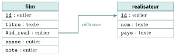
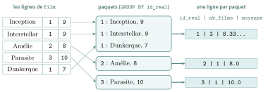
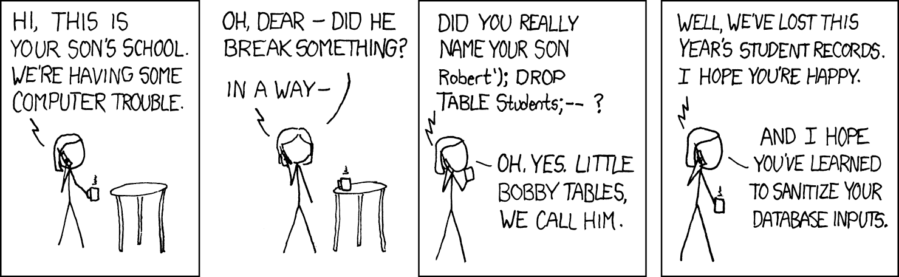

# Cours

<p class="sous-titre">Bases de données et SQL</p>

<span id="chap-06" class="ancre"></span>

<div class="tete-chapitre" markdown>

Programme (BO)
:   *« Identifier les concepts définissant le modèle relationnel » (relation, attribut, domaine, clef primaire, clef étrangère, schéma relationnel ; contraintes d’intégrité de domaine, de relation et de référence). « Savoir distinguer la structure d’une base de données de son contenu. Repérer des anomalies dans le schéma d’une base de données » (redondances, anomalies d’insertion, de suppression, de mise à jour). « Identifier les services rendus par un système de gestion de bases de données relationnelles : persistance des données, gestion des accès concurrents, efficacité de traitement des requêtes, sécurisation des accès. Identifier les composants d’une requête. Construire des requêtes d’interrogation à l’aide des clauses du langage SQL : `SELECT`, `FROM`, `WHERE`, `JOIN`. Construire des requêtes d’insertion et de mise à jour à l’aide de : `UPDATE`, `INSERT`, `DELETE`. »*

Prérequis
:   la notion de **type** (domaine) ; les tableaux et dictionnaires (comme analogies) ; un peu de logique (**et**, **ou**, **non**). $\to$ rappels de 1re : dictionnaires, données en tables, binaire et booléens

Objectifs
:   *comprendre* pourquoi une base de données s’impose ; *modéliser* des données en relationnel (relations, clés) ; *connaître* le rôle d’un SGBD ; *écrire* des requêtes SQL d’interrogation **et** de mise à jour.

</div>

!!! situation "Situation de départ"

    1.  Un lycée note tout (élèves, classes, notes) dans un seul tableau partagé. Pourquoi, au bout de quelques semaines, y trouve-t-on des fautes de frappe, des doublons et des informations contradictoires ?

    2.  Quand deux personnes modifient le même fichier en même temps, l’une écrase le travail de l’autre. Comment une banque ou un site marchand l’évitent-ils ?

    3.  Les films sont rangés dans un tableau, leurs réalisateurs dans un autre. Comment obtenir, en une seule demande, le titre de chaque film avec le nom de son réalisateur ?

## Pourquoi une base de données ? Quand le tableur ne suffit plus

Pour ranger quelques informations, un tableur (type Excel) ou un fichier texte peuvent suffire. Mais dès que les données deviennent **nombreuses**, **partagées** et **précieuses**, ces solutions craquent : une même information recopiée à plusieurs endroits finit par se contredire, deux personnes qui modifient le fichier en même temps écrasent le travail l’une de l’autre, la recherche devient lente. Une banque (un virement doit être fait en entier ou pas du tout : c’est une <span id="lex-transaction06" class="ancre"></span>**transaction**), un site marchand (le dernier article en stock ne doit pas être vendu deux fois), un réseau social (des milliards de lignes interrogées en une fraction de seconde) ou le carnet de notes d’un lycée (pas de note pour un élève qui n’existe pas, chacun ne voit que ce qui le concerne) ne peuvent pas s’en contenter.

!!! regle "Règle 1 — Ce qu’un simple fichier ne sait pas faire"

    Une base de données assure quatre choses qu’un tableur néglige : la **cohérence** (des règles empêchent les données absurdes), les **accès concurrents** (plusieurs utilisateurs à la fois, sans se marcher dessus), l’**efficacité** (recherche rapide même sur d’énormes volumes) et la **sécurité** (droits d’accès, sauvegarde, transactions).

!!! curieux "Pour les curieux (facultatif)"

    Vous en utilisez sans le savoir des dizaines par jour : votre téléphone stocke ses contacts, ses messages, ses photos dans des bases de données. La quasi-totalité des applications du monde repose dessus.

## Le modèle relationnel

En **1970**, un chercheur d’IBM, **Edgar F. Codd**, propose d’organiser les données en **tableaux** reliés entre eux : c’est le <span id="lex-modelerelationnel06" class="ancre"></span>**modèle relationnel**, encore ultra-dominant aujourd’hui.

!!! definition "Définition 1 — Relation, attribut, enregistrement, domaine"

    Une <span id="lex-relation06" class="ancre"></span>**relation** (ou **table**) est un tableau à deux dimensions. Chaque **colonne** est un <span id="lex-attributbdd06" class="ancre"></span>**attribut**, qui porte un **nom** et un <span id="lex-domaine06" class="ancre"></span>**domaine** (son type : entier, texte, date…). Chaque **ligne** est un <span id="lex-enregistrement06" class="ancre"></span>**enregistrement** : une entité décrite par une valeur pour chaque attribut.

Prenons une base de données de **films**. Voici la relation `film` :

| **id** | **titre**    | **id_real** | **annee** | **note** |
|:------:|:-------------|:-----------:|:---------:|:--------:|
|   1    | Inception    |      1      |   2010    |    9     |
|   2    | Interstellar |      1      |   2014    |    9     |
|   3    | Amélie       |      2      |   2001    |    8     |
|   4    | Parasite     |      3      |   2019    |    10    |
|   5    | Dunkerque    |      1      |   2017    |    7     |

!!! definition "Définition 2 — Schéma"

    Le <span id="lex-schema06" class="ancre"></span>**schéma** d’une relation donne le nom de la relation et, pour chaque attribut, son nom et son domaine. On le note ainsi (la clé primaire est soulignée) :

    $$\texttt{film}\,(\ \underline{\texttt{id}}:\text{entier},\ \texttt{titre}:\text{texte},\ \texttt{id\_real}:\text{entier},\ \texttt{annee}:\text{entier},\ \texttt{note}:\text{entier}\ )$$

    Le **schéma d’une base** est l’ensemble des schémas de ses relations.

!!! regle "Règle 2 — Structure et contenu d’une base"

    La **structure** d’une base, c’est son schéma : les relations, leurs attributs, leurs domaines et leurs clés. Elle est fixée à la création des tables (on verra `CREATE TABLE` au § V) et change rarement. Le **contenu**, ce sont les enregistrements (les lignes) présents à un instant donné : il change sans cesse, à chaque ajout, modification ou suppression. Ajouter un film change le contenu ; ajouter un attribut `duree` à la relation `film` change la structure.

!!! remarque "Remarque"

    Une relation est un **ensemble** d’enregistrements : l’ordre des lignes n’a aucune importance, et il ne peut pas y avoir deux lignes totalement identiques.

<span id="cours-06-1" class="ancre"></span>

<span class="afaire">▶ Exercices d'application :</span> exercice **[1](exercices.md#ex-06-1)** (lire un schéma)

## Les contraintes d’intégrité : garder des données saines

Le modèle relationnel impose des **règles** qui empêchent les incohérences. Ce sont les <span id="lex-integrite06" class="ancre"></span>**contraintes d’intégrité**.

### Contrainte de domaine

<span id="lex-contraintedomaine06" class="ancre"></span>

!!! regle "Règle 3"

    Chaque valeur d’un attribut doit appartenir à son **domaine**, c’est-à-dire à son **type**. Un attribut `annee` de type *entier* doit refuser la valeur `"hier"`. Bien choisir les domaines, c’est déjà interdire une foule d’erreurs.

!!! curieux "Pour les curieux (facultatif) — SQLite, un SGBD au typage souple"

    La plupart des SGBD (PostgreSQL, MySQL…) refusent `"hier"` dans une colonne `INTEGER`. **SQLite, lui, peut l’accepter** : le type déclaré n’est qu’une *préférence* (on parle d’**affinité**). Il convertit `’2024’` en l’entier `2024`, mais range `’hier’` tel quel, comme du texte, sans erreur. Pour obtenir un vrai contrôle de domaine en SQLite, on ajoute une contrainte explicite, par exemple `annee INTEGER CHECK (typeof(annee) = ’integer’)`, ou l’on déclare la table `STRICT` (SQLite 3.37 et plus).

!!! remarque "Remarque — Les principaux types SQL"

    En SQL (ici en SQLite), les domaines les plus courants sont : `INTEGER` (entier), `REAL` (nombre à virgule), `TEXT` (chaîne de caractères) et `BLOB` (données binaires). Un **booléen** se code par un `INTEGER` (`0`/`1`) et une **date** par un `TEXT` (ou un entier). *Attention aux « faux nombres »* : un code postal (`06000`) ou un numéro de téléphone se stockent en `TEXT`, pas en `INTEGER` — sinon le `0` initial disparaît et `06000` devient `6000` !

### Clé primaire : identifier sans ambiguïté

!!! definition "Définition 3 — Clé primaire"

    La <span id="lex-cleprimaire06" class="ancre"></span>**clé primaire** d’une relation est un attribut (ou un groupe d’attributs) dont la valeur **identifie de façon unique** chaque enregistrement. Son **rôle** est donc de *distinguer sans ambiguïté* les lignes ; le SGBD garantit qu’**aucune** clé primaire ne se répète (et qu’elle n’est jamais vide). C’est la **contrainte d’entité**.

Dans `film`, deux films peuvent partager le même titre ou la même année : c’est pourquoi on ajoute un attribut `id` (un numéro unique) qui sert de clé primaire.

!!! regle "Règle 4 — Question de bac : « tel attribut peut-il être clé primaire ? »"

    Un attribut ne peut être clé primaire que si ses valeurs sont **toujours différentes** d’une ligne à l’autre (et jamais vides). C’est pourquoi le `nom`, le `titre` ou un numéro de `téléphone` font en général de **mauvaises** clés (homonymes, valeurs partagées ou manquantes) : on leur préfère un **identifiant** dédié. Plusieurs attributs peuvent convenir (les *clés candidates*) ; on en choisit **une**.

### Clé étrangère : relier les tables

Dans `film`, l’attribut `id_real` ne contient pas le *nom* du réalisateur, mais un **numéro** qui **renvoie** à une autre table, `realisateur` :

| **id** | **nom**      | **pays**     |
|:------:|:-------------|:-------------|
|   1    | Nolan        | Royaume-Uni  |
|   2    | Jeunet       | France       |
|   3    | Bong Joon-ho | Corée du Sud |

!!! definition "Définition 4 — Clé étrangère"

    Une <span id="lex-cleetrangere06" class="ancre"></span>**clé étrangère** est un attribut d’une relation dont la valeur doit être celle d’une **clé primaire** dans une autre (ou la même) relation. Son **rôle** est de *relier deux tables* et de garantir que la référence **existe** vraiment. Ici, `film.id_real` est une clé étrangère qui référence `realisateur.id`.

<span class="retouract">↺ Retour sur l'activité.</span> La colonne inventée dans l’activité pour distinguer les deux Léa Martin était une **clé primaire** de ÉLÈVE ; la colonne « Élève » de NOTE, qui renvoie vers une ligne d’ÉLÈVE plutôt que de recopier le nom, était une **clé étrangère**.

On représente souvent le schéma de la base par un dessin : une boîte par relation, la clé primaire soulignée, la clé étrangère précédée d’un `#`, et une flèche qui va de la clé étrangère vers la clé primaire qu’elle référence.

{ .tikz loading=lazy }

!!! regle "Règle 5 — Contrainte de référence"

    <span id="lex-contraintereference06" class="ancre"></span>Une clé étrangère ne peut désigner qu’une valeur **existante**. Impossible d’ajouter un film dont le `id_real` vaut `7` si aucun réalisateur n’a l’`id` `7`. Impossible, aussi, de supprimer le réalisateur `1` tant que des films le référencent. La base reste **cohérente**.

!!! regle "Règle 6 — Question de bac : différence entre clé primaire et clé étrangère"

    La **clé primaire** *identifie* de façon unique les lignes de **sa** table (unicité garantie). La **clé étrangère** *pointe* vers la clé primaire d’une **autre** table pour les relier (elle, peut se répéter : un même réalisateur a plusieurs films). En résumé : la primaire *distingue*, l’étrangère *relie*.

!!! encadre "À retenir — pourquoi deux tables plutôt qu’une ? Les anomalies d’un mauvais schéma"

    On aurait pu écrire le nom et le pays du réalisateur en toutes lettres dans chaque film. Mais alors « Nolan, Royaume-Uni » serait recopié 3 fois : c’est une **redondance**. Elle entraîne trois <span id="lex-anomalies06" class="ancre"></span>**anomalies** :

    - **anomalie de mise à jour** : corriger le pays de Nolan oblige à modifier toutes ses lignes ; en oublier une rend la base incohérente (une faute de frappe, « Nollan », crée même un réalisateur fantôme) ;

    - **anomalie d’insertion** : impossible d’enregistrer un réalisateur qui n’a encore aucun film, sans inventer un film ;

    - **anomalie de suppression** : supprimer le seul film de Bong Joon-ho efface du même coup tout ce que la base savait de lui.

    En **séparant** en deux tables reliées par une clé étrangère, chaque information n’est écrite **qu’une fois** : les trois anomalies disparaissent. Repérer ces anomalies dans un schéma, puis le découper, c’est tout l’art du modèle relationnel.

<span id="cours-06-24" class="ancre"></span>

<span class="afaire">▶ Exercices d'application :</span> exercice **[24](exercices.md#ex-06-24)** (un schéma mal conçu : anomalies, structure et contenu)

### D’autres contraintes utiles

Au-delà des trois grandes contraintes (domaine, entité, référence), on peut en imposer d’autres à un attribut :

- `NOT NULL` : l’attribut ne peut pas être **vide** (obligatoire) ;

- `UNIQUE` : toutes ses valeurs doivent être **différentes**, sans pour autant être la clé primaire (*ex.* une adresse e-mail) ;

- une **contrainte utilisateur** (ou « métier ») : une règle propre au contexte, par exemple « une `note` est comprise entre `0` et `20` » ou « un `age` est positif ».

!!! regle "Règle 7 — Récapitulatif : les contraintes d’intégrité"

    **de domaine** (bon type) ; **d’entité** (clé primaire unique) ; **de référence** (clé étrangère existante) ; et les contraintes complémentaires (`NOT NULL`, `UNIQUE`, règles métier). Toutes servent le même but : garder des données **cohérentes**.

<span class="retouract">↺ Retour sur l'activité.</span> Les « règles vérifiées à chaque saisie » imaginées dans l’activité sont des contraintes d’intégrité : « abs » dans la colonne Note viole la contrainte de domaine, une note de $23$ une contrainte utilisateur.

<span id="cours-06-2" class="ancre"></span>

<span class="afaire">▶ Exercices d'application :</span> exercices **[2](exercices.md#ex-06-2) et [3](exercices.md#ex-06-3)** (clés, contraintes, faire évoluer le modèle)

## Le SGBD : le chef d’orchestre

On ne manipule jamais les fichiers d’une base « à la main » : on passe par un **logiciel** spécialisé.

!!! definition "Définition 5 — Système de gestion de bases de données (SGBD)"

    Un <span id="lex-sgbd06" class="ancre"></span>**SGBD** est le logiciel qui **stocke**, **protège** et **interroge** une base de données. On ne lui parle pas dans un langage de programmation classique, mais avec un langage dédié : **SQL**.

!!! regle "Règle 8 — Les grandes fonctions d’un SGBD"

    - **Persistance** : les données survivent à l’extinction de la machine.

    - **Cohérence** : il fait respecter toutes les contraintes d’intégrité.

    - **Efficacité** : il recherche vite, même dans des milliards de lignes (grâce à des *index* — souvent des arbres, cf. chapitre *Arbres* !).

    - **Sécurité** : droits d’accès par utilisateur, sauvegardes. Quand la base contient des **données personnelles**, protéger les accès est aussi une obligation légale : on ne collecte que ce qui est nécessaire et l’on en garde le contrôle (le RGPD dans l’Union européenne ; à Monaco, la loi n° 1.565 du 3 décembre 2024, contrôlée par l’Autorité de protection des données personnelles, APDP).

    - **Accès concurrents** : plusieurs utilisateurs en même temps, sans conflit, grâce aux **transactions** (un problème de ressource partagée, comme entre les processus du chapitre 4).

<span class="retouract">↺ Retour sur l'activité.</span> Les deux secrétaires qui enregistraient le même fichier à une minute d’intervalle se heurtaient au problème des **accès concurrents** : la correction de M. Giraud effaçait la note saisie par Mme Leroy. Un SGBD empêche une modification d’en écraser une autre.

!!! encadre "Au bac — « intérêt d’un SGBD » / « deux services rendus »"

    Il suffit d’en citer deux parmi la liste ci-dessus. Réponses attendues typiques : il **garantit la cohérence** des données (contraintes d’intégrité), il gère les **accès concurrents** de plusieurs utilisateurs, il assure la **persistance** et la **sécurité**, et il permet d’**interroger efficacement** de gros volumes. Là où un simple fichier laisserait apparaître des incohérences, le SGBD les *empêche*.

!!! remarque "Remarque — Les transactions : le « tout ou rien »"

    Une **transaction** regroupe des opérations qui doivent réussir **ensemble** ou **pas du tout**. Le virement bancaire (débit *et* crédit) en est l’exemple parfait : si une panne survient au milieu, la transaction est **annulée** entièrement, comme si rien ne s’était passé. On résume ces garanties par l’acronyme **ACID**.

!!! curieux "Pour les curieux (facultatif)"

    Des SGBD célèbres : **PostgreSQL**, **MySQL**, **Oracle**, **SQLite**. Ce dernier, minuscule et sans serveur, est embarqué dans presque toutes les applications et tous les téléphones. C’est celui que nous utiliserons (via *DB Browser* ou un site en ligne).

## SQL : interroger une base de données

<span id="lex-sql06" class="ancre"></span>**SQL** (*Structured Query Language*) est le langage universel des bases relationnelles. Une instruction SQL s’appelle une **requête**. Commençons par la plus importante : **lire** des données.

### Créer et remplir une table

Pour mémoire, on crée une table avec `CREATE TABLE` et on y ajoute des lignes avec `INSERT`.

```sql
CREATE TABLE film (
    id INTEGER PRIMARY KEY,
    titre TEXT,
    id_real INTEGER,
    annee INTEGER,
    note INTEGER
);

INSERT INTO film (id, titre, id_real, annee, note)
VALUES (1, 'Inception', 1, 2010, 9);
```

!!! remarque "Remarque — Déclarer une clé étrangère"

    Dans `CREATE TABLE`, on déclare la clé étrangère avec `REFERENCES` : `id_real INTEGER REFERENCES realisateur(id)`. Le SGBD fait alors respecter la contrainte de référence. Attention, **SQLite** ne vérifie les clés étrangères que si on le lui demande, au début de chaque session, par `PRAGMA foreign_keys = ON;` : sans cette ligne, il accepte un `id_real` qui ne désigne aucun réalisateur.

!!! remarque "Remarque"

    En SQL, les mots-clés (`SELECT`, `FROM`…) s’écrivent traditionnellement en **majuscules** (ce n’est pas obligatoire) et les chaînes de caractères entre **apostrophes simples** : `’Inception’`.

### `SELECT` … `FROM` : choisir des colonnes

<span id="lex-select06" class="ancre"></span>

!!! regle "Règle 9 — La requête de base"

    `SELECT` liste les **colonnes** à récupérer ; `FROM` indique la **table**. L’étoile `*` signifie « toutes les colonnes ».

<span class="routine">▷ Je prédis.</span> Cacher la table résultat, la prévoir, puis vérifier.

```sql
SELECT titre, annee
FROM film;
```

donne :

| **titre**    | **annee** |
|:-------------|:---------:|
| Inception    |   2010    |
| Interstellar |   2014    |
| Amélie       |   2001    |
| Parasite     |   2019    |
| Dunkerque    |   2017    |

### `WHERE` : filtrer les lignes

!!! regle "Règle 10"

    `WHERE` garde uniquement les lignes qui **satisfont une condition**. On combine les conditions avec `AND`, `OR`, `NOT`, et on compare avec `=`, `<>` (différent), `<`, `>`, `<=`, `>=`.

<span class="routine">▷ Je prédis.</span> Cacher la table résultat, la prévoir, puis vérifier.

```sql
SELECT titre
FROM film
WHERE annee > 2010 AND note >= 9;
```

renvoie `Interstellar` et `Parasite`.

!!! remarque "Remarque — Tester une case vide : IS NULL"

    Un attribut peut être **vide** (valeur `NULL` — par exemple une date de retour non encore renseignée). On ne la teste **pas** avec `= NULL` (qui ne fonctionne pas en SQL), mais avec `IS NULL` (case vide) ou `IS NOT NULL` (case renseignée) :

    ```sql
    SELECT titre
    FROM film
    WHERE note IS NULL;      -- les films dont la note n'est pas renseignee
    ```

### `ORDER BY` : trier le résultat

<span id="lex-orderby06" class="ancre"></span>

```sql
SELECT titre, note
FROM film
ORDER BY note DESC;
```

trie les films de la meilleure note à la moins bonne (`DESC` = décroissant ; `ASC` = croissant, par défaut).

<span class="routine">▷ Je prédis.</span> Quel film arrive en tête ? Lequel en dernier ?

??? verifie "Je vérifie"

    `Parasite` (10) en tête, `Dunkerque` (7) en dernier. `Inception` et `Interstellar` ont la même note : leur ordre entre eux n’est pas garanti.

### `DISTINCT` : supprimer les doublons

<span id="lex-distinct06" class="ancre"></span>

```sql
SELECT DISTINCT id_real
FROM film;
```

renvoie chaque réalisateur **une seule fois**, même s’il a plusieurs films.

<span class="routine">▷ Je prédis.</span> Combien de lignes contient le résultat ? Et sans `DISTINCT` ?

??? verifie "Je vérifie"

    `3` lignes (`1`, `2`, `3`) ; sans `DISTINCT`, `5` lignes : le `1` de Nolan apparaît trois fois.

### Les fonctions d’agrégation

<span id="lex-agregation06" class="ancre"></span> Elles **résument** une colonne en *une* valeur : `COUNT` (compter), `SUM` (somme), `AVG` (moyenne), `MIN`, `MAX`.

```sql
SELECT COUNT(*)                    -- nombre de films : 5
FROM film;

SELECT AVG(note)                   -- note moyenne
FROM film;

SELECT MAX(note)                   -- meilleure note avant 2015
FROM film
WHERE annee < 2015;
```

<span class="routine">▷ Je prédis.</span> Que renvoient la deuxième et la troisième requête ?

??? verifie "Je vérifie"

    `8.6` (la somme `43` divisée par `5`), puis `9` : `Parasite` (`10`) date de 2019, il est écarté par le `WHERE` *avant* le calcul du maximum.

!!! curieux "Pour les curieux (facultatif) — Au-delà du strict programme"

    Les clauses présentées d’ici aux jointures (`LIKE`, `LIMIT`, l’alias `AS`, `GROUP BY` et `HAVING`) ne sont pas exigées au bac, mais elles sont très courantes et rendent SQL vraiment puissant. Les fonctions d’agrégation ci-dessus, elles, sont au programme, à condition de les utiliser **sans** `GROUP BY` ni `HAVING`.

### `LIKE` : rechercher un motif

`LIKE` compare du texte à un **motif** : `%` remplace n’importe quelle suite de caractères, `_` un seul.

<span class="routine">▷ Je prédis.</span> Cacher la table résultat, la prévoir, puis vérifier.

```sql
SELECT titre
FROM film
WHERE titre LIKE 'In%';
```

renvoie les titres commençant par « In » : `Inception`, `Interstellar`.

### Alias `AS` et `LIMIT`

`AS` renomme une colonne dans le résultat ; `LIMIT` borne le nombre de lignes.

```sql
SELECT titre AS film, note AS etoiles
FROM film
ORDER BY note DESC
LIMIT 3;
```

donne les **3** meilleurs films, avec des colonnes renommées.

<span class="routine">▷ Je prédis.</span> Quelle table résultat (en-têtes compris) ?

??? verifie "Je vérifie"

    Deux colonnes nommées `film` et `etoiles` ; trois lignes : `Parasite | 10`, puis `Inception | 9` et `Interstellar | 9`, dans un ordre non garanti entre ces deux-là.

### `GROUP BY` : regrouper puis résumer

`GROUP BY` forme des **paquets** de lignes partageant une même valeur, et applique un agrégat à **chaque** paquet.

<span class="routine">▷ Je prédis.</span> Cacher la table résultat, la prévoir, puis vérifier.

```sql
SELECT id_real, COUNT(*) AS nb_films, AVG(note) AS moyenne
FROM film
GROUP BY id_real;
```

donne, **pour chaque réalisateur**, son nombre de films et sa note moyenne :

{ .tikz loading=lazy }

On peut filtrer *après* regroupement avec `HAVING` :

```sql
SELECT id_real, COUNT(*) AS nb
FROM film
GROUP BY id_real
HAVING COUNT(*) >= 2;
```

ne garde que les réalisateurs ayant **au moins 2** films.

<span class="routine">▷ Je prédis.</span> Quelle table résultat ?

??? verifie "Je vérifie"

    Une seule ligne, `1 | 3` : seul le réalisateur `1` (Nolan) a au moins deux films.

!!! curieux "Pour les curieux (facultatif)"

    Retenez la différence : `WHERE` filtre les lignes *avant* le regroupement, `HAVING` filtre les paquets *après*.

### Les jointures : croiser deux tables

Notre requête `GROUP BY` affiche des `id_real` (`1`, `2`…), pas des noms. Pour afficher le **nom** du réalisateur, il faut **recoller** les deux tables : c’est une <span id="lex-jointure06" class="ancre"></span>**jointure**.

!!! regle "Règle 11 — JOIN … ON"

    `FROM A JOIN B ON A.cle_etrangere = B.cle_primaire` fusionne chaque ligne de `A` avec la ligne de `B` qui lui correspond, selon l’égalité indiquée après `ON`.

<span class="routine">▷ Je prédis.</span> Cacher la table résultat, la prévoir, puis vérifier.

```sql
SELECT film.titre, realisateur.nom
FROM film
JOIN realisateur ON film.id_real = realisateur.id;
```

associe à chaque film le nom de son réalisateur :

| **titre**    | **nom**      |
|:-------------|:-------------|
| Inception    | Nolan        |
| Interstellar | Nolan        |
| Amélie       | Jeunet       |
| Parasite     | Bong Joon-ho |
| Dunkerque    | Nolan        |

!!! encadre "À retenir — préfixer un attribut par sa table"

    Quand un nom d’attribut existe dans les deux tables (ici `id`), on le **préfixe** par le nom de sa table (`realisateur.id`) pour lever l’ambiguïté. On peut évidemment combiner une jointure avec `WHERE`, `ORDER BY`, `GROUP BY`… et joindre **trois** tables ou plus.

<span id="cours-06-4" class="ancre"></span>

<span class="afaire">▶ Exercices d'application :</span> exercices **[4](exercices.md#ex-06-4) à [14](exercices.md#ex-06-14)** (interroger, agréger, regrouper, jointures)

## SQL : modifier une base de données

Au-delà de la lecture, SQL sait aussi **écrire**. Trois instructions, à manier avec prudence.

!!! regle "Règle 12 — Les trois commandes de mise à jour"

    <span id="lex-miseajour06" class="ancre"></span>

    - `INSERT INTO … VALUES …` : **ajouter** une ligne ;

    - `UPDATE … SET … WHERE …` : **modifier** des lignes existantes ;

    - `DELETE FROM … WHERE …` : **supprimer** des lignes.

```sql
UPDATE film
SET note = 8
WHERE titre = 'Dunkerque';

DELETE FROM film
WHERE annee < 2005;
```

<span class="routine">▷ Je prédis.</span> Après ces deux requêtes, combien de lignes reste-t-il dans `film`, et quelle est la note de `Dunkerque` ?

??? verifie "Je vérifie"

    `4` lignes (seul `Amélie`, de 2001, est supprimé) ; `Dunkerque` a désormais la note `8`.

!!! regle "Règle 13 — Le WHERE qui sauve des vies"

    **N’oubliez jamais le `WHERE`** dans un `UPDATE` ou un `DELETE` ! `DELETE FROM film;` (sans condition) efface **tous** les films d’un coup. C’est la requête la plus redoutée des informaticiens.

<span id="cours-06-15" class="ancre"></span>

<span class="afaire">▶ Exercices d'application :</span> exercices **[15](exercices.md#ex-06-15) et [16](exercices.md#ex-06-16)** (insérer, modifier, supprimer ; transactions et ACID)

### Injection SQL : ne jamais coller une saisie dans une requête

Dans une vraie application (un site web, le logiciel de vie scolaire…), personne ne tape les requêtes : un **programme** les fabrique à partir de ce que l’utilisateur a saisi. En Python, le module `sqlite3` envoie une requête à la base avec `connexion.execute(requete)`. La tentation est grande de coller la saisie dans le texte de la requête :

```python
titre = input("Titre du film : ")
requete = "SELECT titre, note FROM film WHERE titre = '" + titre + "'"
resultat = connexion.execute(requete).fetchall()
```

<span class="routine">▷ Je prédis.</span> Un utilisateur tape `x’ OR ’1’=’1`. Quelle requête est envoyée au SGBD ? Que renvoie-t-elle ?

??? verifie "Je vérifie"

    La requête devient `SELECT titre, note FROM film WHERE titre = ’x’ OR ’1’=’1’`. La condition `’1’=’1’` est toujours vraie : on obtient **tous** les films, alors qu’aucun ne s’appelle « x ».

!!! definition "Définition 6 — Injection SQL"

    Une **injection SQL** consiste à saisir un texte qui, une fois collé dans une requête, en **change le sens** : une apostrophe ferme la chaîne prévue par le programmeur, et la suite est lue comme du SQL. C’est l’une des failles les plus exploitées du Web : lire des données interdites, se connecter sans mot de passe, modifier ou détruire des tables.

{ .photo loading=lazy style="width:95%" }  
Randall Munroe, « Exploits of a Mom », xkcd n° 327 (2007), <https://xkcd.com/327/> — licence CC BY-NC 2.5

!!! encadre "La blague expliquée — « Little Bobby Tables »"

    L’école appelle une mère : elle a « des problèmes informatiques ». Son fils s’appellerait-il vraiment `Robert’); DROP TABLE Students;--` ? « Oui, on l’appelle le petit Bobby Tables. » Résultat : les fiches des élèves de l’année sont perdues. Le logiciel de l’école enregistrait chaque nouvel élève avec une requête fabriquée par collage, du type `INSERT INTO Students (nom) VALUES (’`*`nom`*`’);`. Avec le prénom de Bobby, le SGBD reçoit :

    ```sql
    INSERT INTO Students (nom) VALUES ('Robert'); DROP TABLE Students;--');
    ```

    - l’apostrophe après `Robert` **ferme la chaîne** : pour le SGBD, le nom est simplement « Robert » ;

    - `);` **termine** l’`INSERT`, qui est correct et s’exécute ;

    - `DROP TABLE Students;` est une **seconde requête**, qui supprime la table entière, structure et contenu <span class="horsprog">au-delà du programme</span> : pire qu’un `DELETE` sans `WHERE` ;

    - `--` ouvre un **commentaire** SQL : la fin prévue par le programmeur, `’);`, est ignorée, donc aucune erreur de syntaxe ne trahit l’attaque.

    La mère conclut qu’il faut « nettoyer » les saisies. Mieux encore : ne **jamais** les coller dans une requête.

!!! regle "Règle 14 — Requêtes paramétrées"

    On écrit un point d’interrogation `?` à la place de chaque valeur, et on passe les valeurs **à part**, dans un tuple :

    ```python
    requete = "SELECT titre, note FROM film WHERE titre = ?"
    resultat = connexion.execute(requete, (titre,)).fetchall()
    ```

    `sqlite3` transmet la valeur comme une simple **donnée**, jamais interprétée comme du SQL. Avec la saisie `x’ OR ’1’=’1`, on cherche un film dont le titre est exactement ce texte : aucune ligne. Bobby, lui, serait enregistré sous son nom complet, apostrophe comprise, et la table survivrait. Donc : **jamais** de valeur saisie collée dans une requête (ni avec `+`, ni avec une f-string), toujours un `?` par valeur.

!!! remarque "Remarque"

    `connexion.execute` refuse d’exécuter deux instructions à la fois : l’attaque de Bobby échouerait telle quelle avec `sqlite3`. Mais l’injection `x’ OR ’1’=’1`, qui reste dans une seule requête, fonctionne : seul le `?` protège vraiment. C’est un aspect concret de la **sécurité** des accès, l’un des services d’un SGBD (§ IV). On le met en pratique dans la partie 6 du TP « La ligue de futsal des quartiers ».

!!! curieux "Pour les curieux (facultatif) — Un peu d’histoire… et d’humour"

    Avant de ranger les données, il a fallu pouvoir les **retrouver vite**. Jusque dans les années 1950, elles dorment sur des cartes perforées ou des bandes magnétiques, qu’il faut dérouler du début. En **1956**, IBM commercialise le **premier disque dur**, l’**IBM 350** du système *RAMAC* : cinquante plateaux de 61 cm de diamètre pour… 5 millions de caractères (moins de 4 Mo), loués plus de $3\,000$ dollars par mois. Pour la première fois, on accède **directement** à n’importe quel enregistrement. Le modèle relationnel naît ensuite en **1970** sous la plume d’**Edgar F. Codd**, chez IBM — une idée si féconde qu’elle lui vaudra le prix **Turing** en 1981. Dans la foulée, **Donald Chamberlin** et **Raymond Boyce** conçoivent un langage pour l’interroger : *SEQUEL*, vite rebaptisé **SQL**. D’où l’éternelle querelle : faut-il prononcer « *ess-cue-elle* » ou « *sequel* » ? Un demi-siècle plus tard, personne n’a tranché — c’est la seule dispute plus vieille que celle des accolades. Codd et ses collègues cherchaient alors à gérer les **grandes masses de données** des entreprises (le prototype d’IBM s’appelait *System R*) ; depuis, SQL règne sans partage : les données de la planète, de votre banque à votre application de messagerie, s’expriment dans ce langage vieux d’un demi-siècle et jamais détrôné.

    { .photo loading=lazy style="width:140px" }  
    Le mécanisme du disque IBM 350 (1956)

!!! curieux "Pour les curieux (facultatif) — Liens avec d’autres chapitres"

    - **Ce qu’il réutilise :** un enregistrement ressemble à un objet, ses colonnes à des attributs (*Programmation orientée objet et paradigmes*) ; on prolonge *Les données en tables* (Première).

    - **Déjà croisé :** les index sont souvent des arbres de recherche (*Arbres*) ; les transactions règlent un partage de ressource, comme en *Processus et ordonnancement*.

    - **Pour aller plus loin :** un réseau social se modélisera parfois mieux par des *Graphes* ; `LIKE` annonce la *Recherche textuelle*.

## Bilan — la carte mémoire

| **Notion / clause** | **À retenir** |
|:---|:---|
| Relation / attribut / enregistrement | table / colonne / ligne |
| Domaine | le type d’un attribut (contrainte de domaine) |
| Clé primaire | identifie chaque ligne de façon **unique** |
| Clé étrangère | référence une clé primaire d’une autre table |
| SGBD | logiciel qui stocke, protège, interroge (persistance, cohérence, …) |
| `SELECT … FROM … WHERE` | choisir des colonnes, filtrer des lignes |
| `ORDER BY` / `DISTINCT` | trier / enlever les doublons |
| `COUNT/SUM/AVG/MIN/MAX` | résumer une colonne en une valeur |
| `GROUP BY` / `HAVING` | regrouper, filtrer les groupes (au-delà du BO) |
| `JOIN … ON` | croiser deux tables par une clé |
| `INSERT` / `UPDATE` / `DELETE` | ajouter / modifier / supprimer (**penser au `WHERE` !**) |
| Requête paramétrée (`?`) | ne jamais coller une saisie dans une requête (injection SQL) |

!!! situation "Retour à la situation de départ"

    1.  Les mêmes informations y sont recopiées à plusieurs endroits, et rien ne contrôle la saisie. Le **modèle relationnel** découpe les données en **relations** reliées par des **clés étrangères**, où chaque information n’est écrite qu’une fois, et les **contraintes d’intégrité** refusent les valeurs absurdes (§ II et III).

    2.  Elles confient leurs données à un **SGBD**, qui gère les **accès concurrents** grâce aux **transactions** (« tout ou rien ») et garantit la cohérence des données (§ IV).

    3.  Par une requête SQL avec **jointure** (`JOIN … ON`), qui recolle chaque film à la ligne de `realisateur` désignée par sa clé étrangère `id_real` (§ V.J).

## Erreurs fréquentes

- **Oublier le `WHERE` d’un `UPDATE` / `DELETE`.** Sans lui, on modifie ou supprime **toute la table**. *Le réflexe :* « le `WHERE` qui sauve des vies ».

- **Oublier la condition de jointure.** `FROM a, b` sans `WHERE`/`ON` produit le **produit cartésien** (toutes les combinaisons).

- **Confondre `WHERE` et `HAVING`.** `WHERE` filtre les **lignes** (avant regroupement), `HAVING` filtre les **groupes** (après `GROUP BY`).

- **Confondre clé primaire et clé étrangère.** La clé primaire **identifie** une ligne ; la clé étrangère **référence** la clé primaire d’une autre table.

- **Croire que `ORDER BY` / `DISTINCT` changent les données.** Ils ne changent que l’**affichage** du résultat, pas la table.

- **Détails de syntaxe.** Chaînes entre **apostrophes** (`’Ada’`), test d’égalité avec **un seul** `=`.

## Savoir-faire à maîtriser

*À la fin du chapitre, je sais…*

- lire un **schéma relationnel** (clés primaire et étrangère) $\to$ ex. [1](exercices.md#ex-06-1), [2](exercices.md#ex-06-2), [3](exercices.md#ex-06-3) ;

- distinguer la **structure** d’une base de son **contenu**, et repérer les **anomalies** d’un schéma (redondance ; insertion, suppression, mise à jour) $\to$ ex. [3](exercices.md#ex-06-3), [24](exercices.md#ex-06-24) ;

- écrire `SELECT` / `FROM` / `WHERE` (`AND`, `OR`, `NOT`), `ORDER BY`, `DISTINCT` $\to$ ex. [4](exercices.md#ex-06-4), [5](exercices.md#ex-06-5), [6](exercices.md#ex-06-6) ;

- utiliser les **agrégats** (`COUNT`, `SUM`, `AVG`, `MIN`, `MAX`) $\to$ ex. [8](exercices.md#ex-06-8), [9](exercices.md#ex-06-9), [10](exercices.md#ex-06-10) ; pour aller plus loin, regrouper avec `GROUP BY` / `HAVING` $\to$ ex. [11](exercices.md#ex-06-11) ;

- écrire une **jointure** (`JOIN … ON`) entre deux tables $\to$ ex. [12](exercices.md#ex-06-12), [13](exercices.md#ex-06-13) ;

- **mettre à jour** une base (`INSERT`, `UPDATE`, `DELETE`) sans oublier le `WHERE` $\to$ ex. [15](exercices.md#ex-06-15), [18](exercices.md#ex-06-18) ;

- expliquer le rôle d’un **SGBD** et d’une **transaction** (propriétés ACID) $\to$ ex. [2](exercices.md#ex-06-2), [16](exercices.md#ex-06-16).

## Vers le Grand Oral

Quelques pistes de questions que ce chapitre permet de préparer (à étayer d’un exemple concret) :

- **Pourquoi répartir les données en plusieurs tables ?** *(éviter la redondance, garantir la cohérence, relier par des clés.)*

- **Qu’est-ce qu’une transaction, et pourquoi les propriétés ACID ?** *(un virement bancaire en tout-ou-rien ; les accès simultanés.)*

- **SQL : comment retrouver une information dans des millions de lignes ?** *(langage déclaratif « je décris ce que je veux » ; les index, qui sont des arbres.)*
