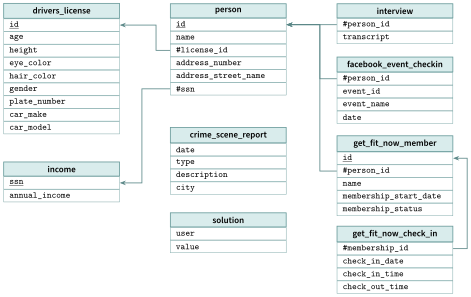

# TP et projets

<p class="sous-titre">Bases de données et SQL</p>

## <span class="etiquette">TP 1</span> La ligue de futsal des quartiers

*modéliser, créer, interroger une base SQLite, puis la piloter depuis Python*

<p class="infos-activite">Durée : 2 séances (environ 3 h) · Par deux, sur machine</p>

!!! fichiers "Fichiers à télécharger"

    [:material-folder-open: dossier en ligne](https://github.com/MathThibaud/nsi-fichiers-eleves/tree/main/terminale/06-tp-bdd-sql){ .md-button } [:material-zip-box: archive .zip](https://github.com/MathThibaud/nsi-fichiers-eleves/raw/main/zips/terminale-06-tp-bdd-sql.zip){ .md-button }

!!! consignes "Consignes"

    - Outils : **DB Browser for SQLite** (onglets « Structure de la base », « Parcourir les données », « Exécuter le SQL ») et **Python** (Thonny, IDLE ou VS Code).

    - Fichiers à télécharger (lien ci-dessus) : la base `tp_bdd_sql.db`, le script `tp_bdd_sql_creation.py` qui la fabrique (le relancer **remet la base dans son état de départ**) et le fichier `tp_bdd_sql_depart.py` de la partie 6.

    - Écrire chaque requête **sur plusieurs lignes** (`SELECT`… / `FROM`… / `WHERE`…), l’exécuter, puis noter sur le cahier (ou dans un fichier texte) le résultat demandé. <span class="run" title="À programmer et tester sur machine">▶</span>  signale ce qui se fait sur machine.

    - Dans DB Browser, une modification n’est enregistrée dans le fichier qu’après « **Écrire les modifications** » (Ctrl+S).

    - Usage de l’IA, indiqué sur chaque exercice : <span class="ia ia-rouge" title="Sans IA : le but est l'automatisme lui-même"></span> aucune ; <span class="ia ia-orange" title="IA en appui : déboguer, reformuler, vérifier ; la réponse finale est la vôtre"></span> en appui (déboguer, reformuler, vérifier ; la réponse finale est écrite et comprise par vous) ; <span class="ia ia-vert" title="IA intégrée : l'exercice s'appuie sur une réponse d'IA"></span> l’exercice s’appuie sur une réponse d’IA. Voir la [charte d’usage de l’IA](../charte.md).

!!! encadre "But du TP"

    Une ligue amateur (fictive) organise un championnat de futsal entre six quartiers de Monaco. On va **modéliser** ses données, **créer** des tables avec leurs contraintes et les **mettre à l’épreuve**, **interroger** la base de la saison (sélections, agrégats, regroupements, jointures), la **mettre à jour** après une journée de matchs, et enfin écrire en Python le programme qui calcule le **classement du championnat** — le produit final du TP.

## Partie 1 — Modéliser (sur papier, 20 min)

### <span class="stars" title="Niveau 1 sur 3">★</span> <span class="exo-num">Exercice 1</span> — Du cahier des charges au schéma <span class="ia ia-orange" title="IA en appui : déboguer, reformuler, vérifier ; la réponse finale est la vôtre"></span> { #ex-06-bases-de-donnees-et-sql-tp-1-1 }

Le secrétaire de la ligue décrit ses besoins : « Chaque **équipe** a un nom (deux équipes n’ont jamais le même), un quartier et une année de création. Chaque **joueur** a un nom, un prénom, une année de naissance, un poste (gardien, défenseur, milieu ou attaquant) et joue dans **une seule** équipe. Une **rencontre** a lieu lors d’une journée, à une date, entre une équipe qui reçoit et une équipe qui se déplace ; on note le score une fois le match joué. Enfin, on veut savoir **qui a marqué chaque but**, et à quelle minute. »

1.  Quelles relations (tables) proposez-vous ? Pour chacune, donner ses attributs, sa clé primaire et ses clés étrangères, dans la notation du cours.

2.  Pourquoi ne pas écrire le **nom** de l’équipe dans chaque ligne de la table des joueurs ?

3.  La relation des rencontres fait référence **deux fois** à la même relation. Laquelle, et pourquoi ?

4.  Avant que le match soit joué, que met-on dans les cases du score ?

!!! encadre "Le schéma retenu par la ligue"

    equipe (id, nom, quartier, annee_creation)  
    joueur (id, nom, prenom, annee_naissance, poste, #id_equipe)  
    rencontre (id, journee, date_match, #id_domicile, #id_exterieur, buts_dom, buts_ext)  
    but (id, #id_rencontre, #id_joueur, minute)

    `id_domicile` et `id_exterieur` référencent `equipe.id` ; un score non encore connu vaut `NULL`. Les dates sont du texte `’AAAA-MM-JJ’`. Comparer avec votre proposition avant de continuer.

??? corrige "Corrigé"

    - Trois erreurs parmi : clé primaire en double (entité), nom d’équipe en double (`UNIQUE`), quartier absent (`NOT NULL`), équipe ou joueur inexistant (référence), poste inconnu ou équipe contre elle-même (`CHECK`), suppression d’un joueur qui a marqué (référence).

    - `WHERE` filtre les **lignes** avant le regroupement ; `HAVING` filtre les **groupes** après `GROUP BY` (Q13 : `HAVING COUNT(*) >= 10`).

    - Le `?` empêche l’injection SQL : la valeur reste une donnée, alors qu’une valeur collée dans le texte de la requête peut en changer le sens.

    - Classement final ci-dessus ; c’est la **transaction** (atomicité) qui garantit qu’aucun match n’est à moitié saisi.

    **1.** Quatre relations, exactement celles du schéma retenu (encadré du sujet). Toute proposition équivalente convient (par exemple `numero` au lieu de `id`). Pièges : oublier la clé primaire de `but`, ou mettre une liste de buteurs dans `rencontre` (un attribut ne contient qu’**une** valeur).  
    **2.** Le nom serait recopié six fois : une faute de frappe créerait une équipe fantôme, et renommer l’équipe obligerait à modifier toutes les lignes. On écrit chaque information **une seule fois** et on relie par une **clé étrangère** (`id_equipe`).  
    **3.** `rencontre` référence deux fois `equipe` : une fois pour l’équipe qui reçoit (`id_domicile`), une fois pour celle qui se déplace (`id_exterieur`).  
    **4.** Rien : la valeur `NULL` (case vide), que l’on teste avec `IS NULL`.

## Partie 2 — Créer des tables avec leurs contraintes

### <span class="stars" title="Niveau 1 sur 3">★</span> <span class="exo-num">Exercice 2</span> — Deux tables dans une base vierge <span class="ia ia-orange" title="IA en appui : déboguer, reformuler, vérifier ; la réponse finale est la vôtre"></span> { #ex-06-bases-de-donnees-et-sql-tp-1-2 }

<span class="run" title="À programmer et tester sur machine">▶</span>  Dans DB Browser, créer une **nouvelle** base `essai.db` (« Nouvelle base de données »), puis, dans l’onglet « Exécuter le SQL », écrire et exécuter les deux `CREATE TABLE` des relations `equipe` et `joueur`, en traduisant **toutes** les règles suivantes :

- chaque `id` est la clé primaire (`INTEGER PRIMARY KEY`) ;

- le nom d’une équipe est **obligatoire** et **unique** ; son quartier est obligatoire ;

- le nom et le prénom d’un joueur sont obligatoires ; son année de naissance est comprise entre $1950$ et $2015$ ; son poste est l’un des quatre mots `’gardien’`, `’defenseur’`, `’milieu’`, `’attaquant’` ;

- `id_equipe` est obligatoire et **référence** `equipe(id)`.

??? pouce "Coup de pouce"

    Mots-clés utiles : `NOT NULL`, `UNIQUE`, `CHECK (…)`, `REFERENCES equipe(id)`. Dans un `CHECK`, on peut écrire `x BETWEEN a AND b` et `x IN (’…’, ’…’)`.

Insérer ensuite deux équipes et deux joueurs de votre choix, et vérifier dans « Parcourir les données » qu’ils sont bien là.

??? corrige "Corrigé"

    Ce sont les instructions qui ont créé la base de la ligue (suivies des `INSERT` de deux équipes et de deux joueurs, au choix) :

    ```sql
    CREATE TABLE equipe (
        id             INTEGER PRIMARY KEY,
        nom            TEXT NOT NULL UNIQUE,
        quartier       TEXT NOT NULL,
        annee_creation INTEGER
    );

    CREATE TABLE joueur (
        id              INTEGER PRIMARY KEY,
        nom             TEXT NOT NULL,
        prenom          TEXT NOT NULL,
        annee_naissance INTEGER CHECK (annee_naissance BETWEEN 1950 AND 2015),
        poste           TEXT CHECK (poste IN ('gardien', 'defenseur', 'milieu', 'attaquant')),
        id_equipe       INTEGER NOT NULL REFERENCES equipe(id)
    );
    ```

    On accepte aussi la syntaxe `FOREIGN KEY (id_equipe) REFERENCES equipe(id)` placée en fin de table.

### <span class="stars" title="Niveau 2 sur 3">★★</span> <span class="exo-num">Exercice 3</span> — La table des rencontres <span class="ia ia-orange" title="IA en appui : déboguer, reformuler, vérifier ; la réponse finale est la vôtre"></span> { #ex-06-bases-de-donnees-et-sql-tp-1-3 }

<span class="run" title="À programmer et tester sur machine">▶</span>  Toujours dans `essai.db`, écrire le `CREATE TABLE rencontre`. Les deux équipes sont obligatoires et référencent `equipe(id)` ; les deux scores sont positifs ou nuls ; et une équipe ne peut pas jouer **contre elle-même**.

??? pouce "Coup de pouce"

    La dernière règle porte sur **deux** attributs : on l’écrit après la liste des attributs, sous la forme `CHECK (… <> …)`.

??? corrige "Corrigé"

    ```sql
    CREATE TABLE rencontre (
        id           INTEGER PRIMARY KEY,
        journee      INTEGER NOT NULL,
        date_match   TEXT NOT NULL,
        id_domicile  INTEGER NOT NULL REFERENCES equipe(id),
        id_exterieur INTEGER NOT NULL REFERENCES equipe(id),
        buts_dom     INTEGER CHECK (buts_dom >= 0),
        buts_ext     INTEGER CHECK (buts_ext >= 0),
        CHECK (id_domicile <> id_exterieur)
    );
    ```

    La contrainte « une équipe ne joue pas contre elle-même » porte sur deux attributs : elle s’écrit après la liste des attributs. La table `but` est construite sur le même modèle (`minute` entre $1$ et $40$ : un match de futsal dure $2 \times 20$ minutes).

### <span class="stars" title="Niveau 1 sur 3">★</span> <span class="exo-num">Exercice 4</span> — Comparer avec la vraie base <span class="ia ia-orange" title="IA en appui : déboguer, reformuler, vérifier ; la réponse finale est la vôtre"></span> { #ex-06-bases-de-donnees-et-sql-tp-1-4 }

<span class="run" title="À programmer et tester sur machine">▶</span>  Ouvrir `tp_bdd_sql.db`. Dans l’onglet « Structure de la base » (ou avec la requête `SELECT sql` `FROM sqlite_master;`), lire les `CREATE TABLE` de la ligue et les comparer aux vôtres. Noter sur le cahier les différences éventuelles.

??? corrige "Corrigé"

    Différences typiquement relevées : un `NOT NULL` oublié, la contrainte « domicile $\neq$ extérieur » écrite sur une seule colonne (impossible : elle porte sur deux attributs), une clé étrangère sans `REFERENCES`.

## Partie 3 — Mettre les contraintes à l’épreuve

### <span class="stars" title="Niveau 2 sur 3">★★</span> <span class="exo-num">Exercice 5</span> — Le SGBD monte la garde <span class="ia ia-orange" title="IA en appui : déboguer, reformuler, vérifier ; la réponse finale est la vôtre"></span> { #ex-06-bases-de-donnees-et-sql-tp-1-5 }

<span class="run" title="À programmer et tester sur machine">▶</span>  Sur `tp_bdd_sql.db`, exécuter les instructions suivantes **une par une**. Pour chacune, noter sur le cahier si elle est **acceptée** ou **refusée**, et quelle contrainte du cours est en jeu (domaine, entité, référence, `NOT NULL`, `UNIQUE`, contrainte métier).

|  | **Instruction** |
|:--:|:---|
| a | `INSERT INTO equipe VALUES (1, ’Les Pingouins’, ’Fontvieille’, 2020);` |
| b | `INSERT INTO equipe VALUES (7, ’Condamine FC’, ’La Condamine’, 2020);` |
| c | `INSERT INTO equipe (id, nom, annee_creation) VALUES (7, ’Saint-Roman FC’, 2020);` |
| d | `INSERT INTO joueur VALUES (37, ’Durand’, ’Léa’, 2007, ’attaquant’, 9);` |
| e | `INSERT INTO joueur VALUES (37, ’Durand’, ’Léa’, 2007, ’avant-centre’, 2);` |
| f | `INSERT INTO rencontre VALUES (16, 6, ’2026-10-10’, 3, 3, NULL, NULL);` |
| g | `DELETE FROM equipe WHERE id = 6;` |
| h | `INSERT INTO equipe VALUES (8, ’Saint-Roman FC’, ’Saint-Roman’, ’hier’);` |

1.  Pourquoi l’instruction g est-elle refusée, alors qu’elle ne fait que **supprimer** ?

2.  L’instruction h est acceptée ! Que montre-t-elle sur la façon dont SQLite applique la contrainte de **domaine** ? Proposer une contrainte `CHECK` qui l’aurait empêchée.

3.  <span class="run" title="À programmer et tester sur machine">▶</span>  Écrire la requête qui supprime l’équipe insérée en h (et seulement elle).

??? corrige "Corrigé"

    Messages réels de SQLite (DB Browser affiche les mêmes) :

    |  | **Message** | **Contrainte** |
    |:--:|:---|:---|
    | a | `UNIQUE constraint failed: equipe.id` | d’entité : la clé primaire `1` existe déjà |
    | b | `UNIQUE constraint failed: equipe.nom` | `UNIQUE` sur le nom |
    | c | `NOT NULL constraint failed: equipe.quartier` | `NOT NULL` : quartier manquant |
    | d | `FOREIGN KEY constraint failed` | de référence : pas d’équipe `9` |
    | e | `CHECK constraint failed: poste IN (…)` | métier (`CHECK`) |
    | f | `CHECK constraint failed: id_domicile <> id_exterieur` | métier : une équipe contre elle-même |
    | g | `FOREIGN KEY constraint failed` | de référence : des joueurs et des rencontres pointent vers l’équipe `6` |
    | h | *acceptée* | domaine *non* vérifié par SQLite |

    **1.** Supprimer l’équipe $6$ laisserait des joueurs et des rencontres qui désignent une équipe **inexistante** : la contrainte de référence interdit aussi les suppressions qui créeraient de telles « références pendantes ».  
    **2.** SQLite a un typage **souple** : le type déclaré n’est qu’une préférence (« affinité »). `’2021’` serait converti en entier, mais `’hier’` est stocké tel quel, en texte (`typeof(annee_creation)` vaut `’text’`). D’autres SGBD (PostgreSQL, MySQL) refusent. Parade : `annee_creation INTEGER CHECK (typeof(annee_creation) = ’integer’)` — avec cette contrainte, `2020` et `’2021’` sont acceptés, `’hier’` est refusé (depuis SQLite 3.37, on peut aussi déclarer la table `STRICT`).  
    **3.** Requête :

    ```sql
    DELETE FROM equipe
    WHERE id = 8;
    ```

## Partie 4 — Interroger la base de la saison

**Pour chaque requête :** l’écrire sur plusieurs lignes, l’exécuter, puis noter le nombre de lignes obtenues et la première ligne du résultat. *Après quatre journées, la cinquième n’a pas encore été jouée.*

### <span class="stars" title="Niveau 1 sur 3">★</span> <span class="exo-num">Exercice 6</span> — Sélectionner, filtrer, trier <span class="ia ia-orange" title="IA en appui : déboguer, reformuler, vérifier ; la réponse finale est la vôtre"></span> { #ex-06-bases-de-donnees-et-sql-tp-1-6 }

1.  Le nom et le quartier des équipes, de la plus ancienne à la plus récente.

2.  Le prénom, le nom et l’année de naissance des joueurs nés en $2008$ ou après, du plus jeune au plus âgé.

3.  Les gardiens nés avant $2000$ (nom, prénom, numéro de leur équipe).

4.  Les différents postes, chacun une seule fois.

5.  Les joueurs dont le nom se termine par la lettre `i` (avec `LIKE`). <span class="horsprog">au-delà du programme</span>

6.  Les rencontres (numéro, journée, date) dont le score n’est pas encore connu.

??? corrige "Corrigé"

    ```sql
    -- Q1 (6 lignes) : Rocher Club | Monaco-Ville  en premier (1995)
    SELECT nom, quartier
    FROM equipe
    ORDER BY annee_creation;

    -- Q2 (5 lignes)
    SELECT prenom, nom, annee_naissance
    FROM joueur
    WHERE annee_naissance >= 2008
    ORDER BY annee_naissance DESC;

    -- Q3 (4 lignes)
    SELECT nom, prenom, id_equipe
    FROM joueur
    WHERE poste = 'gardien' AND annee_naissance < 2000;

    -- Q4 (4 lignes) : gardien, defenseur, milieu, attaquant
    SELECT DISTINCT poste
    FROM joueur;

    -- Q5 (6 lignes) : Rossi, Bianchi, Ricci, Benali, Moretti, Bellini
    SELECT nom, prenom
    FROM joueur
    WHERE nom LIKE '%i';

    -- Q6 (3 lignes) : rencontres 13 et 14 (2026-10-03), 15 (2026-10-04)
    SELECT id, journee, date_match
    FROM rencontre
    WHERE buts_dom IS NULL;
    ```

    **Q1** : Rocher Club (1995), AS Fontvieille (1998), Monte-Carlo United (2001), Condamine FC (2004), Moneghetti Futsal (2011), Larvotto Sporting (2016). **Q2** : Gianni Esposito 2010, Sacha Brun 2009, Simone Gallo 2009, Yanis Moreau 2008, Maxime Faure 2008 (l’ordre entre deux joueurs de la même année n’est pas garanti). **Q3** : Rossi Luca (1), Fabre Louis (2), Lefebvre Paul (4), Girard Antoine (5).

### <span class="stars" title="Niveau 2 sur 3">★★</span> <span class="exo-num">Exercice 7</span> — Agréger et regrouper <span class="ia ia-orange" title="IA en appui : déboguer, reformuler, vérifier ; la réponse finale est la vôtre"></span> { #ex-06-bases-de-donnees-et-sql-tp-1-7 }

1.  En une seule requête : le nombre de joueurs, l’année de naissance du plus âgé et celle du plus jeune.

2.  Le nombre total de buts marqués pendant la saison, puis la moyenne de buts par match joué. Vérifier le total en comptant les lignes de la table `but`.

3.  Le nombre de joueurs pour chaque poste (`GROUP BY`). <span class="horsprog">au-delà du programme</span>

4.  Le nombre de buts marqués lors de chaque journée (`GROUP BY`). <span class="horsprog">au-delà du programme</span>

??? corrige "Corrigé"

    ```sql
    -- Q7 : 36 | 1990 | 2010
    SELECT COUNT(*), MIN(annee_naissance), MAX(annee_naissance)
    FROM joueur;

    -- Q8 : 56 | 4.666...   (et SELECT COUNT(*) FROM but; donne aussi 56)
    SELECT SUM(buts_dom + buts_ext), AVG(buts_dom + buts_ext)
    FROM rencontre
    WHERE buts_dom IS NOT NULL;

    -- Q9 : attaquant 12, defenseur 12, gardien 6, milieu 6
    SELECT poste, COUNT(*) AS nb
    FROM joueur
    GROUP BY poste;

    -- Q10 : journee 1 -> 14, 2 -> 14, 3 -> 17, 4 -> 11
    SELECT journee, SUM(buts_dom + buts_ext) AS buts
    FROM rencontre
    WHERE buts_dom IS NOT NULL
    GROUP BY journee;
    ```

    Remarque sur Q8 : sans le `WHERE`, `AVG` ignore de toute façon les lignes où la somme vaut `NULL` ; le filtre rend l’intention explicite.

### <span class="stars" title="Niveau 2 sur 3">★★</span> <span class="exo-num">Exercice 8</span> — Croiser les tables <span class="ia ia-orange" title="IA en appui : déboguer, reformuler, vérifier ; la réponse finale est la vôtre"></span> { #ex-06-bases-de-donnees-et-sql-tp-1-8 }

1.  Le prénom, le nom et le poste des joueurs du `’Rocher Club’`, triés par nom.

2.  **Le classement des buteurs** : les cinq meilleurs buteurs avec leur prénom, leur nom, le nom de leur équipe et leur nombre de buts (en cas d’égalité, par ordre alphabétique des noms). <span class="horsprog">au-delà du programme</span>

    ??? pouce "Coup de pouce"

        Trois tables : `but`, `joueur`, `equipe`. On regroupe par joueur (`GROUP BY joueur.id`), on trie par nombre de buts décroissant, puis `LIMIT 5`.

3.  Les équipes dont les joueurs ont marqué **au moins** $10$ buts, avec ce nombre (`GROUP BY` … `HAVING`). <span class="horsprog">au-delà du programme</span>

??? corrige "Corrigé"

    ```sql
    -- Q11 (6 lignes) : Andrea Bellini (milieu) en premier
    SELECT joueur.prenom, joueur.nom, joueur.poste
    FROM joueur
    JOIN equipe ON joueur.id_equipe = equipe.id
    WHERE equipe.nom = 'Rocher Club'
    ORDER BY joueur.nom;

    -- Q12 : le classement des buteurs
    SELECT joueur.prenom, joueur.nom, equipe.nom AS equipe, COUNT(*) AS nb_buts
    FROM but
    JOIN joueur ON but.id_joueur = joueur.id
    JOIN equipe ON joueur.id_equipe = equipe.id
    GROUP BY joueur.id
    ORDER BY nb_buts DESC, joueur.nom
    LIMIT 5;

    -- Q13 (3 lignes)
    SELECT equipe.nom, COUNT(*) AS buts_marques
    FROM but
    JOIN joueur ON but.id_joueur = joueur.id
    JOIN equipe ON joueur.id_equipe = equipe.id
    GROUP BY equipe.id
    HAVING COUNT(*) >= 10;
    ```

    **Q12** :

    | **prenom** | **nom** | **equipe**         | **nb_buts** |
    |:-----------|:--------|:-------------------|:-----------:|
    | Yanis      | Moreau  | AS Fontvieille     |      7      |
    | Karim      | Benali  | Monte-Carlo United |      6      |
    | Nicolo     | Ferraro | Rocher Club        |      5      |
    | Alessio    | Moretti | Monte-Carlo United |      5      |
    | Tom        | Barbier | Moneghetti Futsal  |      4      |

    Diego Carvalho et Marco Colombo ont eux aussi $4$ buts : le tri par nom départage.

    **Q13** :

    | **nom**            | **buts_marques** |
    |:-------------------|:----------------:|
    | AS Fontvieille     |        10        |
    | Condamine FC       |        10        |
    | Monte-Carlo United |        15        |

    (ordre non garanti sans `ORDER BY`). `WHERE` ne peut pas filtrer sur `COUNT(*)` : c’est le rôle de `HAVING`.

### <span class="stars" title="Niveau 3 sur 3">★★★</span> <span class="exo-num">Exercice 9</span> — Les résultats d’une journée <span class="ia ia-orange" title="IA en appui : déboguer, reformuler, vérifier ; la réponse finale est la vôtre"></span> { #ex-06-bases-de-donnees-et-sql-tp-1-9 }

1.  Afficher les résultats de la journée $3$ sous la forme : *nom de l’équipe qui reçoit, buts_dom, buts_ext, nom de l’équipe qui se déplace*.

    ??? pouce "Coup de pouce"

        Il faut joindre la table `equipe` **deux fois** : une fois pour l’équipe qui reçoit, une fois pour celle qui se déplace. On la renomme à chaque fois avec un alias : `JOIN equipe AS d ON …`, `JOIN equipe AS e ON …`.

2.  **Contrôle de cohérence.** Dans une base saine, pour chaque rencontre jouée, le nombre de lignes de la table `but` est égal à `buts_dom + buts_ext`. Écrire une requête qui affiche les rencontres pour lesquelles ce n’est **pas** le cas. Que doit-elle renvoyer ici ? <span class="horsprog">au-delà du programme</span>

??? corrige "Corrigé"

    ```sql
    -- Q14 : la table equipe jointe deux fois, sous deux alias
    SELECT d.nom AS domicile, r.buts_dom, r.buts_ext, e.nom AS exterieur
    FROM rencontre AS r
    JOIN equipe AS d ON r.id_domicile = d.id
    JOIN equipe AS e ON r.id_exterieur = e.id
    WHERE r.journee = 3;

    -- Q15 : controle de coherence
    SELECT rencontre.id, rencontre.buts_dom + rencontre.buts_ext AS score_total,
           COUNT(but.id) AS buts_saisis
    FROM rencontre
    JOIN but ON but.id_rencontre = rencontre.id
    GROUP BY rencontre.id
    HAVING rencontre.buts_dom + rencontre.buts_ext <> COUNT(but.id);
    ```

    **Q14** : AS Fontvieille 4 – 4 Moneghetti Futsal ; Condamine FC 1 – 0 Rocher Club ; Monte-Carlo United 6 – 2 Larvotto Sporting.  
    **Q15** : résultat **vide** — la base est cohérente pour les $12$ rencontres jouées. Limite : un match joué sur le score de $0$ à $0$ n’a aucune ligne dans `but` et échappe à la jointure ; il n’y en a pas ici.

## Partie 5 — Mettre la base à jour

### <span class="stars" title="Niveau 2 sur 3">★★</span> <span class="exo-num">Exercice 10</span> — Le week-end de la journée 5 <span class="ia ia-orange" title="IA en appui : déboguer, reformuler, vérifier ; la réponse finale est la vôtre"></span> { #ex-06-bases-de-donnees-et-sql-tp-1-10 }

<span class="run" title="À programmer et tester sur machine">▶</span>  Écrire et exécuter les requêtes qui traduisent les nouvelles suivantes. **Relire chaque `WHERE` avant d’exécuter.**

1.  La rencontre $14$ (Larvotto Sporting – Condamine FC) s’est terminée sur le score de $1$ à $1$ : buts de Gianni Esposito (joueur $36$) à la $12^\text{e}$ minute et de Diego Carvalho (joueur $11$) à la $29^\text{e}$. Mettre à jour le score, puis insérer les deux buts en **une seule** instruction `INSERT`.

    ??? pouce "Coup de pouce"

        On peut écrire plusieurs n-uplets après `VALUES`, séparés par des virgules : `VALUES (…), (…)`.

2.  La rencontre $15$ est reportée au 11 octobre 2026.

3.  Le Rocher Club a été créé en $1993$, et non en $1995$.

4.  Yanis Moreau (joueur $6$) quitte la ligue. Tenter de le supprimer de la table `joueur`. Que se passe-t-il, et pourquoi ? Combien de lignes de `but` le concernent ?

5.  Raphaël Petit quitte lui aussi la ligue : le supprimer (en le désignant par son nom **et** son prénom). Pourquoi cette fois la suppression réussit-elle ?

6.  Que ferait l’instruction `DELETE FROM joueur;` ? *(Ne pas l’exécuter !)*

Relancer la requête de contrôle de cohérence : elle ne doit toujours rien renvoyer. Puis **écrire les modifications** (Ctrl+S) et **fermer** la base dans DB Browser avant de passer à Python (un fichier ouvert en écriture par un logiciel peut être *verrouillé* pour les autres).

??? corrige "Corrigé"

    **1. à 3.** puis tentatives des questions 4 et 5 :

    ```sql
    UPDATE rencontre
    SET buts_dom = 1, buts_ext = 1
    WHERE id = 14;

    INSERT INTO but (id_rencontre, id_joueur, minute)
    VALUES (14, 36, 12), (14, 11, 29);

    UPDATE rencontre
    SET date_match = '2026-10-11'
    WHERE id = 15;

    UPDATE equipe
    SET annee_creation = 1993
    WHERE nom = 'Rocher Club';

    DELETE FROM joueur
    WHERE id = 6;                      -- refusee : FOREIGN KEY constraint failed

    DELETE FROM joueur
    WHERE nom = 'Petit' AND prenom = 'Raphaël';   -- 1 ligne supprimee
    ```

    **4.** Refus (`FOREIGN KEY constraint failed`) : $7$ lignes de `but` désignent Yanis Moreau ; les supprimer avec lui effacerait l’histoire de la saison. Dans la vraie vie, on garderait le joueur (par exemple avec un attribut « actif »).  
    **5.** Raphaël Petit (gardien de Larvotto) n’a marqué aucun but : aucune ligne ne le référence. Il reste $35$ joueurs.  
    **6.** Elle tenterait de supprimer **tous** les joueurs. Ici, SQLite la refuse en bloc (des buts référencent certains joueurs) : il reste bien $35$ joueurs. Mais sans clés étrangères actives, la table serait vidée : « le `WHERE` qui sauve des vies ».  
    La requête de contrôle (Q15) renvoie toujours un résultat vide.

## Partie 6 — Piloter la base depuis Python

Le module `sqlite3` (fourni avec Python) permet d’envoyer des requêtes SQL à une base et de récupérer les résultats sous forme de **liste de tuples**. Ouvrir `tp_bdd_sql_depart.py` (dans le même dossier que la base). On y trouve :

```python
connexion = sqlite3.connect("tp_bdd_sql.db")
connexion.execute("PRAGMA foreign_keys = ON")   # sinon : cles etrangeres ignorees !

def equipes_creees_avant(annee):
    requete = """SELECT nom, quartier
                 FROM equipe
                 WHERE annee_creation < ?
                 ORDER BY annee_creation"""
    return connexion.execute(requete, (annee,)).fetchall()
```

Le point d’interrogation `?` est un **paramètre** : `sqlite3` le remplace par la valeur du tuple `(annee,)`. `fetchall()` renvoie toutes les lignes, `fetchone()` la première seulement.

### <span class="stars" title="Niveau 1 sur 3">★</span> <span class="exo-num">Exercice 11</span> — Premières requêtes depuis Python <span class="ia ia-orange" title="IA en appui : déboguer, reformuler, vérifier ; la réponse finale est la vôtre"></span> { #ex-06-bases-de-donnees-et-sql-tp-1-11 }

<span class="run" title="À programmer et tester sur machine">▶</span>  Dans la console, que renvoie `equipes_creees_avant(2005)` ?

<span class="run" title="À programmer et tester sur machine">▶</span>  Compléter `joueurs_de(nom_equipe)` (liste des triplets `(prenom, nom, poste)` des joueurs de l’équipe, triés par nom) et `nb_buts(nom, prenom)` (un **entier**). Lancer le fichier : les tests `test_joueurs_de` et `test_nb_buts` doivent afficher `OK`.

??? pouce "Coup de pouce"

    Pour `nb_buts`, la requête `SELECT COUNT(*)` … renvoie une seule ligne d’une seule colonne : `connexion.execute(…).fetchone()[0]`.

??? corrige "Corrigé"

    Après la partie 5 (Rocher Club créé en 1993), `equipes_creees_avant(2005)` renvoie :

    ```console
    [('Rocher Club', 'Monaco-Ville'), ('AS Fontvieille', 'Fontvieille'),
     ('Monte-Carlo United', 'Monte-Carlo'), ('Condamine FC', 'La Condamine')]
    ```

    ```python
    def joueurs_de(nom_equipe):
        requete = """SELECT joueur.prenom, joueur.nom, joueur.poste
                     FROM joueur
                     JOIN equipe ON joueur.id_equipe = equipe.id
                     WHERE equipe.nom = ?
                     ORDER BY joueur.nom"""
        return connexion.execute(requete, (nom_equipe,)).fetchall()

    def nb_buts(nom, prenom):
        requete = """SELECT COUNT(*)
                     FROM but
                     JOIN joueur ON but.id_joueur = joueur.id
                     WHERE joueur.nom = ? AND joueur.prenom = ?"""
        return connexion.execute(requete, (nom, prenom)).fetchone()[0]
    ```

### <span class="stars" title="Niveau 2 sur 3">★★</span> <span class="exo-num">Exercice 12</span> — Pourquoi le point d’interrogation ? <span class="ia ia-orange" title="IA en appui : déboguer, reformuler, vérifier ; la réponse finale est la vôtre"></span> { #ex-06-bases-de-donnees-et-sql-tp-1-12 }

Un camarade construit plutôt la requête en y collant directement le nom : `requete = f"… WHERE equipe.nom = ’{nom_equipe}’"`.

1.  <span class="run" title="À programmer et tester sur machine">▶</span>  Essayer sa version avec `joueurs_de("x’ OR ’1’=’1")`. Combien de joueurs obtient-on ? Écrire la condition `WHERE` réellement envoyée au SGBD.

2.  Ce piège s’appelle une **injection SQL**. Pourquoi est-il dangereux sur un site web où l’utilisateur tape lui-même le texte ? Que fait le `?` de différent ?

??? corrige "Corrigé"

    **1.** La condition envoyée devient `WHERE equipe.nom = ’x’ OR ’1’=’1’`, toujours vraie : on obtient **tous** les joueurs ($35$ après la partie 5, $36$ sinon). **2.** Sur un site, un utilisateur malveillant peut ainsi lire, modifier ou détruire des données auxquelles il n’a pas droit (*injection SQL*, l’une des failles les plus exploitées du Web). Avec `?`, la valeur est transmise **à part**, comme une simple donnée : elle n’est jamais interprétée comme du SQL ; la version avec `?` renvoie une liste vide (c’est un test du fichier).

### <span class="stars" title="Niveau 2 sur 3">★★</span> <span class="exo-num">Exercice 13</span> — Le classement du championnat <span class="ia ia-orange" title="IA en appui : déboguer, reformuler, vérifier ; la réponse finale est la vôtre"></span> { #ex-06-bases-de-donnees-et-sql-tp-1-13 }

<span class="run" title="À programmer et tester sur machine">▶</span>  Compléter `classement()` : écrire la requête qui sélectionne `id_domicile`, `id_exterieur`, `buts_dom`, `buts_ext` des rencontres **déjà jouées**, puis, pour chacune, mettre à jour le dictionnaire des deux équipes (`J`, `G`, `N`, `P`, buts pour `bp`, buts contre `bc`, points `pts` : victoire $3$, nul $1$, défaite $0$). Le tri final est fourni. Décommenter `afficher_classement()` et recopier le podium sur le cahier (rang, équipe, points, différence de buts).

??? pouce "Coup de pouce"

    La boucle du fichier de départ, `for (dom, ext, bd, be) in connexion.execute(requete):`, donne pour chaque rencontre l’équipe qui reçoit (`dom`), l’équipe qui se déplace (`ext`) et les buts de chacune (`bd`, `be`). Une même rencontre compte pour **deux** équipes : pour l’équipe qui reçoit, les buts « pour » sont `bd` et les buts « contre » `be` ; pour l’autre, c’est l’inverse. On peut parcourir les deux cas avec `for (equipe, pour, contre) in ((dom, bd, be), (ext, be, bd)):`.

Pourquoi les tests vérifient-ils que la somme des buts pour est égale à la somme des buts contre ?

??? corrige "Corrigé"

    *Idée.* Une rencontre jouée compte pour **deux** équipes, avec les mêmes buts vus de deux côtés : pour l’équipe qui reçoit, les buts « pour » sont `bd` et les buts « contre » `be` ; pour l’équipe qui se déplace, c’est l’inverse. On écrit donc **une seule fois** la mise à jour d’une ligne du classement (fonction `compter_match`), et on l’appelle deux fois par rencontre.

    ```python
    def compter_match(s, pour, contre):
        # met a jour la ligne s du classement apres un match
        s["J"] = s["J"] + 1
        s["bp"] = s["bp"] + pour
        s["bc"] = s["bc"] + contre
        if pour > contre:
            s["G"] = s["G"] + 1
            s["pts"] = s["pts"] + 3
        elif pour == contre:
            s["N"] = s["N"] + 1
            s["pts"] = s["pts"] + 1
        else:
            s["P"] = s["P"] + 1
    ```

    Dans `classement()`, à la place des trous :

    ```python
        requete = """SELECT id_domicile, id_exterieur, buts_dom, buts_ext
                     FROM rencontre
                     WHERE buts_dom IS NOT NULL"""
        for (dom, ext, bd, be) in connexion.execute(requete):
            compter_match(stats[dom], bd, be)   # equipe qui recoit
            compter_match(stats[ext], be, bd)   # equipe qui se deplace : buts inverses
    ```

    *Autre méthode :* sans fonction auxiliaire, la boucle du coup de pouce `for (equipe, pour, contre) in ((dom, bd, be), (ext, be, bd)):` parcourt les deux cas, et son corps contient les mêmes instructions que `compter_match`, appliquées à `s = stats[equipe]`.

    Affichage obtenu après la partie 5 (journées 1 à 4 et rencontre 14) :

    ```console
       Equipe                J  G  N  P  bp  bc diff  Pts
    1  Monte-Carlo United    4  2  2  0  15   8   +7    8
    2  Condamine FC          5  2  2  1  11   7   +4    8
    3  AS Fontvieille        4  2  1  1  10   8   +2    7
    4  Rocher Club           4  1  2  1   7   7   +0    5
    5  Moneghetti Futsal     4  1  1  2   9  14   -5    4
    6  Larvotto Sporting     5  0  2  3   6  14   -8    2
    ```

    Chaque but marqué par une équipe est un but encaissé par une autre : sur tout le championnat, la somme des buts pour égale la somme des buts contre. C’est un **invariant** qui détecte une inversion `bd`/`be`.

### <span class="stars" title="Niveau 3 sur 3">★★★</span> <span class="exo-num">Exercice 14</span> — Saisir un résultat en « tout ou rien » <span class="ia ia-orange" title="IA en appui : déboguer, reformuler, vérifier ; la réponse finale est la vôtre"></span> { #ex-06-bases-de-donnees-et-sql-tp-1-14 }

On veut saisir les deux autres matchs de la journée 5 **depuis Python**, sans risquer une base incohérente (des buts enregistrés mais un score faux, ou l’inverse).

<span class="run" title="À programmer et tester sur machine">▶</span>  Compléter `saisir_resultat(id_rencontre, buts)`, où `buts` est une liste de couples `(id_joueur, minute)` : à l’intérieur du bloc `with connexion:`, insérer chaque but, **compter** les buts de chaque équipe (le joueur doit appartenir à l’une des deux équipes de la rencontre, sinon lever une erreur avec `raise ValueError(…)`), puis mettre à jour le score. Le bloc `with connexion:` est une **transaction** : si une erreur survient, **tout** ce qui a été fait dans le bloc est annulé.

1.  Tester d’abord ces deux appels (le joueur $1$ joue pour Fontvieille, le joueur $99$ n’existe pas) :  
    `saisir_resultat(15, [(30, 14), (1, 20)])`  
    `saisir_resultat(15, [(30, 14), (99, 20)])`  
    Dans chaque cas, quelle erreur obtient-on ? Combien de buts de la rencontre $15$ sont enregistrés ensuite ? Quelle propriété des transactions est illustrée ?

2.  Saisir pour de bon : rencontre $13$ avec `[(6, 5), (23, 11), (5, 18), (24, 30), (23, 38)]` et rencontre $15$ avec `[(30, 14), (29, 33)]`. Donner les scores obtenus, puis le **classement final** de la saison et le meilleur buteur.

??? corrige "Corrigé"

    *Idée.* Dans le bloc `with connexion:`, on insère chaque but en comptant au passage les buts de chaque équipe (on cherche l’équipe du buteur) ; un buteur étranger au match provoque une erreur, qui annule tout le bloc. Le score n’est écrit qu’à la fin, une fois tous les buts insérés.

    ```python
    def saisir_resultat(id_rencontre, buts):
        dom, ext = connexion.execute(
            "SELECT id_domicile, id_exterieur FROM rencontre WHERE id = ?",
            (id_rencontre,)).fetchone()
        bd = 0
        be = 0
        with connexion:
            for (id_joueur, minute) in buts:
                connexion.execute(
                    "INSERT INTO but (id_rencontre, id_joueur, minute) VALUES (?, ?, ?)",
                    (id_rencontre, id_joueur, minute))
                ligne = connexion.execute("SELECT id_equipe FROM joueur WHERE id = ?",
                                          (id_joueur,)).fetchone()
                if ligne[0] == dom:
                    bd = bd + 1
                elif ligne[0] == ext:
                    be = be + 1
                else:
                    raise ValueError(f"le joueur {id_joueur} ne joue pas ce match")
            connexion.execute(
                "UPDATE rencontre SET buts_dom = ?, buts_ext = ? WHERE id = ?",
                (bd, be, id_rencontre))
    ```

    **1.** Premier appel : `ValueError: le joueur 1 ne joue pas ce match` ; second : `sqlite3.IntegrityError: FOREIGN KEY constraint failed` (joueur $99$ inexistant). Dans les deux cas, le premier but (joueur $30$), pourtant inséré, a été **annulé** : $0$ but enregistré pour la rencontre $15$, score toujours `NULL`. C’est l’**atomicité** (le A de ACID) : tout ou rien.  
    **2.** Rencontre 13 : AS Fontvieille 2 – 3 Monte-Carlo United ; rencontre 15 : Moneghetti Futsal 0 – 2 Rocher Club. Classement final :

    ```console
       Equipe                J  G  N  P  bp  bc diff  Pts
    1  Monte-Carlo United    5  3  2  0  18  10   +8   11
    2  Condamine FC          5  2  2  1  11   7   +4    8
    3  Rocher Club           5  2  2  1   9   7   +2    8
    4  AS Fontvieille        5  2  1  2  12  11   +1    7
    5  Moneghetti Futsal     5  1  1  3   9  16   -7    4
    6  Larvotto Sporting     5  0  2  3   6  14   -8    2
    ```

    Meilleurs buteurs : **égalité** entre Karim Benali (Monte-Carlo United) et Yanis Moreau (AS Fontvieille), $8$ buts chacun (requête Q12 relancée), devant Nicolo Ferraro et Alessio Moretti ($6$). La base contient alors $65$ buts.

## Pour aller plus loin

### <span class="stars" title="Niveau 3 sur 3">★★★</span> <span class="exo-num">Exercice 15</span> — Le classement en une seule requête SQL <span class="horsprog">au-delà du programme</span> <span class="ia ia-orange" title="IA en appui : déboguer, reformuler, vérifier ; la réponse finale est la vôtre"></span> { #ex-06-bases-de-donnees-et-sql-tp-1-15 }

Obtenir les points et la différence de buts de chaque équipe **sans Python**. Idée : fabriquer une table intermédiaire qui contient **deux lignes par rencontre jouée** (une par équipe, avec ses buts « pour » et « contre ») grâce à `UNION ALL`, puis regrouper par équipe. Pour les points, SQL possède une expression conditionnelle : `CASE WHEN pour > contre THEN 3 WHEN pour = contre THEN 1 ELSE 0 END`. Comparer avec le classement obtenu en Python.

??? corrige "Corrigé"

    ```sql
    SELECT equipe.nom,
           COUNT(*) AS j,
           SUM(CASE WHEN pour > contre THEN 3
                    WHEN pour = contre THEN 1
                    ELSE 0 END) AS pts,
           SUM(pour) - SUM(contre) AS diff
    FROM (SELECT id_domicile AS id_eq, buts_dom AS pour, buts_ext AS contre
          FROM rencontre
          WHERE buts_dom IS NOT NULL
          UNION ALL
          SELECT id_exterieur, buts_ext, buts_dom
          FROM rencontre
          WHERE buts_dom IS NOT NULL) AS resultats
    JOIN equipe ON resultats.id_eq = equipe.id
    GROUP BY equipe.id
    ORDER BY pts DESC, diff DESC;
    ```

    Sur la base finale : Monte-Carlo United 11 (+8), Condamine FC 8 (+4), Rocher Club 8 (+2), AS Fontvieille 7 (+1), Moneghetti Futsal 4 ($-7$), Larvotto Sporting 2 ($-8$) — identique au classement Python. `UNION ALL`, `CASE` et les sous-requêtes dépassent le programme : défi réservé aux plus rapides.

## Bilan à rédiger

En une dizaine de lignes, sur le cahier ou dans un fichier :

- citer **trois** erreurs de saisie que les contraintes de la base ont empêchées pendant le TP, et la contrainte responsable de chacune ;

- expliquer la différence entre `WHERE` et `HAVING` à l’aide d’une requête du TP ;

- expliquer pourquoi on passe les valeurs avec `?` plutôt qu’en les collant dans le texte de la requête ;

- recopier le classement final et dire quel « service » du SGBD a garanti qu’aucun match n’a été à moitié saisi.

## <span class="etiquette">TP 2</span> SQL Murder Mystery

*une enquête à résoudre en SQL*

<p class="infos-activite">Durée : 1 séance (environ 2 h) · Par deux, sur machine</p>

D’après « SQL Murder Mystery », de Joon Park et Cathy He (Knight Lab, Northwestern University) : <https://mystery.knightlab.com/>, dépôt <https://github.com/NUKnightLab/sql-mysteries> (code sous licence MIT, textes et données sous licence CC BY-SA 4.0). Fiche adaptée en français (traduction du scénario, questions, coups de pouce), diffusée sous la même licence CC BY-SA 4.0 : <https://creativecommons.org/licenses/by-sa/4.0/deed.fr>.

!!! fichiers "Fichiers à télécharger"

    [:material-folder-open: dossier en ligne](https://github.com/MathThibaud/nsi-fichiers-eleves/tree/main/terminale/06-tp-murder-mystery){ .md-button } [:material-zip-box: archive .zip](https://github.com/MathThibaud/nsi-fichiers-eleves/raw/main/zips/terminale-06-tp-murder-mystery.zip){ .md-button }

!!! consignes "Consignes"

    - Trois façons de jouer, au choix :

      - **en ligne**, sans rien installer : sur <https://mystery.knightlab.com/>, chaque cadre de code de la page accepte n’importe quelle requête (bouton *Run*) ; rien n’est enregistré d’une visite à l’autre ;

      - avec **DB Browser for SQLite** : ouvrir la base `sql-murder-mystery.db`, puis onglet « Exécuter le SQL » ;

      - avec **Python** : le fichier `tp_murder_depart.py`, placé dans le même dossier que la base, contient la connexion et une fonction `afficher(requete)` qui exécute une requête et en affiche le résultat.

    - Fichiers à télécharger (lien ci-dessus) : la base `sql-murder-mystery.db`, sa licence `sql-murder-mystery_LICENCE.txt` et `tp_murder_depart.py`.

    - Tenir un **carnet d’enquête** (cahier ou fichier texte) : chaque requête utile, ce qu’elle a appris, les numéros (`id`) des personnes repérées. <span class="run" title="À programmer et tester sur machine">▶</span>  signale ce qui se fait sur machine.

    - La solution de l’enquête se trouve facilement sur Internet : la chercher, c’est se priver du plaisir de la trouver.

    - Niveau : ★ échauffement, ★★ classique (niveau bac), ★★★ défi ; les *coups de pouce* et les *corrigés* se déplient sous chaque exercice.

    - Usage de l’IA, indiqué sur chaque exercice : <span class="ia ia-rouge" title="Sans IA : le but est l'automatisme lui-même"></span> aucune ; <span class="ia ia-orange" title="IA en appui : déboguer, reformuler, vérifier ; la réponse finale est la vôtre"></span> en appui (déboguer, reformuler, vérifier ; la réponse finale est écrite et comprise par vous) ; <span class="ia ia-vert" title="IA intégrée : l'exercice s'appuie sur une réponse d'IA"></span> l’exercice s’appuie sur une réponse d’IA. Voir la [charte d’usage de l’IA](../charte.md).

!!! encadre "But du TP"

    Un meurtre a été commis à *SQL City*, une ville imaginaire. L’inspecteur vous avait confié le rapport de police… que vous avez égaré. Vous vous souvenez seulement qu’il s’agissait d’un **meurtre** (*murder*), commis le **15 janvier 2018** à **SQL City**. Tout le reste se trouve dans la base de données de la ville, et vous n’avez qu’un seul outil : **SQL**. On va d’abord **explorer** une base inconnue (ses tables, ses clés, son schéma), puis **recouper** des indices à coups de `WHERE`, d’agrégats et de jointures, et enfin **valider** sa réponse avec un `INSERT`.

!!! encadre "Petit lexique — les données sont en anglais"

    Les noms des tables, des attributs et les textes de la base sont en anglais.

    |  |  |  |  |
    |:---|:---|:---|:---|
    | *crime scene report* | rapport de police (scène de crime) | *witness* | témoin |
    | *murder*, *robbery*, *theft* | meurtre, vol avec violence, vol | *interview*, *transcript* | audition, déposition écrite |
    | *drivers license* | permis de conduire | *plate number* | numéro d’immatriculation |
    | *car make*, *car model* | marque, modèle de la voiture | *gender* : *male*, *female* | sexe : homme, femme |
    | *hair color*, *eye color* | couleur des cheveux, des yeux | *height* | taille en **pouces** (1 pouce = 2,54 cm) |
    | *income*, *annual income* | revenu, revenu annuel | *ssn* | numéro de sécurité sociale |
    | *gym*, *membership* | salle de sport, abonnement | *check in*, *check out* | arrivée, départ |
    | *event*, *to attend* | événement, assister à | *last*, *somewhere* | dernier, quelque part |
    | *street*, *Dr*, *Ave* | rue, *Drive*, *Avenue* | *to hire* | engager (quelqu’un) |

## Partie 1 — Explorer la base avant d’enquêter (25 min)

Un enquêteur sérieux commence par savoir **où** chercher. Toute base SQLite contient une table spéciale qui la décrit, `sqlite_master` : on y trouve la liste des tables et, pour chacune, l’instruction `CREATE TABLE` qui l’a créée.

### <span class="stars" title="Niveau 1 sur 3">★</span> <span class="exo-num">Exercice 1</span> — Combien de tables, combien de lignes ? <span class="ia ia-orange" title="IA en appui : déboguer, reformuler, vérifier ; la réponse finale est la vôtre"></span> { #ex-06-bases-de-donnees-et-sql-tp-2-1 }

<span class="run" title="À programmer et tester sur machine">▶</span>  Exécuter la requête suivante, qui affiche le nom de chaque table de la base :

```sql
SELECT name
FROM sqlite_master
WHERE type = 'table';
```

1.  Combien la base compte-t-elle de tables ?

2.  <span class="run" title="À programmer et tester sur machine">▶</span>  Pour chaque table, écrire la requête qui donne son nombre de lignes, et noter les résultats dans un tableau du carnet. Quelle table contient le plus de lignes ? Laquelle est vide ?

3.  D’après son nom, à quoi la table vide pourrait-elle servir ? (On le vérifiera à la fin de la partie 2.)

??? corrige "Corrigé"

    D’après « SQL Murder Mystery », de Joon Park et Cathy He (Knight Lab, Northwestern University) : <https://mystery.knightlab.com/>, dépôt <https://github.com/NUKnightLab/sql-mysteries> (code sous licence MIT, textes et données sous licence CC BY-SA 4.0). Fiche adaptée en français (traduction du scénario, questions, coups de pouce), diffusée sous la même licence CC BY-SA 4.0 : <https://creativecommons.org/licenses/by-sa/4.0/deed.fr>.

    - Au programme : `SELECT`, `FROM`, `WHERE` (avec `AND`, `OR`), `JOIN … ON`, `ORDER BY`, `DISTINCT`, `COUNT`, `MIN`, `MAX`, `INSERT`. Au-delà : `LIKE`, `LIMIT`, `GROUP BY` / `HAVING`, la table `sqlite_master`, le déclencheur.

    - Chemin, en trois étapes :

      - rapport de police (par le texte : rue, prénom) $\to$ `person` $\to$ `interview` (par `person_id`) ;

      - `get_fit_now_check_in` $\to$ `get_fit_now_member` (`membership_id`) $\to$ `person` (`person_id`) $\to$ `drivers_license` (`license_id`) ;

      - `drivers_license` $\to$ `person` $\to$ `facebook_event_checkin` (`person_id`).

    - Domaines : dates entières AAAAMMJJ (pas d’apostrophes, comparaisons possibles), taille en pouces, texte comparé caractère par caractère (`’SQL City’`, prénom et nom réunis dans `name`), identifiant d’abonnement de type texte.

    - Réponse personnelle ; le plus souvent : la jointure à trois tables de l’exercice 7 ou l’oubli du préfixe de table (*ambiguous column name: id*).

    **1.** La requête donne $9$ tables. **2.** Par exemple `SELECT COUNT(*) FROM person;`, puis de même pour chaque table :

    | **table**                | **lignes** | **table**              | **lignes** |
    |:-------------------------|-----------:|:-----------------------|-----------:|
    | `crime_scene_report`     |   $1\,228$ | `get_fit_now_check_in` |   $2\,703$ |
    | `drivers_license`        |  $10\,007$ | `solution`             |        $0$ |
    | `facebook_event_checkin` |  $20\,011$ | `income`               |   $7\,514$ |
    | `interview`              |   $4\,991$ | `person`               |  $10\,011$ |
    | `get_fit_now_member`     |      $184$ |                        |            |

    La plus grosse table est `facebook_event_checkin` ; la table `solution` est vide. **3.** Elle sert à proposer et vérifier la réponse (exercices 8 et 11).

### <span class="stars" title="Niveau 2 sur 3">★★</span> <span class="exo-num">Exercice 2</span> — Lire la structure et dessiner le schéma <span class="ia ia-orange" title="IA en appui : déboguer, reformuler, vérifier ; la réponse finale est la vôtre"></span> { #ex-06-bases-de-donnees-et-sql-tp-2-2 }

<span class="run" title="À programmer et tester sur machine">▶</span>  Afficher l’instruction de création d’une table, par exemple `person` :

```sql
SELECT sql
FROM sqlite_master
WHERE name = 'person';
```

(Dans DB Browser, l’onglet « Structure de la base » montre la même chose.) Faire de même pour les autres tables.

1.  Pour chaque table, donner sa **clé primaire**, s’il y en a une. Quelles tables n’en ont pas ? Dans ces tables, deux lignes pourraient-elles être exactement identiques ? Que dit le cours d’une relation à ce sujet ?

2.  Lister toutes les **clés étrangères**, sous la forme `table.attribut` $\to$ `table.attribut` référencé.

3.  Dans la table `person`, l’attribut `ssn` est-il une clé primaire ou une clé étrangère ? Et dans la table `income` ?

4.  Dessiner le **schéma relationnel** de la base dans la notation du cours : une boîte par relation, la clé primaire soulignée, un `#` devant chaque clé étrangère, une flèche de la clé étrangère vers la clé qu’elle référence. Quelle table est au centre du schéma ? Quelles tables ne sont reliées à aucune autre ?

5.  Les dates sont stockées comme des **entiers**, par exemple `20170101`. Comment s’écrit le 15 janvier 2018 ? Pourquoi ce format permet-il de comparer deux dates avec `<` ou de chercher toutes les dates d’un mois avec `>=` et `<=` ?

??? corrige "Corrigé"

    **1.** Clés primaires : `drivers_license.id`, `person.id`, `income.ssn` et `get_fit_now_member.id` (un **texte**, comme `’48Z55’` : une clé primaire n’est pas forcément un entier). Cinq tables n’en ont pas : `crime_scene_report`, `interview`, `facebook_event_checkin`, `get_fit_now_check_in` et `solution`. Rien n’y empêche donc deux lignes identiques (il n’y en a d’ailleurs aucune : vérifié avec `SELECT DISTINCT`). Le cours dit qu’une relation est un **ensemble** : pas de doublon. Pour le garantir, il faudrait déclarer une clé, éventuellement formée de plusieurs attributs, par exemple (`membership_id`, `check_in_date`, `check_in_time`) pour les passages à la salle. Sans clé, aucune autre table ne peut non plus faire référence à une ligne précise.

    **2.** Six clés étrangères :

    - `person.license_id` $\to$ `drivers_license.id` et `person.ssn` $\to$ `income.ssn` ;

    - `interview.person_id`, `facebook_event_checkin.person_id` et `get_fit_now_member.person_id` $\to$ `person.id` ;

    - `get_fit_now_check_in.membership_id` $\to$ `get_fit_now_member.id`.

    **3.** `ssn` est une clé **étrangère** dans `person` (`ssn CHAR REFERENCES income (ssn)`) et la clé **primaire** de `income`.

    **4.** Schéma attendu (les domaines peuvent être ajoutés : entier, texte) :

    { .tikz loading=lazy }

    `person` est au centre : cinq des six clés étrangères y aboutissent ou en partent. `crime_scene_report` et `solution` ne sont reliées à aucune table : le rapport de police ne mène aux personnes qu’à travers le **texte** de sa description (une rue, un prénom), c’est le travail de l’enquêteur de faire le lien.

    **5.** `20180115`. Le format AAAAMMJJ place l’année en tête, puis le mois, puis le jour : l’ordre des nombres est celui du calendrier. Décembre 2017 s’écrit `date >= 20171201 AND date <= 20171231`.

### <span class="stars" title="Niveau 1 sur 3">★</span> <span class="exo-num">Exercice 3</span> — Premiers coups de sonde <span class="ia ia-orange" title="IA en appui : déboguer, reformuler, vérifier ; la réponse finale est la vôtre"></span> { #ex-06-bases-de-donnees-et-sql-tp-2-3 }

<span class="run" title="À programmer et tester sur machine">▶</span>  Avant de chercher le rapport, prendre la mesure de la table `crime_scene_report` :

1.  les différents types de crimes, chacun une seule fois (combien y en a-t-il ?) ;

2.  le nombre de crimes enregistrés à `SQL City` ;

3.  en une seule requête, la date du plus ancien et celle du plus récent rapport.

??? corrige "Corrigé"

    ```sql
    SELECT DISTINCT type
    FROM crime_scene_report;

    SELECT COUNT(*)
    FROM crime_scene_report
    WHERE city = 'SQL City';

    SELECT MIN(date), MAX(date)
    FROM crime_scene_report;
    ```

    **1.** $9$ types : `robbery`, `murder`, `theft`, `fraud`, `arson` (incendie criminel), `bribery` (corruption), `assault` (agression), `smuggling` (contrebande), `blackmail` (chantage). **2.** $9$ crimes à SQL City. **3.** De `20170101` (1<sup>er</sup> janvier 2017) à `20180501` (1<sup>er</sup> mai 2018).

## Partie 2 — L’enquête (55 min)

Les questions sont de moins en moins guidées. Noter au fur et à mesure, dans le carnet, les **indices** et les **numéros** des personnes : ils resserviront.

### <span class="stars" title="Niveau 1 sur 3">★</span> <span class="exo-num">Exercice 4</span> — Le rapport perdu <span class="ia ia-orange" title="IA en appui : déboguer, reformuler, vérifier ; la réponse finale est la vôtre"></span> { #ex-06-bases-de-donnees-et-sql-tp-2-4 }

<span class="run" title="À programmer et tester sur machine">▶</span>  Retrouver le rapport du meurtre du 15 janvier 2018 à SQL City. Quelle table interroger ? Sur quels attributs porte la condition ? Écrire la requête, puis traduire la description du rapport dans le carnet.

??? pouce "Coup de pouce"

    Trois conditions reliées par `AND`. La date est un entier : on l’écrit sans apostrophes. Le texte, lui, s’écrit entre apostrophes et en respectant les majuscules : `’SQL City’`.

??? corrige "Corrigé"

    ```sql
    SELECT *
    FROM crime_scene_report
    WHERE date = 20180115 AND type = 'murder' AND city = 'SQL City';
    ```

    Une seule ligne (sans la condition sur le type, on obtient aussi deux agressions du même jour). Sa description :

    > *Security footage shows that there were 2 witnesses. The first witness lives at the last house on “Northwestern Dr”. The second witness, named Annabel, lives somewhere on “Franklin Ave”.*

    Traduction : les images de vidéosurveillance montrent deux témoins. Le premier habite la dernière maison de *Northwestern Drive*. La seconde, prénommée Annabel, habite quelque part sur *Franklin Avenue*.

### <span class="stars" title="Niveau 2 sur 3">★★</span> <span class="exo-num">Exercice 5</span> — Les deux témoins <span class="ia ia-orange" title="IA en appui : déboguer, reformuler, vérifier ; la réponse finale est la vôtre"></span> { #ex-06-bases-de-donnees-et-sql-tp-2-5 }

1.  <span class="run" title="À programmer et tester sur machine">▶</span>  **Le premier témoin.** Avec les attributs de la table `person`, comment traduire « habiter la *dernière* maison d’une rue » ? Trouver ce témoin **avec une fonction d’agrégation**, en deux requêtes. Noter son nom et son `id`.

    ??? pouce "Coup de pouce"

        Première requête : le plus grand numéro (`address_number`) parmi les habitants de la rue. Seconde requête : la personne de cette rue qui habite à ce numéro. Autre méthode : trier les habitants de la rue par numéro décroissant (`ORDER BY … DESC`) et lire la première ligne.

2.  <span class="run" title="À programmer et tester sur machine">▶</span>  **Le second témoin.** On ne connaît que son prénom et sa rue. Que renvoie la condition `name = ’Annabel’` ? Pourquoi ? Trouver ce témoin en affichant les habitants de sa rue **triés par nom**. Noter son nom et son `id`.

3.  **Autre méthode** <span class="horsprog">au-delà du programme</span> : l’opérateur `LIKE` du cours, où `%` remplace n’importe quelle suite de caractères. Écrire la condition qui trouve directement les personnes dont le nom **commence** par `Annabel` et qui habitent cette rue.

??? corrige "Corrigé"

    **1.** « La dernière maison » : le plus grand numéro de la rue.

    ```sql
    SELECT MAX(address_number)
    FROM person
    WHERE address_street_name = 'Northwestern Dr';

    SELECT id, name
    FROM person
    WHERE address_street_name = 'Northwestern Dr' AND address_number = 4919;
    ```

    Le maximum vaut $4919$ ; le premier témoin est **Morty Schapiro**, `id` $14887$. Autre méthode : `ORDER BY address_number DESC` sur les $50$ habitants de la rue, première ligne (identique). On accepte aussi `LIMIT 1`, au-delà du programme.

    **2.** `name = ’Annabel’` ne renvoie **aucune** ligne : l’attribut `name` contient le prénom **et** le nom, et `=` compare la chaîne entière.

    ```sql
    SELECT id, name, address_number
    FROM person
    WHERE address_street_name = 'Franklin Ave'
    ORDER BY name;
    ```

    $45$ habitants ; la deuxième ligne est `16371 | Annabel Miller | 103`. Le second témoin est **Annabel Miller**, `id` $16371$.

    **3.** <span class="horsprog">au-delà du programme</span> `WHERE name LIKE ’Annabel%’ AND address_street_name = ’Franklin Ave’` donne directement la même ligne.

### <span class="stars" title="Niveau 2 sur 3">★★</span> <span class="exo-num">Exercice 6</span> — Les dépositions <span class="ia ia-orange" title="IA en appui : déboguer, reformuler, vérifier ; la réponse finale est la vôtre"></span> { #ex-06-bases-de-donnees-et-sql-tp-2-6 }

1.  <span class="run" title="À programmer et tester sur machine">▶</span>  Afficher les dépositions (`transcript`) des deux témoins à partir de leurs `id`.

2.  <span class="run" title="À programmer et tester sur machine">▶</span>  Écrire une **seule** requête, avec une jointure, qui affiche pour les deux témoins leur **nom** à côté de leur déposition.

3.  Traduire les deux dépositions et dresser la **liste des indices** sur le meurtrier. Pour chaque indice, indiquer la table (et l’attribut) où il pourra être vérifié.

??? pouce "Coup de pouce"

    La table `interview` n’a pas de nom de personne, seulement `person_id` : c’est une clé étrangère vers `person.id`. D’où `FROM person JOIN interview ON interview.person_id = person.id`.

??? corrige "Corrigé"

    **1.** `SELECT * FROM interview WHERE person_id = 14887 OR person_id = 16371;` **2.** Avec une jointure :

    ```sql
    SELECT person.name, interview.transcript
    FROM person
    JOIN interview ON interview.person_id = person.id
    WHERE person.id = 14887 OR person.id = 16371;
    ```

    (On peut aussi filtrer sur `person.name`.) Deux lignes :

    > *Morty Schapiro : I heard a gunshot and then saw a man run out. He had a “Get Fit Now Gym” bag. The membership number on the bag started with “48Z”. Only gold members have those bags. The man got into a car with a plate that included “H42W”.*

    > *Annabel Miller : I saw the murder happen, and I recognized the killer from my gym when I was working out last week on January the 9th.*

    **3.** Indices et attributs où les vérifier :

    - c’est un **homme** : `drivers_license.gender` ;

    - il a un sac de la salle *Get Fit Now Gym*, réservé aux abonnés **gold** : `get_fit_now_member.membership_status` ;

    - son numéro d’abonnement commence par **48Z** : `get_fit_now_member.id` ;

    - sa plaque d’immatriculation contient **H42W** : `drivers_license.plate_number` ;

    - il était à la salle le **9 janvier 2018** (Annabel s’y entraînait aussi) : `get_fit_now_check_in.check_in_date`.

### <span class="stars" title="Niveau 3 sur 3">★★★</span> <span class="exo-num">Exercice 7</span> — Le suspect <span class="ia ia-orange" title="IA en appui : déboguer, reformuler, vérifier ; la réponse finale est la vôtre"></span> { #ex-06-bases-de-donnees-et-sql-tp-2-7 }

Recouper maintenant les indices, une table après l’autre.

1.  <span class="run" title="À programmer et tester sur machine">▶</span>  Combien de passages à la salle de sport ont été enregistrés le jour indiqué par le second témoin ?

2.  <span class="run" title="À programmer et tester sur machine">▶</span>  Parmi les personnes venues ce jour-là, afficher l’identifiant d’abonnement, le nom et le `person_id` de celles qui ont le type d’abonnement décrit par le premier témoin. En lisant le résultat, ne garder que les abonnements dont le numéro correspond à l’indice. Combien de suspects reste-t-il ?

3.  <span class="run" title="À programmer et tester sur machine">▶</span>  Pour départager les suspects, afficher leur sexe et le numéro d’immatriculation de leur voiture. Qui est le meurtrier ? Que remarque-t-on pour l’autre suspect ?

4.  **Défi** <span class="horsprog">au-delà du programme</span> : écrire une **seule** requête, avec trois jointures et `LIKE`, qui renvoie directement le nom du meurtrier.

??? pouce "Coup de pouce"

    Le chemin dans le schéma : `get_fit_now_check_in` $\to$ `get_fit_now_member` (par `membership_id`) $\to$ `person` (par `person_id`) $\to$ `drivers_license` (par `license_id`). Quand deux tables ont un attribut de même nom (`id`), on le préfixe par le nom de sa table.

??? corrige "Corrigé"

    **1.** `SELECT COUNT(*) FROM get_fit_now_check_in WHERE check_in_date = 20180109;` donne $10$ passages.

    **2.**

    ```sql
    SELECT get_fit_now_member.id, get_fit_now_member.name, get_fit_now_member.person_id
    FROM get_fit_now_member
    JOIN get_fit_now_check_in ON get_fit_now_check_in.membership_id = get_fit_now_member.id
    WHERE get_fit_now_check_in.check_in_date = 20180109
      AND get_fit_now_member.membership_status = 'gold'
    ORDER BY get_fit_now_member.id;
    ```

    | **id** | **name**       | **person_id** |
    |:-------|:---------------|--------------:|
    | 48Z55  | Jeremy Bowers  |         67318 |
    | 48Z7A  | Joe Germuska   |         28819 |
    | 6LSTG  | Burton Grippe  |         83186 |
    | 90081  | Annabel Miller |         16371 |
    | GE5Q8  | Carmen Dimick  |         92736 |
    | XTE42  | Sarita Bartosh |         55662 |

    Le témoin Annabel Miller est bien dans la liste. Deux abonnements commencent par `48Z` : **deux suspects**, Jeremy Bowers ($67318$) et Joe Germuska ($28819$).

    **3.**

    ```sql
    SELECT person.name, drivers_license.gender, drivers_license.plate_number,
           drivers_license.car_make, drivers_license.car_model
    FROM person
    JOIN drivers_license ON person.license_id = drivers_license.id
    WHERE person.id = 67318 OR person.id = 28819;
    ```

    Une seule ligne : `Jeremy Bowers | male | 0H42W2 | Chevrolet | Spark LS`. La plaque contient `H42W` : le meurtrier est **Jeremy Bowers**. Joe Germuska **disparaît** du résultat : son `license_id` ($173289$) ne correspond à aucun permis, et une jointure ne garde que les lignes qui ont un correspondant.

    *Pour le professeur.* C’est une **violation de la contrainte de référence** : la base déclare la clé étrangère mais ne la respecte pas. `PRAGMA foreign_key_check;` en compte $2\,502$ ($5$ permis introuvables, $2\,497$ numéros `ssn` absents de `income`). SQLite ne vérifie les clés étrangères que sur demande (`PRAGMA foreign_keys = ON`, cf. cours) : bel exemple, à commenter en classe, de ce que le SGBD laisse passer quand on ne lui demande rien.

    **4.** <span class="horsprog">au-delà du programme</span> Trois jointures et `LIKE` :

    ```sql
    SELECT person.id, person.name
    FROM person
    JOIN get_fit_now_member ON get_fit_now_member.person_id = person.id
    JOIN get_fit_now_check_in ON get_fit_now_check_in.membership_id = get_fit_now_member.id
    JOIN drivers_license ON person.license_id = drivers_license.id
    WHERE get_fit_now_check_in.check_in_date = 20180109
      AND get_fit_now_member.membership_status = 'gold'
      AND get_fit_now_member.id LIKE '48Z%'
      AND drivers_license.plate_number LIKE '%H42W%';
    ```

    Résultat : `67318 | Jeremy Bowers`.

### <span class="stars" title="Niveau 1 sur 3">★</span> <span class="exo-num">Exercice 8</span> — Valider la réponse <span class="ia ia-orange" title="IA en appui : déboguer, reformuler, vérifier ; la réponse finale est la vôtre"></span> { #ex-06-bases-de-donnees-et-sql-tp-2-8 }

La base vérifie elle-même la réponse. <span class="run" title="À programmer et tester sur machine">▶</span>  Exécuter, en remplaçant le texte par le prénom et le nom trouvés (majuscules comprises, entre apostrophes simples) :

```sql
INSERT INTO solution VALUES (1, 'Prénom Nom');

SELECT value
FROM solution;
```

(Sur le site, écrire les deux instructions dans le même cadre.)

1.  Traduire le message obtenu.

2.  Combien de lignes la table `solution` contient-elle maintenant ? Que vaut sa colonne `user` ? On a pourtant inséré la valeur $1$… L’énigme sera résolue à l’exercice 11.

??? corrige "Corrigé"

    `INSERT INTO solution VALUES (1, ’Jeremy Bowers’);` puis `SELECT value FROM solution;` :

    > *Congrats, you found the murderer! But wait, there’s more... If you think you’re up for a challenge, try querying the interview transcript of the murderer to find the real villain behind this crime. If you feel especially confident in your SQL skills, try to complete this final step with no more than 2 queries. Use this same INSERT statement with your new suspect to check your answer.*

    **1.** Bravo, vous avez trouvé le meurtrier ! Mais ce n’est pas fini… Si vous aimez les défis, lisez la déposition du meurtrier pour trouver le vrai responsable de ce crime. Si vous êtes sûr de vous en SQL, faites cette dernière étape en deux requêtes au plus. Vérifiez votre réponse avec la même instruction `INSERT`.  
    **2.** Une seule ligne, dont la colonne `user` vaut $0$ et non $1$ : la ligne insérée a été remplacée (explication à l’exercice 11).

## Partie 3 — Le vrai commanditaire (25 min)

### <span class="stars" title="Niveau 2 sur 3">★★</span> <span class="exo-num">Exercice 9</span> — Ce que sait le meurtrier <span class="ia ia-orange" title="IA en appui : déboguer, reformuler, vérifier ; la réponse finale est la vôtre"></span> { #ex-06-bases-de-donnees-et-sql-tp-2-9 }

<span class="run" title="À programmer et tester sur machine">▶</span>  Afficher la déposition du meurtrier, la traduire, puis dresser la liste des indices sur la personne qui l’a engagé. Pour chacun, indiquer la table et l’attribut qui permettront de le vérifier. Convertir en centimètres l’intervalle de taille donné.

??? corrige "Corrigé"

    `SELECT transcript FROM interview WHERE person_id = 67318;`

    > *I was hired by a woman with a lot of money. I don’t know her name but I know she’s around 5’5” (65”) or 5’7” (67”). She has red hair and she drives a Tesla Model S. I know that she attended the SQL Symphony Concert 3 times in December 2017.*

    J’ai été engagé par une femme très riche ; je ne connais pas son nom, mais elle mesure entre 5 pieds 5 et 5 pieds 7 (65 à 67 pouces), elle est rousse, conduit une Tesla Model S et a assisté trois fois au *SQL Symphony Concert* en décembre 2017. Indices : femme (`gender`), taille de $65$ à $67$ pouces, soit environ $165$ à $170$ cm ($65 \times 2{,}54 \approx 165{,}1$ et $67 \times 2{,}54 \approx 170{,}2$) (`height`), cheveux roux (`hair_color = ’red’`), Tesla Model S (`car_make`, `car_model`), tous dans `drivers_license` ; le concert dans `facebook_event_checkin` (`event_name`, `date`) ; la fortune dans `income` (inutile pour conclure).

### <span class="stars" title="Niveau 3 sur 3">★★★</span> <span class="exo-num">Exercice 10</span> — Démasquer la commanditaire <span class="ia ia-orange" title="IA en appui : déboguer, reformuler, vérifier ; la réponse finale est la vôtre"></span> { #ex-06-bases-de-donnees-et-sql-tp-2-10 }

<span class="run" title="À programmer et tester sur machine">▶</span>  Sans aide cette fois : retrouver la personne qui a commandité le meurtre, puis valider la réponse comme à l’exercice 8.

1.  Commencer par les indices de la table `drivers_license`. Combien de permis correspondent ?

2.  Vérifier ensuite la présence au concert. Comment écrire « en décembre 2017 » avec les dates entières de la base ?

3.  **Défi** (proposé par le site) : n’utiliser que **deux** requêtes en tout pour cette partie, la lecture de la déposition comprise.

4.  <span class="horsprog">au-delà du programme</span> Avec `GROUP BY` et `HAVING`, combien de personnes sont allées **exactement trois fois** au concert en décembre 2017 ? Pourquoi cet indice ne suffit-il pas à lui seul ?

??? pouce "Coup de pouce"

    Une jointure `person` – `drivers_license` (par `license_id`), puis une seconde avec `facebook_event_checkin` (par `person_id`). Les conditions sur la taille : `height >= … AND height <= …`. On lit ensuite combien de fois chaque nom apparaît.

??? corrige "Corrigé"

    **1.**

    ```sql
    SELECT person.id, person.name, drivers_license.height
    FROM person
    JOIN drivers_license ON person.license_id = drivers_license.id
    WHERE drivers_license.gender = 'female' AND drivers_license.hair_color = 'red'
      AND drivers_license.car_make = 'Tesla' AND drivers_license.car_model = 'Model S'
      AND drivers_license.height >= 65 AND drivers_license.height <= 67;
    ```

    $3$ permis, donc trois personnes : Red Korb ($78881$, 65), Regina George ($90700$, 66), Miranda Priestly ($99716$, 66).

    **2 et 3.** En ajoutant une jointure avec `facebook_event_checkin` et les conditions sur le concert, on obtient la **seconde** requête du défi (la première étant la lecture de la déposition) :

    ```sql
    SELECT person.name, facebook_event_checkin.date
    FROM person
    JOIN drivers_license ON person.license_id = drivers_license.id
    JOIN facebook_event_checkin ON facebook_event_checkin.person_id = person.id
    WHERE drivers_license.gender = 'female' AND drivers_license.hair_color = 'red'
      AND drivers_license.car_make = 'Tesla' AND drivers_license.car_model = 'Model S'
      AND drivers_license.height >= 65 AND drivers_license.height <= 67
      AND facebook_event_checkin.event_name = 'SQL Symphony Concert'
      AND facebook_event_checkin.date >= 20171201 AND facebook_event_checkin.date <= 20171231
    ORDER BY facebook_event_checkin.date;
    ```

    Trois lignes, toutes pour **Miranda Priestly** (`20171206`, `20171212`, `20171229`). Validation avec `INSERT INTO solution VALUES (1, ’Miranda Priestly’);` :

    > *Congrats, you found the brains behind the murder! Everyone in SQL City hails you as the greatest SQL detective of all time. Time to break out the champagne!*

    (Bravo, vous avez démasqué le cerveau du crime ! Tout SQL City vous acclame comme le plus grand détective SQL de tous les temps. Sortez le champagne !) Pour la petite histoire, son revenu annuel est de $310\,000$ dollars (jointure `person` – `income` par `ssn`).

    **4.** <span class="horsprog">au-delà du programme</span>

    ```sql
    SELECT person_id, COUNT(*)
    FROM facebook_event_checkin
    WHERE event_name = 'SQL Symphony Concert'
      AND date >= 20171201 AND date <= 20171231
    GROUP BY person_id
    HAVING COUNT(*) = 3;
    ```

    Deux personnes : $24556$ et $99716$ (Miranda Priestly). La première, Bryan Pardo, n’a aucun permis enregistré (encore une clé étrangère sans correspondant) : seul le croisement avec le portrait permet de conclure. C’est l’intérêt d’un indice **recoupé**.

## Partie 4 — Comment la base vérifie-t-elle la réponse ? (10 min)

### <span class="stars" title="Niveau 2 sur 3">★★</span> <span class="exo-num">Exercice 11</span> — Le déclencheur caché <span class="ia ia-orange" title="IA en appui : déboguer, reformuler, vérifier ; la réponse finale est la vôtre"></span> { #ex-06-bases-de-donnees-et-sql-tp-2-11 }

Au-delà des tables, une base peut contenir des **déclencheurs** (*triggers*) <span class="horsprog">au-delà du programme</span> : des instructions que le SGBD exécute **automatiquement** quand un événement se produit, par exemple après chaque `INSERT` dans une table.

<span class="run" title="À programmer et tester sur machine">▶</span>  Afficher le déclencheur de la base :

```sql
SELECT sql
FROM sqlite_master
WHERE type = 'trigger';
```

1.  Après quel événement ce déclencheur s’exécute-t-il ? Quelles sont les deux instructions qu’il exécute alors ? Expliquer le mystère de l’exercice 8 (la colonne `user`).

2.  La fonction `hex` écrit un texte en **hexadécimal**, un octet (deux chiffres hexadécimaux) par caractère. Pourquoi les auteurs ont-ils écrit les noms des coupables de cette façon plutôt qu’en clair ?

3.  À l’aide d’une table ASCII, décoder les quatre premiers octets du premier code. Le nom est-il vraiment *secret* ? Quelle est la différence entre **coder** et **chiffrer** ?

??? corrige "Corrigé"

    La requête affiche (textes des messages abrégés) :

    ```sql
    CREATE TRIGGER check_solution AFTER INSERT ON solution
        WHEN new.user==1
        BEGIN
            DELETE FROM solution;
            INSERT INTO solution VALUES (0,
            CASE WHEN hex(new.value)=='4A6572656D7920426F77657273' THEN "Congrats, you found the murderer! ..."
                 WHEN hex(new.value)=='4D6972616E6461205072696573746C79' THEN "Congrats, you found the brains ..."
                 ELSE "That's not the right person. Try again!"
            END
            );
        END
    ```

    **1.** Il s’exécute **après chaque insertion** dans `solution` dont la colonne `user` vaut $1$. Il **vide** la table (`DELETE`), puis y **insère** une ligne dont `user` vaut $0$ et dont `value` est le message choisi selon le nom proposé (`CASE … WHEN`, au-delà du programme). D’où la ligne unique avec `user` à $0$ de l’exercice 8 ; et comme la nouvelle ligne a `user` à $0$, elle ne redéclenche pas le déclencheur.  
    **2.** Pour ne pas gâcher l’enquête : le schéma de la base est lisible par tous (on l’a affiché dès l’exercice 1), un nom écrit en clair y serait trouvé sans aucune requête.  
    **3.** `4A 65 72 65` donne `J e r e` ($\mathrm{4A}_{16} = 74$, code ASCII de `J`) : c’est le début de « Jeremy Bowers », et le second code donne « Miranda Priestly ». Le nom n’est **pas secret** : il est seulement **codé**, et n’importe qui peut le décoder avec une table publique. **Chiffrer**, c’est rendre le message illisible sans une **clé** secrète (chapitre *Cryptographie*). Pour vérifier une réponse sans pouvoir la retrouver, on stockerait plutôt une **empreinte** (fonction de hachage), au-delà du programme.

## Bilan à rédiger

En une dizaine de lignes, dans le carnet :

- la liste des clauses SQL utilisées pendant l’enquête, en séparant celles du programme de celles qui vont au-delà ;

- le « chemin » suivi dans le schéma pour aller du rapport de police au meurtrier, avec les clés étrangères empruntées ;

- deux attributs de la base dont le **domaine** a dû être compris pour avancer (dates entières, taille en pouces, texte sensible aux majuscules…) ;

- quelle requête a coûté le plus d’essais, et pourquoi.

## Pour aller plus loin

### <span class="stars" title="Niveau 3 sur 3">★★★</span> <span class="exo-num">Exercice 12</span> — L’enquête rejouée en Python, sans `LIKE` <span class="ia ia-orange" title="IA en appui : déboguer, reformuler, vérifier ; la réponse finale est la vôtre"></span> { #ex-06-bases-de-donnees-et-sql-tp-2-12 }

<span class="run" title="À programmer et tester sur machine">▶</span>  Dans `tp_murder_depart.py`, la fonction `afficher(requete, parametres)` accepte des requêtes **paramétrées** : chaque `?` de la requête est remplacé par une valeur du tuple `parametres`. Pour récupérer les lignes elles-mêmes, on écrit `connexion.execute(requete, parametres).fetchall()`, qui renvoie une liste de tuples.

Écrire un script qui retrouve le meurtrier **sans lire aucun résultat à la main** et **sans** `LIKE` : une requête paramétrée par la date et le type d’abonnement renvoie les candidats ; une boucle ne garde que ceux dont l’identifiant d’abonnement commence par les bons caractères (avec une **tranche**) ; une seconde requête paramétrée par l’`id` de chaque candidat vérifie sa plaque. Le script affiche le nom du coupable.

??? corrige "Corrigé"

    Extrait de `tp_murder_corrige.py`, où `lignes(requete, parametres)` renvoie la liste des lignes du résultat :

    ```python
    requete_gold = """SELECT get_fit_now_member.id, get_fit_now_member.person_id
    FROM get_fit_now_member
    JOIN get_fit_now_check_in ON get_fit_now_check_in.membership_id = get_fit_now_member.id
    WHERE get_fit_now_check_in.check_in_date = ? AND get_fit_now_member.membership_status = ?"""
    candidats = []                                        # INITIALISER
    for (id_membre, id_personne) in lignes(requete_gold, (20180109, "gold")):  # PARCOURIR
        if id_membre[:3] == "48Z":                        # TESTER
            candidats.append(id_personne)                 # METTRE A JOUR

    requete_permis = """SELECT person.name, drivers_license.plate_number
    FROM person
    JOIN drivers_license ON person.license_id = drivers_license.id
    WHERE person.id = ?"""
    coupables = []                                        # INITIALISER
    for id_personne in candidats:                         # PARCOURIR
        for (nom, plaque) in lignes(requete_permis, (id_personne,)):
            if "H42W" in plaque:                          # TESTER
                coupables.append(nom)                     # METTRE A JOUR
    print(coupables)                                      # ['Jeremy Bowers']
    ```

    La tranche `id_membre[:3]` remplace `LIKE ’48Z%’` ; `"H42W" in plaque` remplace `LIKE ’%H42W%’`. Les valeurs passent par des `?` : jamais collées dans le texte de la requête (cf. cours, injection SQL). Le candidat Joe Germuska, sans permis, ne produit aucune ligne dans la seconde boucle.
