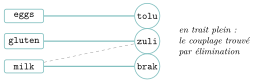

# Défis Advent of Code

<p class="sous-titre">Graphes</p>

## <span class="etiquette">Défi 1</span> Jurassic Jigsaw

*le puzzle d’images — grilles, rotations et symétries*

<p class="infos-activite">Jour 20</p>

!!! fichiers "Fichiers à télécharger"

    [:material-folder-open: dossier en ligne](https://github.com/MathThibaud/nsi-fichiers-eleves/tree/main/terminale/08-defi-aoc-2020-20){ .md-button } [:material-zip-box: archive .zip](https://github.com/MathThibaud/nsi-fichiers-eleves/raw/main/zips/terminale-08-defi-aoc-2020-20.zip){ .md-button }

!!! consignes "Consignes"

    - L’énoncé se lit sur le site (voir le QR code) : [https://adventofcode.com/2020/day/20 ](https://adventofcode.com/2020/day/20 ). On peut le lire en anglais ou le faire traduire par le navigateur (clic droit, *Traduire en français*).

    - Avec un compte (GitHub, Google…), le bouton *get your puzzle input* donne **votre** fichier de données, à enregistrer sous `input.txt` à côté de votre programme. Sans compte : le dossier du défi (lien ci-dessus) contient des **données maison** (`input.txt`) et le programme `verifier.py`, qui dit si vos réponses sont justes.

    - **Attention aux exemples.** L’énoncé en ligne a son propre exemple, avec d’autres réponses. Les valeurs de test de cette fiche portent sur **l’exemple inventé de la fiche** (exercice « À la main ») : l’enregistrer dans un fichier `exemple.txt` à côté du programme, et ouvrir `"exemple.txt"` au lieu de `"input.txt"` pour tester.

    - La partie 2 n’apparaît qu’une fois la partie 1 validée sur le site.

    - <span class="ia ia-orange" title="IA en appui : déboguer, reformuler, vérifier ; la réponse finale est la vôtre"></span> L’IA peut aider à comprendre un message d’erreur, jamais à écrire la solution.

!!! encadre "Le défi en bref"

    **Le problème.** Une image a été découpée en une centaine de petits carrés, mélangés, tournés et retournés au hasard. Pour la reconstituer, il faut trouver quelles tuiles se touchent, en comparant leurs bords dans toutes les orientations possibles : des dizaines de milliers de comparaisons, impossibles à faire à la main.

    **Ce qu’on réinvestit.** Les **graphes** de ce chapitre : les tuiles en sont les sommets, et deux tuiles qui partagent un bord sont reliées par une arête. Le degré d’un sommet dit alors où est la tuile : 2 voisines pour un coin, 3 pour un bord, 4 à l’intérieur. La partie 1 se résout ainsi sans reconstituer l’image ; l’approfondissement assemble l’image par un **parcours** de ce graphe.

    **La démarche de la fiche.**

    1.  Comprendre comment deux tuiles se raccordent, et le vérifier à la main sur deux petites tuiles.

    2.  Lire les tuiles dans un dictionnaire, puis extraire les quatre bords de chacune.

    3.  Compter, pour chaque bord, les autres tuiles qui le possèdent : les tuiles à deux bords libres sont les coins (partie 1).

    4.  Pour la partie 2, orienter et assembler les tuiles, puis chercher un motif dans l’image obtenue.

## Lire l’énoncé

Vocabulaire utile pour lire le texte original :

|  |  |  |  |
|:---|:---|:---|:---|
| tile | tuile, morceau d’image | reassemble | réassembler |
| rotated / flipped | tourné / retourné (en miroir) | border / edge | bord |
| line up | coïncider, s’aligner | outermost | le plus à l’extérieur |
| corner | coin | ID number | numéro d’identification |
| sea monster | monstre marin (motif à chercher) | roughness | rugosité (partie 2) |

!!! encadre "Résumé de l’énoncé (partie 1)"

    **Contexte.** Les messages du satellite contiennent en fait une photo, mais l’appareil l’a envoyée découpée en petits carrés (des « tuiles »), mélangés et, pire, tournés ou retournés au hasard. Il faut reconstituer ce puzzle. Pour commencer, il suffit de trouver les quatre tuiles des coins.

    **Les données.** Le fichier est une suite de blocs séparés par une ligne vide. Chaque bloc est une tuile : une ligne <code>Tile &lt;numéro&gt;:</code> qui donne son numéro, suivie d’une grille carrée de $10 \times 10$ caractères, `.` (blanc) ou `#` (noir). Le nombre de tuiles est un carré parfait : l’image complète est un carré de tuiles.

    **La règle.**

    - Chaque tuile a pu être tournée d’un nombre quelconque de quarts de tour et/ou retournée en miroir.

    - Deux tuiles voisines dans l’image ont, une fois bien orientées, des bords identiques : c’est ce qui permet de les raccorder.

    - Les bords extérieurs de l’image ne correspondent à aucune autre tuile.

    - En pratique, deux tuiles non voisines n’ont jamais de bord commun : un bord partagé désigne donc sans ambiguïté deux voisines.

    **La réponse attendue.** Le produit des numéros des quatre tuiles placées aux coins de l’image. Par exemple, si les coins portaient les numéros 2, 3, 5 et 7, la réponse serait $2 \times 3 \times 5 \times 7 = 210$.

### <span class="exo-num">Exercice 1</span> — Vérifier sa compréhension <span class="ia ia-orange" title="IA en appui : déboguer, reformuler, vérifier ; la réponse finale est la vôtre"></span> { #ex-08-graphes-aoc-1-1 }

**But.** Comprendre comment se comparent deux bords et ce que révèle le nombre de bords libres d’une tuile.

**À quoi ça sert ?** La deuxième question donne la clé de la partie 1 : on reconnaît un coin à son nombre de bords sans correspondant, ce qui évite d’assembler l’image.

1.  Deux bords qui se correspondent peuvent apparaître « à l’envers » l’un par rapport à l’autre : pourquoi ?

2.  Combien de bords sans correspondant a une tuile de coin ? une tuile du bord de l’image ? une tuile intérieure ?

3.  Faut-il reconstituer toute l’image pour la partie 1 ?

### <span class="exo-num">Exercice 2</span> — À la main, sur un petit exemple <span class="ia ia-orange" title="IA en appui : déboguer, reformuler, vérifier ; la réponse finale est la vôtre"></span> { #ex-08-graphes-aoc-1-2 }

**But.** Écrire les bords de deux petites tuiles et trouver celui qu’elles partagent.

**À quoi ça sert ?** On fait à la main exactement ce que fera le programme : extraire quatre bords, et les comparer à l’endroit et à l’envers. Le résultat connu (bord droit de A, bord gauche de B) servira de test.

Voici deux tuiles inventées de taille $5\times 5$ :

```console
Tuile A
#.#..
#.#..
#...#
.#.##
#....
```

```console
Tuile B
.#...
##.##
###.#
....#
.#.##
```

1.  Écrire les quatre bords de chaque tuile sous forme de chaînes, en lisant toujours de gauche à droite (haut, bas) ou de haut en bas (gauche, droite).

2.  Montrer qu’un seul bord de A coïncide avec un bord de B, à condition de lire l’un des deux à l’envers. Vérification : il s’agit du bord droit de A et du bord gauche de B.

3.  Pour placer B à droite de A, B doit-il être tourné, retourné, ou laissé tel quel ?

## Programmer la partie 1

!!! encadre "Outil Python : strip (nettoyer une ligne lue)"

    Chaque ligne lue dans un fichier (avec `for ligne in fichier` ou `readlines()`) se termine par le caractère de fin de ligne `"\n"` (sauf parfois la dernière). `ligne.strip()` renvoie une copie de la ligne sans les espaces ni les fins de ligne placés au début et à la fin.

    ```python
    ligne = "1721\n"
    print(ligne.strip())                  # 1721
    print(len(ligne), len(ligne.strip())) # 5 4
    ```

    **Intérêt.** Comparer ou découper une ligne sans que la fin de ligne ne gêne : `"abc\n" == "abc"` vaut `False`.

### <span class="exo-num">Exercice 3</span> — Lire les tuiles <span class="ia ia-orange" title="IA en appui : déboguer, reformuler, vérifier ; la réponse finale est la vôtre"></span> { #ex-08-graphes-aoc-1-3 }

**But.** Ranger chaque tuile, sous forme de liste de chaînes, dans un dictionnaire indexé par son numéro.

**À quoi ça sert ?** Toute la suite manipule les tuiles par leur numéro (la réponse est un produit de numéros) ; vérifier que leur nombre est un carré parfait permet aussi de contrôler la lecture.

Construire un dictionnaire `tuiles` qui associe à chaque numéro (un entier) la tuile sous forme de liste de chaînes. Vérifier le nombre de tuiles : est-ce un carré parfait ?

??? pouce "Coup de pouce"

    Les tuiles sont séparées par une ligne vide : `split("\n\n")`. La première ligne d’un bloc donne le numéro : une tranche enlève le texte `Tile ` et le `:` final.

!!! encadre "Outils Python : lire une chaîne à l’envers, construire une colonne, comparer deux chaînes"

    `s[::-1]` est la tranche qui parcourt `s` avec un pas de $-1$ : c’est la chaîne à l’envers. Pour obtenir une **colonne** d’une tuile, on part d’une chaîne vide et on lui ajoute, ligne après ligne, le caractère voulu. Enfin `min(a, b)` et `<` comparent deux chaînes dans l’ordre « alphabétique » des caractères (l’ordre de leurs codes : `#` vient avant `.`).

    ```python
    tuile = ["#.#", "..#", "##."]
    print(tuile[0][::-1])               # "#.#" lu a l'envers : "#.#"
    print("..#"[::-1])                  # "#.."
    gauche = ""
    for ligne in tuile:
        gauche += ligne[0]              # premier caractere de chaque ligne
    print(gauche)                       # "#.#"
    print(min("..#", "#.."))            # "#.." car "#" < "."
    ```

    **Intérêt.** Avec `min(b, b[::-1])`, un bord et son inverse donnent **la même** chaîne : on peut alors les ranger sous une seule clé de dictionnaire. Question : écrire le bord droit de cette tuile avec une boucle. Que vaut `min("##.", ".##")` ?

### <span class="exo-num">Exercice 4</span> — Les bords <span class="ia ia-orange" title="IA en appui : déboguer, reformuler, vérifier ; la réponse finale est la vôtre"></span> { #ex-08-graphes-aoc-1-4 }

**But.** Extraire les quatre bords d’une tuile, puis compter pour chacun les autres tuiles qui le possèdent.

**À quoi ça sert ?** Ce comptage construit en fait les arêtes du graphe des tuiles : un bord possédé par une autre tuile est une liaison avec une voisine, un bord possédé par aucune autre est un bord de l’image.

Écrire une fonction `bords(tuile)` qui renvoie la liste `[haut, bas, gauche, droite]` des quatre bords, lus comme dans l’exercice « À la main, sur un petit exemple ». Puis, pour chaque tuile, compter combien de ses bords ne se retrouvent, à l’endroit ou à l’envers, chez aucune *autre* tuile.

??? pouce "Coup de pouce"

    Une boucle qui ajoute `ligne[0]` à une chaîne, vide au départ, donne le bord gauche ; `chaine[::-1]` lit une chaîne à l’envers.

### <span class="exo-num">Exercice 5</span> — Les coins <span class="ia ia-orange" title="IA en appui : déboguer, reformuler, vérifier ; la réponse finale est la vôtre"></span> { #ex-08-graphes-aoc-1-5 }

**But.** Repérer les tuiles qui ont exactement deux bords libres et multiplier leurs numéros.

**À quoi ça sert ?** C’est la réponse de la partie 1. Ces quatre coins seront aussi le point de départ de l’assemblage de la partie 2.

Une tuile de coin a exactement deux bords qui ne correspondent à aucune autre tuile. Repérer les quatre coins et calculer la réponse.

??? pouce "Coup de pouce"

    Construire un dictionnaire qui associe à chaque bord, mis sous une forme *canonique* (le plus petit, dans l’ordre alphabétique, entre le bord et son inverse : `min(b, b[::-1])`), la liste des tuiles qui le possèdent. Un bord de tuile est « libre » si cette liste n’a qu’un élément.

## Partie 2

Une fois la partie 1 validée, lire la suite de l’énoncé sur le site. Cette partie est **longue** : la découper en étapes et tester chacune.

!!! encadre "Résumé de la partie 2 (à lire après avoir validé la partie 1)"

    **Ce qui change.** Il faut maintenant reconstituer vraiment l’image, puis y chercher des monstres marins, dont le dessin (un motif de `#`) est donné sur le site.

    **La nouvelle règle.**

    - Assembler l’image en orientant chaque tuile pour que ses bords coïncident avec ceux de ses voisines.

    - Retirer le bord (première et dernière lignes et colonnes) de chaque tuile, puis recoller les tuiles : chacune devient un carré $8 \times 8$.

    - Chercher le motif dans l’une des 8 orientations de l’image : chaque `#` du motif doit tomber sur un `#` de l’image, les autres cases du motif sont quelconques.

    - Une seule orientation de l’image contient des monstres.

    **La réponse attendue.** Le nombre de `#` de l’image qui n’appartiennent à aucun monstre. Par exemple, si l’image contenait 100 `#` dont 30 couverts par des monstres, la réponse serait 70.

### <span class="stars" title="Niveau 2 sur 3">★★</span> <span class="exo-num">Exercice 6</span> — Assembler l’image <span class="ia ia-orange" title="IA en appui : déboguer, reformuler, vérifier ; la réponse finale est la vôtre"></span> { #ex-08-graphes-aoc-1-6 }

**But.** Écrire les fonctions qui tournent et retournent une tuile, puis placer toutes les tuiles dans la bonne orientation.

**À quoi ça sert ?** Sans image assemblée, impossible de chercher le monstre. C’est l’étape la plus longue : les huit orientations, obtenues avec seulement deux fonctions, servent aussi bien pour les tuiles que pour l’image entière.

Écrire `rotation(tuile)` (quart de tour) et `symetrie(tuile)` (miroir), puis `orientations(tuile)` qui renvoie les huit positions possibles (encadré « Les huit orientations d’une grille carrée », section « Pour y arriver »). Assembler ensuite toute l’image en suivant l’encadré « Stratégie d’assemblage pas à pas ».

??? pouce "Coup de pouce"

    Tester `rotation` sur la tuile A : quatre rotations successives doivent redonner A, et `orientations(A)` doit contenir 8 tuiles toutes différentes.

??? pouce "Coup de pouce 2 (début de solution)"

    Pour une liste de chaînes `t` de taille $n$, la ligne `j` de la tuile tournée d’un quart de tour dans le sens horaire est formée des caractères `t[n - 1 - i][j]` pour `i` de `0` à `n - 1`, ajoutés un par un à une chaîne vide au départ.

!!! encadre "Outil Python : les ensembles (set), et rappel sur le drapeau"

    Pour tester si **toutes** les cases d’une liste sont des `#`, on utilise un booléen « drapeau » (méthode du défi *Handy Haversacks*, chapitre 1) : il part de `True` et la boucle le passe à `False` au premier contre-exemple. Un **ensemble** est une collection sans doublon et sans ordre ; on y ajoute avec `add`, on réunit deux ensembles avec `a | b`, et le test `x in ensemble` est très rapide (encadré « les ensembles » du défi *Crab Combat*, chapitre 4).

    ```python
    image = ["#.#", "###"]
    cases = [(0, 0), (1, 1)]
    tout_diese = True
    for i, j in cases:
        if image[i][j] != "#":
            tout_diese = False
    print(tout_diese)                    # True
    couvertes = set()                    # ensemble vide (attention : {} est un dict)
    couvertes.add((0, 0))
    couvertes = couvertes | {(0, 0), (1, 1)}   # reunion : (0, 0) n'est pas compte deux fois
    print(len(couvertes))                # 2
    print((1, 1) in couvertes)           # True
    ```

    **Intérêt.** Si deux monstres se chevauchaient, une case commune ne serait comptée qu’une fois dans l’ensemble. Question : que vaudrait `tout_diese` avec la liste de cases `[(0, 0), (0, 1)]` ?

### <span class="stars" title="Niveau 2 sur 3">★★</span> <span class="exo-num">Exercice 7</span> — Chercher le motif <span class="ia ia-orange" title="IA en appui : déboguer, reformuler, vérifier ; la réponse finale est la vôtre"></span> { #ex-08-graphes-aoc-1-7 }

**But.** Recoller l’image sans les bords des tuiles, y repérer toutes les positions du monstre, et compter les `#` restants.

**À quoi ça sert ?** C’est la réponse de la partie 2. Ranger les cases couvertes dans un ensemble garantit qu’une case commune à deux monstres n’est retirée qu’une fois.

Retirer les bords de chaque tuile, recoller l’image, puis chercher le motif dans chacune de ses huit orientations. Calculer la réponse demandée.

??? pouce "Coup de pouce"

    Stocker le motif comme une liste de décalages `(ligne, colonne)` des cases `#` ; le motif est présent à la position `(i, j)` si (avec un drapeau) toutes les cases `(i + dl, j + dc)` de l’image sont des `#`. Une seule orientation de l’image contient des motifs.

## Pour y arriver : orientations et assemblage

!!! encadre "Les huit orientations d’une grille carrée"

    Un carré peut être tourné de $0$, $1$, $2$ ou $3$ quarts de tour : cela fait 4 positions. On peut aussi le retourner (miroir gauche-droite) avant de le tourner : 4 positions de plus. Toute autre transformation (miroir haut-bas, miroir selon une diagonale) redonne l’une de ces 8 positions : par exemple, le miroir haut-bas est un miroir gauche-droite suivi d’un demi-tour. Il suffit donc de deux fonctions, `rotation` et `symetrie`, pour toutes les obtenir.

!!! encadre "Stratégie d’assemblage pas à pas"

    1.  Prendre un coin trouvé en partie 1 et chercher l’orientation où ses deux bords libres sont en haut et à gauche : il sera la case $(0, 0)$.

    2.  Remplir la première ligne de gauche à droite : pour la case suivante, chercher parmi les tuiles non placées celle qui, dans l’une de ses 8 orientations, a un bord gauche égal au bord droit de la tuile précédente.

    3.  Pour les lignes suivantes, chaque tuile doit avoir son bord haut égal au bord bas de la tuile du dessus.

    4.  Grâce à la partie 1, on sait que chaque bord intérieur n’est partagé que par deux tuiles : à chaque étape, il y a donc une seule tuile possible.

## Approfondissement

### <span class="stars" title="Niveau 2 sur 3">★★</span> <span class="exo-num">Exercice 8</span> — Approfondissement 1 : assembler par un parcours <span class="ia ia-orange" title="IA en appui : déboguer, reformuler, vérifier ; la réponse finale est la vôtre"></span> { #ex-08-graphes-aoc-1-8 }

**But.** Assembler l’image en partant de n’importe quelle tuile et en propageant le placement de voisine en voisine.

**À quoi ça sert ?** C’est un parcours du graphe des tuiles, avec une pile comme dans le cours : la méthode n’a plus besoin de commencer par un coin, et l’on reconnaît un algorithme général derrière un problème de puzzle.

La stratégie du défi part d’un coin et remplit l’image ligne par ligne. On peut aussi partir de **n’importe quelle** tuile, laissée telle quelle à la position $(0, 0)$, et propager : pour chaque tuile placée, on cherche ses voisines par ses quatre bords, on les oriente et on les place à côté. Les positions peuvent devenir négatives ; on « recadre » à la fin.

1.  À la main, avec les tuiles A et B de la fiche : A est placée telle quelle en $(0, 0)$. À quelle position va B, et dans quelle orientation ? Quelle serait la position de **A**, et son orientation, si l’on avait placé B en premier, telle quelle, en $(0, 0)$ ?

2.  Écrire `assembler_parcours(tuiles)` qui utilise une **pile** des tuiles placées mais pas encore traitées, et un dictionnaire `place` qui associe à chaque position `(ligne, colonne)` la tuile orientée. Vérifier qu’on obtient la même réponse à la partie 2.

    ??? pouce "Coup de pouce"

        Pour le côté droit d’une tuile `t` placée en `(l, c)` : la voisine (si elle existe et n’est pas encore placée) va en `(l, c + 1)`, dans l’orientation dont le bord **gauche** est égal au bord droit de `t`. Idem pour les trois autres côtés.

    ??? pouce "Coup de pouce 2 (début de solution)"

        Une liste `COTES` de quadruplets `(dl, dc, mon_bord, son_bord)`, par exemple `(0, 1, droite, gauche)`, évite d’écrire quatre fois le même code (les fonctions sont des valeurs comme les autres). Recadrage : soustraire à toutes les positions le plus petit numéro de ligne et le plus petit numéro de colonne, trouvés par une boucle sur les clés de `place`.

3.  Cette méthode suppose qu’aucun bord n’est un palindrome (une chaîne égale à son inverse). Pourquoi ? La méthode du défi a-t-elle le même défaut ?

4.  Comparer les deux méthodes : nombre de tuiles examinées, longueur du code. Quel parcours de graphe reconnaît-on ?

## <span class="etiquette">Défi 2</span> Allergen Assessment

*les allergènes — ensembles, intersections et élimination*

<p class="infos-activite">Jour 21</p>

!!! fichiers "Fichiers à télécharger"

    [:material-folder-open: dossier en ligne](https://github.com/MathThibaud/nsi-fichiers-eleves/tree/main/terminale/08-defi-aoc-2020-21){ .md-button } [:material-zip-box: archive .zip](https://github.com/MathThibaud/nsi-fichiers-eleves/raw/main/zips/terminale-08-defi-aoc-2020-21.zip){ .md-button }

!!! consignes "Consignes"

    - L’énoncé se lit sur le site (voir le QR code) : [https://adventofcode.com/2020/day/21 ](https://adventofcode.com/2020/day/21 ). On peut le lire en anglais ou le faire traduire par le navigateur (clic droit, *Traduire en français*).

    - Avec un compte (GitHub, Google…), le bouton *get your puzzle input* donne **votre** fichier de données, à enregistrer sous `input.txt` à côté de votre programme. Sans compte : le dossier du défi (lien ci-dessus) contient des **données maison** (`input.txt`) et le programme `verifier.py`, qui dit si vos réponses sont justes.

    - **Attention aux exemples.** L’énoncé en ligne a son propre exemple, avec d’autres réponses. Les valeurs de test de cette fiche portent sur **l’exemple inventé de la fiche** (exercice « À la main ») : l’enregistrer dans un fichier `exemple.txt` à côté du programme, et ouvrir `"exemple.txt"` au lieu de `"input.txt"` pour tester.

    - La partie 2 n’apparaît qu’une fois la partie 1 validée sur le site.

    - <span class="ia ia-orange" title="IA en appui : déboguer, reformuler, vérifier ; la réponse finale est la vôtre"></span> L’IA peut aider à comprendre un message d’erreur, jamais à écrire la solution.

!!! encadre "Le défi en bref"

    **Le problème.** On dispose d’une liste d’aliments : pour chacun, ses ingrédients (dans une langue inconnue) et quelques-uns des allergènes qu’il contient. On veut en déduire quels ingrédients sont sans danger, puis quel ingrédient contient chaque allergène. Le raisonnement est celui d’une enquête par recoupements, mais avec des dizaines de lignes et des centaines d’ingrédients : il faut un programme.

    **Ce qu’on réinvestit.** Les **graphes** de ce chapitre : relier chaque allergène aux ingrédients qui peuvent le contenir donne un graphe, et l’élimination de la partie 2 retire des arêtes jusqu’à ce qu’il n’en reste qu’une par allergène. Pour trouver ces arêtes, on utilise les opérations sur les **ensembles** : l’intersection garde ce qui est commun à plusieurs lignes, la réunion rassemble les suspects.

    **La démarche de la fiche.**

    1.  Comprendre ce qu’une ligne permet de déduire (et ce qu’elle ne permet pas), puis mener l’enquête à la main sur un petit fichier.

    2.  Lire chaque aliment comme deux ensembles : ses ingrédients et ses allergènes.

    3.  Calculer les candidats de chaque allergène, puis compter les ingrédients sans danger (partie 1).

    4.  Éliminer pas à pas pour attribuer chaque allergène à un ingrédient (partie 2).

## Lire l’énoncé

Vocabulaire utile pour lire le texte original :

|                 |                    |                |                        |
|:----------------|:-------------------|:---------------|:-----------------------|
| ingredient      | ingrédient         | allergen       | allergène              |
| food            | aliment            | contains       | contient               |
| listed / marked | indiqué, mentionné | safe           | sans danger            |
| exactly one     | exactement un      | zero or one    | zéro ou un             |
| dangerous       | dangereux          | alphabetically | par ordre alphabétique |

!!! encadre "Résumé de l’énoncé (partie 1)"

    **Contexte.** Pour rejoindre votre île, vous construisez un radeau et devez emporter des provisions. Problème : les étiquettes des aliments sont écrites dans une langue inconnue ; seuls certains allergènes sont indiqués dans une langue que vous comprenez. Avant de choisir vos provisions, vous voulez repérer les ingrédients qui sont certainement sans danger.

    **Les données.** Chaque ligne du fichier décrit un aliment. Elle commence par sa liste d’ingrédients (des mots illisibles), séparés par des espaces, puis vient `(contains` suivi de quelques allergènes séparés par des virgules, et une parenthèse fermante. Par exemple, `kesa zuli brak (contains milk)` : trois ingrédients et un allergène indiqué.

    **La règle.**

    - Chaque allergène se trouve dans exactement un ingrédient ; un ingrédient contient zéro ou un allergène.

    - Si un allergène est indiqué sur une ligne, l’ingrédient qui le contient figure forcément sur cette ligne.

    - Mais un allergène peut être présent dans un aliment sans y être indiqué : l’absence de mention ne prouve rien.

    - Un ingrédient est sans danger s’il ne peut contenir aucun des allergènes, compte tenu de toutes les lignes.

    **La réponse attendue.** Le nombre total d’apparitions des ingrédients sans danger : un ingrédient présent sur trois lignes compte trois fois. Par exemple, avec les deux lignes `rel mux tap (contains soy)` et `mux dov (contains soy)`, seul `mux` peut contenir `soy` ; `rel`, `tap` et `dov` sont sans danger et apparaissent une fois chacun : la réponse serait 3.

### <span class="exo-num">Exercice 1</span> — Vérifier sa compréhension <span class="ia ia-orange" title="IA en appui : déboguer, reformuler, vérifier ; la réponse finale est la vôtre"></span> { #ex-08-graphes-aoc-2-1 }

**But.** Distinguer ce qu’une ligne prouve et ce qu’elle ne prouve pas.

**À quoi ça sert ?** Ces trois questions contiennent toute la logique du défi : la première conduit à l’intersection des lignes, les deux suivantes évitent d’éliminer un ingrédient à tort.

1.  Un allergène est indiqué sur deux lignes : où peut se trouver l’ingrédient qui le contient ?

2.  Un ingrédient absent d’une ligne qui indique `milk` peut-il contenir `milk` ?

3.  Un ingrédient présent sur une ligne qui n’indique pas `milk` peut-il contenir `milk` ?

### <span class="exo-num">Exercice 2</span> — À la main, sur un petit exemple <span class="ia ia-orange" title="IA en appui : déboguer, reformuler, vérifier ; la réponse finale est la vôtre"></span> { #ex-08-graphes-aoc-2-2 }

**But.** Mener l’enquête à la main sur cinq aliments.

**À quoi ça sert ?** On découvre la méthode (garder les ingrédients communs à toutes les lignes d’un allergène) avant de la programmer, et l’on obtient une réponse connue, `7`, pour tester le programme.

On considère le fichier (inventé) suivant :

```console
brak zuli monto pirf (contains gluten, milk)
zuli kesa tolu (contains gluten)
monto tolu brak vemi (contains eggs)
tolu pirf zuli (contains gluten, eggs)
kesa zuli brak (contains milk)
```

1.  Pour l’allergène `gluten`, quels ingrédients figurent sur *toutes* les lignes qui le mentionnent ? Faire de même pour `eggs` et `milk`.

2.  En déduire les ingrédients qui ne peuvent contenir aucun allergène, et la réponse de la partie 1. Vérification : on doit trouver `7`.

3.  L’ingrédient `monto` figure sur une ligne qui mentionne `milk`. Pourquoi est-il pourtant sans danger ?

## Programmer la partie 1

!!! encadre "Outil Python : les ensembles (set) — rappel"

    Tout est présenté dans l’encadré « Outil Python : les ensembles » du défi *Crab Combat* (chapitre 4) : `set()`, `add`, `remove`, test `x in ensemble` en temps constant, parcours avec `for`, éléments non modifiables (tuples), **réunion** `a | b` (éléments présents dans l’un ou dans l’autre) et **intersection** `a & b` (éléments présents dans les deux). Ces deux opérateurs renvoient un nouvel ensemble, sans modifier `a` ni `b`.

    **À essayer.** Avec `a = set("brak zuli monto".split())` et `b = {"zuli", "kesa", "brak"}`, que valent `a & b`, `b & a` et `a | b` ? Écrire une boucle qui construit l’ensemble des éléments de `b` absents de `a`. Que vaut `len(a & set())` ?

!!! encadre "Outil Python : strip (nettoyer une ligne lue)"

    Chaque ligne lue dans un fichier (avec `for ligne in fichier` ou `readlines()`) se termine par le caractère de fin de ligne `"\n"` (sauf parfois la dernière). `ligne.strip()` renvoie une copie de la ligne sans les espaces ni les fins de ligne placés au début et à la fin.

    ```python
    ligne = "1721\n"
    print(ligne.strip())                  # 1721
    print(len(ligne), len(ligne.strip())) # 5 4
    ```

    **Intérêt.** Comparer ou découper une ligne sans que la fin de ligne ne gêne : `"abc\n" == "abc"` vaut `False`.

### <span class="exo-num">Exercice 3</span> — Lire le fichier <span class="ia ia-orange" title="IA en appui : déboguer, reformuler, vérifier ; la réponse finale est la vôtre"></span> { #ex-08-graphes-aoc-2-3 }

**But.** Transformer chaque ligne en un couple de deux ensembles : ingrédients et allergènes.

**À quoi ça sert ?** Les ensembles rendent les recoupements immédiats (une intersection avec `&`) et toutes les questions suivantes partent de cette liste `aliments`.

Construire la liste `aliments` : chaque aliment est un couple `(ingredients, allergenes)` de deux ensembles de chaînes.

??? pouce "Coup de pouce"

    Après `strip`, `ligne.split(" (contains ")` sépare les deux parties ; il reste à enlever la parenthèse finale (le dernier caractère) avec la tranche `[:-1]` puis à couper selon `", "`.

### <span class="exo-num">Exercice 4</span> — Les candidats <span class="ia ia-orange" title="IA en appui : déboguer, reformuler, vérifier ; la réponse finale est la vôtre"></span> { #ex-08-graphes-aoc-2-4 }

**But.** Associer à chaque allergène l’ensemble des ingrédients qui peuvent le contenir.

**À quoi ça sert ?** Ce dictionnaire est le graphe allergènes–ingrédients du défi : il donne les suspects de la partie 1 et sert de point de départ à l’élimination de la partie 2.

Écrire une fonction `candidats(aliments)` qui renvoie un dictionnaire associant à chaque allergène l’ensemble des ingrédients qui peuvent le contenir. Tester sur l’exemple.

??? pouce "Coup de pouce"

    L’ingrédient qui contient un allergène est présent sur chaque ligne où cet allergène est indiqué : il est donc dans l’**intersection** (opérateur `&`) des ensembles d’ingrédients de ces lignes.

### <span class="exo-num">Exercice 5</span> — Compter <span class="ia ia-orange" title="IA en appui : déboguer, reformuler, vérifier ; la réponse finale est la vôtre"></span> { #ex-08-graphes-aoc-2-5 }

**But.** Rassembler tous les suspects, puis compter les apparitions des autres ingrédients.

**À quoi ça sert ?** C’est la réponse de la partie 1. Le piège est de compter chaque ingrédient une seule fois au lieu de compter chacune de ses apparitions.

Calculer l’ensemble des ingrédients « suspects » (réunion des candidats), puis compter les apparitions des autres ingrédients dans le fichier.

??? pouce "Coup de pouce"

    Réunion de plusieurs ensembles : partir de `set()` et le remplacer, pour chaque ensemble de candidats `e`, par `suspects | e`. Pour compter, parcourir les ingrédients de chaque ligne et ajouter 1 à un compteur pour chacun qui n’est pas dans `suspects` ; attention, on compte chaque apparition sur chaque ligne.

## Partie 2

Une fois la partie 1 validée, lire la suite de l’énoncé sur le site.

!!! encadre "Résumé de la partie 2 (à lire après avoir validé la partie 1)"

    **Ce qui change.** Il reste à identifier précisément les ingrédients dangereux, pour pouvoir les éviter.

    **La nouvelle règle.**

    - Déterminer, pour chaque allergène, l’ingrédient qui le contient ; avec les données fournies, la solution est unique.

    - Ranger ces ingrédients dans l’ordre alphabétique de leur **allergène** (et non de leur propre nom).

    **La réponse attendue.** La liste de ces ingrédients, séparés par des virgules sans espace. Par exemple, si `soy` était dans `mux` et `fish` dans `dov`, la réponse serait `dov,mux`, car `fish` vient avant `soy`.

!!! encadre "Méthode : trier puis assembler des chaînes"

    **Trier.** Les chaînes se comparent avec `<` dans l’ordre alphabétique (`"eggs" < "gluten"` vaut `True`) : le **tri par insertion** du cours de première les range donc dans l’ordre alphabétique, sans rien changer à son code.

    **Assembler.** Pour coller des chaînes en intercalant un séparateur, on part du premier mot et l’on ajoute, pour chacun des suivants, le séparateur puis le mot : il n’y a pas de virgule en trop à la fin.

    ```python
    mots = ["tolu", "zuli", "brak"]
    texte = mots[0]
    for i in range(1, len(mots)):
        texte = texte + "," + mots[i]
    print(texte)                    # tolu,zuli,brak
    ```

    Question : que se passe-t-il si la liste `mots` est vide ? Que faut-il changer pour obtenir `tolu - zuli - brak` ?

### <span class="exo-num">Exercice 6</span> — Attribuer chaque allergène <span class="ia ia-orange" title="IA en appui : déboguer, reformuler, vérifier ; la réponse finale est la vôtre"></span> { #ex-08-graphes-aoc-2-6 }

**But.** Réduire les candidats par élimination jusqu’à un seul ingrédient par allergène, puis écrire la réponse dans le bon ordre.

**À quoi ça sert ?** C’est la réponse de la partie 2 : en termes de graphe, on retire des arêtes jusqu’à ce que chaque allergène ne soit plus relié qu’à un ingrédient.

Déterminer quel ingrédient contient chaque allergène, puis construire la chaîne demandée. Sur l’exemple inventé de la fiche, on doit obtenir `tolu,zuli,brak`.

??? pouce "Coup de pouce"

    C’est le même raisonnement qu’un sudoku : un allergène qui n’a plus qu’un seul candidat est résolu, et cet ingrédient peut être retiré des candidats de tous les autres allergènes.

??? pouce "Coup de pouce 2 (début de solution)"

    Tant que le dictionnaire des candidats n’est pas vide : chercher un allergène dont l’ensemble a une seule valeur, le retirer du dictionnaire (`del`) en notant l’ingrédient dans un dictionnaire `attribution`, puis retirer cet ingrédient (`remove`, après avoir testé `in`) de tous les autres ensembles. Pour la réponse, trier les **allergènes** (tri par insertion), puis assembler les ingrédients correspondants.

### <span class="stars" title="Niveau 3 sur 3">★★★</span> <span class="exo-num">Exercice 7</span> — Défi : et si ça bloquait ? <span class="ia ia-orange" title="IA en appui : déboguer, reformuler, vérifier ; la réponse finale est la vôtre"></span> { #ex-08-graphes-aoc-2-7 }

**But.** Chercher un cas où la méthode d’élimination ne permet plus d’avancer.

**À quoi ça sert ?** Le programme marche sur les données du défi, mais rien ne garantit qu’il marche toujours : construire un contre-exemple permet de connaître les limites d’un algorithme et d’imaginer une méthode plus générale.

Inventer un petit fichier pour lequel la méthode d’élimination ne suffit pas : à un moment, aucun allergène n’a un seul candidat. Que faudrait-il faire alors ?

??? pouce "Coup de pouce"

    Essayer avec deux allergènes indiqués toujours ensemble, sur les mêmes lignes : le problème a-t-il encore une seule solution ? Dans les cas où la solution est unique mais où l’élimination bloque, on peut tester les possibilités une à une (retour sur trace).

!!! encadre "Un peu d’histoire : Philip Hall et le « problème des mariages » (1935)"

    **Le graphe du défi.** Dessinons les allergènes d’un côté, les ingrédients de l’autre, et relions chaque allergène à ses candidats. Toutes les arêtes vont d’un groupe à l’autre : c’est un graphe **biparti**. Choisir un ingrédient par allergène, deux allergènes n’ayant jamais le même ingrédient, revient à garder des arêtes **sans sommet commun** : on appelle cela un **couplage**. Sur le petit exemple de la fiche :

    { .tikz loading=lazy }

    **Le théorème.** En 1935, le mathématicien anglais **Philip Hall** (1904–1982), spécialiste d’algèbre à Cambridge, publie un article de cinq pages, *On Representatives of Subsets*. Il y répond à une question simple : à quelle condition peut-on choisir, dans chaque ensemble d’une liste, un élément différent pour chacun ? Réponse : il faut et il suffit que **tout groupe de $k$ ensembles contienne, à eux tous, au moins $k$ éléments différents**. La condition est évidemment nécessaire (trois allergènes qui n’ont que deux candidats à eux trois ne peuvent pas être servis) ; le tour de force de Hall est de prouver qu’elle suffit. En 1950, Paul Halmos et Herbert Vaughan le reformulent avec des jeunes filles qui veulent chacune épouser un garçon qu’elle connaît : depuis, on l’appelle le **théorème des mariages**.

    **Et aujourd’hui.** En 1962, David Gale et Lloyd Shapley étudient la version où chacun classe ses partenaires par préférence (« mariages stables ») ; leur algorithme sert à répartir des étudiants entre des formations (la procédure Parcoursup s’en inspire) et a valu à Shapley le prix Nobel d’économie 2012, partagé avec Alvin Roth.

    *Sources :* P. Hall, « On Representatives of Subsets », *J. London Math. Soc.*, 10 (1935), p. 26–30 ; P. Halmos et H. Vaughan, « The Marriage Problem », *Amer. J. Math.*, 72 (1950) ; D. Gale et L. Shapley, « College Admissions and the Stability of Marriage », *Amer. Math. Monthly*, 69 (1962).
