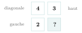
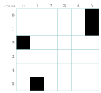
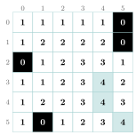
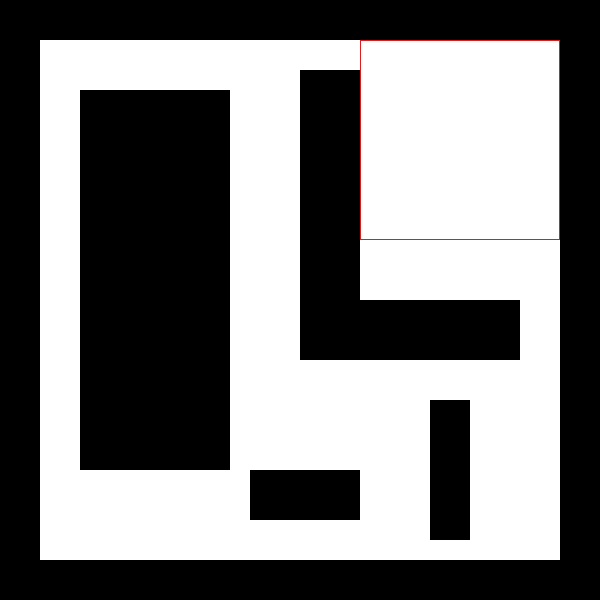
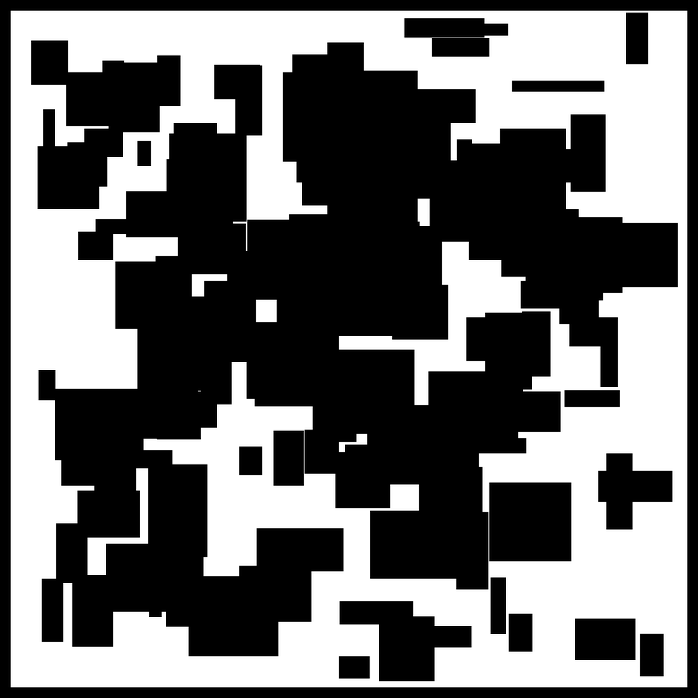
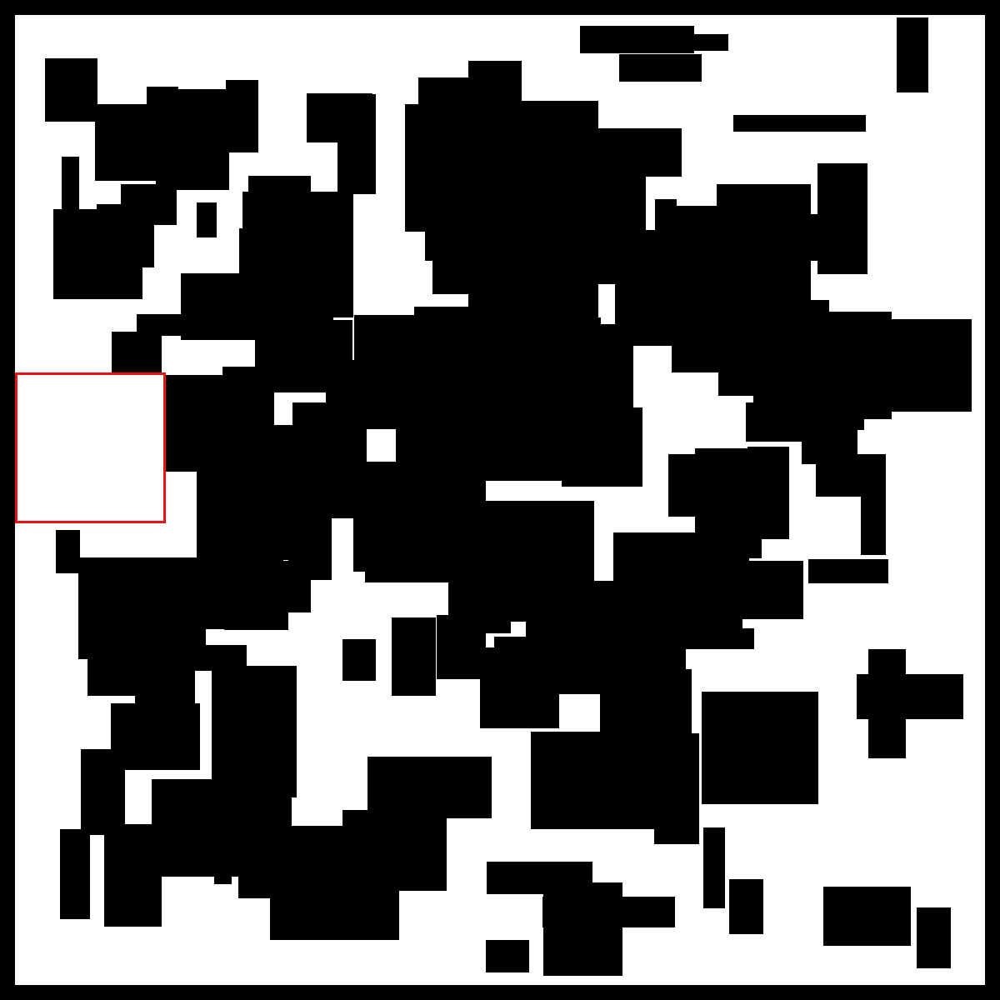
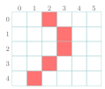
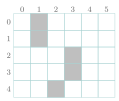

# TP et projets

<p class="sous-titre">Programmation dynamique</p>

## <span class="etiquette">TP</span> Le plus grand carré blanc

!!! fichiers "Fichiers à télécharger"

    [:material-folder-open: dossier en ligne](https://github.com/MathThibaud/nsi-fichiers-eleves/tree/main/terminale/11-tp-carre-blanc){ .md-button } [:material-zip-box: archive .zip](https://github.com/MathThibaud/nsi-fichiers-eleves/raw/main/zips/terminale-11-tp-carre-blanc.zip){ .md-button }

*Ce TP guidé réinvestit tout le chapitre : on découvre une **récurrence** en remplissant une grille à la main, puis on la programme en **récursif**, on l’accélère par **mémoïsation**, et enfin on la déroule en **tabulation** sur une vraie image. Fil rouge du chapitre : « ne jamais recalculer deux fois la même chose ».*

**Fichier à télécharger** (lien ci-dessus) : `carre_blanc.py` (chargement de l’image, **trame** des fonctions à écrire et **tests** — `python3 carre_blanc.py` affiche `OK` ou `A FAIRE ou ECHEC` pour chaque fonction). Il nécessite la bibliothèque `PIL` (Pillow) et les images fournies.

## Le problème

On dispose d’une image en **noir et blanc**. On cherche la taille du **plus grand carré entièrement blanc** que l’on peut y dessiner (côtés parallèles aux bords).

{ .photo loading=lazy style="width:271px" }

**Convention.** Un pixel a pour coordonnées `(x, y)`, où `x` est la **colonne** et `y` la **ligne** (comme dans la bibliothèque `PIL`). L’idée centrale, qui va tout débloquer :

!!! encadre "La bonne question à se poser"

    Pour chaque pixel, on calcule la taille du plus grand carré blanc **dont ce pixel est le coin inférieur droit**. Notons cette valeur `pgcb(x, y)`. La réponse au problème sera alors le **maximum** de toutes ces valeurs.

## Découverte à la main

Travaillons d’abord sur une petite grille ($1$ = blanc, $0$ = noir), en remplissant chaque case **de gauche à droite et de haut en bas**.

### <span class="exo-num">Exercice 1</span> — Le coin inférieur droit { #ex-11-programmation-dynamique-tp-1-1 }

On regarde une case **blanche** dont les trois voisins *déjà calculés* portent les valeurs ci-dessous. Quelle valeur faut-il mettre dans la case « ? » ? (Un carré blanc s’appuyant sur ce coin est limité par le plus *petit* des trois carrés voisins.)

{ .tikz loading=lazy }

??? corrige "Corrigé"

    Un carré blanc appuyé sur ce coin ne peut pas être plus grand que le plus **petit** des trois carrés voisins : la valeur est $1 + \min(\underbrace{3}_{\text{haut}}, \underbrace{2}_{\text{gauche}}, \underbrace{4}_{\text{diag.}}) = 1 + 2 = \mathbf{3}$.

### <span class="exo-num">Exercice 2</span> — Remplir toute la grille { #ex-11-programmation-dynamique-tp-1-2 }

Recopier la grille ci-dessous et **écrire dans chaque case blanche** la valeur `pgcb`. Règles :

- case **noire** $\rightarrow$ on écrit **0** ;

- case blanche sur la **ligne du haut** ou la **colonne de gauche** $\rightarrow$ on écrit **1** ;

- autre case blanche $\rightarrow$ on écrit **$1 + \min(\text{haut},\ \text{gauche},\ \text{diagonale})$**.

{ .tikz .tikz-inline loading=lazy }

**En déduire** sur le cahier la taille du plus grand carré blanc de cette grille (le maximum des valeurs écrites).

??? corrige "Corrigé"

    Grille de départ ($1$ blanc, $0$ noir) et table `pgcb` obtenue :

    { .tikz loading=lazy }

    Le **maximum** de la table vaut **4** (cases surlignées, aux coins `(ligne 3, col 4)`, `(ligne 4, col 4)` et `(ligne 5, col 5)`) : le plus grand carré blanc de cette grille est de **côté 4**.

## La formule

!!! definition "Définition 4 — Récurrence du plus grand carré blanc"

    $$\displaystyle\texttt{pgcb}(x, y) = \begin{cases} 0 & \text{si le pixel } (x,y) \text{ est \textbf{noir},}\\  1 & \text{si le pixel est \textbf{blanc} et } x = 0 \text{ ou } y = 0,\\  1 + \min\big(\texttt{pgcb}(x{-}1, y),\ \texttt{pgcb}(x, y{-}1),\ \texttt{pgcb}(x{-}1, y{-}1)\big) & \text{sinon.} \end{cases}$$

Les deux premières lignes sont les **cas de base** ; la troisième relie un sous-problème à **trois sous-problèmes plus petits** (à gauche, au-dessus, en diagonale). C’est exactement la structure d’un problème de **programmation dynamique**.

## Version récursive

On utilise une fonction `est_noir(x, y)` renvoyant `True` si le pixel est noir. Dans `carre_blanc.py`, ce n’est encore qu’une trame qui renvoie toujours `False` : **commencer par l’écrire** (exercice « La fonction `est_noir` », section « Sur une vraie image »), car les tests de `pgcb` et de `pgcb_memo` en dépendent.

### <span class="exo-num">Exercice 3</span> — Écrire `pgcb` en récursif { #ex-11-programmation-dynamique-tp-1-3 }

<span class="routine">▷ Avant de coder.</span> Écrire trois appels attendus sous forme d’`assert` : un cas **normal**, un cas **limite**, un cas **piège**.

Recopier et compléter :

```python
def pgcb(x, y):
    if est_noir(x, y):
        return ...              # (a) cas de base : pixel noir
    elif x == 0 or y == 0:
        return ...              # (b) cas de base : bord haut / gauche
    else:
        g = ...                 # (c) a gauche
        h = ...                 # (d) au-dessus
        d = ...                 # (e) en diagonale
        return 1 + min(min(g, h), d)
```

??? corrige "Corrigé"

    ```python
    def pgcb(x, y):
        if est_noir(x, y):
            return 0                        # (a)
        elif x == 0 or y == 0:
            return 1                        # (b)
        else:
            g = pgcb(x - 1, y)                  # (c) a gauche
            h = pgcb(x, y - 1)                  # (d) au-dessus
            d = pgcb(x - 1, y - 1)              # (e) en diagonale
            return 1 + min(min(g, h), d)
    ```

### <span class="exo-num">Exercice 4</span> — Le problème de la lenteur { #ex-11-programmation-dynamique-tp-1-4 }

Si l’on teste `pgcb(250, 250)` sur l’image de la section « Sur une vraie image », le calcul ne se termine **jamais** en temps raisonnable.

1.  En observant les trois appels récursifs, expliquer pourquoi un **même** sous-problème `pgcb(x, y)` est recalculé un très grand nombre de fois. *(Indication : pensez à l’arbre des appels de `fibo` du cours.)*

2.  Quelle technique du cours permet d’y remédier ?

??? corrige "Corrigé"

    1.  Chaque appel `pgcb(x, y)` déclenche **trois** appels sur des pixels voisins, qui se **chevauchent** d’un pixel à l’autre : par exemple `pgcb(x-1, y-1)` est réclamé à la fois par `pgcb(x, y)`, par `pgcb(x-1, y)` et par `pgcb(x, y-1)`. Le **même** sous-problème est donc recalculé un nombre **exponentiel** de fois — exactement comme l’arbre d’appels de `fibo`.

    2.  On applique la **mémoïsation** : on mémorise chaque résultat déjà calculé pour ne jamais le refaire.

## Mémoïsation (top-down)

### <span class="exo-num">Exercice 5</span> — Écrire `pgcb_memo` { #ex-11-programmation-dynamique-tp-1-5 }

Écrire la fonction `pgcb_memo` qui fait le même calcul que `pgcb`, mais **mémorise** ses résultats dans un dictionnaire `memo` pour ne jamais recalculer deux fois la même case. Comme pour `fibo` dans le cours, on passe le dictionnaire en paramètre, dans la version sûre vue en remarque du cours : `def pgcb_memo(x, y, memo=None)`, puis, en tête de fonction, `if memo is None:` `memo = {}`. Vérifier que l’appel devient instantané :

```python
>>> pgcb_memo(250, 250)
21
```

??? corrige "Corrigé"

    ```python
    def pgcb_memo(x, y, memo=None):
        if memo is None:
            memo = {}                       # carnet neuf a chaque appel principal
        if (x, y) in memo:
            return memo[(x, y)]
        if est_noir(x, y):
            r = 0
        elif x == 0 or y == 0:
            r = 1
        else:
            g = pgcb_memo(x - 1, y, memo)
            h = pgcb_memo(x, y - 1, memo)
            d = pgcb_memo(x - 1, y - 1, memo)
            r = 1 + min(min(g, h), d)
        memo[(x, y)] = r
        return r
    ```

    C’est la construction de `fibo` dans le cours, dans sa version sûre (`memo=None` : le dictionnaire par défaut n’est pas partagé d’un appel à l’autre). L’appel `pgcb_memo(250, 250)` devient instantané et renvoie `21` (sans mémoïsation, `pgcb(250, 250)` dépasse $30$ millions d’appels en $10$ secondes sans finir). À la question suivante, on passe explicitement un même dictionnaire pour tous les pixels.

## Sur une vraie image

Le fichier `carre_blanc.py` charge l’image fournie `carre_blanc.png` avec `PIL` (c’est déjà écrit en haut du fichier) :

```python
from PIL import Image
NOM_IMAGE = "carre_blanc.png"
img = Image.open(NOM_IMAGE).convert("RGB")
pixels = img.load()
largeur, hauteur = img.size          # ici (600, 600)
```

### <span class="exo-num">Exercice 6</span> — La fonction `est_noir` { #ex-11-programmation-dynamique-tp-1-6 }

Écrire `est_noir(x, y)` qui renvoie `True` si le pixel `(x, y)` est noir (couleur `(0, 0, 0)`), `False` sinon.

??? corrige "Corrigé"

    ```python
    def est_noir(x, y):
        return pixels[x, y] == (0, 0, 0)
    ```

### <span class="exo-num">Exercice 7</span> — Chercher le plus grand carré de l’image { #ex-11-programmation-dynamique-tp-1-7 }

Écrire `total_pgcb()` qui **parcourt tous les pixels** de l’image, ligne par ligne (`y` puis `x`), et renvoie la taille du plus grand carré blanc, avec les coordonnées `(x, y)` de son coin inférieur droit. Plusieurs carrés peuvent avoir la même taille maximale : en cas d’égalité, on garde le **premier** coin rencontré (comparaison stricte) :

```python
>>> total_pgcb()
(200, (559, 239))
```

**Attention** : pour que ce soit efficace, il faut réutiliser **le même** dictionnaire de mémoïsation pour tous les pixels : créer `memo = {}` au début de `total_pgcb`, puis appeler `pgcb_memo(x, y, memo)`. (Un dictionnaire neuf évite aussi de réutiliser par erreur les résultats d’une autre image.)

??? corrige "Corrigé"

    On partage **un seul** dictionnaire de mémoïsation pour tous les pixels, créé au début de la fonction et passé à `pgcb_memo`, sinon le calcul reste interminable :

    ```python
    def total_pgcb():
        memo = {}                           # un seul carnet pour tous les pixels
        meilleur = 0
        coin = (0, 0)
        for y in range(hauteur):
            for x in range(largeur):
                taille = pgcb_memo(x, y, memo)
                if taille > meilleur:       # > strict : on garde le premier coin
                    meilleur = taille
                    coin = (x, y)
        return meilleur, coin
    ```

    Sur l’image fournie : `total_pgcb()` renvoie **(200, (559, 239))** — un carré blanc de **côté 200**, dont le coin inférieur droit est le pixel `(559, 239)` (le grand bloc blanc en haut à droite).

    { .photo loading=lazy style="width:271px" }  
    Le plus grand carré blanc trouvé (contour rouge), côté $200$.

### <span class="exo-num">Exercice 8</span> — Défi — la grande image { #ex-11-programmation-dynamique-tp-1-8 }

Voici une image beaucoup plus grande ($1200 \times 1200$ pixels), fournie sous le nom `carre_blanc_grand.png`. Cette fois, **impossible de deviner à l’œil** où se cache le plus grand carré blanc : plusieurs zones blanches se ressemblent ! C’est tout l’intérêt de l’algorithme.

{ .photo loading=lazy style="width:288px" }

Dans `carre_blanc.py`, remplacer `NOM_IMAGE = "carre_blanc.png"` par `NOM_IMAGE = "carre_blanc_grand.png"` (les tests sont alors remplacés par l’affichage des résultats), lancer `total_pgcb()` (ou `pgcb_bottom_up()`) et **noter sur le cahier la taille du plus grand carré blanc et son coin**. Sauriez-vous, *sans le programme*, désigner à coup sûr le bon carré ? (C’est bien là que la machine gagne.)

??? corrige "Corrigé"

    Sur `carre_blanc_grand.png` ($1200 \times 1200$), après avoir remplacé `NOM_IMAGE` par `"carre_blanc_grand.png"`, le programme renvoie un carré blanc de **côté 181**, de coin inférieur droit `(198, 627)` — une zone que l’œil n’aurait pas su désigner parmi toutes les taches blanches voisines. C’est précisément ce qu’apporte la programmation dynamique : une réponse **exacte** et **rapide** là où l’intuition est impuissante.

    { .photo loading=lazy style="width:288px" }  
    Le plus grand carré blanc de la grande image (contour rouge), côté $181$ — indevinable à l’œil.

## Bonus : tabulation (bottom-up)

### <span class="exo-num">Exercice 9</span> — Écrire `pgcb_bottom_up` { #ex-11-programmation-dynamique-tp-1-9 }

En s’inspirant **du remplissage à la main** de la section « Découverte à la main », écrire `pgcb_bottom_up` qui construit une **table** `S` de la taille de l’image, la remplit **ligne par ligne** (sans aucune récursion), et renvoie la taille et le coin du plus grand carré. Comparer avec `total_pgcb` : on doit trouver le **même** résultat.

*Ce que ce TP illustre : un même problème résolu par **mémoïsation** (on part du haut et on descend en mémorisant) puis par **tabulation** (on part des cas de base et on remonte) — les deux visages de la programmation dynamique, à parité.*

??? corrige "Corrigé"

    La table `S` (une ligne de `largeur` zéros pour chaque `y`) se construit par compréhension :

    ```python
    def pgcb_bottom_up():
        S = [[0] * largeur for y in range(hauteur)]     # S[y][x]
        meilleur = 0
        coin = (0, 0)
        for y in range(hauteur):
            for x in range(largeur):
                if est_noir(x, y):
                    S[y][x] = 0
                elif x == 0 or y == 0:
                    S[y][x] = 1
                else:
                    S[y][x] = 1 + min(min(S[y][x - 1], S[y - 1][x]), S[y - 1][x - 1])
                if S[y][x] > meilleur:
                    meilleur = S[y][x]
                    coin = (x, y)
        return meilleur, coin
    ```

    On remplit la table **ligne par ligne**, exactement comme à la main : aucune récursion, aucun dictionnaire. Le résultat est identique : **(200, (559, 239))**.

    *Mémoïsation et tabulation donnent le même résultat : ce sont les deux faces de la programmation dynamique.*

## <span class="etiquette">Projet</span> Seam carving

*redimensionner une image sans la déformer*

!!! fichiers "Fichiers à télécharger"

    [:material-folder-open: dossier en ligne](https://github.com/MathThibaud/nsi-fichiers-eleves/tree/main/terminale/11-projet-seam-carving){ .md-button } [:material-zip-box: archive .zip](https://github.com/MathThibaud/nsi-fichiers-eleves/raw/main/zips/terminale-11-projet-seam-carving.zip){ .md-button }

!!! encadre "But du projet"

    Une photo de $300 \times 200$ pixels doit entrer dans un emplacement large de $200$ pixels seulement, sans changer de hauteur. **Recadrer** coupe ce qui est près des bords ; **étirer** l’image (la mettre à l’échelle) écrase tout ce qu’elle montre. Le *seam carving* (« découpage par coutures », inventé en 2007 par Shai Avidan et Ariel Shamir) fait mieux : il retire, une par une, des **coutures** de pixels qui traversent l’image de haut en bas en passant là où il ne se passe rien. Trouver la meilleure couture parmi un nombre astronomique de possibilités est un problème de **programmation dynamique** : on y réinvestit tout le chapitre (relation de récurrence, tabulation, remontée de la table), comme dans le TP « Le plus grand carré blanc ». <span class="run" title="À programmer et tester sur machine">▶</span>  signale ce qui est à programmer et tester.

!!! consignes "Consignes"

    - **Organisation.** Parties I à V **en commun**, seul ou par deux, sur machine : 2 heures environ. Puis la classe se répartit en **quatre groupes** ; chaque groupe traite **un** approfondissement de la partie VI (1 heure environ) et le **présente à l’oral, en 10 minutes, devant la classe**. L’oral est **évalué** (grille en fin de sujet) : c’est aussi un entraînement au Grand Oral.

    - Les fichiers `projet_seam_carving_depart.py` et `seam_carving_ballons.png` sont **fournis** ; les placer dans le même dossier. Le programme utilise la bibliothèque `PIL` (Pillow), comme le TP du carré blanc. Relancer le fichier après chaque partie : chaque ligne `[A FAIRE]` doit devenir `[OK]`. On ne modifie pas les tests.

    - **Convention.** Une image est une liste de lignes : `image[y][x]` est le pixel `(r, g, b)` de la **colonne** `x` et de la **ligne** `y`. Attention à l’ordre : la ligne d’abord. Les matrices de nombres (niveaux de gris, énergies, table de programmation dynamique) suivent la même convention. Au chargement, la photo est rangée dans la variable `photo`.

    - Usage de l’IA, indiqué sur chaque exercice : <span class="ia ia-rouge" title="Sans IA : le but est l'automatisme lui-même"></span> aucune ; <span class="ia ia-orange" title="IA en appui : déboguer, reformuler, vérifier ; la réponse finale est la vôtre"></span> en appui (déboguer, reformuler, vérifier ; la réponse finale est écrite et comprise par vous) ; <span class="ia ia-vert" title="IA intégrée : l'exercice s'appuie sur une réponse d'IA"></span> l’exercice s’appuie sur une réponse d’IA. Voir la [charte d’usage de l’IA](../charte.md).

{ .photo loading=lazy style="width:306px" }  
La photo du projet, $300 \times 200$ pixels (crédit en fin de sujet).

## L’énergie d’un pixel

Retirer un pixel au milieu d’un ciel uniforme ne se voit pas ; retirer un pixel du bord d’un ballon se voit tout de suite. On mesure donc l’**énergie** d’un pixel : elle est grande là où l’image change brusquement, faible là où elle est uniforme. On travaille sur les **niveaux de gris** : le gris d’un pixel `(r, g, b)` est la moyenne entière `(r + g + b) // 3`.

!!! definition "Définition 5 — Énergie d’un pixel"

    Si `G` est la matrice des niveaux de gris, l’énergie du pixel de colonne $x$ et de ligne $y$ est

    $$e(x, y) = \big|\, G[y][x+1] - G[y][x-1] \,\big| + \big|\, G[y+1][x] - G[y-1][x] \,\big|.$$

    Au **bord** de l’image, un voisin qui n’existe pas est remplacé par le pixel lui-même (par exemple, en colonne $0$, $G[y][x-1]$ est remplacé par $G[y][0]$).

### <span class="stars" title="Niveau 1 sur 3">★</span> <span class="exo-num">Exercice 1</span> — Une énergie à la main <span class="ia ia-orange" title="IA en appui : déboguer, reformuler, vérifier ; la réponse finale est la vôtre"></span> { #ex-11-programmation-dynamique-tp-2-1 }

On considère la petite image en niveaux de gris ci-dessous ($3$ colonnes, $3$ lignes).

|         | $x = 0$ | $x = 1$ | $x = 2$ |
|:-------:|:-------:|:-------:|:-------:|
| $y = 0$ |   10    |   10    |   50    |
| $y = 1$ |   10    |   20    |   90    |
| $y = 2$ |   10    |   30    |   90    |

1.  Calculer l’énergie du pixel central $(1, 1)$, puis celle du coin $(2, 0)$ en appliquant la règle des bords.

2.  Quelle est l’énergie d’un pixel situé dans une zone où tous les gris sont égaux ?

### <span class="stars" title="Niveau 1 sur 3">★</span> <span class="exo-num">Exercice 2</span> — Programmer l’énergie <span class="ia ia-orange" title="IA en appui : déboguer, reformuler, vérifier ; la réponse finale est la vôtre"></span> { #ex-11-programmation-dynamique-tp-2-2 }

<span class="routine">▷ Avant de coder.</span> Écrire trois appels attendus sous forme d’`assert` : un cas **normal**, un cas **limite**, un cas **piège**.

1.  <span class="run" title="À programmer et tester sur machine">▶</span> Écrire `gris(image)`, qui renvoie la matrice des niveaux de gris, en **une ligne**, avec une liste en compréhension imbriquée.

2.  <span class="run" title="À programmer et tester sur machine">▶</span> Écrire `energie(G)`, qui renvoie la matrice des énergies (même taille que `G`). Vérifier que votre calcul de l’exercice 1 est retrouvé.

    ??? pouce "Coup de pouce"

        Pour le pixel $(x, y)$, calculer d’abord les colonnes des deux voisins, ramenées dans l’image : `xg = max(x - 1, 0)` et `xd = min(x + 1, largeur - 1)` ; de même pour les lignes du dessus et du dessous.

3.  <span class="run" title="À programmer et tester sur machine">▶</span> La fonction fournie `sauver_carte(matrice, nom)` enregistre une matrice de nombres comme une image en niveaux de gris (blanc pour les grandes valeurs). Enregistrer la carte des énergies de la photo et l’ouvrir. Quelles zones sont claires ? Lesquelles sont noires ?

## Les coutures et leur relation de récurrence (sur papier)

!!! definition "Définition 6 — Couture verticale"

    Une **couture verticale** est un chemin de pixels qui traverse l’image de haut en bas, avec **exactement un pixel par ligne** ; d’une ligne à la suivante, la colonne change d’**au plus 1** (les deux pixels se touchent, au moins par un coin). L’**énergie d’une couture** est la somme des énergies de ses pixels. On cherche une couture d’énergie **minimale** : c’est elle que l’on retirera.

|  |  |
|:--:|:--:|
| { .tikz .tikz-inline loading=lazy } | { .tikz .tikz-inline loading=lazy } |
|  une couture : colonnes $2, 3, 3, 2, 1$ |  **pas** une couture : de la ligne 1 à la ligne 2, on saute deux colonnes |

### <span class="stars" title="Niveau 2 sur 3">★★</span> <span class="exo-num">Exercice 3</span> — Pourquoi pas toutes les essayer ? <span class="ia ia-orange" title="IA en appui : déboguer, reformuler, vérifier ; la réponse finale est la vôtre"></span> { #ex-11-programmation-dynamique-tp-2-3 }

1.  Dans une image de largeur au moins $2$, justifier que, depuis n’importe quel pixel d’une ligne qui n’est pas la dernière, on peut toujours continuer la couture d’**au moins deux** façons. En déduire qu’une image de hauteur $h$ contient au moins $2^{h-1}$ coutures qui partent d’un même pixel de la première ligne.

2.  Pour la photo ($h = 200$), $2^{199} \approx 8 \times 10^{59}$. Combien d’années faudrait-il à un ordinateur qui examine un milliard de coutures par seconde ? (Une année dure environ $3 \times 10^{7}$ secondes.) Conclure.

### <span class="stars" title="Niveau 2 sur 3">★★</span> <span class="exo-num">Exercice 4</span> — La relation de récurrence <span class="ia ia-orange" title="IA en appui : déboguer, reformuler, vérifier ; la réponse finale est la vôtre"></span> { #ex-11-programmation-dynamique-tp-2-4 }

On ne cherche pas directement la meilleure couture de l’image : on se pose une question plus petite pour **chaque** pixel. Notons $M(x, y)$ l’énergie minimale d’une couture qui part de la ligne $0$ et **s’arrête** au pixel $(x, y)$ (elle descend seulement jusqu’à la ligne $y$). On note $E(x, y)$ l’énergie du pixel $(x, y)$.

1.  Que vaut $M(x, 0)$ ? C’est le **cas de base**.

2.  Une couture qui s’arrête en $(x, y)$, avec $y \geq 1$, est passée par la ligne $y - 1$. Par quel(s) pixel(s) de cette ligne a-t-elle pu passer ? En déduire $M(x, y)$ en fonction de $E(x, y)$ et de valeurs de $M$ sur la ligne $y - 1$. Que change le fait que $x$ soit sur un bord ?

    ??? pouce "Coup de pouce"

        La partie de la couture qui va de la ligne $0$ à la ligne $y - 1$ est elle-même une couture qui s’arrête sur la ligne $y - 1$ : pour que le total soit le plus petit possible, elle doit être la meilleure de celles qui s’arrêtent à cet endroit.

3.  Où lit-on, une fois toutes les valeurs $M(x, y)$ calculées, l’énergie de la meilleure couture de toute l’image ?

4.  Le cours donne une recette en deux ingrédients pour reconnaître un problème de programmation dynamique. Montrer que ce problème les réunit tous les deux.

5.  Comparer votre relation avec celle du plus grand carré blanc (TP) et avec celle de la distance d’édition (cours) : qu’ont-elles en commun ? Dans quel ordre faudra-t-il remplir la table ?

**Faire valider la relation de récurrence par le professeur avant de passer à la partie III.**

### <span class="stars" title="Niveau 2 sur 3">★★</span> <span class="exo-num">Exercice 5</span> — Remplir la table à la main <span class="ia ia-orange" title="IA en appui : déboguer, reformuler, vérifier ; la réponse finale est la vôtre"></span> { #ex-11-programmation-dynamique-tp-2-5 }

Voici les énergies d’une petite image de $5$ colonnes et $4$ lignes. Recopier le tableau et le compléter avec les valeurs $M(x, y)$, **ligne par ligne**, de haut en bas. Quelle est l’énergie de la meilleure couture ? Sur quel pixel de la dernière ligne s’arrête-t-elle ?

|   $E$   | $x = 0$ | $x = 1$ | $x = 2$ | $x = 3$ | $x = 4$ |
|:-------:|:-------:|:-------:|:-------:|:-------:|:-------:|
| $y = 0$ |    3    |    1    |    4    |    1    |    5    |
| $y = 1$ |    9    |    2    |    6    |    5    |    3    |
| $y = 2$ |    5    |    8    |    9    |    7    |    9    |
| $y = 3$ |    3    |    2    |    3    |    8    |    4    |

## La table de programmation dynamique

### <span class="stars" title="Niveau 2 sur 3">★★</span> <span class="exo-num">Exercice 6</span> — Programmer la table <span class="ia ia-orange" title="IA en appui : déboguer, reformuler, vérifier ; la réponse finale est la vôtre"></span> { #ex-11-programmation-dynamique-tp-2-6 }

1.  <span class="run" title="À programmer et tester sur machine">▶</span> Écrire `table_cumul(E)`, qui renvoie la table `M` (une matrice de même taille que `E`, avec `M[y][x]` $= M(x, y)$), remplie par **tabulation** en suivant votre relation de récurrence. Le test reprend le tableau de l’exercice 5 : votre calcul à la main doit être exactement celui du programme.

2.  Combien de cases compte la table pour une image de largeur $\ell$ et de hauteur $h$ ? Combien d’opérations, environ, pour la remplir ? Comparer avec l’exercice 3.

3.  La remarque du cours sur le **coût en mémoire** dit que, pour le sac à dos, deux lignes de la table suffisent si l’on ne veut que la meilleure valeur. Est-ce aussi le cas ici ? Pourquoi va-t-on pourtant garder toute la table (voir la partie suivante) ?

## Retrouver la couture : la remontée

La table donne l’énergie de la meilleure couture, mais pas la couture elle-même. Comme pour la plus longue sous-séquence commune du cours, on la retrouve en **remontant** la table depuis la case où se lit la réponse.

### <span class="stars" title="Niveau 1 sur 3">★</span> <span class="exo-num">Exercice 7</span> — Remonter à la main <span class="ia ia-orange" title="IA en appui : déboguer, reformuler, vérifier ; la réponse finale est la vôtre"></span> { #ex-11-programmation-dynamique-tp-2-7 }

Sur la table de l’exercice 5, partir de la case de la dernière ligne où se lit l’énergie minimale. À chaque ligne, choisir, parmi les cases de la ligne du dessus d’où la couture a pu venir, celle qui a la plus petite valeur de $M$. Écrire la couture obtenue sous la forme de la liste de ses colonnes, de la ligne $0$ à la ligne $3$, et vérifier que la somme de ses énergies est bien le minimum trouvé.

### <span class="stars" title="Niveau 2 sur 3">★★</span> <span class="exo-num">Exercice 8</span> — Programmer la remontée <span class="ia ia-orange" title="IA en appui : déboguer, reformuler, vérifier ; la réponse finale est la vôtre"></span> { #ex-11-programmation-dynamique-tp-2-8 }

1.  <span class="run" title="À programmer et tester sur machine">▶</span> Écrire `indice_du_min(ligne, debut, fin)`, qui renvoie l’indice du plus petit élément de `ligne` entre les indices `debut` et `fin` (inclus), avec une boucle. En cas d’égalité, on garde le **plus à gauche** : les tests en dépendent.

2.  <span class="run" title="À programmer et tester sur machine">▶</span> Écrire `couture_min(M)`, qui renvoie la liste `couture` telle que `couture[y]` soit la colonne du pixel de la couture sur la ligne `y`. On remplit cette liste **à partir de la fin**.

    ??? pouce "Coup de pouce"

        Créer `couture = [0] * hauteur`, placer le bas de la couture avec `indice_du_min` sur la dernière ligne, puis parcourir les lignes en remontant avec `range(hauteur - 2, -1, -1)` ; sur chaque ligne, chercher le minimum entre les colonnes `x - 1` et `x + 1`, ramenées dans l’image.

3.  <span class="run" title="À programmer et tester sur machine">▶</span> La fonction fournie `marquer_couture(image, couture)` renvoie une copie de l’image où la couture est coloriée en rouge. Enregistrer la photo avec sa meilleure couture (`sauver_image`) et l’ouvrir. Par où passe-t-elle ? Pourquoi ?

## Retirer des coutures, et comparer

### <span class="stars" title="Niveau 2 sur 3">★★</span> <span class="exo-num">Exercice 9</span> — Rétrécir l’image <span class="ia ia-orange" title="IA en appui : déboguer, reformuler, vérifier ; la réponse finale est la vôtre"></span> { #ex-11-programmation-dynamique-tp-2-9 }

1.  <span class="run" title="À programmer et tester sur machine">▶</span> Écrire `supprimer_couture(matrice, couture)` en **une ligne** : une liste en compréhension qui, pour chaque ligne `y`, recolle la tranche située avant `couture[y]` et celle située après. Elle doit marcher aussi bien pour une image que pour une matrice de nombres.

2.  <span class="run" title="À programmer et tester sur machine">▶</span> Écrire `reduire_largeur(image, k)`, qui retire $k$ coutures **une par une** : à chaque tour, on recalcule les gris, les énergies, la table, la couture, puis on la retire.

3.  Pourquoi ne pas calculer une seule table, puis retirer d’un coup les $k$ meilleures coutures qu’on y lit ? (Penser à ce qui arrive aux voisins des pixels retirés.)

4.  <span class="run" title="À programmer et tester sur machine">▶</span> Réduire la photo à $200$ pixels de large et enregistrer le résultat. Mesurer la durée du calcul avec `time.time()` (le module `time` est importé). Combien de temps faut-il pour une couture ?

### <span class="stars" title="Niveau 1 sur 3">★</span> <span class="exo-num">Exercice 10</span> — Trois façons de rétrécir <span class="ia ia-orange" title="IA en appui : déboguer, reformuler, vérifier ; la réponse finale est la vôtre"></span> { #ex-11-programmation-dynamique-tp-2-10 }

1.  <span class="run" title="À programmer et tester sur machine">▶</span> Écrire `recadrer(image, k)`, qui retire $k$ colonnes sur les bords (`k // 2` à gauche, le reste à droite), et `mise_a_echelle(image, nouvelle_largeur)`, où la colonne `x` de la nouvelle image recopie la colonne `x * largeur // nouvelle_largeur` de l’ancienne. Une compréhension suffit pour chacune.

2.  <span class="run" title="À programmer et tester sur machine">▶</span> Enregistrer les trois versions de la photo en $200 \times 200$ et les comparer. Qu’est-ce que chaque méthode sacrifie ?

3.  Imaginer une image sur laquelle le seam carving donnerait un mauvais résultat. Expliquer pourquoi.

## Approfondissements : un sujet par groupe

Chaque groupe traite **son** sujet et prépare l’oral. Les fonctions à écrire sont déjà déclarées dans le fichier de départ `projet_ seam_ carving_ depart.py`, avec un test par groupe. Les calculs sur la photo entière prennent quelques secondes : faire les essais avec une petite valeur de $k$ avant de lancer le calcul complet.

### Des coutures horizontales

### <span class="stars" title="Niveau 2 sur 3">★★</span> <span class="exo-num">Exercice 11</span> — Réduire la hauteur <span class="ia ia-orange" title="IA en appui : déboguer, reformuler, vérifier ; la réponse finale est la vôtre"></span> { #ex-11-programmation-dynamique-tp-2-11 }

1.  Définir une **couture horizontale**. Écrire, sur papier, la relation de récurrence qui donne l’énergie minimale d’une couture horizontale partant de la colonne $0$ et s’arrêtant au pixel $(x, y)$. Dans quel ordre remplir la table ?

2.  <span class="run" title="À programmer et tester sur machine">▶</span> Plutôt que de tout réécrire, on peut **transposer** l’image (échanger lignes et colonnes). Écrire en une compréhension la fonction `transposer(matrice)`, puis `reduire_hauteur(image, k)` en **une ligne**, à l’aide de `reduire_largeur`.

3.  <span class="run" title="À programmer et tester sur machine">▶</span> Retirer $60$ lignes à la photo. Qu’est-ce qui a disparu ? Comparer avec une mise à l’échelle en hauteur.

4.  <span class="run" title="À programmer et tester sur machine">▶</span> *(Défi.)* Écrire `table_cumul_horizontale(E)` directement, sans transposer, et vérifier qu’elle donne la transposée de `table_cumul(transposer(E))`.

5.  Pour passer de $300 \times 200$ à $200 \times 150$, faut-il retirer d’abord les coutures verticales ou les horizontales ? Proposer une expérience pour le savoir.

*À l’oral :* la relation de récurrence des coutures horizontales, l’astuce de la transposition, les images avant/après.

### Élargir une image

### <span class="stars" title="Niveau 3 sur 3">★★★</span> <span class="exo-num">Exercice 12</span> — Ajouter des colonnes là où ça ne se voit pas <span class="ia ia-orange" title="IA en appui : déboguer, reformuler, vérifier ; la réponse finale est la vôtre"></span> { #ex-11-programmation-dynamique-tp-2-12 }

1.  <span class="run" title="À programmer et tester sur machine">▶</span> Première idée : $k$ fois de suite, trouver la couture d’énergie minimale et la **dédoubler** (chaque pixel de la couture est recopié une fois de plus, juste à côté de lui). Écrire `elargir_naif(image, k)`, l’essayer avec $k = 80$, et observer le résultat. Expliquer ce qui se passe.

2.  Seconde idée : chercher d’abord les $k$ coutures que l’on **retirerait** pour rétrécir l’image, puis dédoubler chacune d’elles dans l’image d’origine. Difficulté : après une suppression, les colonnes sont décalées. Pour s’y retrouver, on fabrique une matrice `origine` où `origine[y][x]` vaut d’abord `x`, et on lui fait subir **les mêmes suppressions** qu’à l’image. Pourquoi `supprimer_couture` peut-elle servir telle quelle ? <span class="run" title="À programmer et tester sur machine">▶</span> Écrire `coutures_a_dupliquer(image, k)`, qui renvoie la liste des $k$ coutures exprimées en colonnes de l’image d’origine.

3.  <span class="run" title="À programmer et tester sur machine">▶</span> Écrire `elargir(image, k)` : ligne par ligne, on recopie les pixels de l’image d’origine et, juste après chaque pixel d’une des $k$ coutures, on insère la moyenne de ce pixel et de son voisin de droite (fonction `moyenne_pixels` fournie).

4.  <span class="run" title="À programmer et tester sur machine">▶</span> Élargir la photo de $80$ pixels et comparer avec `mise_a_echelle(photo, 380)`. Pourquoi cette méthode ne permet-elle pas, en une fois, de doubler la largeur ?

*À l’oral :* pourquoi l’idée naïve échoue, le suivi des colonnes d’origine, les images avant/après.

### Protéger ou effacer une zone

### <span class="stars" title="Niveau 2 sur 3">★★</span> <span class="exo-num">Exercice 13</span> — Guider les coutures <span class="ia ia-orange" title="IA en appui : déboguer, reformuler, vérifier ; la réponse finale est la vôtre"></span> { #ex-11-programmation-dynamique-tp-2-13 }

On guide les coutures à l’aide d’un **masque** : une matrice de même taille que l’image, qui vaut $1$ sur une zone à **protéger**, $-1$ sur une zone à **effacer**, $0$ ailleurs. On ajoute à l’énergie de chaque pixel `masque[y][x] * PROTECTION`, où `PROTECTION = 10 ** 6`.

1.  <span class="run" title="À programmer et tester sur machine">▶</span> Écrire `masque_rectangle(hauteur, largeur, x1, y1, x2, y2, valeur)`, qui vaut `valeur` dans le rectangle des colonnes `x1` à `x2` et des lignes `y1` à `y2` (inclus), $0$ ailleurs, puis `energie_modifiee(E, masque)`, chacune en une compréhension.

2.  <span class="run" title="À programmer et tester sur machine">▶</span> Écrire `reduire_largeur_masque(image, k, masque)`. Pourquoi faut-il retirer la couture du masque en même temps que de l’image ?

3.  <span class="run" title="À programmer et tester sur machine">▶</span> Retirer $180$ colonnes à la photo, une fois sans protection, une fois en protégeant le groupe de ballons de gauche (colonnes $36$ à $140$, lignes $138$ à $172$). Comparer.

4.  <span class="run" title="À programmer et tester sur machine">▶</span> Écrire `effacer_zone(image, masque)`, qui retire des coutures tant qu’il reste dans le masque un pixel marqué $-1$, et renvoie l’image obtenue et le nombre de coutures retirées. Effacer le ballon de droite (colonnes $213$ à $231$, lignes $150$ à $171$). Combien de coutures a-t-il fallu ?

5.  Une couture compte $200$ pixels et l’énergie d’un pixel ne dépasse pas $2 \times 255$. Justifier que `PROTECTION = 10 ** 6` est assez grand pour qu’aucune couture ne traverse une zone protégée tant qu’il en existe une qui l’évite.

*À l’oral :* comment une simple modification des énergies guide l’algorithme, les images avant/après, l’objet effacé.

### Glouton contre programmation dynamique

### <span class="stars" title="Niveau 2 sur 3">★★</span> <span class="exo-num">Exercice 14</span> — Trois algorithmes pour une même couture <span class="ia ia-orange" title="IA en appui : déboguer, reformuler, vérifier ; la réponse finale est la vôtre"></span> { #ex-11-programmation-dynamique-tp-2-14 }

1.  Un algorithme **glouton** part du pixel de plus faible énergie de la première ligne, puis descend, ligne après ligne, vers celui des voisins du dessous qui a la plus faible énergie. Sur la petite matrice ci-dessous, trouver à la main la couture gloutonne et la meilleure couture. Comparer leurs énergies.

    |  0  |  5  |  5  |  5  |
    |:---:|:---:|:---:|:---:|
    |  9  |  9  |  5  |  5  |
    |  9  |  9  |  5  |  5  |
    |  9  |  9  |  5  |  5  |

2.  <span class="run" title="À programmer et tester sur machine">▶</span> Écrire `couture_gloutonne(E)` (avec `indice_du_min`) et `energie_couture(E, couture)`. Sur la photo, comparer l’énergie de la couture gloutonne à celle de la couture de la programmation dynamique, puis enregistrer la photo avec les deux coutures (deux couleurs différentes). Écrire `reduire_largeur_glouton(image, k)` et comparer les images réduites de $100$ colonnes.

3.  <span class="run" title="À programmer et tester sur machine">▶</span> Écrire `cumul_rec(E, x, y)`, qui calcule $M(x, y)$ par une fonction récursive **sans mémoire**, puis `cumul_memo(E, x, y, memo=None)`, sa version **mémoïsée** (même construction que `fibo` dans le cours). Chronométrer les deux sur des bandes de la photo de plus en plus hautes : `bande = [ligne[100:140] for ligne in E[:h]]` pour $h = 8, 10, 12, 14, 16$, en calculant la valeur au pixel $(20, h - 1)$. Comment évolue la durée quand $h$ augmente de $2$ ? Expliquer à l’aide de l’arbre des appels.

4.  Avec `cumul_memo`, calculer la dernière ligne de la table de la photo entière et vérifier qu’on retrouve `table_cumul`. Que se passerait-il sur une photo de $3000$ lignes ? Quel argument cela donne-t-il en faveur de la tabulation ?

*À l’oral :* pourquoi le glouton se trompe (contre-exemple), l’explosion de la version récursive naïve, mémoïsation contre tabulation.

## L’oral : présenter son algorithme

!!! encadre "Déroulement"

    Chaque groupe dispose de **10 minutes**, suivies de quelques minutes de questions de la classe et du professeur. Tous les membres du groupe prennent la parole. La présentation doit :

    - rappeler en une minute le problème (la couture, son énergie) pour que la classe suive ;

    - écrire **au tableau** la relation de récurrence (ou l’idée de l’algorithme) propre au groupe, et la justifier ;

    - faire une **démonstration** : le programme qui tourne, les images avant/après, commentées ;

    - dire une limite de la méthode.

    Comme au Grand Oral : on parle sans lire ses notes, on regarde la classe, on s’appuie sur le tableau ; pour répondre à une question, on la reformule d’abord.

**Grille d’évaluation de l’oral** (une grille par élève ; note individuelle sur 20)

<table>
<thead>
<tr>
<th style="text-align: left;"><strong>Critère</strong></th>
<th style="text-align: left;"><strong>Insuffisant</strong></th>
<th style="text-align: left;"><strong>Fragile</strong></th>
<th style="text-align: left;"><strong>Satisfaisant</strong></th>
<th style="text-align: left;"><strong>Très bien</strong></th>
</tr>
</thead>
<tbody>
<tr>
<td style="text-align: left;"><strong>Clarté de la récurrence</strong> (6 pts)</td>
<td style="text-align: left;">relation absente ou fausse<br />
0–1</td>
<td style="text-align: left;">relation écrite mais non expliquée, cas de base oublié<br />
2–3</td>
<td style="text-align: left;">sous-problème défini, cas de base et relation justifiés<br />
4–5</td>
<td style="text-align: left;">idem, avec le sens de remplissage et le coût<br />
6</td>
</tr>
<tr>
<td style="text-align: left;"><strong>Démonstration</strong> (4 pts)</td>
<td style="text-align: left;">rien ne tourne<br />
0</td>
<td style="text-align: left;">images montrées sans commentaire<br />
1–2</td>
<td style="text-align: left;">programme lancé, avant/après commentés<br />
3</td>
<td style="text-align: left;">idem, avec une comparaison ou une limite montrée<br />
4</td>
</tr>
<tr>
<td style="text-align: left;"><strong>Réponse aux questions</strong> (4 pts)</td>
<td style="text-align: left;">pas de réponse<br />
0</td>
<td style="text-align: left;">réponse partielle ou hors sujet<br />
1–2</td>
<td style="text-align: left;">réponse juste<br />
3</td>
<td style="text-align: left;">réponse juste, précise et argumentée<br />
4</td>
</tr>
<tr>
<td style="text-align: left;"><strong>Répartition de la parole</strong> (3 pts)</td>
<td style="text-align: left;">n’intervient pas<br />
0</td>
<td style="text-align: left;">intervention très courte<br />
1</td>
<td style="text-align: left;">part équitable du temps de parole<br />
2</td>
<td style="text-align: left;">part équitable, enchaînements préparés avec le groupe<br />
3</td>
</tr>
<tr>
<td style="text-align: left;"><strong>Expression orale</strong> (3 pts)</td>
<td style="text-align: left;">lit ses notes, inaudible<br />
0</td>
<td style="text-align: left;">lit souvent, regarde peu la classe<br />
1</td>
<td style="text-align: left;">parle librement, vocabulaire juste<br />
2</td>
<td style="text-align: left;">parle librement, s’appuie sur le tableau, tient le temps<br />
3</td>
</tr>
</tbody>
</table>

## Crédit de l’image

*Hot Air Balloon Silhouettes*, Yaoqi LAI (Unsplash), 2015 — CC0 (domaine public), image réduite à $300 \times 200$ pixels : <https://commons.wikimedia.org/wiki/File:Hot_Air_Balloon_Silhouettes_(Unsplash).jpg>
