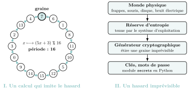

# Préparer le Grand Oral

Le Grand Oral se passe **fin juin**, **après les épreuves écrites**. Vous y préparez **deux questions** adossées à vos enseignements de spécialité ; **au moins l’une des deux** doit mobiliser la **NSI**. Le jury en choisit une, vous exposez votre réponse, puis vous échangez avec lui. Ce n’est pas une récitation de cours : c’est **vous**, expliquant **pourquoi une question vous intéresse** et **comment la NSI y répond**.

!!! encadre "Ce qu’est — et n’est pas — une bonne question"

    - Une bonne question est une **vraie question**, pas un titre de chapitre.  
      *Pas :* « Les graphes ». *Plutôt :* « Comment un GPS trouve-t-il le chemin le plus court ? »

    - Elle a un **enjeu** qu’on peut discuter (technique, mais aussi de société, d’éthique, d’histoire).

    - Elle est **à votre portée** : vous savez y répondre *et* improviser dans l’échange.

    - Elle vous **tient à cœur** : reliez-la à un projet, un stage, une envie d’orientation.

### Le déroulement de l’épreuve

{ .tikz loading=lazy }

- **Préparation (20 min).** Vous remettez au jury vos deux questions ; il en choisit **une**. Vous mettez vos idées en ordre et écrivez vos **notes** ; vous pouvez aussi préparer une **feuille** (un schéma, quelques mots-clés) à montrer au jury : elle n’est **pas évaluée**.

- **Exposé (10 min).** Vous expliquez **pourquoi vous avez choisi** cette question, puis vous la développez et vous **y répondez**. Vous pouvez vous aider de vos notes et montrer votre feuille, mais vous n’avez **pas le droit d’écrire** pendant ces dix minutes.

- **Échange avec le jury (10 min).** Le jury approfondit, vous fait préciser, peut interroger sur d’autres points du programme de spécialité. Vous avez alors **le droit d’écrire** si besoin (compléter un schéma, refaire un calcul).

Vous passez donc **20 minutes** devant le jury, après 20 minutes de préparation (coefficient **8**). Il n’y a pas de temps à part pour parler de votre projet d’orientation : c’est dans l’exposé, en accroche ou en conclusion, que vous dites pourquoi la question compte pour vous. Un jury de deux professeurs vous évalue avec la grille présentée plus bas.

### La structure de l’exposé (10 minutes)

{ .tikz loading=lazy }

- **Accroche** (1 min) : une situation concrète (« quand j’envoie un mot de passe sur un site…»), un chiffre qui étonne ; puis **pourquoi vous avez choisi** cette question (un projet, une lecture, une envie d’orientation).

- **Problématique** (1 min) : votre question, clairement énoncée, et son **enjeu**. Annoncez votre **plan en deux temps**.

- **Développement** (7 min) : deux parties d’environ 3 min 30. **Montrez un mécanisme**, pas seulement un vocabulaire : un exemple chiffré, un mini-algorithme déroulé, une idée expliquée pas à pas valent mieux que dix définitions. Puis regardez-le sous d’autres angles : ses défauts, une limite, un cas réel.

- **Conclusion** (1 min) : **répondez** vraiment à la question, puis **ouvrez** (une limite, un lien avec votre projet d’orientation).

Dix minutes, c’est long si l’on survole et court si l’on veut tout dire : **un seul** mécanisme bien expliqué, puis examiné sous plusieurs angles, vaut mieux que cinq notions énumérées. Le reste (détails, autres exemples) se garde pour l’échange. *Chronométrez-vous à voix haute : au premier essai, presque personne ne tombe juste.*

!!! remarque "Remarque — Notes, feuille et écriture"

    Pendant la **préparation**, vous écrivez vos notes et, si vous le souhaitez, une feuille à montrer au jury (un schéma, des mots-clés) ; cette feuille n’est pas évaluée. Pendant l’**exposé**, vous pouvez consulter vos notes et montrer votre feuille, mais vous **n’écrivez plus rien**. Des notes réduites au plan, aux chiffres et aux valeurs de l’exemple vous laissent regarder le jury ; un texte entièrement rédigé pousse à le lire, et la qualité orale s’en ressent. Pendant l’**échange**, vous avez de nouveau **le droit d’écrire** si besoin : compléter un schéma (graphe, arbre, chronogramme), refaire un calcul pour répondre au jury.

!!! remarque "Remarque"

    Le jury vous notera surtout sur votre capacité à **expliquer clairement**, à **réagir** à ses questions et à **prendre du recul**. Préparez donc, pour chaque question, **trois relances probables** du jury et votre réponse.

### Construire ses deux questions : une méthode

Les deux questions portent sur vos deux spécialités, **chacune séparément** ou **les deux à la fois** (une question transversale, par exemple NSI et mathématiques). Pour chacune, suivez ces cinq étapes.

1.  **Partir de vous.** Un objet que vous utilisez, une actualité, un stage, un métier visé : notez trois sujets qui vous intriguent vraiment.

2.  **Trouver la NSI dedans.** Pour chaque sujet, listez les **notions du programme** qui l’expliquent (au moins un chapitre de Terminale). Si vous n’en trouvez pas, changez de sujet.

3.  **Formuler une vraie question.** Commencez par « Comment…», « Pourquoi…» ou « Peut-on…». Elle doit avoir un **enjeu** et appeler une **réponse** (pas une définition).

4.  **La passer au crible.** Puis-je la traiter en 10 minutes, sans survoler ni délayer ? Ai-je **un mécanisme** précis à expliquer (un algorithme, une structure, un protocole) ? Puis-je imaginer **trois relances** du jury et y répondre ?

5.  **Bâtir le plan et le lien.** Deux parties, un exemple déroulé, une conclusion qui répond ; puis une phrase qui dit pourquoi la question compte pour vous (votre projet, votre **orientation**).

##### Une question par grand thème du programme

| **Thème** | **Question possible** | **Notions à mobiliser** |
|:---|:---|:---|
| Histoire de l’informatique | « Pourquoi une machine imaginée sur le papier en 1936 est-elle encore le modèle de nos ordinateurs ? » | machine de Turing, programme-donnée, calculabilité |
| Structures de données | « Comment retrouver un nom parmi un million en une vingtaine d’étapes ? » | arbres binaires de recherche, hauteur, $\log_2 n$ |
| Bases de données | « Comment une billetterie en ligne évite-t-elle de vendre deux fois la même place ? » | modèle relationnel, contraintes d’intégrité, SGBD et accès simultanés |
| Architectures, systèmes et réseaux | « Pourquoi un smartphone ne chauffe-t-il pas comme un ordinateur de bureau ? » | système sur puce, consommation, loi de Moore et ses limites |
| Langages et programmation | « Pourquoi existe-t-il des centaines de langages de programmation ? » | paradigmes (impératif, objet, fonctionnel), récursivité |
| Algorithmique | « Comment un correcteur orthographique devine-t-il le mot que je voulais écrire ? » | distance d’édition, programmation dynamique, coût |

*Exemple transversal (NSI et mathématiques) :* « Pourquoi les nombres premiers protègent-ils nos paiements en ligne ? » (RSA, arithmétique modulaire, factorisation).

### Banque de questions NSI (avec angle et notions)

Pour chaque question : la *problématique*, les *notions du programme* à mobiliser (chapitre entre parenthèses) et un *angle* pour ne pas réciter le cours.

##### Sécurité & société

- **« Comment deux machines qui ne se sont jamais parlé peuvent-elles partager un secret ? »**  
  *Notions :* chiffrement symétrique vs asymétrique, échange de clé, HTTPS (*ch. 10 Cryptographie*, *ch. 9 Réseaux*).  
  *Angle :* le paradoxe du cadenas (clé publique/privée) ; pourquoi je peux payer en ligne en confiance.

- **« Un mot de passe est-il vraiment secret dans une base de données ? »**  
  *Notions :* SGBD, fonctions de hachage, sécurisation des accès (*ch. 6 Bases de données*, *ch. 10 Cryptographie*).  
  *Angle :* pourquoi un site sérieux ne *connaît* pas votre mot de passe (il n’en stocke que l’empreinte).

##### Intelligence artificielle & données

- **« Une machine peut-elle deviner à quoi ressemble un chiffre manuscrit ? »**  
  *Notions :* $k$ plus proches voisins, distance, jeu d’entraînement (*Algorithmique 1re*, réinvesti).  
  *Angle :* montrer l’algorithme sur 3 points, puis parler des **biais** (données d’entraînement).

- **« À qui appartiennent les données que je laisse en ligne ? »**  
  *Notions :* bases de données, modèle relationnel, usage responsable des données, RGPD (*ch. 6 Bases de données*).  
  *Angle :* croiser deux tables (jointure) suffit à ré-identifier une personne « anonyme ».

##### Algorithmique & efficacité

- **« Comment un GPS calcule-t-il le plus court chemin en une seconde ? »**  
  *Notions :* graphes, parcours, plus court chemin, coût d’un algorithme (*ch. 8 Graphes*).  
  *Angle :* la carte $=$ un graphe ; dérouler une étape ; pourquoi on ne teste pas « tous les chemins ».

- **« Rendre la monnaie : la solution évidente est-elle toujours la meilleure ? »**  
  *Notions :* algorithmes gloutons, optimalité, systèmes de pièces (*Gloutons 1re*).  
  *Angle :* un contre-exemple ($\{1,6,10\}$ pour rendre $12$) où la méthode « gloutonne » échoue.

- **« Pourquoi couper un problème en deux le rend-il plus rapide ? »**  
  *Notions :* diviser pour régner, tri fusion, coût $n\log_2 n$, récursivité (*ch. 7 Diviser pour régner*).  
  *Angle :* comparer, chiffres à l’appui, $n^2$ et $n\log_2 n$ quand $n$ devient grand.

- **« Comment éviter de recalculer mille fois la même chose ? »**  
  *Notions :* programmation dynamique, mémoïsation, coût en mémoire (*ch. 11 Programmation dynamique*).  
  *Angle :* Fibonacci naïf (explosion) vs mémoïsé ; « la mémoire contre le temps ».

##### Les limites & l’histoire

- **« Existe-t-il des problèmes qu’aucun ordinateur ne pourra jamais résoudre ? »**  
  *Notions :* calculabilité, décidabilité, problème de l’arrêt, programme-donnée (*ch. 13 Calculabilité*).  
  *Angle :* l’idée de Turing (1936) ; sans formalisme, l’argument « si un tel programme existait…».

- **« Y a-t-il des problèmes que l’on sait résoudre mais pas assez vite ? »**  
  *Notions :* coût exponentiel, explosion combinatoire, P vs NP <span class="horsprog">au-delà du programme</span> (*Gloutons 1re*, *ch. 8 Graphes*).  
  *Angle :* le voyageur de commerce ; pourquoi « vérifier » est facile mais « trouver » est dur.

##### Machines & réseaux

- **« Comment un message arrive-t-il intact malgré des paquets perdus ? »**  
  *Notions :* paquets, routage, accusés de réception, TCP (*ch. 9 Réseaux*, *Le Web 1re*).  
  *Angle :* dérouler le bit alterné ; le lien avec les graphes (routage RIP/OSPF).

- **« Comment un ordinateur fait-il semblant de tout faire en même temps ? »**  
  *Notions :* processus, ordonnancement, interblocage (*ch. 4 Processus*).  
  *Angle :* le « chef d’orchestre » ; un chronogramme ; le risque d’interblocage.

### La grille d’évaluation du jury

Le jury s’appuie sur une **grille indicative nationale** à cinq critères, chacun décrit sur quatre niveaux. Voici sa substance, reformulée.

| **Critère** | **Très insuffisant** | **Insuffisant** | **Satisfaisant** | **Très satisfaisant** |
|:---|:---|:---|:---|:---|
| **Qualité orale** (voix, présence) | On entend mal du début à la fin ; l’attention du jury n’est pas captée. | Plus audible au fil de l’épreuve, mais voix monotone ; vocabulaire pauvre ou approximatif. | Voix qui varie, parole assurée, vocabulaire adapté ; le candidat intéresse. | La voix porte le propos (débit, rythme, nuances) ; engagement net ; vocabulaire riche et précis. |
| **Prise de parole en continu** (l’exposé) | Phrases hachées, pauses et reprises ; ou phrases longues et mal construites. | Propos assez clair, mais schématique et répétitif. | Propos articulé et pertinent, phrases bien construites. | Propos fluide et efficace, qui exploite tout le temps imparti pour développer ses idées. |
| **Qualité des connaissances** | Connaissances floues ; pas de réponse aux questions, même avec de l’aide. | Des connaissances réelles, mais difficiles à mobiliser face aux questions. | Connaissances précises, mobilisées pour répondre, parfois après une relance. | Connaissances maîtrisées, utilisées à bon escient et exposées clairement. |
| **Qualité de l’interaction** (l’échange) | Réponses rares ou très brèves ; le jury porte seul l’échange. | Un début d’échange, qui reste limité. | Le candidat répond, réagit, se reprend et reformule en s’appuyant sur le jury. | Il s’empare des questions, prend des initiatives dans l’échange, exprime une pensée personnelle. |
| **Argumentation** (construction) | Sujet mal compris ; propos décousu, sans arguments. | Un début de démonstration, mais des manques ; structure fragile. | Démonstration construite, appuyée sur des arguments précis et pertinents. | Enjeux maîtrisés ; argumentation personnelle, construite et raisonnée. |

!!! remarque "Remarque — Ce que cela change pour un exposé de NSI"

    - *Connaissances* : le jury attend un vocabulaire **exact** (une file n’est pas une pile, un processus n’est pas un programme) et un mécanisme que vous savez **redérouler** pendant l’échange, en écrivant si besoin.

    - *Argumentation* : un coût chiffré, un contre-exemple, une limite sont de vrais arguments ; « c’est plus rapide » sans preuve n’en est pas un.

    - *Interaction* : si vous ne savez pas, dites-le, puis **raisonnez à voix haute** à partir de ce que vous savez : c’est valorisé.

### La grille entre camarades

Pour s’entraîner toute l’année (en particulier avec l’exercice **« Expliquer en deux minutes »**, à la fin des exercices de chaque chapitre), on utilise une version simplifiée : **trois critères**, chacun relié à la grille du jury.

<table>
<thead>
<tr>
<th style="text-align: left;"><strong>Grille entre camarades</strong></th>
<th style="text-align: left;"><strong>Critère du jury</strong></th>
<th style="text-align: center;"><strong>Oui</strong></th>
<th style="text-align: center;"><strong>En partie</strong></th>
<th style="text-align: center;"><strong>Pas encore</strong></th>
</tr>
</thead>
<tbody>
<tr>
<td style="text-align: left;"><strong>Clair</strong> — audible, posé ; chaque mot technique est expliqué</td>
<td style="text-align: left;">qualité orale, parole en continu</td>
<td style="text-align: center;"><span class="math inline">▫</span></td>
<td style="text-align: center;"><span class="math inline">▫</span></td>
<td style="text-align: center;"><span class="math inline">▫</span></td>
</tr>
<tr>
<td style="text-align: left;"><strong>Juste</strong> — c’est exact, et l’exemple montre vraiment l’idée</td>
<td style="text-align: left;">connaissances</td>
<td style="text-align: center;"><span class="math inline">▫</span></td>
<td style="text-align: center;"><span class="math inline">▫</span></td>
<td style="text-align: center;"><span class="math inline">▫</span></td>
</tr>
<tr>
<td style="text-align: left;"><strong>Construit</strong> — un fil conducteur, tenu dans le temps, sans lire</td>
<td style="text-align: left;">argumentation</td>
<td style="text-align: center;"><span class="math inline">▫</span></td>
<td style="text-align: center;"><span class="math inline">▫</span></td>
<td style="text-align: center;"><span class="math inline">▫</span></td>
</tr>
<tr>
<td colspan="5" style="text-align: left;"><strong>Un conseil</strong> pour la prochaine fois :</td>
</tr>
</tbody>
</table>

Le cinquième critère, **l’interaction**, s’entraîne par la **question de relance** : après l’exposé, le camarade pose une question, et l’on y répond sans revenir à ses notes.

- **Évaluer, c’est observer** : cochez ce que vous avez entendu, pas ce que vous pensez du camarade.

- **Un seul conseil**, concret et réalisable (« donne ton exemple plus tôt », « définis *variant* avant de l’utiliser »).

- **Changez de rôle** à chaque fois : on apprend autant en écoutant qu’en parlant.

### Les pièges à éviter

- **Réciter le cours** sans répondre à la question : le jury attend une *démonstration de compréhension*, pas un exposé.

- **Choisir une question trop large** (« l’intelligence artificielle ») : impossible à traiter en 10 minutes. Restreignez.

- **Choisir une question trop technique** que vous ne maîtrisez pas dans l’échange.

- **Oublier le « pourquoi vous »** : reliez la question à un projet, une lecture, une envie d’orientation.

- **Lire ses notes** : le plan, les chiffres et les valeurs de l’exemple suffisent. Vouloir tout rédiger pendant les 20 minutes de préparation, c’est manquer de temps, puis lire au lieu de parler.

- **Oublier de rendre vos idées visuelles** : pendant la préparation, tracez un schéma clair (graphe, arbre, chronogramme) sur la feuille que vous montrerez pendant l’exposé ; rien ne pourra y être ajouté avant l’échange, où vous pourrez le compléter.

### Un exposé modèle

Voici l’exposé complet d’un élève sur la question **« Comment génère-t-on de l’aléatoire en informatique ? »**. Elle s’appuie sur le chapitre 10 (*Cryptographie* : clés secrètes, module `secrets`), sur la graine de `random.seed` rencontrée au chapitre 2 et sur l’opérateur `%` (reste de la division euclidienne). L’exposé suit la structure présentée plus haut : un seul mécanisme, déroulé avec de vraies valeurs, et une conclusion qui répond ; dit d’une voix posée, il dure dix minutes. Ne l’apprenez pas par cœur : servez-vous-en comme d’un **patron** pour vos propres questions. Les passages marqués <span class="horsprog">au-delà du programme</span> dépassent le programme : on peut les dire, à condition de savoir les expliquer si le jury creuse.

##### Le script minuté (10 minutes)

0:00 — Accroche (1 min)

« Dans le hall de l’entreprise Cloudflare, à San Francisco, un mur d’une centaine de lampes à lave est filmé en permanence. Ce n’est pas de la décoration : les images de ces bulles qui montent et descendent servent, avec d’autres sources, à fabriquer du hasard pour sécuriser des connexions sur Internet. Pourquoi une entreprise d’informatique aurait-elle besoin de lampes à lave ? Moi, je me suis posé la question en programmant un jeu de dés en Python. Quand j’écris `randint(1, 6)`, comment une machine qui ne fait qu’exécuter des instructions peut-elle « choisir » ? Et j’ai remarqué une chose étrange : quand je fixais la graine avec `random.seed(42)`, comme on l’avait fait en cours pour tester un programme, mes dés donnaient exactement les mêmes résultats à chaque lancement. Ce hasard-là avait de la mémoire. »

1:00 — Problématique et plan (1 min)

« D’où ma question : comment génère-t-on de l’aléatoire en informatique ? C’est presque un paradoxe. Un ordinateur est déterministe : avec les mêmes données, un programme donne toujours le même résultat. Produire de l’imprévu avec une machine prévisible semble donc impossible. Je vais vous montrer qu’il y a en fait deux réponses, selon l’usage. D’abord, comment on fabrique, par un simple calcul, des nombres qui ont l’air aléatoires, et pourquoi cela suffit pour un jeu ou une simulation. Ensuite, pourquoi ce même calcul devient dangereux dès qu’il s’agit de sécurité, et où l’ordinateur va alors chercher un vrai hasard. »

2:00 — I. Un calcul qui imite le hasard (3 min 30)

« La méthode la plus simple s’appelle un *générateur congruentiel linéaire*. On part d’un nombre, la **graine**, et on calcule chaque nombre à partir du précédent, toujours avec la même formule : $a$ fois le nombre, plus $c$, modulo $m$, c’est-à-dire le reste de la division par $m$. Prenons $a = 5$, $c = 3$, $m = 16$ et la graine $7$. Cinq fois sept plus trois, trente-huit ; divisé par seize, il reste six. Cinq fois six plus trois, trente-trois : il reste un. Puis viennent huit, onze, dix, cinq, douze, quinze… Sans la formule, cette suite a l’air désordonnée. Pour obtenir un nombre entre zéro et un, comme la fonction `random` de Python, il suffit de diviser par seize : six seizièmes, c’est 0,375.

Regardons maintenant ses défauts, car ils expliquent tout le reste. Premier défaut : la suite est entièrement fixée par la graine. Si je repars de sept, j’obtiens exactement les mêmes nombres : c’est ce qui arrivait à mes dés. Beaucoup de grands frères et de grandes sœurs l’ont vécu sans le savoir : sur les calculatrices TI-83, une réinitialisation remet la graine à zéro, et `rand` redonne alors toujours la même suite, 0,943, puis 0,908, puis 0,146… Toutes les calculatrices réinitialisées « tiraient au sort » les mêmes nombres. Mais c’est aussi une qualité : un scientifique peut rejouer une simulation à l’identique, un programmeur peut retrouver un bug qui n’apparaît qu’une fois sur mille.

Deuxième défaut : il n’y a que seize restes possibles, et chaque nombre ne dépend que du précédent. Dès qu’un nombre revient, toute la suite recommence. Ici, on retombe sur sept après seize nombres : la **période** vaut seize. Imaginez une ronde de seize cases, toujours parcourue dans le même ordre : c’est le schéma de ma feuille.

Troisième défaut, plus caché : la parité. Sept, impair ; six, pair ; un, impair ; huit, pair… Les nombres sont tour à tour impairs et pairs, sans aucune exception. Si je jouais à pile ou face avec la parité, j’obtiendrais pile, face, pile, face : moitié-moitié, mais parfaitement prévisible. La raison est simple : multiplier par cinq garde la parité, ajouter trois la change, et le reste de la division par seize, un nombre pair, la conserve.

Les vrais générateurs corrigent ces défauts avec de très grands nombres et des calculs plus élaborés. Celui de Python a une période qui s’écrit avec plus de six mille chiffres <span class="horsprog">au-delà du programme</span> : personne ne verra jamais la ronde recommencer. Pour mélanger une liste de lecture ou simuler un jeu de dés, c’est parfait. On parle de nombres *pseudo-aléatoires* : ils ont l’air aléatoires, mais ils sont calculés. »

5:30 — II. Quand le hasard doit être imprévisible (3 min 30)

« Le problème, c’est la sécurité. Dans le chapitre de cryptographie, on a vu que la solidité d’un chiffrement repose sur le secret de la clé : l’algorithme, lui, est public. Or une clé, c’est un grand nombre tiré au hasard. Si je la fabrique avec mon générateur, un attaquant qui connaît la formule et voit passer un seul nombre, par exemple six, calcule tous les suivants : un, huit, onze… Il n’a même pas besoin de casser le chiffrement. Et si la graine est l’heure de l’ordinateur, à la seconde près, il lui suffit d’essayer les 86 400 secondes d’une journée : c’est instantané pour une machine.

Ce n’est pas un cas d’école. En 2008, on a découvert qu’une version de la bibliothèque OpenSSL distribuée par Debian, une distribution Linux très utilisée, ne produisait, pour un type de clé donné, que quelques dizaines de milliers de clés différentes <span class="horsprog">au-delà du programme</span>. Un attaquant pouvait toutes les essayer. Le chiffrement était solide : c’est le hasard qui était faible.

Il faut donc une graine que personne ne peut deviner, et pour cela l’ordinateur sort du calcul : il va chercher du hasard dans le monde physique. Par exemple l’instant exact, à la microseconde près, où je frappe une touche ou bouge la souris, l’arrivée des données du disque ou du réseau, ou le bruit électrique d’un circuit du processeur prévu pour cela <span class="horsprog">au-delà du programme</span>. Aucune de ces mesures n’est parfaite, mais personne ne peut toutes les prévoir. Le système d’exploitation les accumule dans une réserve qu’on appelle l’**entropie**. Il en tire des graines, qu’un générateur conçu pour la cryptographie étire en autant de nombres qu’il faut, de telle sorte qu’en voyant ces nombres on ne puisse ni remonter à la graine, ni prévoir les suivants. Voilà le rôle des lampes à lave du début : une source de plus, très difficile à prévoir, pour alimenter cette réserve.

En Python, ces deux mondes correspondent à deux modules : `random`, pour simuler, rapide et reproductible avec une graine ; `secrets`, pour les mots de passe et les clés, qui puise dans le hasard du système. La documentation de Python le dit elle-même : `random` ne doit pas servir pour la sécurité. »

9:00 — Conclusion et ouverture (1 min)

« Pour répondre à ma question : un ordinateur ne crée pas le hasard, il l’imite ou il va le chercher. Pour simuler, mélanger ou tirer au sort, un calcul déterministe qui a l’air aléatoire suffit, et sa prévisibilité devient même un avantage, puisqu’on peut rejouer une expérience. Pour protéger un secret, il faut au contraire de l’imprévisible : on le puise dans le monde physique, puis le calcul le fait fructifier. C’est ce mélange de physique, de mathématiques et de programmation qui m’attire : je voudrais poursuivre mes études en informatique et me spécialiser en cybersécurité, un domaine où, comme chez Debian, une seule graine trop facile à deviner suffit à ruiner le meilleur des chiffrements. »

##### Les notes et la feuille préparées en 20 minutes

L’élève écrit des **notes** qui tiennent en une demi-page : le plan minuté, les valeurs de l’exemple et les chiffres à ne pas oublier, rien de rédigé.

!!! encadre "Ses notes"

    - **0:00 Accroche** : lampes à lave (Cloudflare) $\to$ mon jeu de dés, `random.seed(42)` $=$ mêmes dés.

    - **1:00 Question** : machine déterministe $\Rightarrow$ hasard ? Plan : I. imiter ; II. aller chercher.

    - **2:00 I.** $x \mapsto (5x+3)\ \texttt{\%}\ 16$, graine 7 : 6, 1, 8, 11, 10, 5, 12… $\div 16$ $\to$ 0,375. Trois défauts : graine (TI-83 réinitialisée : 0,943 ; 0,908 ; 0,146… ; rejouer : qualité) ; période 16 (ronde, *montrer la feuille*) ; parité qui alterne. Python : période $>$ 6 000 chiffres. Pseudo-aléatoire.

    - **5:30 II.** Clé $=$ nombre au hasard. Un nombre vu $\Rightarrow$ toute la suite ; graine $=$ heure $\Rightarrow$ 86 400 essais. Debian 2008. Entropie : touches, souris, disque, réseau, bruit $\to$ générateur crypto. `random` / `secrets`.

    - **9:00 Conclusion** : imiter ou aller chercher ; cybersécurité.

Sur la **feuille** qu’il montrera au jury, il trace le schéma ci-dessous. Pendant l’exposé, il la montre quand il en parle (« voici la ronde de seize cases »), sans rien y ajouter ; pendant l’échange, il peut la compléter ou y refaire un calcul pour appuyer ses réponses.

{ .tikz loading=lazy }

!!! remarque "Remarque — Pourquoi cet exposé fonctionne"

    - Le mécanisme est **déroulé avec de vraies valeurs** ($5 \times 7 + 3 = 38$, reste $6$) au lieu d’une suite de définitions.

    - Chaque mot technique (graine, période, entropie) est **expliqué** au moment où il apparaît.

    - Il **tient les dix minutes sans délayer** : un seul exemple, regardé sous trois angles (ses trois défauts), avec deux cas réels : les calculatrices TI-83, familières à beaucoup, et la faille de 2008, qui montre l’enjeu.

    - La conclusion **répond** à la question ; le jeu de dés de l’accroche et le projet de cybersécurité de la fin donnent le « pourquoi moi ». Pour un projet en sciences, en économie ou en finance, le lien naturel serait la **simulation** : on y tire des millions de nombres pseudo-aléatoires pour estimer ce qu’on ne sait pas calculer directement.

##### Les relances probables du jury, et des réponses modèles

1.  **« Votre ordinateur peut-il produire un vrai hasard ? »**  
    « Par le calcul seul, non : un programme est déterministe, avec la même entrée il donne la même sortie. Mais l’ordinateur est relié au monde physique : il mesure des événements imprévisibles (instants des frappes, mouvements de la souris, bruit électrique) et les accumule dans sa réserve d’entropie. C’est ce hasard physique qui sert de graine aux générateurs de la cryptographie. »

2.  **« Pourquoi un mot de passe généré avec `random` est-il dangereux ? »**  
    « Parce que `random` est fait pour simuler, pas pour protéger. Ses nombres sont calculés à partir d’un état interne, et en observant assez de nombres produits, on peut reconstituer cet état et prévoir tous les suivants (pour le générateur de Python, 624 nombres consécutifs de 32 bits suffisent <span class="horsprog">au-delà du programme</span>). Si la graine a été fixée avec l’heure, il suffit même d’essayer 86 400 graines par jour. Pour un mot de passe, j’utiliserais le module `secrets`. »

3.  **« Quelle est la période de votre générateur ? Peut-elle être plus courte ? »**  
    « Elle vaut 16, le maximum possible : il n’y a que seize restes, de 0 à 15, et ils sortent tous une fois avant que 7 revienne. Mais tout dépend des paramètres : avec $c = 2$ au lieu de $3$, la suite issue de 7 est 7, 5, 11, 9, 15, 13, 3, 1, puis de nouveau 7 : période 8, et jamais un nombre pair. On connaît des conditions sur $a$, $c$ et $m$ qui garantissent la période maximale <span class="horsprog">au-delà du programme</span>. »

4.  **« Comment trouveriez-vous cette période avec un programme ? »**  
    « Je note dans un dictionnaire le rang où chaque nombre apparaît pour la première fois ; au premier nombre déjà vu, l’écart entre les deux rangs donne la longueur du cycle. Attendre le retour de la graine ne suffit pas : avec $a = 4$, la suite 7, 15, 15, 15… n’y revient jamais. »

    ```python
    def suivant(x, a, c, m):
        """Renvoie le nombre qui suit x."""
        return (a * x + c) % m

    def periode(graine, a, c, m):
        """Renvoie la longueur du cycle sur lequel la suite finit par tourner."""
        rang = {}        # nombre -> rang de sa premiere apparition
        x = graine
        k = 0
        while x not in rang:
            rang[x] = k
            x = suivant(x, a, c, m)
            k = k + 1
        return k - rang[x]
    ```

    `periode(7, 5, 3, 16)` renvoie `16`, `periode(7, 5, 2, 16)` renvoie `8` et `periode(7, 4, 3, 16)` renvoie `1`.

5.  **« Comment vérifier qu’une suite a l’air aléatoire ? »**  
    « Par des tests statistiques. Le premier consiste à compter les fréquences : chaque valeur doit sortir à peu près aussi souvent que les autres. Mais cela ne suffit pas : avec mon générateur, la parité donne exactement moitié-moitié, et pourtant elle alterne sans exception. Il faut donc aussi tester les enchaînements. Et réussir ces tests ne prouve pas qu’une suite est imprévisible. »

6.  **« Avec votre générateur, comment simuler un dé à six faces ? »**  
    « On pourrait prendre le reste de la division par six, plus un. Mais seize n’est pas un multiple de six : parmi les nombres de 0 à 15, ceux qui donnent les faces 1 à 4 sont trois chacun, ceux qui donnent 5 et 6 seulement deux. Le dé serait truqué : 3 chances sur 16 pour chacune des faces 1 à 4, 2 sur 16 pour 5 et pour 6. La solution : rejeter les nombres de 12 à 15 et passer au suivant ; il reste douze nombres, deux par face. »

!!! encadre "Pendant l’échange : trois attitudes"

    - **Répondre d’abord en une phrase** (« Non, pas par le calcul seul »), puis justifier avec un exemple : le jury entend tout de suite que vous avez compris la question.

    - **Écrire quand cela aide** : compléter la ronde sur votre feuille, recalculer un terme devant le jury. Un calcul fait en direct convainc plus qu’une affirmation.

    - **Si vous ne savez pas, le dire, puis repartir de ce que vous savez** : « Je ne connais pas le détail du générateur de Python, mais il a forcément une graine et une période, puisque c’est un calcul sur une mémoire finie. »

### À faire dès maintenant

- choisir **une** question NSI dans la banque (ou en inventer une proche) qui vous **motive** ;

- la reformuler en *une phrase*, avec un **enjeu** clair ;

- préparer **deux parties** et **un schéma** à montrer pendant l’exposé (et à compléter pendant l’échange) ;

- réduire ses **notes** à une demi-page (plan minuté, valeurs de l’exemple, chiffres) et **chronométrer** l’exposé : dix minutes ;

- lister **trois relances** probables du jury et vos réponses ;

- dire, en accroche ou en conclusion, pourquoi la question compte pour vous (votre **projet d’orientation**).
