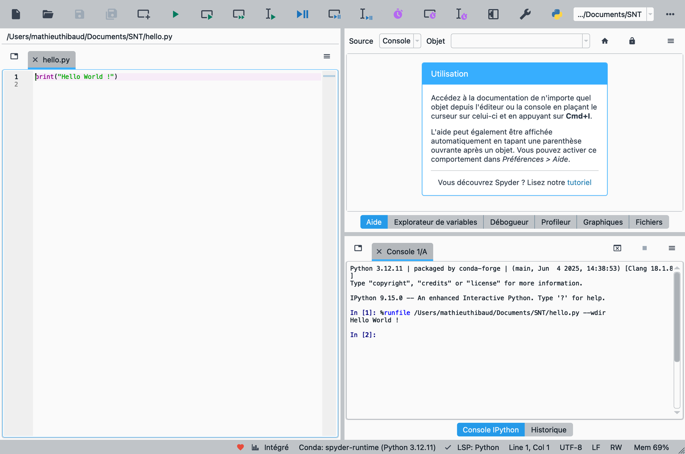

# Présentation de l'année

Cette année prolonge et couronne ce que vous avez commencé en Première. On monte d’un cran : de nouvelles **structures de données** (arbres, graphes), des **méthodes algorithmiques** puissantes, les **bases de données**, le fonctionnement profond des **machines et des réseaux**… et même les **limites** de ce qu’un ordinateur peut calculer. Objectif : devenir autonome et rigoureux, et arriver prêt(e)s aux épreuves.

!!! encadre "L’esprit NSI, version Terminale"

    - **Autonomie** : concevoir une solution, la programmer, la tester, la corriger — par vous-même.

    - **Abstraction** : choisir la bonne *structure de données* et la bonne *méthode* pour chaque problème.

    - **Rigueur** : justifier qu’un programme *se termine*, qu’il est *correct*, et estimer son *coût*.

## La discipline, cette année

La NSI est une **spécialité scientifique** à part entière. En Terminale, c’est **6 heures par semaine**, dont une bonne partie **sur machine**. Elle s’articule autour des mêmes grands piliers qu’en Première, poussés plus loin :

- **programmer** — avec de nouveaux styles (objet, récursif, fonctionnel) ;

- **l’algorithmique** — des méthodes puissantes (diviser pour régner, programmation dynamique, algorithmes de graphes) ;

- **les structures de données** — listes chaînées, piles, files, arbres, graphes ;

- **les données** — les bases de données relationnelles et le langage SQL ;

- **les machines et les réseaux** — systèmes d’exploitation, processus, routage, sécurité.

Environ **un tiers de l’année** reste consacré à des **projets** et à la pratique sur machine : c’est là qu’on devient vraiment autonome.

## Ce que vous allez apprendre

Le programme est dense et s’enchaîne : la **récursivité** (chapitre 1) est la clé qui ouvre les arbres, « diviser pour régner » et les graphes. L’année alterne les **algorithmes** et les **machines** : on découvre le système d’exploitation dès l’automne, les réseaux en hiver.

### De la rentrée aux vacances de Toussaint

**Chapitre 1 — La récursivité.** Résoudre un problème en le ramenant à une version plus petite de lui-même : une fonction qui s’appelle elle-même. Élégant, et incontournable pour toute la suite.

**Chapitre 2 — La programmation orientée objet.** Concevoir vos propres « objets » (leurs données *et* leurs actions) pour organiser des programmes plus gros et plus clairs.

**Chapitre 3 — Les structures de données linéaires.** Construire vos propres boîtes à ranger l’information : listes chaînées, piles (« dernier arrivé, premier servi ») et files (comme une file d’attente).

### De la Toussaint à Noël

**Chapitre 4 — Processus et ordonnancement.** Comprendre comment le système d’exploitation fait tourner plusieurs programmes « en même temps » et gère les ressources de la machine.

**Chapitre 5 — Les arbres.** Manipuler des structures « en arborescence » (comme un arbre généalogique) et y ranger ou rechercher une information très efficacement.

**Chapitre 6 — Bases de données et SQL.** Interroger de vraies bases de données avec le langage SQL : retrouver, croiser et mettre à jour de très grandes quantités de données.

### De janvier aux vacances d’hiver

**Chapitre 7 — Diviser pour régner.** Couper un gros problème en deux moitiés, les résoudre séparément, puis recombiner : la recette des algorithmes rapides, comme le tri fusion.

**Chapitre 8 — Les graphes.** Modéliser des réseaux (routes, amis, Internet) par des points reliés, et écrire des algorithmes pour s’y déplacer, détecter un cycle, trouver un chemin.

**Chapitre 9 — Les réseaux.** Suivre le voyage d’un message sur Internet : adressage, découpage en paquets, routage — comment les données trouvent leur chemin d’un bout à l’autre du monde.

### De l’hiver au printemps

**Chapitre 10 — Cryptographie.** Protéger ces échanges : le chiffrement (symétrique et asymétrique) qui rend un message illisible pour tout autre que son destinataire.

**Chapitre 11 — La programmation dynamique.** *Rendre certains algorithmes récursifs spectaculairement plus rapides, en évitant de recalculer sans cesse la même chose.*

**Chapitre 12 — La recherche textuelle.** Trouver efficacement un motif dans un grand texte (un roman, un génome) : de la méthode naïve à l’algorithme de Boyer-Moore.

### Au printemps

**Chapitre 13 — Calculabilité et décidabilité.** Toucher aux **limites** de l’informatique : existe-t-il des problèmes qu’*aucun* programme ne pourra jamais résoudre ? (Oui — et c’est vertigineux.)

**Chapitre 14 — Systèmes sur puce et informatique embarquée.** Découvrir comment un ordinateur entier tient sur une seule puce (dans votre téléphone, votre console, votre voiture) et ce que fait un microcontrôleur dans un système embarqué.

## Comment est organisé ce livre

!!! encadre "Comment est organisé un chapitre"

    Chaque chapitre de ce livre suit le même parcours :

    - **Activités préparatoires** : courtes, souvent sans ordinateur, à faire *avant* le cours pour se poser les bonnes questions ;

    - **Cours** : les notions, des exemples corrigés et un bilan ;

    - **Exercices** : du plus simple au niveau du bac, avec des coups de pouce en fin de rubrique ; environ un tiers sont marqués $\bullet$ essentiel (le minimum pour suivre) ; leurs corrigés sont en fin de livre ;

    - **TP et projets** : un travail plus long sur machine qui réinvestit tout le chapitre ;

    - **Fiche de révision** : l’essentiel du chapitre en deux pages, avec « Se tester » (questions sur le chapitre), « Et avant ? » (questions sur les chapitres précédents, pour ne pas oublier) et, souvent, un encadré « Vers le bac » (problèmes de synthèse et sujet d’épreuve pratique que vous pouvez désormais traiter) ;

    - **Défis Advent of Code** : des énigmes de programmation tirées d’*Advent of Code* (`adventofcode.com`), un concours en ligne créé et animé depuis 2015 par le développeur **Eric Wastl**, qui publie chaque année, du 1er au 25 décembre, une énigme en deux parties. L’énoncé, en anglais, se lit sur le site (QR code sur chaque défi ; le navigateur peut le traduire) ; chaque défi est accompagné d’un lexique, d’un résumé, d’un petit exemple pour se tester et de coups de pouce. Ces défis sont **facultatifs** et n’utilisent que des notions déjà vues dans l’année.

    **Les défis n’ont volontairement pas de corrigé** dans ce livre : tout le plaisir d’une énigme est de la résoudre soi-même. Le site indique si votre réponse est juste (avec un compte gratuit) ; en cas de blocage, lisez les coups de pouce, puis venez en parler en classe.

## Travailler avec ce livre

### Avec quel outil ?

Au lycée, on programme avec **Spyder**, un logiciel libre et gratuit. Installez-le aussi chez vous : l’installateur officiel se télécharge sur `spyder-ide.org` et contient Python, il n’y a rien d’autre à installer. En dépannage (ordinateur prêté, installation impossible), **Basthon** fonctionne dans un navigateur, sans installation (`basthon.fr`) : parfait pour un exercice court, moins pratique pour un TP ou un défi qui lit des fichiers, qu’il faut alors déposer dans la page à chaque séance.

{ .photo loading=lazy style="width:82%" }

Deux zones de Spyder servent tout le temps :

- **l’éditeur** (à gauche) : on y écrit le programme, enregistré dans un fichier `.py` et exécuté avec le bouton vert $\blacktriangleright$ (ou la touche F5) ;

- **la console** (en bas à droite, `In [1]:`) : on y lit les résultats, et on y tape une instruction pour tester une idée ou appeler une fonction du fichier une fois celui-ci exécuté.

### Une méthode pour chaque chapitre

1.  **Après chaque séance** (20 à 30 minutes) : relire le passage du cours en *retapant* les exemples dans Spyder, puis faire les exercices $\bullet$ essentiel indiqués par les renvois « Exercices d’application ».

2.  **Bloqué ?** Chercher vraiment (5 à 10 minutes), puis lire le **coup de pouce** ($\triangleright$) : d’abord la piste, ensuite seulement le début de solution.

3.  **Le corrigé** se lit *après* avoir essayé : comparer, repérer son erreur (les corrigés signalent les *erreurs fréquentes*), puis refaire l’exercice sans regarder quelques jours plus tard.

4.  **Deux ou trois jours après** : répondre de mémoire aux questions « Se tester » et « Et avant ? » de la fiche de révision, puis vérifier avec le lien « $\blacktriangleright$ réponses ». Revenir régulièrement sur les chapitres passés, c’est ce qui fait tenir les connaissances jusqu’au bac.

5.  **Avant un test** : la fiche de révision et sa liste « Savoir-faire » ; pour chaque case que vous ne pouvez pas cocher, refaire un exercice essentiel.

Les exercices ★★★, les défis et les encadrés « Pour les curieux » servent à aller plus loin : utiles, mais facultatifs.

### Lire ce livre sur un ordinateur

- **Tout est cliquable** : le sommaire, le petit sommaire de chaque chapitre, « $\blacktriangleright$ corrigé p. 637 » et « $\uparrow$ énoncé », les coups de pouce, les numéros d’exercices des renvois et les mentions « chapitre 5 ». L’**onglet de couleur** au bord de la page ramène à la page de titre du chapitre ; le **numéro de page** ramène au sommaire.

- **Les signets** (panneau latéral « Signets » ou « Table des matières » du lecteur PDF) donnent le plan détaillé : chapitre, rubrique, section.

- **Revenir où l’on était** après un lien : le lien « $\uparrow$ énoncé » ou l’onglet du chapitre, ou bien la commande « page précédente » du lecteur (Alt + $\leftarrow$ dans Acrobat Reader sous Windows, Cmd + \[ dans Aperçu sur Mac).

- **Copier un programme** : cliquer sur l’icône { .tikz .tikz-inline loading=lazy } en haut à droite d’un bloc de code ; une page s’ouvre avec le programme prêt à être copié. Un copier-coller direct depuis le PDF emporte souvent les numéros de ligne et l’indentation est perdue.

- **Chercher un mot** : Ctrl + F (Cmd + F sur Mac).

- Pour lire confortablement, choisir l’affichage « ajuster à la largeur ». Les numéros de page du lecteur sont ceux du livre imprimé.

## Le cap : le baccalauréat

!!! encadre "Les épreuves"

    - **l’épreuve de spécialité** (en **juin**, coefficient **16**), en deux parties : une **partie écrite** de 3 h 30, notée sur 12, qui porte sur l’ensemble du programme, et une **partie pratique** d’1 h sur machine, notée sur 8 (voir la deuxième partie de ce livre) ;

    - **le Grand Oral** (fin juin, **après les écrits**, coefficient **8**) : vous préparez **deux questions**, dont **au moins une doit s’appuyer sur la NSI** ; le jour J, 20 minutes de préparation, puis 10 minutes d’exposé et 10 minutes d’échange avec le jury.

Comme les épreuves ont lieu **en fin d’année**, on dispose de **toute l’année** pour construire le programme. Le **troisième trimestre** sert à le **terminer et le consolider**, à s’entraîner en conditions (**bacs blancs**, pratique sur machine) et à préparer le **Grand Oral**.

## Comment vous êtes évalué

- à chaque chapitre : un ou deux courts **tests rapides** (/10) puis un **contrôle** (/20) ;

- des **bacs blancs** pour s’entraîner en conditions ;

- des **projets et travaux sur machine**, qui comptent aussi.

!!! encadre "L’intelligence artificielle : une charte, trois pastilles"

    Les assistants d’IA savent écrire du code et des explications ; le but de ce cours est que **vous** sachiez le faire, le vérifier et l’expliquer. Une [**charte d’usage de l’IA**](charte.md), reproduite juste après cette présentation, fixe ce qui est permis. L’usage est décidé **exercice par exercice** et signalé par une pastille à côté du titre :

    -  **sans IA** : tests, contrôles, sujets d’épreuve, exercices d’automatisme (lecture de code, questions de cours) ;

    -  **IA en appui** : pour déboguer, reformuler ou vérifier, à condition d’écrire soi-même la réponse finale ;

    -  **IA intégrée** : l’exercice consiste à critiquer, tester ou améliorer une réponse d’assistant.

    Dans tous les cas : vous restez responsable de ce que vous rendez, vous devez pouvoir l’expliquer à l’oral, et vous dites quand l’IA a été utilisée. La complétion automatique de code dans l’éditeur compte comme un assistant.

!!! remarque "Remarque — Une ressource pour réviser à la maison"

    Deux sites tenus par des professeurs de NSI sont d’excellentes ressources pour la terminale : claires, complètes et conformes au programme. Ils ont été une **source d’inspiration** pour la préparation de nos cours, et je vous encourage à les consulter pour réviser ou approfondir, notamment en vue de l’épreuve écrite :

    - le site de **Gilles Lassus** : `glassus.github.io` ;

    - le site de **David Roche** : `pixees.fr/informatiquelycee`.

*Une année exigeante, mais passionnante. À la fin, vous saurez vraiment programmer — et penser comme un informaticien.*
