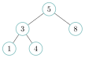
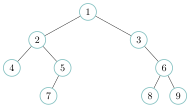
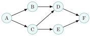
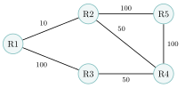

# Exercices

<p class="sous-titre">Problèmes de synthèse et exercices type bac</p>

!!! consignes "Mode d’emploi"

    - Chaque problème **croise** des notions de plusieurs chapitres, comme les exercices du bac, qui ne disent jamais « ceci est un exercice sur les piles ».

    - Sous chaque titre, la ligne Chapitres croisés indique ce qu’il faut avoir vu. Un problème peut être repris plus tard dans l’année, pour réviser.

    - Niveau : ★ échauffement, ★★ classique (niveau bac), ★★★ défi ; les *coups de pouce* et les *corrigés* se déplient sous chaque exercice.

    - <span class="run" title="À programmer et tester sur machine">▶</span> *À programmer et tester* en Python. Les classes `Pile`, `File`, `Cellule` et `Noeud` sont celles du cours.

    - Usage de l’IA, indiqué sur chaque exercice : <span class="ia ia-rouge" title="Sans IA : le but est l'automatisme lui-même"></span> aucune ; <span class="ia ia-orange" title="IA en appui : déboguer, reformuler, vérifier ; la réponse finale est la vôtre"></span> en appui (déboguer, reformuler, vérifier ; la réponse finale est écrite et comprise par vous) ; <span class="ia ia-vert" title="IA intégrée : l'exercice s'appuie sur une réponse d'IA"></span> l’exercice s’appuie sur une réponse d’IA. Voir la [charte d’usage de l’IA](../charte.md).

### Après les chapitres 1 à 3 (récursivité, programmation objet, structures linéaires)

### <span class="stars" title="Niveau 2 sur 3">★★</span> <span class="exo-num">Exercice 1</span> — Dérécursiver avec une pile <span class="ia ia-orange" title="IA en appui : déboguer, reformuler, vérifier ; la réponse finale est la vôtre"></span> { #ex-S-1 }

Chapitres croisés : *Récursivité ; Piles*

On considère la fonction récursive suivante, où `n` est un entier positif ou nul.

```python
def afficher_binaire(n):
    if n >= 2:
        afficher_binaire(n // 2)
    print(n % 2, end="")
```

1.  Dérouler l’appel `afficher_binaire(13)` : donner la liste des appels successifs, puis ce qui est affiché. Que représente l’affichage obtenu ?

2.  Dessiner la **pile d’appels** au moment où l’appel le plus profond s’exécute (sommet en haut). Expliquer pourquoi le chiffre affiché en premier est celui du dernier appel lancé.

3.  <span class="run" title="À programmer et tester sur machine">▶</span> Écrire une fonction **non récursive** `binaire(n)` qui renvoie l’écriture binaire de `n` sous forme de chaîne (par exemple `binaire(13)` renvoie `"1101"` et `binaire(0)` renvoie `"0"`). Elle utilisera une `Pile` pour jouer le rôle de la pile d’appels.

    ??? pouce "Coup de pouce"

        Deux boucles : la première calcule les restes `n % 2` et les range dans la pile ; la seconde les ressort pour construire la chaîne. Attention au cas `n = 0`, qui doit produire un chiffre.

4.  On remplace la `Pile` par une `File` (`enfiler` et `defiler` à la place de `empiler` et `depiler`). Que renvoie alors l’appel pour `n = 13` ? Expliquer.

??? corrige "Corrigé"

    !!! remarque "Remarque"

        On donne une version testée de chaque fonction ; d’autres écritures correctes sont possibles. Le fichier complet, `corrige_synthese_terminale.py`, est en ligne : <https://github.com/MathThibaud/nsi-fichiers-eleves/tree/main/corriges/terminale/synthese>.

    **1.** Appels successifs : `afficher_binaire(13)` $\to$ `(6)` $\to$ `(3)` $\to$ `(1)`. L’appel `(1)` ne relance rien ($1 < 2$) et affiche `1` ; puis, en remontant, `(3)` affiche `1`, `(6)` affiche `0` et `(13)` affiche `1`. Affichage : `1101`, l’écriture **binaire** de $13$ ($8 + 4 + 1$).

    **2.** Au moment de l’appel le plus profond, la pile contient, du sommet vers le bas : `afficher_binaire(1)`, `(3)`, `(6)`, `(13)`. Chaque appel affiche son chiffre **après** le retour de l’appel qu’il a lancé : les affichages se font donc dans l’ordre où les appels quittent la pile, c’est-à-dire du dernier lancé au premier (LIFO). Or le dernier appel porte le chiffre de **poids fort** : on obtient les chiffres dans le bon ordre, alors que les divisions par $2$ les calculent du poids faible au poids fort.

    **3.**

    ```python
    def binaire(n):
        p = Pile()
        p.empiler(n % 2)
        n = n // 2
        while n > 0:
            p.empiler(n % 2)
            n = n // 2
        resultat = ""
        while not p.est_vide():
            resultat = resultat + str(p.depiler())
        return resultat
    ```

    Le premier reste est empilé avant la boucle : ainsi `binaire(0)` renvoie bien `"0"`. La pile remplace la pile d’appels : elle garde les chiffres « en attente » et les rend dans l’ordre inverse.

    **4.** Avec une file, les chiffres ressortent dans l’ordre où ils ont été calculés (FIFO), du poids faible au poids fort : on obtient `"1011"`, l’écriture binaire **à l’envers**. C’est précisément le caractère LIFO de la pile qui remet les chiffres dans l’ordre.

### <span class="stars" title="Niveau 2 sur 3">★★</span> <span class="exo-num">Exercice 2</span> — Annuler et rétablir <span class="ia ia-orange" title="IA en appui : déboguer, reformuler, vérifier ; la réponse finale est la vôtre"></span> { #ex-S-2 }

Chapitres croisés : *Programmation objet ; Piles*

Un éditeur de texte très simple garde le texte saisi dans un attribut `texte` (une chaîne). Il propose deux boutons : **Annuler**, qui revient au texte d’avant la dernière modification, et **Rétablir**, qui refait une modification qu’on vient d’annuler. Pour cela, l’objet possède deux piles : `annulations` contient les textes précédents, `retablissements` les textes annulés.

```python
class Editeur:
    def __init__(self):
        ...

    def ecrire(self, mot):
        """ajoute mot a la fin du texte"""
        ...

    def annuler(self):
        """revient au texte precedent (sans effet s'il n'y en a pas)"""
        ...

    def retablir(self):
        """refait la derniere modification annulee (sans effet sinon)"""
        ...
```

1.  <span class="run" title="À programmer et tester sur machine">▶</span> Écrire la méthode `__init__` : le texte est vide au départ et les deux piles aussi.

2.  On exécute les instructions ci-dessous. Donner, après chacune, la valeur de `e.texte` et le contenu des deux piles (dessinées verticalement, sommet en haut).

    ```python
    e = Editeur()
    e.ecrire("Bon")
    e.ecrire("jour")
    e.annuler()
    e.retablir()
    e.annuler()
    e.ecrire("soir")
    ```

3.  <span class="run" title="À programmer et tester sur machine">▶</span> Écrire les méthodes `ecrire`, `annuler` et `retablir`, en accord avec le déroulé de la question 2.

    ??? pouce "Coup de pouce"

        Avant de modifier le texte, on sauvegarde l’ancien dans la pile qui permettra d’y revenir. Annuler et rétablir sont symétriques : chacune sauvegarde le texte courant dans l’autre pile.

4.  Après la dernière instruction de la question 2, un appel à `e.retablir()` ne doit rien changer. Pourquoi ce choix est-il raisonnable, et quelle ligne de votre méthode `ecrire` le garantit-elle ?

??? corrige "Corrigé"

    **1.**

    ```python
        def __init__(self):
            self.texte = ""
            self.annulations = Pile()
            self.retablissements = Pile()
    ```

    **2.** Les piles sont dessinées verticalement, **sommet en haut**.

    <table>
    <thead>
    <tr>
    <th style="text-align: left;"><strong>Instruction</strong></th>
    <th style="text-align: left;"><code>e.texte</code></th>
    <th style="text-align: center;"><code>annulations</code></th>
    <th style="text-align: center;"><code>retablissements</code></th>
    </tr>
    </thead>
    <tbody>
    <tr>
    <td style="text-align: left;"><code>Editeur()</code></td>
    <td style="text-align: left;"><code>""</code></td>
    <td style="text-align: center;">vide</td>
    <td style="text-align: center;">vide</td>
    </tr>
    <tr>
    <td style="text-align: left;"><code>ecrire("Bon")</code></td>
    <td style="text-align: left;"><code>"Bon"</code></td>
    <td style="text-align: center;"><table>
    <thead>
    <tr>
    <th style="text-align: center;"><code>""</code></th>
    </tr>
    </thead>
    <tbody>
    </tbody>
    </table></td>
    <td style="text-align: center;">vide</td>
    </tr>
    <tr>
    <td style="text-align: left;"><code>ecrire("jour")</code></td>
    <td style="text-align: left;"><code>"Bonjour"</code></td>
    <td style="text-align: center;"><table>
    <thead>
    <tr>
    <th style="text-align: center;"><code>"Bon"</code></th>
    </tr>
    </thead>
    <tbody>
    <tr>
    <td style="text-align: center;"><code>""</code></td>
    </tr>
    </tbody>
    </table></td>
    <td style="text-align: center;">vide</td>
    </tr>
    <tr>
    <td style="text-align: left;"><code>annuler()</code></td>
    <td style="text-align: left;"><code>"Bon"</code></td>
    <td style="text-align: center;"><table>
    <thead>
    <tr>
    <th style="text-align: center;"><code>""</code></th>
    </tr>
    </thead>
    <tbody>
    </tbody>
    </table></td>
    <td style="text-align: center;"><table>
    <thead>
    <tr>
    <th style="text-align: center;"><code>"Bonjour"</code></th>
    </tr>
    </thead>
    <tbody>
    </tbody>
    </table></td>
    </tr>
    <tr>
    <td style="text-align: left;"><code>retablir()</code></td>
    <td style="text-align: left;"><code>"Bonjour"</code></td>
    <td style="text-align: center;"><table>
    <thead>
    <tr>
    <th style="text-align: center;"><code>"Bon"</code></th>
    </tr>
    </thead>
    <tbody>
    <tr>
    <td style="text-align: center;"><code>""</code></td>
    </tr>
    </tbody>
    </table></td>
    <td style="text-align: center;">vide</td>
    </tr>
    <tr>
    <td style="text-align: left;"><code>annuler()</code></td>
    <td style="text-align: left;"><code>"Bon"</code></td>
    <td style="text-align: center;"><table>
    <thead>
    <tr>
    <th style="text-align: center;"><code>""</code></th>
    </tr>
    </thead>
    <tbody>
    </tbody>
    </table></td>
    <td style="text-align: center;"><table>
    <thead>
    <tr>
    <th style="text-align: center;"><code>"Bonjour"</code></th>
    </tr>
    </thead>
    <tbody>
    </tbody>
    </table></td>
    </tr>
    <tr>
    <td style="text-align: left;"><code>ecrire("soir")</code></td>
    <td style="text-align: left;"><code>"Bonsoir"</code></td>
    <td style="text-align: center;"><table>
    <thead>
    <tr>
    <th style="text-align: center;"><code>"Bon"</code></th>
    </tr>
    </thead>
    <tbody>
    <tr>
    <td style="text-align: center;"><code>""</code></td>
    </tr>
    </tbody>
    </table></td>
    <td style="text-align: center;">vide</td>
    </tr>
    </tbody>
    </table>

    **3.**

    ```python
        def ecrire(self, mot):
            self.annulations.empiler(self.texte)
            self.texte = self.texte + mot
            self.retablissements = Pile()

        def annuler(self):
            if not self.annulations.est_vide():
                self.retablissements.empiler(self.texte)
                self.texte = self.annulations.depiler()

        def retablir(self):
            if not self.retablissements.est_vide():
                self.annulations.empiler(self.texte)
                self.texte = self.retablissements.depiler()
    ```

    **4.** Après `ecrire("soir")`, le texte annulé (`"Bonjour"`) appartient à une « histoire » abandonnée : le rétablir effacerait sans prévenir ce qu’on vient d’écrire. Tous les éditeurs se comportent ainsi. C’est la ligne `self.retablissements = Pile()` de `ecrire` qui vide la pile des rétablissements à chaque nouvelle saisie.

### <span class="stars" title="Niveau 3 sur 3">★★★</span> <span class="exo-num">Exercice 3</span> — Listes chaînées récursives <span class="ia ia-orange" title="IA en appui : déboguer, reformuler, vérifier ; la réponse finale est la vôtre"></span> { #ex-S-3 }

Chapitres croisés : *Programmation objet ; Listes chaînées ; Récursivité*

On rappelle la classe `Cellule` du cours : une liste chaînée est soit `None` (liste vide), soit une cellule dont l’attribut `suivante` est elle-même une liste chaînée. C’est une **définition récursive**, qui appelle naturellement des fonctions récursives.

```python
class Cellule:
    def __init__(self, v, s):
        self.valeur = v
        self.suivante = s

lst = Cellule(3, Cellule(1, Cellule(4, None)))
```

1.  Représenter `lst` par un schéma de cellules reliées par des flèches.

2.  <span class="run" title="À programmer et tester sur machine">▶</span> Écrire les fonctions récursives `longueur(lst)` et `somme(lst)`, qui renvoient le nombre d’éléments et leur somme ($0$ pour une liste vide).

3.  <span class="run" title="À programmer et tester sur machine">▶</span> Écrire la fonction récursive `contient(lst, x)`, qui renvoie `True` si `x` est dans la liste et `False` sinon. Pourquoi peut-elle s’arrêter avant la fin de la liste ?

4.  <span class="run" title="À programmer et tester sur machine">▶</span> On veut une fonction `renverser(lst)` qui renvoie une **nouvelle** liste chaînée contenant les mêmes valeurs dans l’ordre inverse, sans modifier `lst`. Écrire une fonction récursive `renverser_dans(lst, acc)`, où `acc` est la liste déjà renversée, puis en déduire `renverser`.

    ??? pouce "Coup de pouce"

        Penser à une pile d’assiettes : on prend la première cellule de `lst` et on la pose *en tête* de `acc` (une nouvelle cellule), puis on continue avec le reste. Que vaut `acc` au tout premier appel ?

5.  Ajouter une cellule **en tête** coûte une seule opération. Combien d’opérations faut-il pour ajouter une cellule **en queue** d’une liste de $n$ cellules ? Comparer avec les opérations d’une pile.

??? corrige "Corrigé"

    **1.** `3` \| $\bullet$$\to$`1` \| $\bullet$$\to$`4` \| $\bullet$$\to$`None`

    **2.** On suit la définition récursive : liste vide, ou une cellule suivie d’une liste.

    ```python
    def longueur(lst):
        if lst is None:
            return 0
        return 1 + longueur(lst.suivante)

    def somme(lst):
        if lst is None:
            return 0
        return lst.valeur + somme(lst.suivante)
    ```

    **3.**

    ```python
    def contient(lst, x):
        if lst is None:
            return False
        if lst.valeur == x:
            return True
        return contient(lst.suivante, x)
    ```

    Dès que `x` est trouvé, la fonction renvoie `True` sans faire d’appel récursif : inutile de regarder la suite.

    **4.**

    ```python
    def renverser_dans(lst, acc):
        if lst is None:
            return acc
        return renverser_dans(lst.suivante, Cellule(lst.valeur, acc))

    def renverser(lst):
        return renverser_dans(lst, None)
    ```

    Pour `lst` $= 3 \to 1 \to 4$ : `acc` vaut successivement `None`, puis $3$, puis $1 \to 3$, puis $4 \to 1 \to 3$. On crée de nouvelles cellules : `lst` n’est pas modifiée.

    *Autre méthode :* la même idée avec une boucle : on parcourt `lst` et on pose chaque valeur *en tête* du résultat, qui joue le rôle de `acc`.

    ```python
    def renverser_iteratif(lst):
        resultat = None
        while lst is not None:
            resultat = Cellule(lst.valeur, resultat)
            lst = lst.suivante
        return resultat
    ```

    **5.** Pour ajouter en queue, il faut d’abord atteindre la dernière cellule en suivant les $n$ liens : environ $n$ opérations (coût **linéaire**), contre une seule en tête. C’est pourquoi une liste chaînée fait une excellente **pile** (on empile et dépile en tête, en une opération), mais une file médiocre si l’on ne garde pas aussi un accès direct à la dernière cellule.

### Après le chapitre 5 (arbres)

### <span class="stars" title="Niveau 3 sur 3">★★★</span> <span class="exo-num">Exercice 4</span> — Trier avec un arbre binaire de recherche <span class="ia ia-orange" title="IA en appui : déboguer, reformuler, vérifier ; la réponse finale est la vôtre"></span> { #ex-S-4 }

Chapitres croisés : *Arbres ; Récursivité ; coût des algorithmes*

On dispose de la fonction `insere` du cours, qui insère `x` dans l’ABR `a` et renvoie l’arbre obtenu (une valeur déjà présente n’est pas ajoutée une seconde fois).

```python
def insere(a, x):
    if a is None:
        return Noeud(x)
    if x < a.valeur:
        a.gauche = insere(a.gauche, x)
    elif x > a.valeur:
        a.droite = insere(a.droite, x)
    return a
```

1.  Dessiner l’ABR obtenu en insérant successivement $5, 3, 8, 1, 4$ dans un arbre vide.

2.  <span class="run" title="À programmer et tester sur machine">▶</span> Écrire une fonction récursive `infixe_dans(a, resultat)` qui ajoute à la fin de la liste Python `resultat` les valeurs de `a` dans l’ordre du parcours **infixe**. Que contient `resultat` pour l’arbre de la question 1 ?

3.  <span class="run" title="À programmer et tester sur machine">▶</span> En déduire une fonction `tri_abr(tab)` qui renvoie une liste contenant les valeurs de `tab` triées dans l’ordre croissant.

4.  Que renvoie `tri_abr([3, 1, 3])` ? Proposer une modification de `insere` pour que ce tri conserve les doublons.

5.  On trie le tableau `[1, 2, 3, …, 100]`, déjà trié. Quelle est la hauteur de l’arbre construit ? Combien de comparaisons coûte l’insertion du dernier élément ? En déduire l’ordre de grandeur du coût du tri dans ce cas, et le comparer au cas d’un tableau mélangé, pour lequel la hauteur reste de l’ordre de $\log_2(n)$ (dans un essai avec $100$ valeurs mélangées, l’arbre avait une hauteur de $12$).

    ??? pouce "Coup de pouce"

        Insérer une valeur parcourt un seul chemin de la racine vers le bas : son coût est au plus la hauteur. Ici, chaque nouvelle valeur est plus grande que toutes les autres : où va-t-elle ?

6.  Avec un tableau trié de $10\,000$ valeurs, Python déclenche une `RecursionError`. Expliquer pourquoi, en lien avec la question précédente.

??? corrige "Corrigé"

    **1.** Racine $5$ ; à gauche $3$ (avec $1$ à sa gauche et $4$ à sa droite) ; à droite $8$.

    { .tikz loading=lazy }

    **2.**

    ```python
    def infixe_dans(a, resultat):
        if a is not None:
            infixe_dans(a.gauche, resultat)
            resultat.append(a.valeur)
            infixe_dans(a.droite, resultat)
    ```

    Pour l’arbre de la question 1, `resultat` contient `[1, 3, 4, 5, 8]` : le parcours infixe d’un ABR donne les valeurs **triées**.

    **3.**

    ```python
    def tri_abr(tab):
        a = None
        for x in tab:
            a = insere(a, x)
        resultat = []
        infixe_dans(a, resultat)
        return resultat
    ```

    **4.** `tri_abr([3, 1, 3])` renvoie `[1, 3]` : le second `3` n’est pas inséré, car `insere` ne fait rien quand `x == a.valeur`. Pour garder les doublons, on envoie les valeurs égales d’un côté choisi, par exemple à droite : on remplace `elif x > a.valeur:` par `else:`. On obtient alors `[1, 3, 3]`.

    **5.** Chaque valeur est plus grande que toutes les précédentes : elle va toujours à droite. L’arbre est un « peigne » de hauteur $100$, en réalité une liste chaînée. L’insertion du dernier élément compare $100$ à $99$ valeurs. Au total, $0 + 1 + \dots + 99 = 4\,950$ comparaisons, soit environ $n^2/2$ : coût **quadratique**, comme un tri par insertion. Pour un tableau mélangé, chaque insertion coûte au plus une douzaine de comparaisons ici, de l’ordre de $\log_2(n)$ : environ $n\log_2(n)$ au total, comme le tri fusion.

    **6.** `insere` s’appelle récursivement une fois par niveau traversé : avec $10\,000$ valeurs triées, l’arbre a une hauteur de $10\,000$, donc il faut $10\,000$ appels emboîtés. Cela dépasse la limite de la pile d’appels de Python (environ $1\,000$ par défaut) : `RecursionError`. La forme de l’arbre a donc un coût en temps *et* en mémoire.

### <span class="stars" title="Niveau 2 sur 3">★★</span> <span class="exo-num">Exercice 5</span> — La largeur d’un arbre <span class="ia ia-orange" title="IA en appui : déboguer, reformuler, vérifier ; la réponse finale est la vôtre"></span> { #ex-S-5 }

Chapitres croisés : *Arbres ; Files ; dictionnaires*

On appelle **niveau** d’un nœud le nombre de nœuds sur le chemin qui va de la racine jusqu’à lui (la racine est au niveau $1$). La **largeur** d’un arbre est le plus grand nombre de nœuds situés sur un même niveau.

{ .tikz loading=lazy }

1.  Pour l’arbre ci-dessus, donner le nombre de nœuds de chaque niveau, puis sa largeur.

2.  <span class="run" title="À programmer et tester sur machine">▶</span> Écrire une fonction `noeuds_par_niveau(a)` qui renvoie un dictionnaire associant à chaque niveau son nombre de nœuds (pour l’arbre ci-dessus : `{1: 1, 2: 2, 3: 3, 4: 3}`). Elle s’inspirera du parcours en largeur du cours, en enfilant des couples `(noeud, niveau)`.

    ??? pouce "Coup de pouce"

        Quand on défile un couple `(n, niveau)`, ses enfants sont au niveau `niveau + 1`. Le dictionnaire se remplit comme un compteur d’occurrences.

3.  <span class="run" title="À programmer et tester sur machine">▶</span> En déduire une fonction `largeur_max(a)`.

4.  On remplace la `File` par une `Pile`. Le dictionnaire obtenu est-il différent ? L’ordre dans lequel les nœuds sont visités l’est-il ? Justifier.

??? corrige "Corrigé"

    **1.** Niveau $1$ : $1$ nœud ($1$) ; niveau $2$ : $2$ ($2$, $3$) ; niveau $3$ : $3$ ($4$, $5$, $6$) ; niveau $4$ : $3$ ($7$, $8$, $9$). Largeur : $\mathbf{3}$.

    **2.**

    ```python
    def noeuds_par_niveau(a):
        compte = {}
        if a is None:
            return compte
        f = File()
        f.enfiler((a, 1))
        while not f.est_vide():
            n, niveau = f.defiler()
            if niveau in compte:
                compte[niveau] = compte[niveau] + 1
            else:
                compte[niveau] = 1
            if n.gauche is not None:
                f.enfiler((n.gauche, niveau + 1))
            if n.droite is not None:
                f.enfiler((n.droite, niveau + 1))
        return compte
    ```

    **3.**

    ```python
    def largeur_max(a):
        compte = noeuds_par_niveau(a)
        maxi = 0
        for niveau in compte:
            if compte[niveau] > maxi:
                maxi = compte[niveau]
        return maxi
    ```

    Pour l’arbre vide, le dictionnaire est vide et la fonction renvoie $0$.

    **4.** Le dictionnaire est le **même** : chaque nœud est visité une fois, avec son niveau, quelle que soit la structure utilisée. Seul l’**ordre de visite** change : avec une file, on visite niveau par niveau (largeur) ; avec une pile, on s’enfonce d’abord dans une branche (profondeur). Ici, l’ordre ne compte pas, car on se contente de compter.

### Après les chapitres 6 à 8 (bases de données, diviser pour régner, graphes)

### <span class="stars" title="Niveau 2 sur 3">★★</span> <span class="exo-num">Exercice 6</span> — Une médiathèque, de la table à l’objet <span class="ia ia-orange" title="IA en appui : déboguer, reformuler, vérifier ; la réponse finale est la vôtre"></span> { #ex-S-6 }

Chapitres croisés : *Bases de données ; Programmation objet*

Une médiathèque gère ses prêts avec trois relations : `adherent(id_adherent, nom, prenom)`, `livre(id_livre, titre, auteur)` et `emprunt(id_emprunt, #id_adherent, #id_livre, jour, rendu)`. L’attribut `jour` est le numéro, dans l’année, du jour de l’emprunt ; `rendu` vaut `1` si le livre a été rendu et `0` sinon.

| `id_adherent` | `nom`  | `prenom` |
|:-------------:|:------:|:--------:|
|       1       | Durand |   Lina   |
|       2       | Rossi  |  Marco   |
|       3       | Durand |   Paul   |

| `id_livre` | `titre`                          | `auteur`      |
|:----------:|:---------------------------------|:--------------|
|     10     | Le Petit Prince                  | Saint-Exupéry |
|     11     | Vingt mille lieues sous les mers | Verne         |
|     12     | Les Misérables                   | Hugo          |
|     13     | Le Tour du monde en 80 jours     | Verne         |

| `id_emprunt` | `id_adherent` | `id_livre` | `jour` | `rendu` |
|:------------:|:-------------:|:----------:|:------:|:-------:|
|      1       |       1       |     10     |   3    |    1    |
|      2       |       2       |     11     |   12   |    0    |
|      3       |       1       |     12     |   20   |    0    |
|      4       |       3       |     10     |   25   |    0    |
|      5       |       2       |     13     |   40   |    0    |

1.  Pourquoi `id_livre` ne peut-il pas servir de clé primaire à la relation `emprunt` ? Citer les clés étrangères de cette relation et la relation à laquelle chacune fait référence.

2.  Écrire une requête qui donne les titres des livres empruntés par Lina Durand. Pourquoi ne suffit-il pas de tester `nom = ’Durand’` ?

3.  Donner le résultat de la requête suivante :

    ```sql
    SELECT COUNT(*)
    FROM emprunt
    WHERE rendu = 0;
    ```

4.  Écrire une requête qui donne, pour chaque auteur, le nombre d’emprunts de ses livres.

5.  Marco Rossi rapporte *Vingt mille lieues sous les mers*. Écrire la requête qui met à jour la base.

6.  Après cette mise à jour, un programme Python interroge la base et obtient la liste des emprunts non rendus, sous forme de triplets `(id_emprunt, titre, jour)` :

    ```python
    lignes = [(3, "Les Misérables", 20), (4, "Le Petit Prince", 25),
              (5, "Le Tour du monde en 80 jours", 40)]
    ```

    <span class="run" title="À programmer et tester sur machine">▶</span> Écrire une classe `Emprunt` dont le constructeur reçoit `numero`, `titre` et `jour`, avec une méthode `en_retard(self, aujourdhui)` qui renvoie `True` si le prêt dure depuis **plus de 21 jours** le jour numéro `aujourdhui`.

7.  <span class="run" title="À programmer et tester sur machine">▶</span> Écrire une fonction `titres_en_retard(lignes, aujourdhui)` qui construit la liste des objets `Emprunt` puis renvoie la liste des titres en retard. Que renvoie-t-elle pour `aujourdhui = 47` ?

    ??? pouce "Coup de pouce"

        Deux listes par compréhension : la première crée un objet par triplet (`for (numero, titre, jour) in lignes`), la seconde ne garde que le titre des objets en retard.

??? corrige "Corrigé"

    **1.** Un même livre peut être emprunté plusieurs fois : le livre `10` apparaît dans les emprunts `1` et `4`. Les valeurs de `id_livre` ne sont donc pas toutes distinctes, alors qu’une clé primaire doit identifier une seule ligne. Les clés étrangères sont `id_adherent`, qui fait référence à `adherent(id_adherent)`, et `id_livre`, qui fait référence à `livre(id_livre)`.

    **2.**

    ```sql
    SELECT livre.titre
    FROM emprunt
    JOIN adherent ON emprunt.id_adherent = adherent.id_adherent
    JOIN livre ON emprunt.id_livre = livre.id_livre
    WHERE adherent.nom = 'Durand' AND adherent.prenom = 'Lina';
    ```

    Résultat : *Le Petit Prince* et *Les Misérables*. Deux adhérents s’appellent Durand : avec la seule condition `nom = ’Durand’`, on obtiendrait aussi le livre emprunté par Paul Durand (emprunt `4`). On peut aussi écrire `WHERE emprunt.id_adherent = 1`.

    **3.** La requête compte les emprunts non rendus : `4` (emprunts `2`, `3`, `4` et `5`).

    **4.**

    ```sql
    SELECT livre.auteur, COUNT(*)
    FROM emprunt
    JOIN livre ON emprunt.id_livre = livre.id_livre
    GROUP BY livre.auteur;
    ```

    Résultat : Hugo $1$, Saint-Exupéry $2$, Verne $2$.

    **5.** On repère l’emprunt par sa clé primaire :

    ```sql
    UPDATE emprunt
    SET rendu = 1
    WHERE id_emprunt = 2;
    ```

    **6.**

    ```python
    class Emprunt:
        def __init__(self, numero, titre, jour):
            self.numero = numero
            self.titre = titre
            self.jour = jour

        def en_retard(self, aujourdhui):
            return aujourdhui - self.jour > 21
    ```

    **7.**

    ```python
    def titres_en_retard(lignes, aujourdhui):
        emprunts = [Emprunt(numero, titre, jour) for (numero, titre, jour) in lignes]
        return [e.titre for e in emprunts if e.en_retard(aujourdhui)]
    ```

    Le jour $47$, les prêts durent depuis $27$, $22$ et $7$ jours : la fonction renvoie `["Les Misérables", "Le Petit Prince"]`. La base stocke les données, l’objet regroupe ces données et le comportement qui les concerne (la règle des 21 jours).

### <span class="stars" title="Niveau 3 sur 3">★★★</span> <span class="exo-num">Exercice 7</span> — Ordonnancer des tâches qui dépendent les unes des autres <span class="ia ia-orange" title="IA en appui : déboguer, reformuler, vérifier ; la réponse finale est la vôtre"></span> { #ex-S-7 }

Chapitres croisés : *Graphes ; Files ; Processus*

Pour construire un logiciel, un système doit exécuter des tâches dont certaines ne peuvent commencer qu’une fois d’autres terminées. On représente ces dépendances par un dictionnaire qui associe à chaque tâche la liste de ses **prérequis** :

```python
taches = {"A": [], "B": ["A"], "C": ["A"], "D": ["B", "C"],
          "E": ["C"], "F": ["D", "E"]}
```

1.  Dessiner le **graphe orienté** des dépendances : un arc va de `X` vers `Y` quand `X` est un prérequis de `Y`.

2.  <span class="run" title="À programmer et tester sur machine">▶</span> Écrire une fonction `successeurs(prerequis)` qui renvoie le dictionnaire associant à chaque tâche la liste des tâches qui en dépendent (pour `taches` : `"A"` est associée à `["B", "C"]`, `"F"` à `[]`).

3.  Comme l’ordonnanceur d’un système d’exploitation, on range dans une **file** les tâches *prêtes*, c’est-à-dire celles dont tous les prérequis sont faits. Au départ, on enfile les tâches sans prérequis. Tant que la file n’est pas vide, on défile une tâche, on l’exécute, puis on retire $1$ au nombre de prérequis restants de chacun de ses successeurs ; un successeur dont ce nombre tombe à $0$ est enfilé. Dérouler cet algorithme sur `taches` en donnant le contenu de la file après chaque tâche exécutée, puis l’ordre d’exécution.

4.  <span class="run" title="À programmer et tester sur machine">▶</span> Écrire une fonction `ordre_execution(prerequis)` qui renvoie la liste des tâches dans l’ordre d’exécution, ou `None` si certaines tâches ne peuvent jamais être exécutées. On utilisera la classe `File` du cours et un dictionnaire `attente` (tâche $\to$ nombre de prérequis non encore faits).

    ??? pouce "Coup de pouce"

        À la fin, comparer la longueur de la liste obtenue au nombre de tâches.

5.  On ajoute une dépendance : `A` doit maintenant attendre `F`.

    ```python
    taches["A"] = ["F"]
    ```

    Que renvoie `ordre_execution(taches)` ? Que contient le graphe ? Quelle situation du chapitre *Processus* reconnaît-on ?

6.  Combien de fois, au plus, chaque tâche est-elle enfilée ? chaque dépendance examinée ? En déduire le coût de l’algorithme en fonction du nombre de tâches et de dépendances.

??? corrige "Corrigé"

    **1.** Les arcs sont `A`$\to$`B`, `A`$\to$`C`, `B`$\to$`D`, `C`$\to$`D`, `C`$\to$`E`, `D`$\to$`F` et `E`$\to$`F`.

    { .tikz loading=lazy }

    **2.**

    ```python
    def successeurs(prerequis):
        succ = {}
        for t in prerequis:
            succ[t] = []
        for t in prerequis:
            for p in prerequis[t]:
                succ[p].append(t)
        return succ
    ```

    **3.** Au départ, les nombres de prérequis restants sont `A` $0$, `B` $1$, `C` $1$, `D` $2$, `E` $1$, `F` $2$, et la file contient `A`.

    | **Tâche exécutée** | **Effet sur les successeurs** | **File (tête à gauche)** |
    |:--:|:---|:---|
    | `A` | `B` et `C` passent à $0$ : enfilées | `B C` |
    | `B` | `D` passe à $1$ | `C` |
    | `C` | `D` et `E` passent à $0$ : enfilées | `D E` |
    | `D` | `F` passe à $1$ | `E` |
    | `E` | `F` passe à $0$ : enfilée | `F` |
    | `F` | aucun successeur | vide |

    Ordre d’exécution : `A`, `B`, `C`, `D`, `E`, `F`.

    **4.**

    ```python
    def ordre_execution(prerequis):
        succ = successeurs(prerequis)
        attente = {}
        for t in prerequis:
            attente[t] = len(prerequis[t])
        f = File()
        for t in prerequis:
            if attente[t] == 0:
                f.enfiler(t)
        ordre = []
        while not f.est_vide():
            t = f.defiler()
            ordre.append(t)
            for s in succ[t]:
                attente[s] = attente[s] - 1
                if attente[s] == 0:
                    f.enfiler(s)
        if len(ordre) < len(prerequis):
            return None
        return ordre
    ```

    **5.** La fonction renvoie `None` : plus aucune tâche n’est sans prérequis, la file est vide dès le départ et aucune tâche n’est exécutée. Le graphe contient désormais des **cycles**, par exemple `A`$\to$`B`$\to$`D`$\to$`F`$\to$`A`. C’est un **interblocage** : comme des processus qui attendent chacun une ressource détenue par un autre, chaque tâche du cycle attend la fin d’une autre tâche du cycle. Le contrôle `len(ordre) < len(prerequis)` le détecte : si un cycle existe, ses tâches ne sont jamais enfilées.

    **6.** Une tâche est enfilée au plus une fois (au moment où son nombre de prérequis restants tombe à $0$, ce qui n’arrive qu’une fois). Chaque dépendance est examinée une fois dans `successeurs`, puis une fois quand son prérequis est exécuté. Le coût est donc **linéaire** en (nombre de tâches $+$ nombre de dépendances).

### Après les chapitres 9 et 10 (réseaux, cryptographie)

### <span class="stars" title="Niveau 2 sur 3">★★</span> <span class="exo-num">Exercice 8</span> — Router des paquets avec un dictionnaire <span class="ia ia-orange" title="IA en appui : déboguer, reformuler, vérifier ; la réponse finale est la vôtre"></span> { #ex-S-8 }

Chapitres croisés : *Réseaux ; Graphes ; Files*

Un réseau de cinq routeurs est représenté par un dictionnaire : à chaque routeur est associé le dictionnaire de ses voisins, avec le **débit** de la liaison en Mbit/s.

{ .tikz loading=lazy }

```python
reseau = {"R1": {"R2": 10, "R3": 100},
          "R2": {"R1": 10, "R4": 50, "R5": 100},
          "R3": {"R1": 100, "R4": 50},
          "R4": {"R2": 50, "R3": 50, "R5": 100},
          "R5": {"R2": 100, "R4": 100}}
```

1.  En OSPF, le coût d’une liaison vaut $10^8/\text{débit}$, le débit étant en bit/s. <span class="run" title="À programmer et tester sur machine">▶</span> Écrire une fonction `cout(debit)` qui prend un débit en Mbit/s et renvoie ce coût. Donner les coûts des liaisons à $10$, $50$ et $100$ Mbit/s.

2.  Le protocole RIP compte les **sauts**. <span class="run" title="À programmer et tester sur machine">▶</span> Écrire une fonction `sauts(reseau, depart)` qui renvoie le dictionnaire associant à chaque routeur son nombre de sauts depuis `depart`, par un **parcours en largeur** avec une `File`. Quelle route RIP suit un paquet de R1 vers R5 ?

    ??? pouce "Coup de pouce"

        C’est le calcul des distances du parcours en largeur du chapitre *Graphes* : un voisin découvert depuis `r` est à la distance de `r` plus $1$.

3.  <span class="run" title="À programmer et tester sur machine">▶</span> Écrire une fonction `est_chemin(reseau, chemin)`, où `chemin` est une liste de routeurs, qui vérifie que deux routeurs consécutifs sont toujours reliés, puis une fonction `cout_chemin(reseau, chemin)` qui renvoie la somme des coûts OSPF de ses liaisons.

4.  <span class="run" title="À programmer et tester sur machine">▶</span> Écrire une fonction `meilleur_chemin(reseau, chemins)` qui renvoie, parmi une liste de chemins candidats, un chemin valide de coût minimal. L’appliquer aux candidats `R1-R2-R5`, `R1-R3-R4-R5`, `R1-R2-R4-R5`, `R1-R3-R4-R2-R5` et `R1-R4-R5`. Quelle route OSPF suit le paquet ? Comparer avec RIP et expliquer.

5.  La liaison R3–R4 tombe en panne. Écrire les deux instructions qui la retirent du dictionnaire, puis donner les nouvelles routes RIP et OSPF de R1 vers R5.

??? corrige "Corrigé"

    **1.**

    ```python
    def cout(debit):
        return 10**8 / (debit * 10**6)
    ```

    $10$ Mbit/s : coût $10$ ; $50$ Mbit/s : coût $2$ ; $100$ Mbit/s : coût $1$.

    **2.** C’est le parcours en largeur du chapitre *Graphes*, qui calcule les distances en nombre d’arêtes.

    ```python
    def sauts(reseau, depart):
        distance = {depart: 0}
        f = File()
        f.enfiler(depart)
        while not f.est_vide():
            r = f.defiler()
            for voisin in reseau[r]:
                if voisin not in distance:
                    distance[voisin] = distance[r] + 1
                    f.enfiler(voisin)
        return distance
    ```

    Depuis R1 : R2 et R3 à $1$ saut, R4 et R5 à $2$ sauts. La route RIP de R1 vers R5 est R1–R2–R5 ($2$ sauts, la seule de cette longueur).

    **3.**

    ```python
    def est_chemin(reseau, chemin):
        for i in range(len(chemin) - 1):
            if chemin[i + 1] not in reseau[chemin[i]]:
                return False
        return True

    def cout_chemin(reseau, chemin):
        total = 0
        for i in range(len(chemin) - 1):
            total = total + cout(reseau[chemin[i]][chemin[i + 1]])
        return total
    ```

    **4.**

    ```python
    def meilleur_chemin(reseau, chemins):
        meilleur = None
        for c in chemins:
            if est_chemin(reseau, c):
                if meilleur is None or cout_chemin(reseau, c) < cout_chemin(reseau, meilleur):
                    meilleur = c
        return meilleur
    ```

    Coûts : R1–R2–R5 : $10 + 1 = 11$ ; R1–R3–R4–R5 : $1 + 2 + 1 = 4$ ; R1–R2–R4–R5 : $10 + 2 + 1 = 13$ ; R1–R3–R4–R2–R5 : $1 + 2 + 2 + 1 = 6$ ; R1–R4–R5 n’est pas un chemin (R1 et R4 ne sont pas reliés). OSPF choisit **R1–R3–R4–R5** (coût $4$). RIP choisit R1–R2–R5, plus court en sauts, mais qui emprunte la liaison lente R1–R2 ($10$ Mbit/s) : RIP ignore les débits, OSPF en tient compte.

    **5.** La liaison figure dans les dictionnaires des deux routeurs :

    ```python
    del reseau["R3"]["R4"]
    del reseau["R4"]["R3"]
    ```

    La route RIP ne change pas (R1–R2–R5, $2$ sauts). Pour OSPF, les candidats qui passent par R3–R4 ne sont plus des chemins ; il reste R1–R2–R5 (coût $11$) et R1–R2–R4–R5 (coût $13$) : le paquet passe désormais par **R1–R2–R5**, comme avec RIP.

### <span class="stars" title="Niveau 2 sur 3">★★</span> <span class="exo-num">Exercice 9</span> — RSA miniature et exponentiation rapide <span class="ia ia-orange" title="IA en appui : déboguer, reformuler, vérifier ; la réponse finale est la vôtre"></span> { #ex-S-9 }

Chapitres croisés : *Cryptographie ; Diviser pour régner ; Récursivité*

Alice choisit $p = 11$ et $q = 17$ ; sa clé publique est $(e, n)$ avec $e = 7$, et sa clé privée est $d = 23$. Un nombre $m$ (avec $0 \leq m < n$) se chiffre en $c = m^e \bmod n$ et se déchiffre en $m = c^d \bmod n$ (en Python : `c = m ** e % n`).

1.  Calculer $n$ et $\varphi = (p-1)(q-1)$, puis vérifier que $e \times d \bmod \varphi = 1$.

2.  Chiffrer **à la main** le nombre $m = 42$, en calculant successivement $42^2$, $42^3$, $42^6$ et $42^7$ modulo $n$ (on réduit modulo $n$ après chaque multiplication).

3.  Combien de multiplications faut-il pour calculer $a^k$ en multipliant $a$ par lui-même, une fois après l’autre ? Dans un vrai RSA, $d$ a environ $600$ chiffres : est-ce envisageable ?

4.  On utilise plutôt la méthode **diviser pour régner** : $a^k = \left(a^{k/2}\right)^2$ si $k$ est pair, et $a^k = \left(a^{(k-1)/2}\right)^2 \times a$ si $k$ est impair. <span class="run" title="À programmer et tester sur machine">▶</span> Écrire une fonction **récursive** `expo_mod(a, k, n)` qui renvoie $a^k \bmod n$ avec **un seul** appel récursif, en réduisant modulo $n$ après chaque multiplication.

    ??? pouce "Coup de pouce"

        Condition d’arrêt : $a^0 = 1$. Ranger le résultat de l’appel sur `k // 2` dans une variable avant de l’élever au carré.

5.  Compter les multiplications effectuées par `expo_mod(c, 23, 187)` (élever au carré compte pour une). Quel est l’ordre de grandeur de ce nombre pour un exposant $k$ quelconque ?

6.  <span class="run" title="À programmer et tester sur machine">▶</span> Déchiffrer le résultat de la question 2 avec `expo_mod`. Chiffrer le message `[72, 105]`.

??? corrige "Corrigé"

    **1.** $n = 11 \times 17 = 187$ et $\varphi = 10 \times 16 = 160$. $e \times d = 7 \times 23 = 161 = 160 + 1$, donc $e \times d \bmod \varphi = 1$.

    **2.** $42^2 = 1\,764 = 9 \times 187 + 81$, donc $42^2 \bmod 187 = 81$. Puis $81 \times 42 = 3\,402 = 18 \times 187 + 36$ : $42^3 \bmod 187 = 36$. Puis $36^2 = 1\,296 = 6 \times 187 + 174$ : $42^6 \bmod 187 = 174$. Enfin $174 \times 42 = 7\,308 = 39 \times 187 + 15$ : le chiffré est $c = \mathbf{15}$.

    **3.** Il faut $k - 1$ multiplications ($a \times a \times \dots \times a$). Avec un exposant d’environ $600$ chiffres, même à un milliard de multiplications par seconde, le calcul durerait des milliards de fois l’âge de l’Univers : c’est impossible.

    **4.**

    ```python
    def expo_mod(a, k, n):
        if k == 0:
            return 1
        moitie = expo_mod(a, k // 2, n)
        carre = (moitie * moitie) % n
        if k % 2 == 0:
            return carre
        return (carre * a) % n
    ```

    Un seul appel récursif, sur `k // 2` : **diviser** l’exposant par deux, **régner** par l’appel récursif, **combiner** en élevant au carré (et en multipliant par $a$ si $k$ est impair). Le variant `k` est un entier positif qui diminue strictement, jusqu’à la condition d’arrêt $k = 0$.

    **5.** Les appels portent sur $k = 23$, $11$, $5$, $2$, $1$, puis $0$. Chaque appel avec $k$ impair fait $2$ multiplications (un carré et un produit par $a$), avec $k$ pair une seule : $2 + 2 + 2 + 1 + 2 = \mathbf{9}$ multiplications, contre $22$ pour la méthode naïve. Le nombre d’appels est de l’ordre de $\log_2 k$, donc il faut au plus environ $2\log_2 k$ multiplications : pour un exposant de $2\,048$ bits, quelques milliers de multiplications suffisent.

    **6.** `expo_mod(15, 23, 187)` renvoie `42` : on retrouve bien le message. Le message `[72, 105]` se chiffre en `[expo_mod(m, 7, 187) for m in [72, 105]]`, soit `[30, 96]`.

### Après les chapitres 11 à 14 (programmation dynamique, recherche textuelle, calculabilité, systèmes sur puce)

### <span class="stars" title="Niveau 3 sur 3">★★★</span> <span class="exo-num">Exercice 10</span> — Détecter un plagiat : la plus longue sous-chaîne commune <span class="ia ia-orange" title="IA en appui : déboguer, reformuler, vérifier ; la réponse finale est la vôtre"></span> { #ex-S-10 }

Chapitres croisés : *Recherche textuelle ; Programmation dynamique*

Pour repérer un passage recopié, on cherche la plus longue **sous-chaîne** commune à deux textes. Attention : une sous-chaîne est faite de caractères **consécutifs** (`a[i:j]`), contrairement à la sous-séquence du chapitre *Programmation dynamique*.

1.  Donner la plus longue sous-chaîne commune à `"ALGORITHME"` et `"LOGARITHME"`.

2.  On dispose de la fonction `recherche_naive(motif, texte)` du cours, qui renvoie la liste des positions de `motif` dans `texte`. <span class="run" title="À programmer et tester sur machine">▶</span> Écrire une fonction `plus_longue_naive(a, b)` qui teste toutes les sous-chaînes `a[i:j]` de `a` et renvoie la plus longue qui apparaît dans `b`. Pour deux textes de $n$ caractères, combien de sous-chaînes teste-t-elle environ ? Que penser de son coût ?

3.  On note $L[i][j]$ la longueur de la plus longue sous-chaîne commune qui **se termine** par le caractère `a[i-1]` dans `a` et par `b[j-1]` dans `b` (avec $L[0][j] = L[i][0] = 0$). Justifier que $L[i][j] = L[i-1][j-1] + 1$ si `a[i-1] == b[j-1]`, et $L[i][j] = 0$ sinon.

4.  Remplir la table $L$ pour `a = "ABAB"` et `b = "BABA"`. Où lit-on la longueur cherchée ? Donner une plus longue sous-chaîne commune.

    ??? pouce "Coup de pouce"

        Contrairement à la sous-séquence, la réponse n’est pas dans le coin en bas à droite : c’est le **maximum** de toute la table.

5.  <span class="run" title="À programmer et tester sur machine">▶</span> Écrire une fonction `plus_longue_dyn(a, b)` qui remplit la table de bas en haut et renvoie une plus longue sous-chaîne commune (et non seulement sa longueur). Quel est son coût pour deux textes de $n$ et $m$ caractères ?

??? corrige "Corrigé"

    **1.** `"RITHME"` ($6$ caractères), à la fin des deux mots.

    **2.**

    ```python
    def plus_longue_naive(a, b):
        meilleure = ""
        for i in range(len(a)):
            for j in range(i + 1, len(a) + 1):
                if j - i > len(meilleure) and recherche_naive(a[i:j], b) != []:
                    meilleure = a[i:j]
        return meilleure
    ```

    Pour un texte `a` de $n$ caractères, il y a $n + (n - 1) + \dots + 1 = \dfrac{n(n+1)}{2}$ couples $(i, j)$, soit environ $n^2/2$ sous-chaînes. Chacune peut déclencher une recherche naïve, qui examine jusqu’à $n$ positions de départ (et compare jusqu’à $j - i$ caractères à chacune) : le coût total est **au moins** de l’ordre de $n^3$. Inutilisable sur deux textes de quelques milliers de caractères.

    **3.** Si `a[i-1] == b[j-1]`, une sous-chaîne commune qui se termine par ces deux caractères est une sous-chaîne commune qui se termine par `a[i-2]` et `b[j-2]` (éventuellement vide), prolongée par ce caractère : la plus longue mesure donc $L[i-1][j-1] + 1$. Si les deux caractères sont différents, aucune sous-chaîne commune ne peut se terminer à la fois par l’un et par l’autre : $L[i][j] = 0$.

    **4.** Lignes : `a = "ABAB"` ; colonnes : `b = "BABA"`.

    |     |     | `B` | `A` |  `B`  |  `A`  |
    |:---:|:---:|:---:|:---:|:-----:|:-----:|
    |     |  0  |  0  |  0  |   0   |   0   |
    | `A` |  0  |  0  |  1  |   0   |   1   |
    | `B` |  0  |  1  |  0  |   2   |   0   |
    | `A` |  0  |  0  |  2  |   0   | **3** |
    | `B` |  0  |  1  |  0  | **3** |   0   |

    La longueur cherchée est le **maximum** de la table, $3$. La case $L[3][4] = 3$ correspond à la sous-chaîne qui se termine par `a[2]` : `a[0:3] = "ABA"` ; la case $L[4][3]$ donne `"BAB"`.

    **5.** On retient la longueur maximale et la position `fin` où elle se termine dans `a`.

    ```python
    def plus_longue_dyn(a, b):
        n, m = len(a), len(b)
        L = [[0 for j in range(m + 1)] for i in range(n + 1)]
        lmax, fin = 0, 0
        for i in range(1, n + 1):
            for j in range(1, m + 1):
                if a[i - 1] == b[j - 1]:
                    L[i][j] = L[i - 1][j - 1] + 1
                    if L[i][j] > lmax:
                        lmax, fin = L[i][j], i
        return a[fin - lmax:fin]
    ```

    `plus_longue_dyn("ALGORITHME", "LOGARITHME")` renvoie `"RITHME"`. Chaque case se calcule en temps constant à partir de sa voisine en haut à gauche : coût de l’ordre de $n \times m$, au lieu d’au moins $n^3$ pour la méthode naïve.

### <span class="stars" title="Niveau 2 sur 3">★★</span> <span class="exo-num">Exercice 11</span> — Une machine minuscule <span class="ia ia-orange" title="IA en appui : déboguer, reformuler, vérifier ; la réponse finale est la vôtre"></span> { #ex-S-11 }

Chapitres croisés : *Calculabilité ; Systèmes sur puce*

Une machine très simple n’a qu’un registre `x` (un entier) et un compteur `position` qui indique l’instruction à exécuter, en partant de `0`. Un programme est une **liste** d’instructions :

- `("ajoute", k)` : ajoute `k` à `x`, puis passe à l’instruction suivante ;

- `("saute_si_nul", c)` : si `x` vaut `0`, va à l’instruction `c` ; sinon passe à la suivante ;

- `("saute", c)` : va à l’instruction `c` ;

- `("stop",)` : arrête la machine.

```python
prog_a = [("saute_si_nul", 3), ("ajoute", -1), ("saute", 0), ("stop",)]
prog_b = [("saute_si_nul", 3), ("ajoute", -2), ("saute", 0), ("stop",)]
```

1.  Dérouler `prog_a` avec `x = 2` au départ : noter `position` et `x` après chaque instruction. Combien d’instructions sont exécutées avant `stop` ? Et pour une valeur de départ `x` positive quelconque ?

2.  Que fait `prog_b` avec `x = 4` ? avec `x = 3` ? Justifier.

3.  <span class="run" title="À programmer et tester sur machine">▶</span> Écrire une fonction `executer(programme, x, max_pas)` qui exécute le programme et renvoie la valeur finale de `x` s’il atteint `stop` en au plus `max_pas` instructions, et `None` sinon.

4.  `executer(prog_a, 50, 100)` renvoie `None`, alors que `prog_a` s’arrête. Pourquoi ? Peut-on choisir `max_pas` assez grand pour que `executer` réponde juste pour *tout* programme ? Relier la réponse au problème de l’arrêt. En quoi la fonction `executer` illustre-t-elle qu’un programme est une **donnée** ?

5.  Le programme d’un microcontrôleur répète sans fin « lire les capteurs, décider, commander ». Écrire un programme de cette machine qui ne s’arrête jamais, quelle que soit la valeur de départ de `x`. Un programme qui ne s’arrête pas est-il forcément faux ?

??? corrige "Corrigé"

    **1.** Avec `x = 2` :

    | **Instruction exécutée**           | `position` après | `x` après |
    |:-----------------------------------|:----------------:|:---------:|
    | `("saute_si_nul", 3)` ($x \neq 0$) |        1         |     2     |
    | `("ajoute", -1)`                   |        2         |     1     |
    | `("saute", 0)`                     |        0         |     1     |
    | `("saute_si_nul", 3)` ($x \neq 0$) |        1         |     1     |
    | `("ajoute", -1)`                   |        2         |     0     |
    | `("saute", 0)`                     |        0         |     0     |
    | `("saute_si_nul", 3)` ($x = 0$)    |        3         |     0     |

    La machine atteint `stop` avec `x = 0` après $7$ instructions. Chaque tour de boucle exécute $3$ instructions et diminue `x` de $1$ : pour une valeur de départ `x` positive, il y a $3x + 1$ instructions avant `stop`.

    **2.** Avec `x = 4`, `x` prend les valeurs $4$, $2$, $0$ : la machine s’arrête avec `x = 0`. Avec `x = 3`, `x` prend les valeurs $3$, $1$, $-1$, $-3$… : il reste impair, ne vaut jamais $0$, et la machine ne s’arrête jamais.

    **3.**

    ```python
    def executer(programme, x, max_pas):
        position = 0
        pas = 0
        while programme[position][0] != "stop" and pas < max_pas:
            instr = programme[position]
            if instr[0] == "ajoute":
                x = x + instr[1]
                position = position + 1
            elif instr[0] == "saute_si_nul":
                if x == 0:
                    position = instr[1]
                else:
                    position = position + 1
            elif instr[0] == "saute":
                position = instr[1]
            pas = pas + 1
        if programme[position][0] == "stop":
            return x
        return None
    ```

    **4.** Avec `x = 50`, `prog_a` a besoin de $3 \times 50 + 1 = 151$ instructions, plus que `max_pas = 100` : `executer` abandonne trop tôt. Quelle que soit la valeur choisie pour `max_pas`, un programme qui s’arrête un peu plus tard sera pris à tort pour un programme qui boucle : `executer` ne sait pas distinguer « s’arrêtera plus tard » de « ne s’arrêtera jamais ». Et aucun autre programme ne peut le faire pour *tous* les programmes : c’est le **problème de l’arrêt**, indécidable. Enfin, `executer` reçoit le programme comme une simple **liste**, qu’elle lit et exécute : un programme est une donnée pour un autre programme, exactement comme Python lit et exécute nos fichiers `.py`.

    **5.** Par exemple `[("ajoute", 1), ("saute", 0)]` (ou même `[("saute", 0)]`) : aucune instruction `stop` n’est jamais atteinte. Un programme qui ne s’arrête pas n’est pas forcément faux : un système embarqué est **conçu** pour tourner tant qu’il est alimenté. Ce qu’on exige alors, c’est que chaque tour de boucle se termine, pour que le système réagisse à temps.
